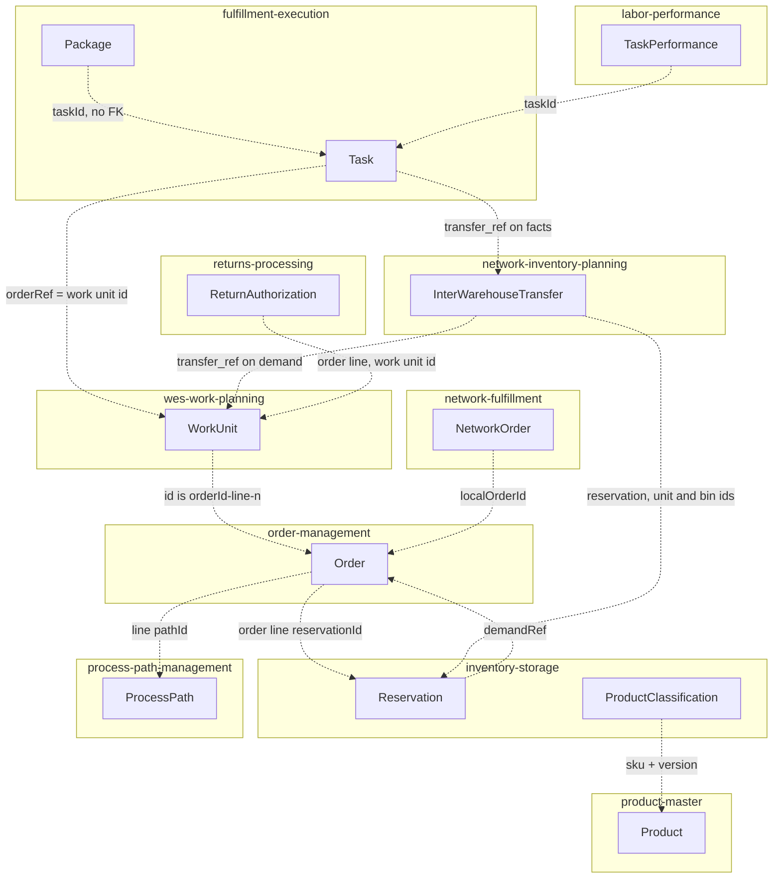

# Domain Model

The fleet-level view of what lives under `internal/domain/**` in each of the
nineteen contexts documented on this site: which aggregate roots each one owns, the invariant
that makes each one a consistency boundary, and how aggregates in different
contexts refer to each other.

This page summarises. The full class diagrams, state machines and invariant
tables are on each context's own pages, synced from that repository's
`develop` branch:

- **Class Diagram**: every aggregate, entity, value object, enumeration and
  port, with the real Go names.
- **Aggregate Design Canvas**: one ddd-crew canvas per aggregate (state
  transitions, enforced invariants, corrective policies, handled commands,
  created events, throughput, size).

:::note[A table is not an aggregate]

This page is the **domain model**. The [Data Models](/architecture/data-models)
page is the *persistence shape* it is stored in, and the two are
deliberately not one-to-one. The domain layer has no knowledge of SQL (no
`pgx` types, no JSON struct tags), so the mapping between them lives entirely
in the outbound Postgres adapter.

:::

## The fleet at a glance

50 aggregate roots across eighteen contexts. The nineteenth, `warehouse-ops-agent`,
owns none, and that is a design decision. The two newest contexts are built and
counted: `returns-processing` (decided 2026-10-20) has three aggregates
(`ReturnAuthorization`, `ReturnReceipt`, `Disposition`; its versioned
`DispositionPolicy` is data without behaviour, not an aggregate) and
`exception-management` (2026-10-20) has two (`ExceptionCase`,
`ExceptionPolicy`). Counts are the per-aggregate sections of each context's
Aggregate Design Canvas, cross-checked against the `<<AggregateRoot>>`
classes in its class diagram and the "is the aggregate root" doc comments in
its `internal/domain` packages on `develop` (the class diagrams of
`slotting-optimization`, `pick-face-replenishment` and `task-interleaving`
draw their aggregates without the stereotype; their canvases cover them).
One count comes from the code instead of the canvas: `inventory-storage`'s
`internal/domain/container` and `internal/domain/relocation` packages each
declare an aggregate root (`Container`, ADR 0045, and `Relocation`, ADR
0039) that its synced canvas does not list yet, so its row counts six.

| Context | Aggregate roots | # | Detailed pages |
| --- | --- | --- | --- |
| `order-management` | `Order` (entity `OrderLine`, value object `PromiseGroup`) | 1 | [class diagram](/contexts/order-management/class-diagram), [canvas](/contexts/order-management/aggregate-design-canvas) |
| `inventory-storage` | `StockUnit`, `Bin`, `Reservation` (entity `Allocation`), `ProductClassification` (a local copy since its ADR 0034), `Container` (one sealed case), `Relocation` (one intra-site move) | 6 | [class diagram](/contexts/inventory-storage/class-diagram), [canvas](/contexts/inventory-storage/aggregate-design-canvas) |
| `wes-work-planning` | `ChargeForecast`, `ShiftPlan` (entity `PathPlan`), `WorkPool` (pool entries), `WorkUnit` | 4 | [class diagram](/contexts/wes-work-planning/class-diagram), [canvas](/contexts/wes-work-planning/aggregate-design-canvas) |
| `fulfillment-execution` | `Task`, `Station`, `Package`, `OrderConsolidation` | 4 | [class diagram](/contexts/fulfillment-execution/class-diagram), [canvas](/contexts/fulfillment-execution/aggregate-design-canvas) |
| `workforce-management` | `ShiftPlan`, `AssociateShift`, `LaborAssignment` | 3 | [class diagram](/contexts/workforce-management/class-diagram), [canvas](/contexts/workforce-management/aggregate-design-canvas) |
| `facility-layout` | `Site`, `Zone`, `Aisle`, `CrossAisle`, `LocationSlot`, `LocationType`, `PlacementRule`, `FixedStructure` | 8 | [class diagram](/contexts/facility-layout/class-diagram), [canvas](/contexts/facility-layout/aggregate-design-canvas) |
| `process-path-management` | `ProcessPath`, `CPTSchedule` (entity `Cutoff`) | 2 | [class diagram](/contexts/process-path-management/class-diagram), [canvas](/contexts/process-path-management/aggregate-design-canvas) |
| `labor-performance` | `LaborStandard`, `TaskPerformance`, `IdlePeriod` | 3 | [class diagram](/contexts/labor-performance/class-diagram), [canvas](/contexts/labor-performance/aggregate-design-canvas) |
| `network-fulfillment` | `NetworkOrder` (entity `Line`), `CapabilityOffer` | 2 | [class diagram](/contexts/network-fulfillment/class-diagram), [canvas](/contexts/network-fulfillment/aggregate-design-canvas) |
| `warehouse-planning` | `ProcessCapacity`, `CapacityPlan` | 2 | [class diagram](/contexts/warehouse-planning/class-diagram), [canvas](/contexts/warehouse-planning/aggregate-design-canvas) |
| `product-master` | `Product` (value objects `Classification`, `PhysicalProfile` with `UnitDimensions` and `Measurement`) | 1 | [class diagram](/contexts/product-master/class-diagram), [canvas](/contexts/product-master/aggregate-design-canvas) |
| `network-inventory-planning` | `InterWarehouseTransfer` (the saga; entities `AuditEntry`, `Allocation`, `StowAllocation`). Planner, snapshot and read-model facts are value objects and services, not aggregates | 1 | [class diagram](/contexts/network-inventory-planning/class-diagram), [canvas](/contexts/network-inventory-planning/aggregate-design-canvas) |
| `inbound-receiving` | `Asn`, `DockAppointment`, `Receipt` (entity `ReceiptLine`) | 3 | [class diagram](/contexts/inbound-receiving/class-diagram), [canvas](/contexts/inbound-receiving/aggregate-design-canvas) |
| `slotting-optimization` | `SlotPlan` (assignments, moves and unassigned SKUs as value objects; the `abc-velocity-v1` planner is a domain service) | 1 | [class diagram](/contexts/slotting-optimization/class-diagram), [canvas](/contexts/slotting-optimization/aggregate-design-canvas) |
| `pick-face-replenishment` | `ReplenishmentRequest` (states `Requested`, `Completed`, `Cancelled`), `ReplenishmentPolicy` (the versioned `MIN_MAX` rule of one site and SKU). The detector in `internal/domain/detection` is a stateless function, not an aggregate | 2 | [class diagram](/contexts/pick-face-replenishment/class-diagram), [canvas](/contexts/pick-face-replenishment/aggregate-design-canvas) |
| `task-interleaving` | `StationTrip` (the station's position and its hint, in the states `Active`, `Consumed`, `Expired`, `Superseded`), `InterleavingPolicy` (the versioned per-site settings). The recommender in `internal/domain/recommend` and the `rectilinear-v1` travel model are pure functions behind a port, not aggregates | 2 | [class diagram](/contexts/task-interleaving/class-diagram), [canvas](/contexts/task-interleaving/aggregate-design-canvas) |
| `returns-processing` | `ReturnAuthorization` (the RMA), `ReturnReceipt` (lines matched to an RMA or `UNEXPECTED`), `Disposition` (immutable; an override is a new instance). `DispositionPolicy` is versioned data, not an aggregate | 3 | class diagram not synced yet, [canvas](/contexts/returns-processing/aggregate-design-canvas) |
| `exception-management` | `ExceptionCase` (one owned anomaly, with its SLA clock and audit trail), `ExceptionPolicy` (the append-only handling policy of one source type) | 2 | [class diagram](/contexts/exception-management/class-diagram), [canvas](/contexts/exception-management/aggregate-design-canvas) |
| `warehouse-ops-agent` | none: per-request decision objects in `internal/domain/policy` | 0 | [class diagram](/contexts/warehouse-ops-agent/class-diagram), [canvas](/contexts/warehouse-ops-agent/aggregate-design-canvas) |

## Aggregates across context boundaries

No aggregate in the fleet holds a pointer to, or a foreign key into, another
context's aggregate. Where one context needs another's identity, it stores it
as an opaque string, and parses it only at the two seams listed on
[Data Models](/architecture/data-models#identity-references-across-contexts).
The dashed edges below are those identity references; only the aggregates
that hold or are the target of one are drawn. Each comes from the
referencing context's own entity-relationship, sequence-diagram or canvas
page.

Read the edges as "stores the identity of". Seven chains are worth following:

- **Order to reservation and back.** `Order` keeps the `reservationId` that
  inventory-storage minted for each allocated line, and the `Reservation`
  keeps the order-management demand reference as `demandRef`. Neither side
  models the other's aggregate locally.
- **Order line to work unit to task.** wes-work-planning mints work unit ids
  of the form `orderId-line-n` when it applies `OrderAllocated`.
  fulfillment-execution stores that work unit id as the `Task`'s `orderRef`,
  and order-management parses it back out of `TaskCPTMissed` and
  `PackageManifested` to re-promise.
- **Task to performance.** labor-performance keys each `TaskPerformance` on
  the CloudEvents `id` of the `TaskCompleted` it scored and keeps the `taskId`
  as a plain reference.
- **Network order to local order.** network-fulfillment raises a held order
  in order-management and stores the returned id as `localOrderId`.
- **Product to its local copies.** inventory-storage's `ProductClassification`
  is keyed by the SKU of a product-master `Product` and stores its `version`.
  order-management, wes-work-planning and fulfillment-execution keep the same
  copy in a `product_classification_copy` table outside their domain
  aggregates.
- **Transfer to reservation, work and facts.** network-inventory-planning stores
  the `reservationId` and the per-stock-unit allocations inventory-storage returns,
  and the stow allocations it returns at the destination. It releases work under the
  deterministic `demand_id` `<transfer_id>:pick` or `:dispatch`, which
  wes-work-planning uses as the work unit id. fulfillment-execution's transfer facts
  carry the `transfer_ref` back. None of the three contexts models a transfer
  aggregate.
- **Return to the shipped order line.** returns-processing authorizes an RMA
  only for an order line whose work unit it has seen manifested. It keys its
  copies by order line and rebuilds the work unit id `{order_id}-line-{line_no}`
  to match fulfillment-execution's `order_ref` on `PackageManifested`.

Same-named aggregates in different contexts are different models. The two
`ShiftPlan`s are the clearest example: workforce-management's is the headcount
a human committed, and wes-work-planning's is its own committed split.
Workforce's plan reaches wes-work-planning only as the `LaborPlanObserved`
read model (wes-work-planning ADR-0006). warehouse-planning also declares its
own `ProcessPath` locally. It shares only the `path_id` string with
process-path-management, by convention (warehouse-planning ADR 0001 Addendum).

## Per context: what each aggregate protects

Each aggregate is listed with one headline invariant and the error that
enforces it. The full invariant tables are on the linked canvas pages.

### order-management

`Order` is the only aggregate. It is the consistency boundary for intake,
allocation, release, hold and cancellation of one customer order.

- At least one line (`order.ErrNoLines`). A line is allocated only from
  `Pending` (`ErrLineNotPending`), and only `RetryAllocate` brings a line back
  from `Backordered` (`ErrLineNotBackordered`).
- **BR3**: a ship-complete order releases nothing while any line is
  unallocated (`ErrShipCompleteBlocked`). **BR6**: no cancellation once any
  line is `Released` (`ErrOrderAlreadyReleased`).
- A held order must be ship-complete (`ErrHeldOrderMustBeShipComplete`,
  ADR 0020). That rule is what lets network-fulfillment raise held orders.
- The order-level `Status` is derived from the line statuses on every call
  and never stored.

`PathSelectionPolicy`, `PromisePolicy` and the `PlannedCapacityWindow` read
model live beside the aggregate but are not aggregates.
[Canvas](/contexts/order-management/aggregate-design-canvas).

### inventory-storage

- `StockUnit`: a quantity of one SKU at one bin. Quantity never goes negative
  (`shared.ErrNegativeQuantity`). There is deliberately no "SKU balance"
  aggregate to contend on.
- `Bin`: a full bin rejects a stow (`location.ErrBinFull`). It has no SKU
  field, which is what makes storage chaotic.
- `Reservation`: revocable and expiring. Its `Allocation`s record which stock
  unit and bin each unit came from, so a revoke returns exactly that quantity.
  The reserved quantity cannot exceed the usable quantity
  (`usecases.ErrInsufficientUsable`).
- `ProductClassification`: at least one handling tag
  (`product.ErrNoHandlingTags`). Since ADR 0034 it is a version-guarded local
  copy of product-master's classification, applied from `ProductClassified`;
  product-master is the source of truth, and this context no longer authors
  it (`PUT /products/{sku}/classification` answers `410`). Placement and DOT
  segregation at stow stay here.
- `Container` (ADR 0045): the identity of one sealed case, its LPN unique,
  bound one-to-one to its `SEALED_CASE` stock unit. `Relocation` (ADR 0039):
  one intra-site move, immutable once applied. Both are aggregate roots in
  the code on `develop` and not yet on the synced canvas.

[Canvas](/contexts/inventory-storage/aggregate-design-canvas).

### wes-work-planning

- `ChargeForecast`: an input fact with at least one CPT bucket
  (`charge.ErrNoBuckets`).
- `ShiftPlan`: the planned heads on a path cannot exceed its installed
  stations (`plan.ErrHeadsExceedStations`).
- `WorkPool`: hands each entry out at most once, and on a release-fed pool
  the WIP limit is a hard invariant (`release.ErrWIPLimitReached`). Backlog
  depth and WIP are computed from the entries, never stored.
- `WorkUnit`: released only from `Pending` (`workunit.ErrAlreadyReleased`) and
  never completed twice (`ErrAlreadyCompleted`).

`WorkPool` and `WorkUnit` are separate aggregates that one use case saves in
one transaction. `ReleasePolicy` is a domain service, not a method on either
of them. [Canvas](/contexts/wes-work-planning/aggregate-design-canvas).

### fulfillment-execution

- `Task`: at most one active claim (`task.ErrAlreadyClaimed`, persisted by
  the `SaveClaim` compare-and-set, ADR-0034). The claiming station must hold
  every required capability (`task.ErrCapabilityMismatch`). A claim is a
  lease that expires.
- `Station`: one occupant at a time (`station.ErrOccupied`).
- `Package`: cannot seal without scanned contents (`pack.ErrNoScannedContents`),
  and SLAM runs once, on a sealed package (`ErrNotSealed`, `ErrAlreadyProcessed`).
- `OrderConsolidation`: the PACK task is created exactly once, on the
  arrival that completes the required set (ADR-0016).

[Canvas](/contexts/fulfillment-execution/aggregate-design-canvas).

### workforce-management

- `ShiftPlan`: planned heads per path cannot exceed installed stations,
  whether supplied by the caller or read live from fulfillment-execution
  (`ErrPlannedHeadsExceedInstalled`, `ErrExceedsInstalledCapacity`).
- `AssociateShift`: no assignment while on break (`associate.ErrOnBreak`) and
  no mutation after the shift ends (`ErrShiftEnded`).
- `LaborAssignment`: at most one active assignment per associate. This is
  structural, because the root is keyed by associate and has a single active
  slot. The associate must also hold the path's certification
  (`assignment.ErrCertificationRequired`).

[Canvas](/contexts/workforce-management/aggregate-design-canvas).

### facility-layout

Eight small aggregates, because physical geography is hierarchical but each
level changes independently. `LocationSlot` is the heart of the model:

- A code has seven `[A-Z0-9]` segments (`shared.ErrMalformedLocationCode`).
  It is globally unique even after decommission
  (`usecases.ErrDuplicateLocationCode`), and its site, zone and aisle must
  exist and be active.
- `Site` decommission is one-way (`site.ErrAlreadyDecommissioned`).
- `CrossAisle` joins two distinct aisles (`ErrCrossAisleSameAisle`, also a DB
  `CHECK`).
- `PlacementRule` constrains at least one zone dimension (`ErrEmptyPredicate`).
  `RuleSet.Check` evaluates the rules at slot registration, and Deny wins.

The site layout, zone grid and travel graph are read models assembled per
request, not aggregates. [Canvas](/contexts/facility-layout/aggregate-design-canvas).

### process-path-management

- `ProcessPath`: `matchPrefix` is lower-case and never coerced
  (`ErrMatchPrefixNotLowercase`). A path needs at least one required
  capability (`ErrNoRequiredCapabilities`).
- `CPTSchedule`: one per site, because a CPT belongs to a departure, not to a
  path (ADR 0010). It needs a valid IANA timezone (`ErrInvalidTimezone`) and
  unique cutoff ids (`ErrDuplicateCptId`), and is always replaced wholesale.

[Canvas](/contexts/process-path-management/aggregate-design-canvas).

### labor-performance

- `LaborStandard`: `expectedSeconds > 0` (`ErrNonPositiveExpectedSeconds`).
  History is append-only. A revision closes the prior record and opens a new
  one, so scored rows stay historically accurate.
- `TaskPerformance`: immutable once recorded. It carries
  `standardSecondsAtCompletion` frozen at scoring time. `efficiencyPct` is
  `nil` rather than `0` when nothing was scorable ("never fabricate a
  number"), and a record is written at most once per CloudEvents `id`.
- `IdlePeriod`: the gap must be strictly positive (`ErrNegativeGap`), and
  it is capped so that a shift-spanning gap cannot poison a mean (ADR 0014).

[Canvas](/contexts/labor-performance/aggregate-design-canvas).

### network-fulfillment

- `NetworkOrder`: owns the network protocol (one answer, a 24h deadline, the
  mapping to a local order) and none of the fulfillment. It needs a non-empty
  `NetworkRef` (`ErrEmptyNetworkRef`), and a translated order has at least
  one line (`ErrNoLines`).
- `CapabilityOffer`: a replaceable snapshot that never advertises more than
  physically exists (`ErrAdvertisedExceedsPhysical`). It is persisted and not
  published to Kafka; in live mode the inventory feed of the supply loop
  (ADR 0027) sends it to the network, and `CAPABILITY_OFFER_ENABLED=true` is
  set in `warehouse-infra` `develop`.

[Canvas](/contexts/network-fulfillment/aggregate-design-canvas).

### warehouse-planning

- `ProcessCapacity`: the minimum across its registered constraints, all of
  which share one native unit (`ErrUnitMismatch`).
- `CapacityPlan`: assigned demand is never negative (`ErrNegativeDemand`),
  the path rate is an ORDER rate (`ErrPathRateNotOrder`), and
  `shortage = max(0, demand - capacity)`. A plan is published once
  (`ErrAlreadyPublished`).

[Canvas](/contexts/warehouse-planning/aggregate-design-canvas).

### product-master

- `Product`: one aggregate per SKU (`product.ErrInvalidSKU`). A
  classification has at least one handling tag (`ErrNoHandlingTags`), a
  TemperatureClass if and only if `TemperatureSensitive`
  (`ErrTemperatureClassRequired`, `ErrTemperatureClassNotApplicable`) and a
  DOT hazard class only with `Hazmat` (`ErrDOTHazardClassNotApplicable`). A
  measurement older than the current one is refused (`ErrStaleMeasurement`).
  A command that changes nothing raises no event and bumps no `version`.

[Canvas](/contexts/product-master/aggregate-design-canvas).

### network-inventory-planning

- `InterWarehouseTransfer`: eleven states with a closed transition table; any
  illegal move is an `IllegalTransitionError` and mutates nothing. A reply or fact
  that does not match the transfer's line, site, SKU or quantity is refused
  (`ErrFactRefused`). A short pick is recorded, not refused, and an impossible
  picked quantity is. Cancel is legal only before `ALLOCATED`, and no use case calls
  it yet. Approval is fail-closed (`ErrFactsIncomplete`) and expires after 24 hours
  (`ErrProposalExpired`).

[Canvas](/contexts/network-inventory-planning/aggregate-design-canvas).

### pick-face-replenishment

- `ReplenishmentRequest`: one decision to move stock from one reserve bin to
  one forward bin, `Requested` to `Completed` or `Cancelled`, both final. At
  most one is open per (site, forward bin, SKU), checked by the use case and
  backed by a partial unique index. `quantity >= 1` and the projected level
  plus the quantity cannot exceed the policy maximum. Only a `REPLENISHMENT`
  relocation whose `source_ref` is the request id completes it.
- `ReplenishmentPolicy`: the `MIN_MAX` rule of one (site, SKU), with
  `0 <= minQty < maxQty` and `multiple >= 1`. It is versioned and changed
  through `If-Match`. Removing it cancels the site's and SKU's open requests
  with `POLICY_REMOVED` in the same unit of work.

[Canvas](/contexts/pick-face-replenishment/aggregate-design-canvas).

### task-interleaving

- `StationTrip`: one per station, holding the position (the end of the last
  completed task) and at most one hint, `Active` to `Consumed`, `Expired` or
  `Superseded` (all three final). The position moves forward in time only: a
  completion that is not strictly newer is ignored and raises nothing. A hint
  lists 1 to `MaxCandidates` distinct eligible candidates within the detour
  limit, ranked by detour then task id, and expires at `now + HintTTL`; a claim
  consumes it only while unexpired and only when the task is a candidate.
- `InterleavingPolicy`: the per-site settings, with `MaxDetourM > 0`,
  `MaxCandidates` 1 to 5, `HintTTL > 0`, a non-empty set of eligible task
  types and `VerticalWeight >= 0`. It is versioned and changed through
  `If-Match`. A site without one is inert.

[Canvas](/contexts/task-interleaving/aggregate-design-canvas).

### returns-processing

- `ReturnAuthorization`: at most one open RMA per (order, line)
  (`ErrOpenRMAExists`, backed by a partial unique index). It is authorizable
  only for the line's own manifested work unit, inside the policy return
  window, and for a quantity within the policy maximum; a rejection is
  terminal and carries its code.
- `ReturnReceipt`: every line is matched to an RMA or explicitly
  `UNEXPECTED`, and a line is inspected exactly once
  (`ErrLineAlreadyInspected`).
- `Disposition`: created decided and never mutated. `RESTOCK` is allowed only
  for grades A and B and never for a hazmat SKU without a DOT rating (demoted,
  fail-closed); an override is a new `Disposition` that names the one it
  supersedes; `ReturnLineStaged` is raised once per `RESTOCK` disposition
  (`ErrAlreadyStaged`, `ErrNotRestock`).

[Canvas](/contexts/returns-processing/aggregate-design-canvas).

### exception-management

- `ExceptionCase`: one direction only, `OPEN` to `TRIAGED` to `ASSIGNED` to
  `RESOLVED`, with `ESCALATED` as a flag. `RESOLVED` needs a resolution code
  and a root cause and is terminal (`ErrCaseClosed`). At most one case is open
  per dedup key (source type, source subject, site): the use case and a
  partial unique index enforce it (`ErrOpenCaseExists`). The frozen source
  payload never changes after open.
- `ExceptionPolicy`: one append-only version chain per source type, with
  `SLAMinutes >= 1` and an optional declarative auto-resolve rule. Two writers
  racing the same next version collide (`ErrConcurrentModification`).

[Canvas](/contexts/exception-management/aggregate-design-canvas).

### warehouse-ops-agent

No aggregate root and no persisted state. `internal/domain/policy` is
deliberately not a domain in the DDD sense: it holds pure functions (`Decide`,
`Arbitrate`, `CorrelateUtilization`) that build per-request decision objects
from upstream reads. Its only rules are boundary validation of untrusted
input, such as `policy.ParseRebalanceAction`. The canvas page lists them in
place of invariants. [Canvas](/contexts/warehouse-ops-agent/aggregate-design-canvas).

## Patterns that hold across every context

1. **Private fields, behaviour-bearing methods.** State changes go through
   methods that can refuse. No public setter lets a caller bypass an
   invariant.
2. **Errors are named domain vocabulary.** `ErrShipCompleteBlocked`,
   `ErrWIPLimitReached` and `ErrAdvertisedExceedsPhysical` each *are* the
   business rule, expressed as a value.
3. **Cross-aggregate references are identities.** That holds inside a
   context (`WorkPool` and `WorkUnit`, `Package` and `Task`) and across
   contexts (the diagram above).
4. **Rules that need siblings live in the use case.** An aggregate cannot see
   its siblings, so uniqueness ("code unique", "id unique") is checked in the
   use case and reported as a `usecases.Err…` value.
5. **Lost updates are refused, not merged.** The aggregates that are
   read-modified-saved concurrently use a version guard or a compare-and-set
   in the repository (for example `ports.ErrConcurrentModification` in
   order-management, `SaveClaim` in fulfillment-execution, and the
   `WorkPool` version check in wes-work-planning).
6. **The domain layer imports nothing framework-shaped.** Every one of the
   nineteen repositories has `internal/architecture/*_test.go` fitness tests
   that fail the build if it does. See [Components](/architecture/components).
