# Capability map: L1, L2 and L3

:::info[Generated page]
Generated by `scripts/capability-map/generate.py` from the model in
`scripts/capability-map/capabilities.py`. Change the model, then run the
generator; do not edit this page by hand. The method and the sources are on
[Business Capability Architecture](/business-capability-architecture).
:::

The map has **14 L1**, **54 L2** and **135 L3** capabilities, and every one
has code behind it: each L3 names the routes, events or MCP tools on `develop`
that realize it. 2 L3 capabilities are marked partial, with the limitation
stated (see the [catalogue](/business-capability-architecture/capability-catalogue)).
Capabilities the fleet does not have are on the
[heat maps](/business-capability-architecture/heat-maps#gaps-against-the-industry-reference).

## Level 1, stratified

Stratification groups the L1 capabilities into three tiers: strategic
(direction setting), core (customer-facing value) and supporting
(enabling).[2][5] The tier says what role the capability plays for the
business. It is not the DDD Core, Supporting or Generic classification of
a context. That one is overlaid on the
[differentiation heat map](/business-capability-architecture/heat-maps#differentiation-heat-map-l1).

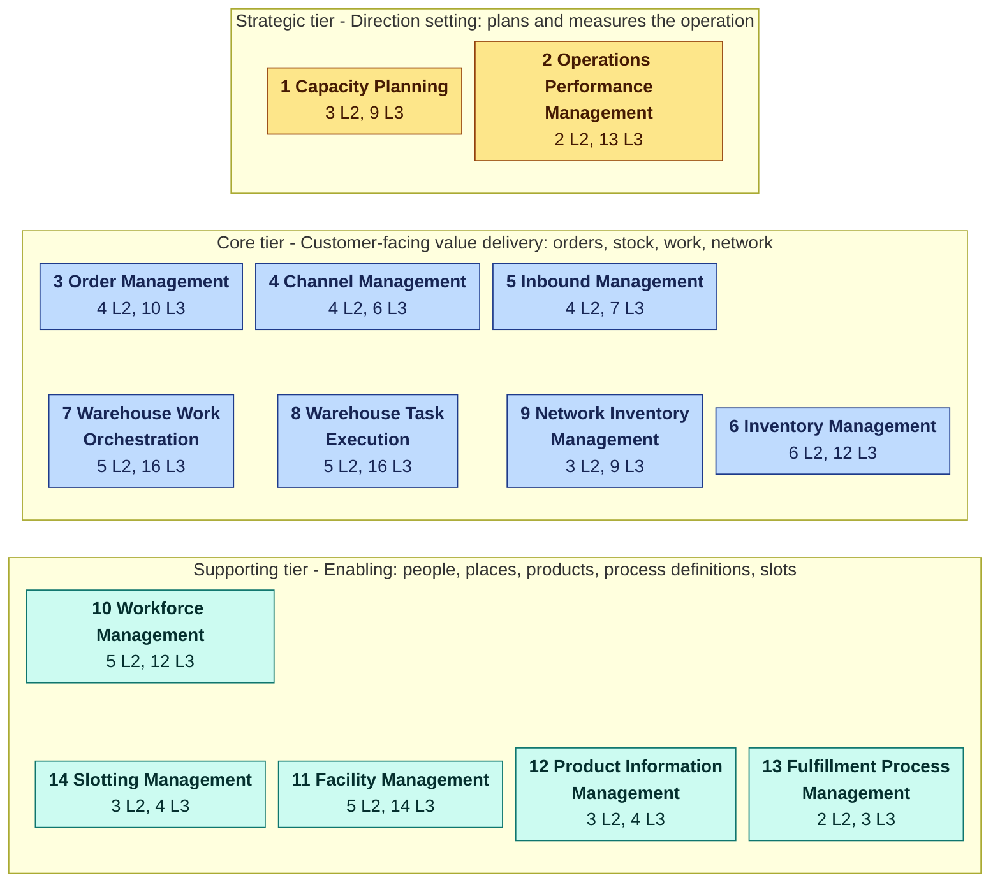

| L1 | Capability | Tier | Description | Realized by |
| --- | --- | --- | --- | --- |
| 1 | **Capacity Planning** | Strategic | The ability to decide, ahead of the work, whether a warehouse can process the demand assigned to it, and where it cannot. | [warehouse-planning](/contexts/warehouse-planning) |
| 2 | **Operations Performance Management** | Strategic | The ability to measure how the operation performs and to explain its exceptions to the people who run it. | [order-management](/contexts/order-management), [inventory-storage](/contexts/inventory-storage), [wes-work-planning](/contexts/wes-work-planning), [fulfillment-execution](/contexts/fulfillment-execution), [workforce-management](/contexts/workforce-management), [labor-performance](/contexts/labor-performance), [inbound-receiving](/contexts/inbound-receiving), [facility-layout](/contexts/facility-layout), [process-path-management](/contexts/process-path-management), [product-master](/contexts/product-master), [warehouse-planning](/contexts/warehouse-planning), [network-inventory-planning](/contexts/network-inventory-planning), [network-fulfillment](/contexts/network-fulfillment), [warehouse-ops-agent](/contexts/warehouse-ops-agent) |
| 3 | **Order Management** | Core | The ability to accept customer demand, commit stock and a ship promise to it, and hand it to warehouse execution. | [order-management](/contexts/order-management), [inventory-storage](/contexts/inventory-storage) |
| 4 | **Channel Management** | Core | The ability to sell the warehouse's fulfillment capability through an external network and honour that network's obligations. | [network-fulfillment](/contexts/network-fulfillment), [order-management](/contexts/order-management) |
| 5 | **Inbound Management** | Core | The ability to plan, receive and account for goods arriving at the warehouse until they are handed to inventory. | [inbound-receiving](/contexts/inbound-receiving), [inventory-storage](/contexts/inventory-storage) |
| 6 | **Inventory Management** | Core | The ability to know exactly what stock exists, where it is, what may be used, and to keep that record true. | [inventory-storage](/contexts/inventory-storage) |
| 7 | **Warehouse Work Orchestration** | Core | The ability to decide when work enters the floor and to keep the flow balanced across process paths. | [wes-work-planning](/contexts/wes-work-planning) |
| 8 | **Warehouse Task Execution** | Core | The ability to hand each piece of released work to the right station and see it done: pick, consolidate, pack, verify, transfer and relocate. | [fulfillment-execution](/contexts/fulfillment-execution) |
| 9 | **Network Inventory Management** | Core | The ability to decide whether stock should move between warehouses and to carry an approved move through to the destination. | [network-inventory-planning](/contexts/network-inventory-planning) |
| 10 | **Workforce Management** | Supporting | The ability to staff the operation with qualified people, plan and assign them, and measure their work against standards. | [workforce-management](/contexts/workforce-management), [labor-performance](/contexts/labor-performance) |
| 11 | **Facility Management** | Supporting | The ability to describe the physical warehouse network: sites, their structure, every location and how far apart things are. | [facility-layout](/contexts/facility-layout) |
| 12 | **Product Information Management** | Supporting | The ability to know what every SKU is, how it must be handled and how big and heavy it is. | [product-master](/contexts/product-master) |
| 13 | **Fulfillment Process Management** | Supporting | The ability to define the process paths work flows through and the shipping cutoffs it must meet. | [process-path-management](/contexts/process-path-management) |
| 14 | **Slotting Management** | Supporting | The ability to decide which SKUs deserve forward pick slots and to publish the approved slot map. | [slotting-optimization](/contexts/slotting-optimization) |

## Level 1 to Level 3, one L1 at a time

Green L2 boxes are fully implemented. Amber boxes contain at least one L3
marked partial in the catalogue.

### 1 Capacity Planning

*Strategic tier.* The ability to decide, ahead of the work, whether a warehouse can process the demand assigned to it, and where it cannot.

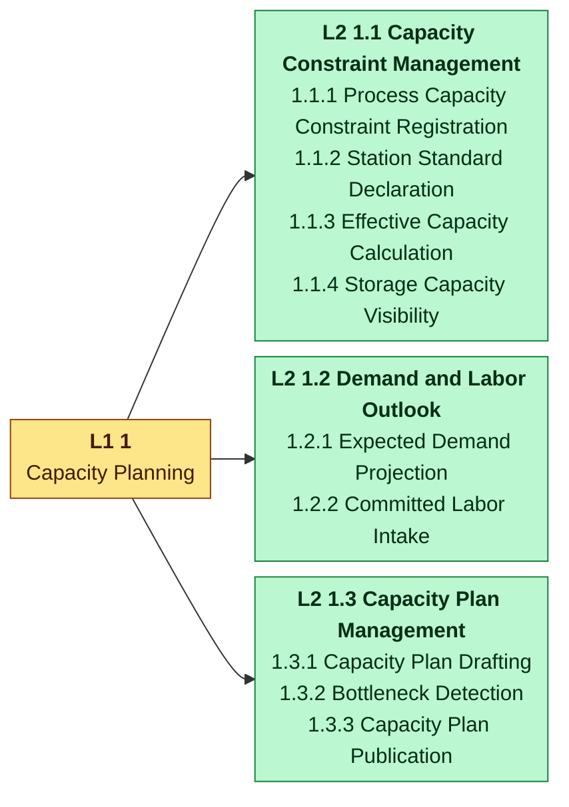

| L2 | Capability | Description | Realized by |
| --- | --- | --- | --- |
| 1.1 | Capacity Constraint Management | The ability to record what each process, station and storage area of a site can do. | [warehouse-planning](/contexts/warehouse-planning) |
| 1.2 | Demand and Labor Outlook | The ability to know the demand and the committed labor a capacity plan must be checked against. | [warehouse-planning](/contexts/warehouse-planning) |
| 1.3 | Capacity Plan Management | The ability to draft, check and publish a capacity plan with its shortages and bottlenecks. | [warehouse-planning](/contexts/warehouse-planning) |

### 2 Operations Performance Management

*Strategic tier.* The ability to measure how the operation performs and to explain its exceptions to the people who run it.

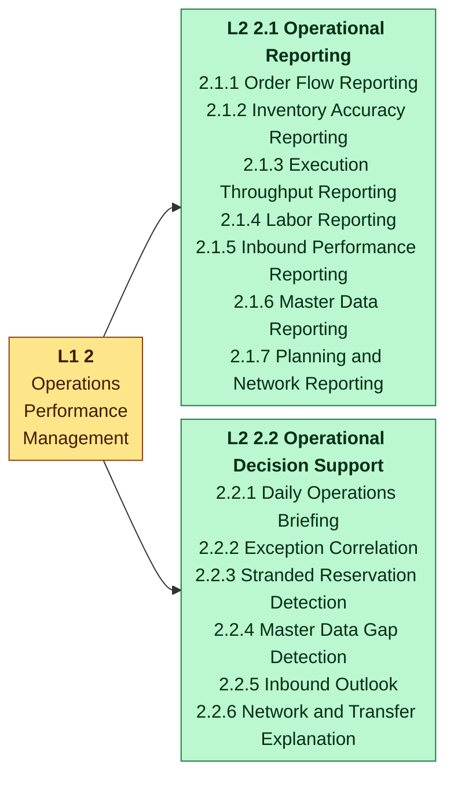

| L2 | Capability | Description | Realized by |
| --- | --- | --- | --- |
| 2.1 | Operational Reporting | The ability to report hourly and daily operational measures from each context's analytics read model. | [order-management](/contexts/order-management), [inventory-storage](/contexts/inventory-storage), [wes-work-planning](/contexts/wes-work-planning), [fulfillment-execution](/contexts/fulfillment-execution), [workforce-management](/contexts/workforce-management), [labor-performance](/contexts/labor-performance), [inbound-receiving](/contexts/inbound-receiving), [facility-layout](/contexts/facility-layout), [process-path-management](/contexts/process-path-management), [product-master](/contexts/product-master), [warehouse-planning](/contexts/warehouse-planning), [network-inventory-planning](/contexts/network-inventory-planning), [network-fulfillment](/contexts/network-fulfillment) |
| 2.2 | Operational Decision Support | The ability to correlate facts from many contexts into briefs, exceptions and explanations, without changing anything. | [warehouse-ops-agent](/contexts/warehouse-ops-agent) |

### 3 Order Management

*Core tier.* The ability to accept customer demand, commit stock and a ship promise to it, and hand it to warehouse execution.

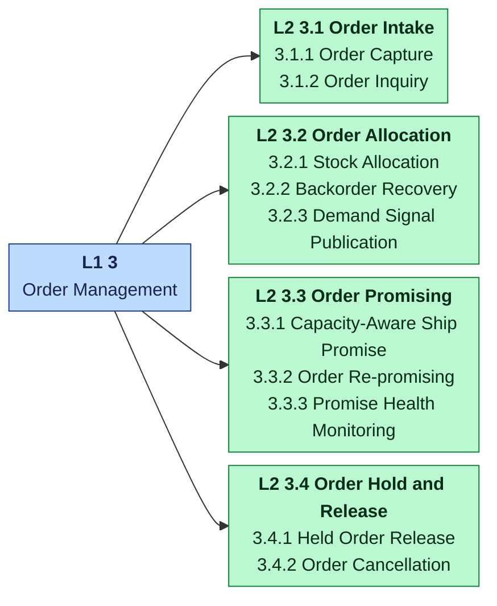

| L2 | Capability | Description | Realized by |
| --- | --- | --- | --- |
| 3.1 | Order Intake | The ability to receive an order and answer questions about it. | [order-management](/contexts/order-management) |
| 3.2 | Order Allocation | The ability to commit usable stock to an order's lines. | [order-management](/contexts/order-management), [inventory-storage](/contexts/inventory-storage) |
| 3.3 | Order Promising | The ability to commit a ship promise that the warehouse can keep, and to correct it when it cannot. | [order-management](/contexts/order-management) |
| 3.4 | Order Hold and Release | The ability to hold an order at intake, release it, or cancel it. | [order-management](/contexts/order-management) |

### 4 Channel Management

*Core tier.* The ability to sell the warehouse's fulfillment capability through an external network and honour that network's obligations.

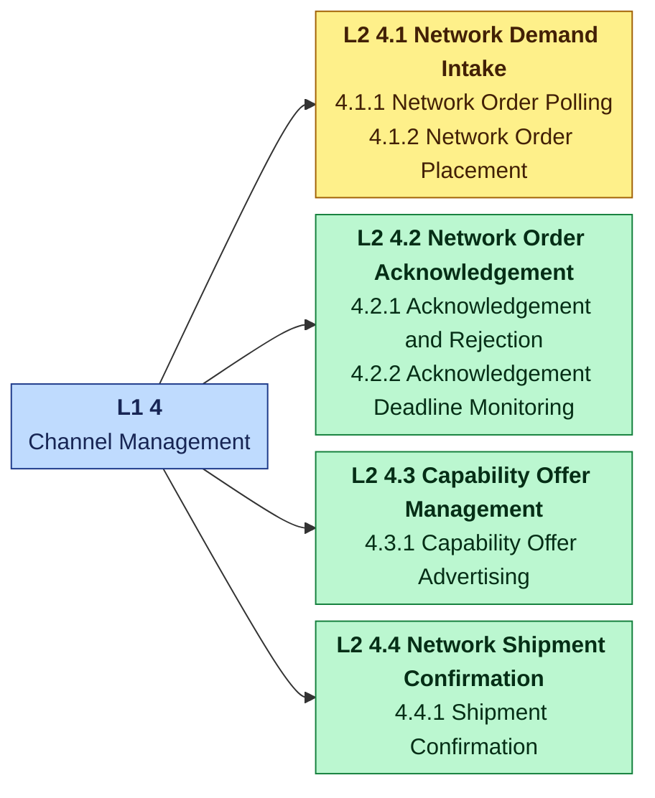

| L2 | Capability | Description | Realized by |
| --- | --- | --- | --- |
| 4.1 | Network Demand Intake | The ability to take demand from an external fulfillment network and place it as a held order. | [network-fulfillment](/contexts/network-fulfillment), [order-management](/contexts/order-management) |
| 4.2 | Network Order Acknowledgement | The ability to answer every network order within its deadline. | [network-fulfillment](/contexts/network-fulfillment) |
| 4.3 | Capability Offer Management | The ability to advertise what the building can fulfil to the network. | [network-fulfillment](/contexts/network-fulfillment) |
| 4.4 | Network Shipment Confirmation | The ability to tell the network that its order shipped. | [network-fulfillment](/contexts/network-fulfillment) |

### 5 Inbound Management

*Core tier.* The ability to plan, receive and account for goods arriving at the warehouse until they are handed to inventory.

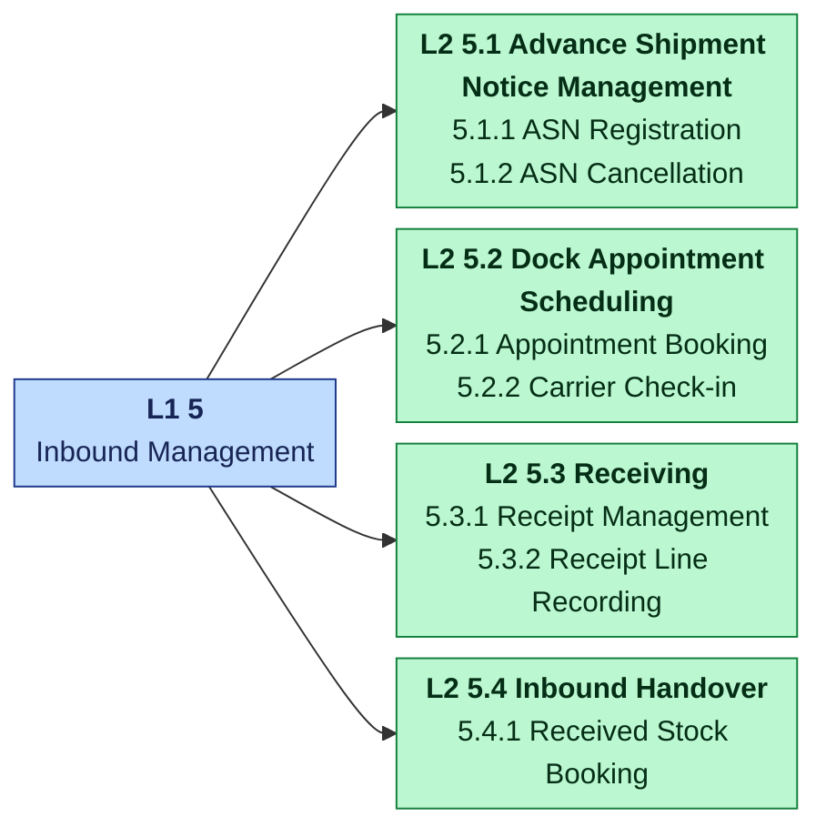

| L2 | Capability | Description | Realized by |
| --- | --- | --- | --- |
| 5.1 | Advance Shipment Notice Management | The ability to know what is coming before it arrives. | [inbound-receiving](/contexts/inbound-receiving) |
| 5.2 | Dock Appointment Scheduling | The ability to book dock doors and windows and track carriers through them. | [inbound-receiving](/contexts/inbound-receiving) |
| 5.3 | Receiving | The ability to count what arrived against what was expected and record the discrepancies. | [inbound-receiving](/contexts/inbound-receiving) |
| 5.4 | Inbound Handover | The ability to hand received good units to inventory. | [inventory-storage](/contexts/inventory-storage), [inbound-receiving](/contexts/inbound-receiving) |

### 6 Inventory Management

*Core tier.* The ability to know exactly what stock exists, where it is, what may be used, and to keep that record true.

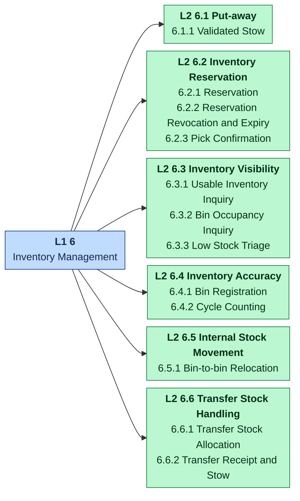

| L2 | Capability | Description | Realized by |
| --- | --- | --- | --- |
| 6.1 | Put-away | The ability to place received stock into a bin that is allowed to hold it. | [inventory-storage](/contexts/inventory-storage) |
| 6.2 | Inventory Reservation | The ability to commit usable stock to demand and to release that commitment. | [inventory-storage](/contexts/inventory-storage) |
| 6.3 | Inventory Visibility | The ability to answer what stock is usable and how full each bin is. | [inventory-storage](/contexts/inventory-storage) |
| 6.4 | Inventory Accuracy | The ability to keep the ledger equal to what is physically in the bins. | [inventory-storage](/contexts/inventory-storage) |
| 6.5 | Internal Stock Movement | The ability to move stock between bins of one site. | [inventory-storage](/contexts/inventory-storage) |
| 6.6 | Transfer Stock Handling | The ability to perform the inventory legs of an inter-warehouse transfer. | [inventory-storage](/contexts/inventory-storage) |

### 7 Warehouse Work Orchestration

*Core tier.* The ability to decide when work enters the floor and to keep the flow balanced across process paths.

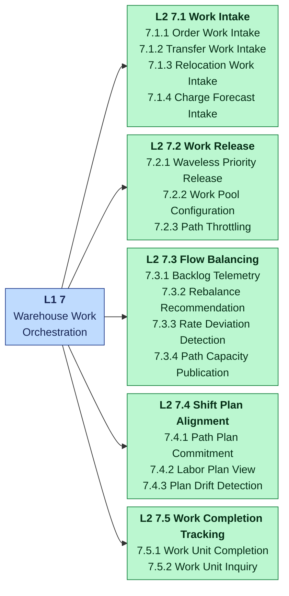

| L2 | Capability | Description | Realized by |
| --- | --- | --- | --- |
| 7.1 | Work Intake | The ability to turn demand of every kind into work units on the right process path. | [wes-work-planning](/contexts/wes-work-planning) |
| 7.2 | Work Release | The ability to admit work into the floor continuously, in priority order, within limits. | [wes-work-planning](/contexts/wes-work-planning) |
| 7.3 | Flow Balancing | The ability to watch the flow across paths and correct it. | [wes-work-planning](/contexts/wes-work-planning) |
| 7.4 | Shift Plan Alignment | The ability to execute against the labor plan and notice when the floor drifts from it. | [wes-work-planning](/contexts/wes-work-planning) |
| 7.5 | Work Completion Tracking | The ability to close the loop from released work back to completed work. | [wes-work-planning](/contexts/wes-work-planning) |

### 8 Warehouse Task Execution

*Core tier.* The ability to hand each piece of released work to the right station and see it done: pick, consolidate, pack, verify, transfer and relocate.

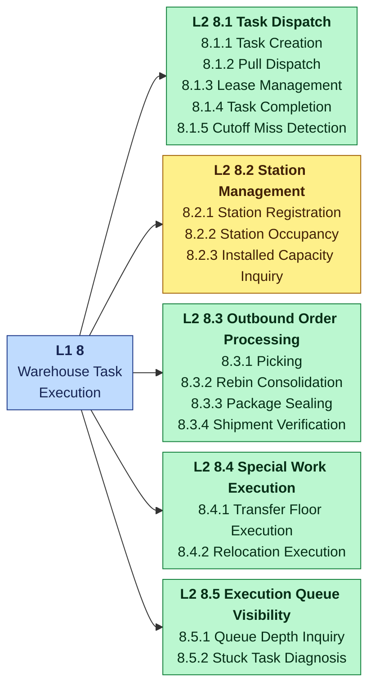

| L2 | Capability | Description | Realized by |
| --- | --- | --- | --- |
| 8.1 | Task Dispatch | The ability to give each station the best-fit task and keep tasks moving. | [fulfillment-execution](/contexts/fulfillment-execution) |
| 8.2 | Station Management | The ability to know which stations exist, what they can do and who occupies them. | [fulfillment-execution](/contexts/fulfillment-execution) |
| 8.3 | Outbound Order Processing | The ability to pick, consolidate, pack and verify an order's units. | [fulfillment-execution](/contexts/fulfillment-execution) |
| 8.4 | Special Work Execution | The ability to execute transfer and slot-relocation work like any other task. | [fulfillment-execution](/contexts/fulfillment-execution) |
| 8.5 | Execution Queue Visibility | The ability to see the queues and find stuck work. | [fulfillment-execution](/contexts/fulfillment-execution) |

### 9 Network Inventory Management

*Core tier.* The ability to decide whether stock should move between warehouses and to carry an approved move through to the destination.

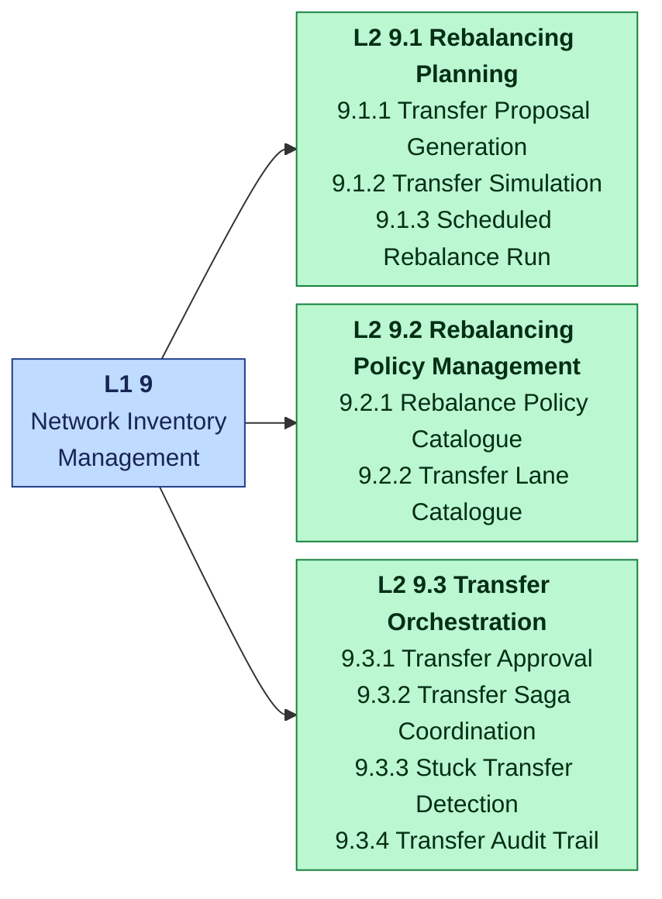

| L2 | Capability | Description | Realized by |
| --- | --- | --- | --- |
| 9.1 | Rebalancing Planning | The ability to find and propose inter-warehouse transfers from reproducible facts. | [network-inventory-planning](/contexts/network-inventory-planning) |
| 9.2 | Rebalancing Policy Management | The ability to govern how rebalancing decides and where it may ship. | [network-inventory-planning](/contexts/network-inventory-planning) |
| 9.3 | Transfer Orchestration | The ability to carry an approved transfer through allocation, floor work and destination stow as a saga. | [network-inventory-planning](/contexts/network-inventory-planning) |

### 10 Workforce Management

*Supporting tier.* The ability to staff the operation with qualified people, plan and assign them, and measure their work against standards.

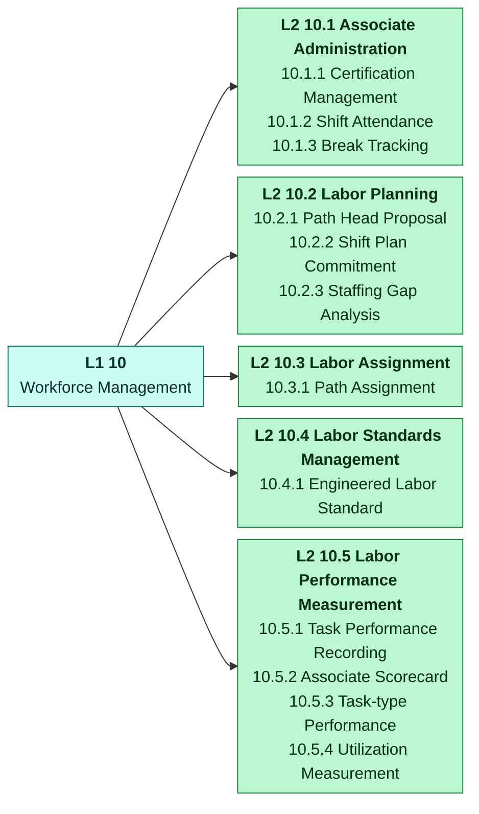

| L2 | Capability | Description | Realized by |
| --- | --- | --- | --- |
| 10.1 | Associate Administration | The ability to know who is qualified and who is working right now. | [workforce-management](/contexts/workforce-management) |
| 10.2 | Labor Planning | The ability to split a shift's headcount across process paths within installed capacity. | [workforce-management](/contexts/workforce-management) |
| 10.3 | Labor Assignment | The ability to put an associate on a path. | [workforce-management](/contexts/workforce-management) |
| 10.4 | Labor Standards Management | The ability to define how long work of each type should take. | [labor-performance](/contexts/labor-performance) |
| 10.5 | Labor Performance Measurement | The ability to measure finished work against its standard. | [labor-performance](/contexts/labor-performance) |

### 11 Facility Management

*Supporting tier.* The ability to describe the physical warehouse network: sites, their structure, every location and how far apart things are.

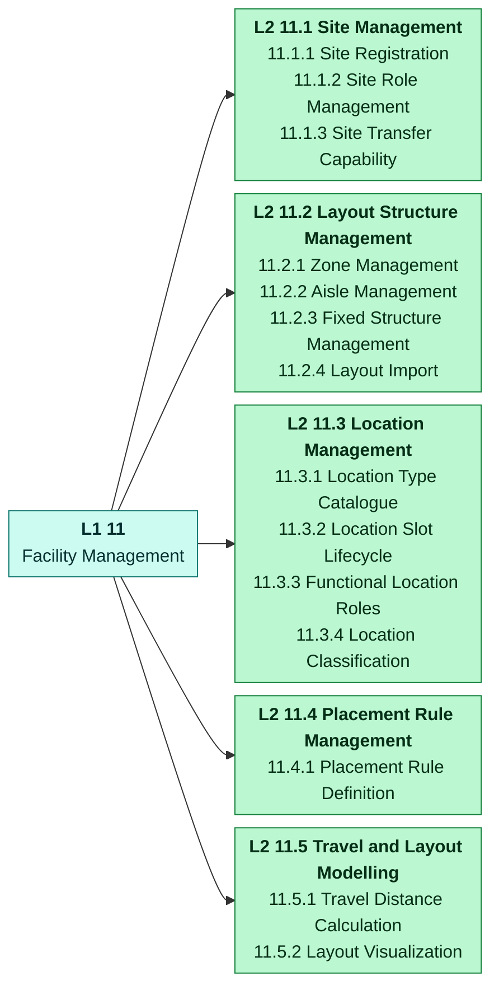

| L2 | Capability | Description | Realized by |
| --- | --- | --- | --- |
| 11.1 | Site Management | The ability to register sites and their role in the fulfillment network. | [facility-layout](/contexts/facility-layout) |
| 11.2 | Layout Structure Management | The ability to describe zones, aisles and fixed structures. | [facility-layout](/contexts/facility-layout) |
| 11.3 | Location Management | The ability to define every coded location, its type, geometry, role and classification. | [facility-layout](/contexts/facility-layout) |
| 11.4 | Placement Rule Management | The ability to declare which location types are legal in which zones. | [facility-layout](/contexts/facility-layout) |
| 11.5 | Travel and Layout Modelling | The ability to model travel and draw the layout. | [facility-layout](/contexts/facility-layout) |

### 12 Product Information Management

*Supporting tier.* The ability to know what every SKU is, how it must be handled and how big and heavy it is.

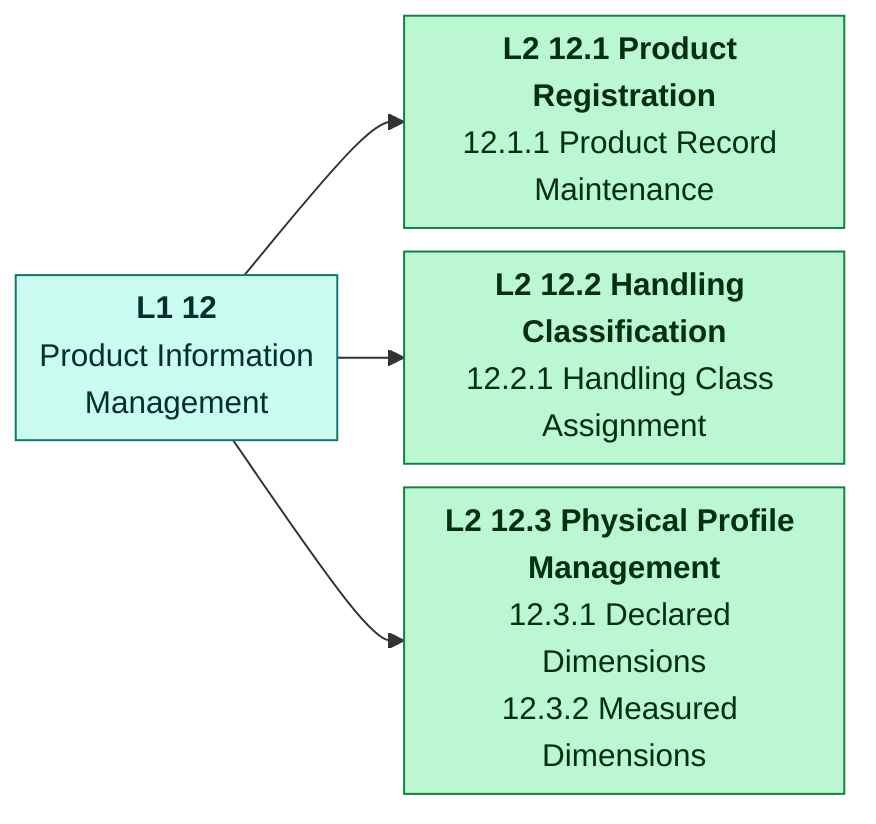

| L2 | Capability | Description | Realized by |
| --- | --- | --- | --- |
| 12.1 | Product Registration | The ability to register a product and keep its description. | [product-master](/contexts/product-master) |
| 12.2 | Handling Classification | The ability to classify how a product must be handled. | [product-master](/contexts/product-master) |
| 12.3 | Physical Profile Management | The ability to know a product's dimensions and weight. | [product-master](/contexts/product-master) |

### 13 Fulfillment Process Management

*Supporting tier.* The ability to define the process paths work flows through and the shipping cutoffs it must meet.

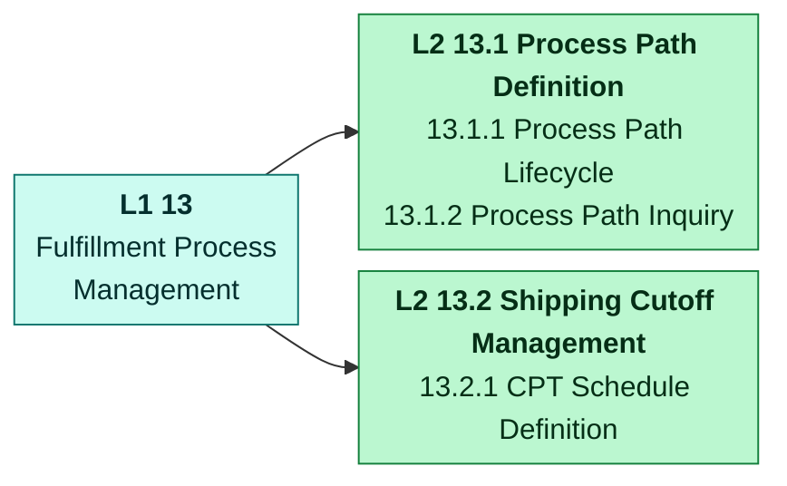

| L2 | Capability | Description | Realized by |
| --- | --- | --- | --- |
| 13.1 | Process Path Definition | The ability to define, revise and retire process paths. | [process-path-management](/contexts/process-path-management) |
| 13.2 | Shipping Cutoff Management | The ability to define each site's CPT schedule. | [process-path-management](/contexts/process-path-management) |

### 14 Slotting Management

*Supporting tier.* The ability to decide which SKUs deserve forward pick slots and to publish the approved slot map.

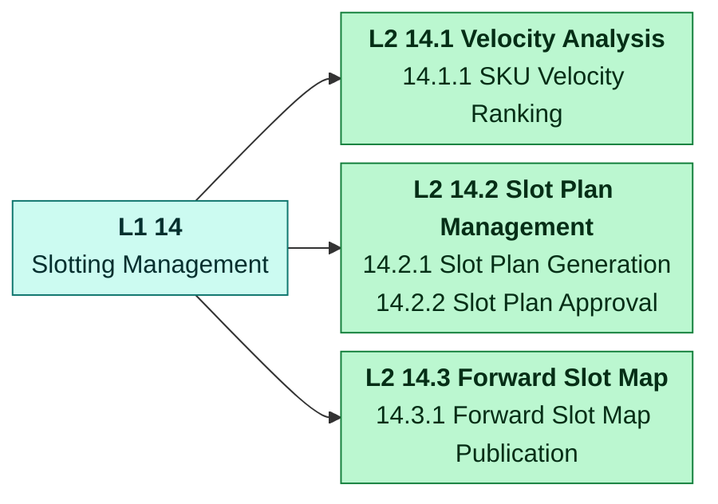

| L2 | Capability | Description | Realized by |
| --- | --- | --- | --- |
| 14.1 | Velocity Analysis | The ability to rank SKUs by how fast they are picked. | [slotting-optimization](/contexts/slotting-optimization) |
| 14.2 | Slot Plan Management | The ability to propose a slot plan and have a person approve or reject it. | [slotting-optimization](/contexts/slotting-optimization) |
| 14.3 | Forward Slot Map | The ability to publish the current approved forward-slot map. | [slotting-optimization](/contexts/slotting-optimization) |

## Sources

- **[2]** [The Open Group — TOGAF Series Guide: Business Capabilities (G189, 2018; superseded by G211)](https://governance.foundation/assets/frameworks/togaf/g189%20-%20Business%20Capbility.pdf)
- **[5]** [Business Architecture Guild — Business Architecture Reference Model Workshop (OMG BASIG, 2015)](https://www.omg.org/cgi-bin/doc?basig%2F15-12-01.pdf)
