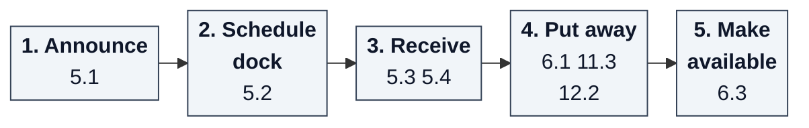
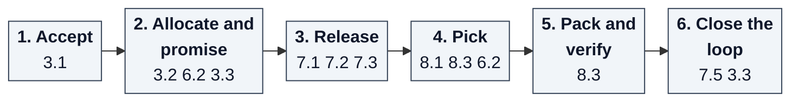
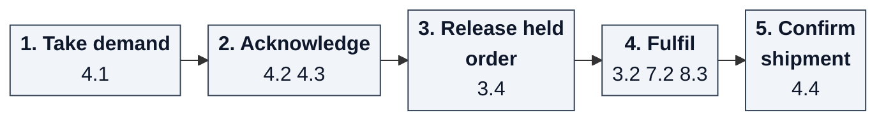
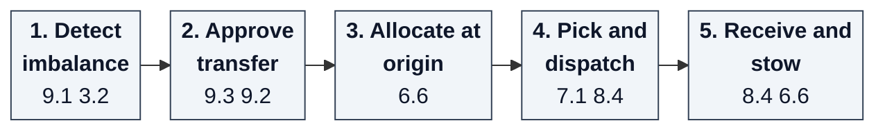
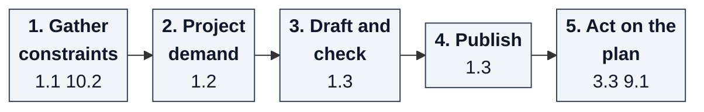
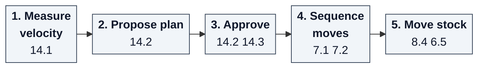

# Cross-mapping: capabilities, contexts and value streams

:::info[Generated page]
Generated by `scripts/capability-map/generate.py` from the model in
`scripts/capability-map/capabilities.py`. Change the model, then run the
generator; do not edit this page by hand. The method and the sources are on
[Business Capability Architecture](/business-capability-architecture).
:::

A capability map becomes useful when it is mapped to the other views of
the business. The TOGAF guide singles out capability-to-organization and
capability-to-value-stream mapping.[2] In the BIZBOK, "Capabilities enable
stages within various value streams and require certain information."[4]
Here the organization view is the set of bounded contexts, each owned by
one team.

## L2 capability by bounded context

● the context realizes at least one L3 of the capability. Column codes:
`OM` order-management, `NF` network-fulfillment, `INB` inbound-receiving, `INV` inventory-storage, `WWP` wes-work-planning, `FE` fulfillment-execution, `NIP` network-inventory-planning, `WPL` warehouse-planning, `WFM` workforce-management, `LP` labor-performance, `FL` facility-layout, `PM` product-master, `PPM` process-path-management, `SO` slotting-optimization, `OA` warehouse-ops-agent.

| L2 | Capability | OM | NF | INB | INV | WWP | FE | NIP | WPL | WFM | LP | FL | PM | PPM | SO | OA |
| --- | --- | :-: | :-: | :-: | :-: | :-: | :-: | :-: | :-: | :-: | :-: | :-: | :-: | :-: | :-: | :-: |
| 1.1 | Capacity Constraint Management |  |  |  |  |  |  |  | ● |  |  |  |  |  |  |  |
| 1.2 | Demand and Labor Outlook |  |  |  |  |  |  |  | ● |  |  |  |  |  |  |  |
| 1.3 | Capacity Plan Management |  |  |  |  |  |  |  | ● |  |  |  |  |  |  |  |
| 2.1 | Operational Reporting | ● | ● | ● | ● | ● | ● | ● | ● | ● | ● | ● | ● | ● |  |  |
| 2.2 | Operational Decision Support |  |  |  |  |  |  |  |  |  |  |  |  |  |  | ● |
| 3.1 | Order Intake | ● |  |  |  |  |  |  |  |  |  |  |  |  |  |  |
| 3.2 | Order Allocation | ● |  |  | ● |  |  |  |  |  |  |  |  |  |  |  |
| 3.3 | Order Promising | ● |  |  |  |  |  |  |  |  |  |  |  |  |  |  |
| 3.4 | Order Hold and Release | ● |  |  |  |  |  |  |  |  |  |  |  |  |  |  |
| 4.1 | Network Demand Intake | ● | ● |  |  |  |  |  |  |  |  |  |  |  |  |  |
| 4.2 | Network Order Acknowledgement |  | ● |  |  |  |  |  |  |  |  |  |  |  |  |  |
| 4.3 | Capability Offer Management |  | ● |  |  |  |  |  |  |  |  |  |  |  |  |  |
| 4.4 | Network Shipment Confirmation |  | ● |  |  |  |  |  |  |  |  |  |  |  |  |  |
| 5.1 | Advance Shipment Notice Management |  |  | ● |  |  |  |  |  |  |  |  |  |  |  |  |
| 5.2 | Dock Appointment Scheduling |  |  | ● |  |  |  |  |  |  |  |  |  |  |  |  |
| 5.3 | Receiving |  |  | ● |  |  |  |  |  |  |  |  |  |  |  |  |
| 5.4 | Inbound Handover |  |  | ● | ● |  |  |  |  |  |  |  |  |  |  |  |
| 6.1 | Put-away |  |  |  | ● |  |  |  |  |  |  |  |  |  |  |  |
| 6.2 | Inventory Reservation |  |  |  | ● |  |  |  |  |  |  |  |  |  |  |  |
| 6.3 | Inventory Visibility |  |  |  | ● |  |  |  |  |  |  |  |  |  |  |  |
| 6.4 | Inventory Accuracy |  |  |  | ● |  |  |  |  |  |  |  |  |  |  |  |
| 6.5 | Internal Stock Movement |  |  |  | ● |  |  |  |  |  |  |  |  |  |  |  |
| 6.6 | Transfer Stock Handling |  |  |  | ● |  |  |  |  |  |  |  |  |  |  |  |
| 7.1 | Work Intake |  |  |  |  | ● |  |  |  |  |  |  |  |  |  |  |
| 7.2 | Work Release |  |  |  |  | ● |  |  |  |  |  |  |  |  |  |  |
| 7.3 | Flow Balancing |  |  |  |  | ● |  |  |  |  |  |  |  |  |  |  |
| 7.4 | Shift Plan Alignment |  |  |  |  | ● |  |  |  |  |  |  |  |  |  |  |
| 7.5 | Work Completion Tracking |  |  |  |  | ● |  |  |  |  |  |  |  |  |  |  |
| 8.1 | Task Dispatch |  |  |  |  |  | ● |  |  |  |  |  |  |  |  |  |
| 8.2 | Station Management |  |  |  |  |  | ● |  |  |  |  |  |  |  |  |  |
| 8.3 | Outbound Order Processing |  |  |  |  |  | ● |  |  |  |  |  |  |  |  |  |
| 8.4 | Special Work Execution |  |  |  |  |  | ● |  |  |  |  |  |  |  |  |  |
| 8.5 | Execution Queue Visibility |  |  |  |  |  | ● |  |  |  |  |  |  |  |  |  |
| 9.1 | Rebalancing Planning |  |  |  |  |  |  | ● |  |  |  |  |  |  |  |  |
| 9.2 | Rebalancing Policy Management |  |  |  |  |  |  | ● |  |  |  |  |  |  |  |  |
| 9.3 | Transfer Orchestration |  |  |  |  |  |  | ● |  |  |  |  |  |  |  |  |
| 10.1 | Associate Administration |  |  |  |  |  |  |  |  | ● |  |  |  |  |  |  |
| 10.2 | Labor Planning |  |  |  |  |  |  |  |  | ● |  |  |  |  |  |  |
| 10.3 | Labor Assignment |  |  |  |  |  |  |  |  | ● |  |  |  |  |  |  |
| 10.4 | Labor Standards Management |  |  |  |  |  |  |  |  |  | ● |  |  |  |  |  |
| 10.5 | Labor Performance Measurement |  |  |  |  |  |  |  |  |  | ● |  |  |  |  |  |
| 11.1 | Site Management |  |  |  |  |  |  |  |  |  |  | ● |  |  |  |  |
| 11.2 | Layout Structure Management |  |  |  |  |  |  |  |  |  |  | ● |  |  |  |  |
| 11.3 | Location Management |  |  |  |  |  |  |  |  |  |  | ● |  |  |  |  |
| 11.4 | Placement Rule Management |  |  |  |  |  |  |  |  |  |  | ● |  |  |  |  |
| 11.5 | Travel and Layout Modelling |  |  |  |  |  |  |  |  |  |  | ● |  |  |  |  |
| 12.1 | Product Registration |  |  |  |  |  |  |  |  |  |  |  | ● |  |  |  |
| 12.2 | Handling Classification |  |  |  |  |  |  |  |  |  |  |  | ● |  |  |  |
| 12.3 | Physical Profile Management |  |  |  |  |  |  |  |  |  |  |  | ● |  |  |  |
| 13.1 | Process Path Definition |  |  |  |  |  |  |  |  |  |  |  |  | ● |  |  |
| 13.2 | Shipping Cutoff Management |  |  |  |  |  |  |  |  |  |  |  |  | ● |  |  |
| 14.1 | Velocity Analysis |  |  |  |  |  |  |  |  |  |  |  |  |  | ● |  |
| 14.2 | Slot Plan Management |  |  |  |  |  |  |  |  |  |  |  |  |  | ● |  |
| 14.3 | Forward Slot Map |  |  |  |  |  |  |  |  |  |  |  |  |  | ● |  |

Most rows have one mark: a capability is usually realized by exactly one
context, which is what decomposing by business capability aims for.
The rows with several marks are the seams: allocation (order-management
asks, inventory-storage reserves), the inbound handover, and the reporting
and channel capabilities that compose several contexts.

## Capabilities by bounded context

| Bounded context | DDD class | L1 | L2 capabilities | L3 count |
| --- | --- | --- | --- | --- |
| [order-management](/contexts/order-management) | Generic/Supporting | 2, 3, 4 | 2.1 Operational Reporting 3.1 Order Intake 3.2 Order Allocation 3.3 Order Promising 3.4 Order Hold and Release 4.1 Network Demand Intake | 12 |
| [network-fulfillment](/contexts/network-fulfillment) | Supporting | 2, 4 | 2.1 Operational Reporting 4.1 Network Demand Intake 4.2 Network Order Acknowledgement 4.3 Capability Offer Management 4.4 Network Shipment Confirmation | 7 |
| [inbound-receiving](/contexts/inbound-receiving) | Supporting | 2, 5 | 2.1 Operational Reporting 5.1 Advance Shipment Notice Management 5.2 Dock Appointment Scheduling 5.3 Receiving 5.4 Inbound Handover | 8 |
| [inventory-storage](/contexts/inventory-storage) | Core | 2, 3, 5, 6 | 2.1 Operational Reporting 3.2 Order Allocation 5.4 Inbound Handover 6.1 Put-away 6.2 Inventory Reservation 6.3 Inventory Visibility 6.4 Inventory Accuracy 6.5 Internal Stock Movement 6.6 Transfer Stock Handling | 15 |
| [wes-work-planning](/contexts/wes-work-planning) | Core | 2, 7 | 2.1 Operational Reporting 7.1 Work Intake 7.2 Work Release 7.3 Flow Balancing 7.4 Shift Plan Alignment 7.5 Work Completion Tracking | 17 |
| [fulfillment-execution](/contexts/fulfillment-execution) | Core | 2, 8 | 2.1 Operational Reporting 8.1 Task Dispatch 8.2 Station Management 8.3 Outbound Order Processing 8.4 Special Work Execution 8.5 Execution Queue Visibility | 17 |
| [network-inventory-planning](/contexts/network-inventory-planning) | Core | 2, 9 | 2.1 Operational Reporting 9.1 Rebalancing Planning 9.2 Rebalancing Policy Management 9.3 Transfer Orchestration | 10 |
| [warehouse-planning](/contexts/warehouse-planning) | Core | 1, 2 | 1.1 Capacity Constraint Management 1.2 Demand and Labor Outlook 1.3 Capacity Plan Management 2.1 Operational Reporting | 10 |
| [workforce-management](/contexts/workforce-management) | Supporting | 2, 10 | 2.1 Operational Reporting 10.1 Associate Administration 10.2 Labor Planning 10.3 Labor Assignment | 8 |
| [labor-performance](/contexts/labor-performance) | Supporting | 2, 10 | 2.1 Operational Reporting 10.4 Labor Standards Management 10.5 Labor Performance Measurement | 6 |
| [facility-layout](/contexts/facility-layout) | Generic | 2, 11 | 2.1 Operational Reporting 11.1 Site Management 11.2 Layout Structure Management 11.3 Location Management 11.4 Placement Rule Management 11.5 Travel and Layout Modelling | 15 |
| [product-master](/contexts/product-master) | Supporting | 2, 12 | 2.1 Operational Reporting 12.1 Product Registration 12.2 Handling Classification 12.3 Physical Profile Management | 5 |
| [process-path-management](/contexts/process-path-management) | Generic | 2, 13 | 2.1 Operational Reporting 13.1 Process Path Definition 13.2 Shipping Cutoff Management | 4 |
| [slotting-optimization](/contexts/slotting-optimization) | Supporting | 14 | 14.1 Velocity Analysis 14.2 Slot Plan Management 14.3 Forward Slot Map | 4 |
| [warehouse-ops-agent](/contexts/warehouse-ops-agent) | Supporting | 2 | 2.2 Operational Decision Support | 6 |

## Value streams

Each value stream runs from a trigger to an outcome a stakeholder values.
Every stage lists the L2 capabilities (by id) that enable it.

### Receive Inbound Goods

Trigger: A supplier ships goods. Outcome: Usable, located stock.

| Stage | Enabling L2 capabilities |
| --- | --- |
| Announce | 5.1 Advance Shipment Notice Management |
| Schedule dock | 5.2 Dock Appointment Scheduling |
| Receive | 5.3 Receiving, 5.4 Inbound Handover |
| Put away | 6.1 Put-away, 11.3 Location Management, 12.2 Handling Classification |
| Make available | 6.3 Inventory Visibility |

### Fulfill Customer Order

Trigger: A customer places an order. Outcome: A verified package handed to shipping.

| Stage | Enabling L2 capabilities |
| --- | --- |
| Accept | 3.1 Order Intake |
| Allocate and promise | 3.2 Order Allocation, 6.2 Inventory Reservation, 3.3 Order Promising |
| Release | 7.1 Work Intake, 7.2 Work Release, 7.3 Flow Balancing |
| Pick | 8.1 Task Dispatch, 8.3 Outbound Order Processing, 6.2 Inventory Reservation |
| Pack and verify | 8.3 Outbound Order Processing |
| Close the loop | 7.5 Work Completion Tracking, 3.3 Order Promising |

### Fulfill Network Channel Order

Trigger: An external network sends demand. Outcome: The network told the order shipped.

| Stage | Enabling L2 capabilities |
| --- | --- |
| Take demand | 4.1 Network Demand Intake |
| Acknowledge | 4.2 Network Order Acknowledgement, 4.3 Capability Offer Management |
| Release held order | 3.4 Order Hold and Release |
| Fulfil | 3.2 Order Allocation, 7.2 Work Release, 8.3 Outbound Order Processing |
| Confirm shipment | 4.4 Network Shipment Confirmation |

### Rebalance Network Inventory

Trigger: Demand and stock diverge across sites. Outcome: Stock stowed where it is needed.

| Stage | Enabling L2 capabilities |
| --- | --- |
| Detect imbalance | 9.1 Rebalancing Planning, 3.2 Order Allocation |
| Approve transfer | 9.3 Transfer Orchestration, 9.2 Rebalancing Policy Management |
| Allocate at origin | 6.6 Transfer Stock Handling |
| Pick and dispatch | 7.1 Work Intake, 8.4 Special Work Execution |
| Receive and stow | 8.4 Special Work Execution, 6.6 Transfer Stock Handling |

### Plan Warehouse Capacity

Trigger: A planning cycle starts. Outcome: A published plan the promise and the network act on.

| Stage | Enabling L2 capabilities |
| --- | --- |
| Gather constraints | 1.1 Capacity Constraint Management, 10.2 Labor Planning |
| Project demand | 1.2 Demand and Labor Outlook |
| Draft and check | 1.3 Capacity Plan Management |
| Publish | 1.3 Capacity Plan Management |
| Act on the plan | 3.3 Order Promising, 9.1 Rebalancing Planning |

### Optimize Slotting

Trigger: Pick velocity changes. Outcome: Fast movers in forward slots.

| Stage | Enabling L2 capabilities |
| --- | --- |
| Measure velocity | 14.1 Velocity Analysis |
| Propose plan | 14.2 Slot Plan Management |
| Approve | 14.2 Slot Plan Management, 14.3 Forward Slot Map |
| Sequence moves | 7.1 Work Intake, 7.2 Work Release |
| Move stock | 8.4 Special Work Execution, 6.5 Internal Stock Movement |

## Capabilities used by more than one value stream

A capability that enables several value streams matters more to the
operation than its size suggests.[2]

| L2 | Capability | Value streams |
| --- | --- | --- |
| 3.2 | Order Allocation | Fulfill Customer Order, Fulfill Network Channel Order, Rebalance Network Inventory |
| 7.1 | Work Intake | Fulfill Customer Order, Optimize Slotting, Rebalance Network Inventory |
| 7.2 | Work Release | Fulfill Customer Order, Fulfill Network Channel Order, Optimize Slotting |
| 3.3 | Order Promising | Fulfill Customer Order, Plan Warehouse Capacity |
| 8.3 | Outbound Order Processing | Fulfill Customer Order, Fulfill Network Channel Order |
| 8.4 | Special Work Execution | Optimize Slotting, Rebalance Network Inventory |
| 9.1 | Rebalancing Planning | Plan Warehouse Capacity, Rebalance Network Inventory |

## Sources

- **[2]** [The Open Group — TOGAF Series Guide: Business Capabilities (G189, 2018; superseded by G211)](https://governance.foundation/assets/frameworks/togaf/g189%20-%20Business%20Capbility.pdf)
- **[4]** [Business Architecture Guild — BIZBOK Guide v13, Part 1: Introduction](https://cdn.ymaws.com/www.businessarchitectureguild.org/resource/resmgr/BIZBOKv13_Intro.pdf)
