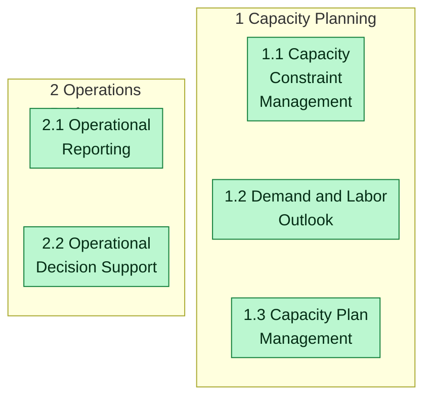
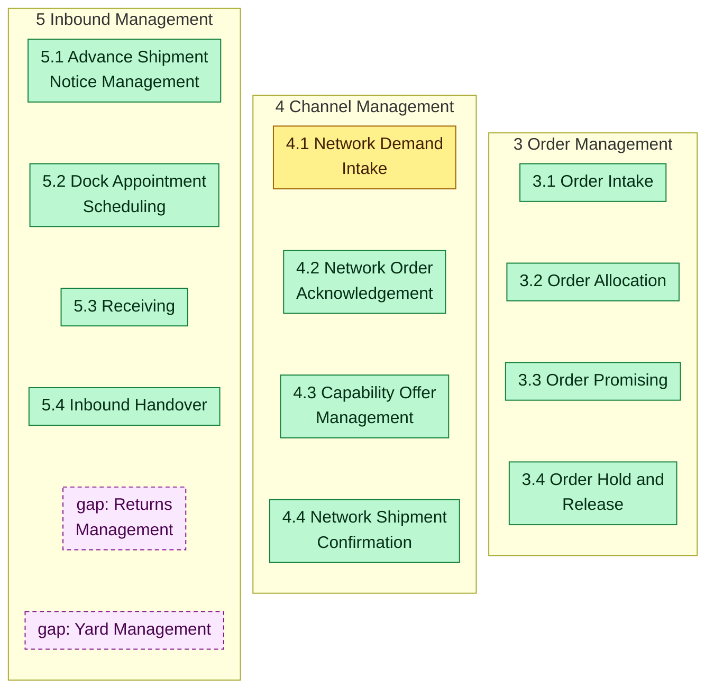
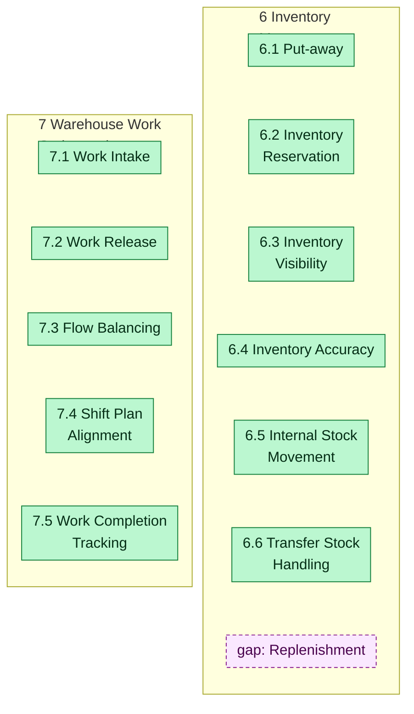
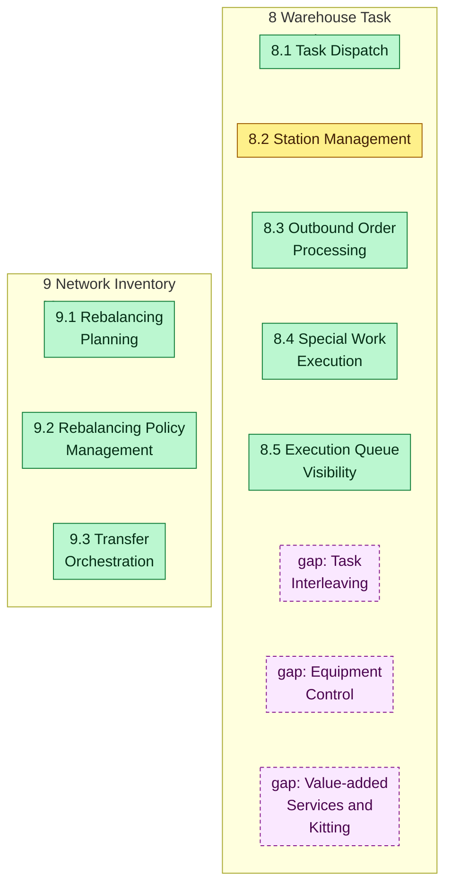
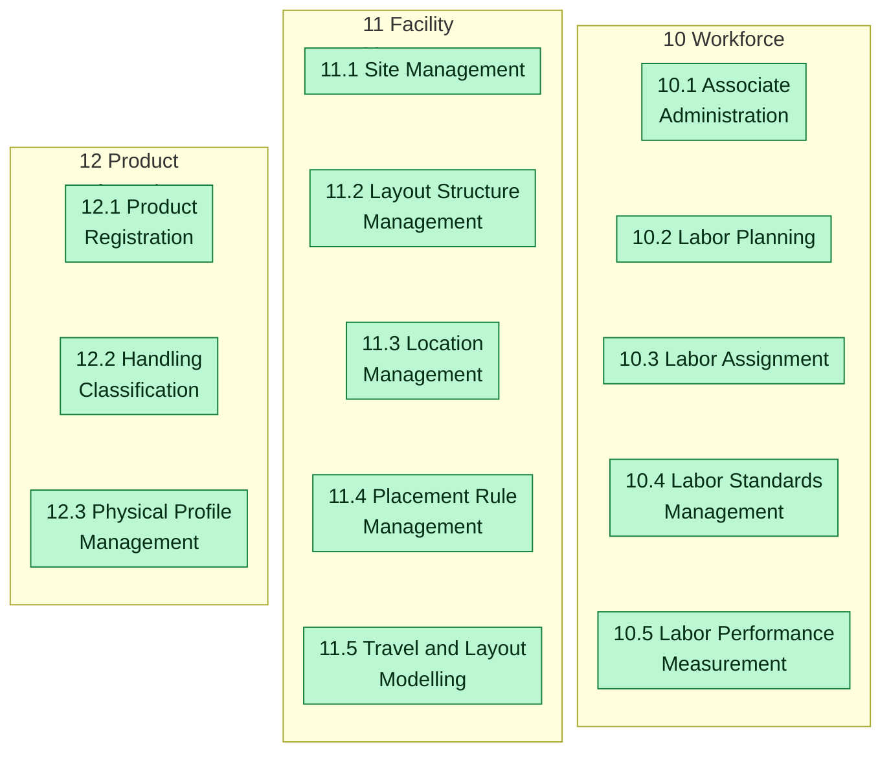
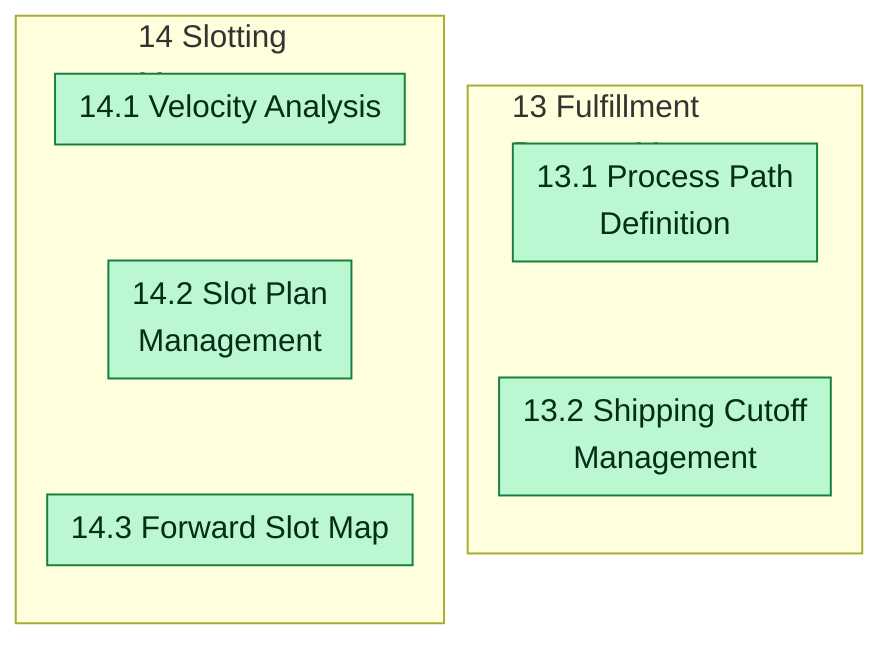
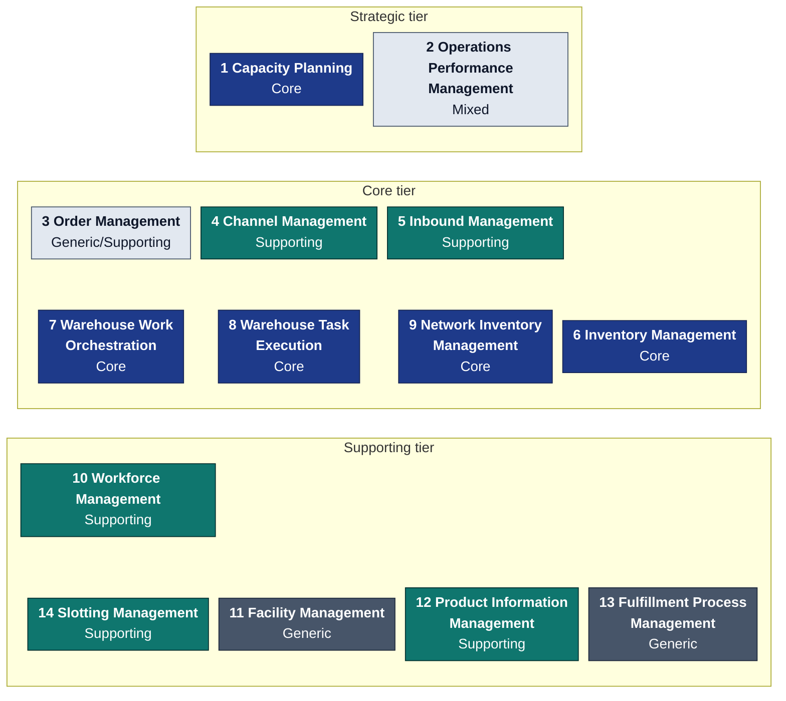

# Capability heat maps

:::info[Generated page]
Generated by `scripts/capability-map/generate.py` from the model in
`scripts/capability-map/capabilities.py`. Change the model, then run the
generator; do not edit this page by hand. The method and the sources are on
[Business Capability Architecture](/business-capability-architecture).
:::

A heat map colours the same capability map by one perspective at a time.
The TOGAF guide uses a stoplight scheme and marks a capability that does not
exist yet in purple, adding that "Missing capabilities signify a significant
gap."[2] This page draws two perspectives: whether each capability is
implemented, and how much each one differentiates the business.

## Implementation heat map (L2)

Green: implemented. Amber: implemented with a stated limitation (see the
catalogue). Purple, dashed: a capability the industry reference names that
this fleet does not have, drawn under the L1 it would extend.

### Strategic tier: L1 1 to 2

### Core tier: L1 3 to 5

### Core tier: L1 6 to 7

### Core tier: L1 8 to 9

### Supporting tier: L1 10 to 12

### Supporting tier: L1 13 to 14

## Gaps against the industry reference

Capabilities that Gartner's WMS definition, APQC's process framework or MHI
name, checked against `develop` in every repository. None of them is
built. They are listed so the map does not read as complete when it is
not.

| Missing capability | Would extend | Description | Named by | What exists today |
| --- | --- | --- | --- | --- |
| Replenishment | L1 6 Inventory Management | The ability to refill forward pick slots from reserve stock before they run empty. | [12] | Not in production. Owner registered: the pick-face-replenishment context (wms, Supporting), built on develop on 2026-10-17 but not deployed; it raises replenishment requests, and its execution chain (REPLENISH work in wes-work-planning and fulfillment-execution, the BinStockLevelChanged producer and the REPLENISHMENT relocation reason in inventory-storage) is not built. Until then warehouse-planning knows REPLENISHMENT only as a capacity-constraint type. |
| Returns Management | L1 5 Inbound Management | The ability to receive, inspect and dispose of returned products. | [10] | No returns flow in any context. |
| Task Interleaving | L1 8 Warehouse Task Execution | The ability to combine tasks of different types into one trip. | [12] | Not in production: pull dispatch hands one task at a time. Owner registered: the task-interleaving context (wes, Supporting), scaffolded 2026-10-17 and in progress. |
| Equipment Control | L1 8 Warehouse Task Execution | The ability to drive conveyors, sorters, AS/RS and robot fleets deterministically. | [13] | fulfillment-execution reserves an EquipmentCommandPort with no methods; no WCS is integrated. |
| Value-added Services and Kitting | L1 8 Warehouse Task Execution | The ability to perform kitting, light assembly and other value-added work. | [12] | facility-layout can model VAS work centres, but no VAS or kitting task type exists. |
| Yard Management | L1 5 Inbound Management | The ability to manage trailers in the yard between gate and dock. | [12] | Yard locations exist in facility-layout and dock appointments in inbound-receiving, but trailers are not tracked. |
| Outbound Transportation | a new L1 | The ability to plan carriers, rate and tender shipments and track delivery. | [10] | Shipping stops at the SLAM label and manifest event; no carrier or transport integration. |
| Logistics Billing | a new L1 | The ability to bill clients for storage and handling, as a third-party logistics provider does. | [12] | No billing in any context. |

Two of the gaps would be new L1 capabilities: outbound transportation
(APQC 4.4.4, "Operate outbound transportation")[10] and billing, which
Gartner lists among the integrated WMS components ("third­party logistics
(3PL) billing").[12]

## Differentiation heat map (L1)

The same L1 map, coloured by the DDD classification of the contexts that
realize each capability ([Subdomain Classification](/strategic-design/subdomain-classification)):
navy Core, teal Supporting, slate Generic, light grey when the realizing
contexts differ. It shows where the investment that differentiates the
business sits on the capability map.

| L1 | Capability | DDD classification | Realizing contexts and their class |
| --- | --- | --- | --- |
| 1 | Capacity Planning | Core | warehouse-planning (Core) |
| 2 | Operations Performance Management | Mixed | order-management (Generic/Supporting), inventory-storage (Core), wes-work-planning (Core), fulfillment-execution (Core), workforce-management (Supporting), labor-performance (Supporting), inbound-receiving (Supporting), facility-layout (Generic), process-path-management (Generic), product-master (Supporting), warehouse-planning (Core), network-inventory-planning (Core), network-fulfillment (Supporting), warehouse-ops-agent (Supporting) |
| 3 | Order Management | Generic/Supporting | order-management (Generic/Supporting), inventory-storage (Core) |
| 4 | Channel Management | Supporting | network-fulfillment (Supporting), order-management (Generic/Supporting) |
| 5 | Inbound Management | Supporting | inbound-receiving (Supporting), inventory-storage (Core) |
| 6 | Inventory Management | Core | inventory-storage (Core) |
| 7 | Warehouse Work Orchestration | Core | wes-work-planning (Core) |
| 8 | Warehouse Task Execution | Core | fulfillment-execution (Core) |
| 9 | Network Inventory Management | Core | network-inventory-planning (Core) |
| 10 | Workforce Management | Supporting | workforce-management (Supporting), labor-performance (Supporting) |
| 11 | Facility Management | Generic | facility-layout (Generic) |
| 12 | Product Information Management | Supporting | product-master (Supporting) |
| 13 | Fulfillment Process Management | Generic | process-path-management (Generic) |
| 14 | Slotting Management | Supporting | slotting-optimization (Supporting) |

Core differentiation concentrates in the core tier (inventory,
orchestration, execution, network) plus capacity planning in the strategic
tier. The supporting tier is Supporting or Generic throughout, which is what
the stratification predicts.

## Sources

- **[2]** [The Open Group — TOGAF Series Guide: Business Capabilities (G189, 2018; superseded by G211)](https://governance.foundation/assets/frameworks/togaf/g189%20-%20Business%20Capbility.pdf)
- **[10]** [APQC Process Classification Framework, Cross-Industry v7.4 (PDF)](https://solutions.ifrc.org/sites/default/files/2024-10/K014750_APQC%20Process%20Classification%20Framework%20%28PCF%29%20-%20Cross%20Industry%20-%20PDF%20Version%207.4.pdf)
- **[12]** [Gartner, Magic Quadrant for Warehouse Management Systems (2015 reprint hosted by Oracle)](http://oracle.com/us/corporate/analystreports/gartner-magic-quadrant-wms-2884695.pdf)
- **[13]** [MHI — Warehouse Software: Discerning the Differences Between WMS, WCS and WES (2021)](https://mhi.org/blog/125930/warehouse-software-discerning-the-differences-between-wms-wcs-and-wes)
