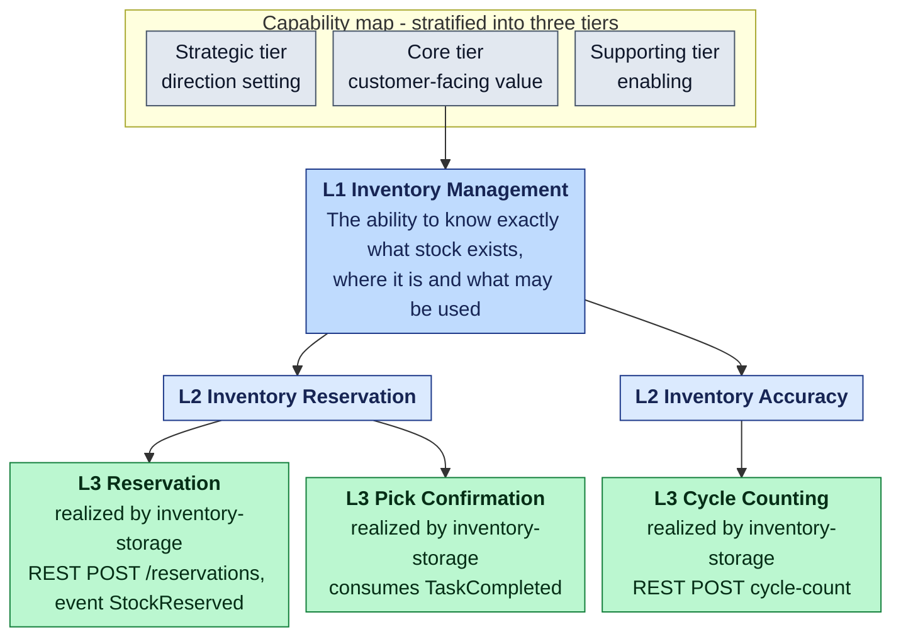
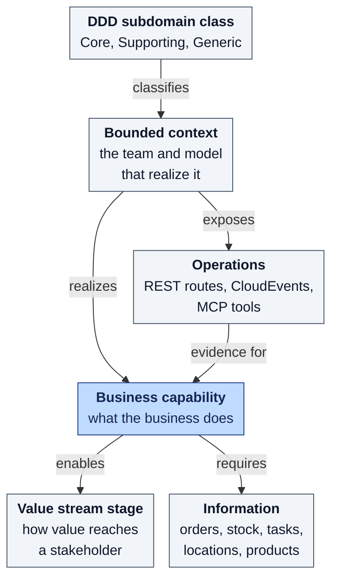

# Business Capability Architecture

A **business capability map** describes *what* a business does, independent of
*who* does it, *how* and *with which system*. This section builds that map for
the warehouse-systems fleet: fourteen L1 capabilities decomposed into L2 and L3
capabilities, every L3 traced to the code of the bounded context that realizes
it. This page covers the theory from authoritative sources, the rules applied
and the method. The map itself is on the pages listed at the end.

## What a business capability is

The Open Group's TOGAF guide on business capabilities gives the definition
most practitioners use: "A business capability is a particular ability or
capacity that a business may possess or exchange to achieve a specific purpose
or outcome."[2] The definition comes from Ulrich Homann's 2006 Microsoft paper,
which adds that business activities like creating purchase orders or shipping
products are stable, while how a business implements them "with people,
procedures, and technology" is far less stable.[3] The current edition of the
guide (G211, 2022, part of the TOGAF Standard, 10th Edition) keeps this purpose:
to create a capability map and align it with the other business architecture
viewpoints.[1]

Three properties follow, and the map on this site respects all three:

- **What, not how.** "Critically, a business capability delineates what a
  business does without attempting to explain how, why, or where the business
  uses the capability."[2] So no capability on the map is named after a
  service, a team or a protocol.
- **Stable.** Capabilities outlive the processes, organizations and systems
  that realize them. A business capability model is "a blueprint that provides
  a static and conceptual view of the set of capabilities present within an
  organisation".[6]
- **Realized by components.** "A combination of roles, processes,
  information, and tools enable a business capability."[2] In this fleet the
  tools are the bounded contexts, so each L3 names the contexts and the
  operations that realize it.

Capabilities are also where strategy meets delivery: "capabilities are the
nexus of strategic business architecture and strategy execution."[7]

## Rules applied to every capability

| Rule | Source | How this map applies it |
| --- | --- | --- |
| Name a capability as a noun | "Capabilities are nouns, not verbs"[5]; a noun says "this is what we do", a verb "this is how we do it"[2] | "Inventory Reservation", never "Reserve stock" or "inventory-storage" |
| Describe it as "the ability to …" | "A useful syntax is to phrase the description of each business capability as “the ability [or capacity] to …”."[2] | Every L1, L2 and L3 description starts "The ability to"; the generator rejects any that does not |
| Define it once | "Capabilities are defined once for an enterprise"[5] | A capability realized by two contexts appears once, with both contexts named |
| Automation does not change the category | "An automated capability is still a business capability, not an IT capability"[5] | The map holds business capabilities even though software realizes all of them |
| Separate it from the organization | Avoid "a tight alignment between the functional names that denote business units, and the top-level business capabilities"[2] | L1 names are business areas, not repository names. Several contexts share L1 Workforce Management and Operations Performance Management |

## Levels: stratification and leveling

The TOGAF guide structures a capability model in two ways.[2]

- **Stratification** applies to the whole map: "Stratification is the process
  of classifying, grouping, and aligning business capabilities within (usually
  three) categories, tiers, or layers."[2] The Business Architecture Guild
  puts it as "Stratification applies to the capability map".[5] The usual
  tiers are strategic (direction setting), core (customer-facing) and
  supporting (essential but behind the scenes).[2]
- **Leveling** applies to each capability: "Leveling is the process of
  decomposing each top-level (Level 1) business capability into lower levels to
  communicate more detail – at a level appropriate to the audience or
  stakeholder group concerned."[2] Again in the Guild's words, "Decomposition
  applies to the capability, not the map".[5]

How many levels? "Between three and six business capability levels of
decomposition is common in practice."[2] Homann's model names the first three:
core capabilities, capability groups, and business capabilities ("Capability
groups are decomposed into business capabilities."), and notes that "It is not
necessary to decompose all capabilities to the same level."[3]

This site uses three levels:

| Level | Meaning here | Audience | Count |
| --- | --- | --- | --- |
| **L1** | A top-level business area, placed in one stratification tier | executives, the whole fleet | 14 |
| **L2** | A capability group: where ownership and service levels can first be stated | product owners of the contexts | 54 |
| **L3** | A business capability, the building block, tied to the routes, events and MCP tools that realize it | engineers and architects | 135 |

## How capabilities relate to the rest of the architecture

- **Value streams.** In the BIZBOK, "Capabilities enable stages within various
  value streams and require certain information."[4] The
  [cross-mapping page](/business-capability-architecture/cross-mapping#value-streams)
  maps six fleet value streams, stage by stage, to the L2 capabilities that
  enable them.
- **Processes.** A process framework such as APQC's PCF is a taxonomy of
  *activities* ("4.4.3 Operate warehousing (10340)")[10]; a capability is the
  ability those activities exercise. APQC and Gartner were used to check that
  the warehouse L2 names follow industry vocabulary and to find the gaps.
- **Bounded contexts and services.** "Decompose by business capability" is a
  standard way to find service boundaries: "Define services corresponding to
  business capabilities."[8] It also gives teams a long life: "A
  business-capability centric team is one whose work is aligned long-term to a
  certain area of the business."[9] In this fleet a bounded context usually
  realizes a coherent slice of one L1, but not always. Workforce Management is
  realized by two contexts, and Operations Performance Management by all of
  them. The [L2-by-context matrix](/business-capability-architecture/cross-mapping#l2-capability-by-bounded-context)
  shows every case.
- **DDD subdomains.** The DDD classification (Core, Supporting, Generic) says
  how much a context *differentiates* the business. The capability tier
  (strategic, core, supporting) says what *role* a capability plays. They are
  different axes. The
  [differentiation heat map](/business-capability-architecture/heat-maps#differentiation-heat-map-l1)
  overlays the first on the second.

## How the map was built

1. **Harvest from code (bottom-up).** For every context, list the operations
   on `develop`: every route in `apis/openapi.yaml` (and the reports spec),
   every published and consumed CloudEvents type in `apis/asyncapi.yaml`, and
   every MCP tool under `internal/adapters/inbound/mcp`. The commits read are
   listed below.
2. **Name and describe (rules above).** Group operations that exercise the
   same ability into one L3, named as a noun and described as "the ability
   to …". Probes, health checks and freshness endpoints are not capabilities.
3. **Group into L2 and L1 (top-down check).** Group L3 into L2 capability
   groups and L1 business areas, and check the warehouse names against
   Gartner's core WMS list ("receive, put away, store, count and pick, pack and
   ship goods")[11] and APQC's warehousing processes.[10]
4. **Stratify.** Place each L1 in the strategic, core or supporting tier.[2]
5. **Cross-map and heat-map.** Map L2 to bounded contexts and value streams,
   colour the map by implementation status and by DDD classification, and list
   what the industry references name but the fleet lacks (missing capabilities
   "signify a significant gap"[2]). Sources for the gaps: Gartner[12], APQC[10]
   and MHI.[13]
6. **Generate.** The model lives in one file,
   `scripts/capability-map/capabilities.py`. `scripts/capability-map/generate.py`
   renders the four map pages from it and refuses a description that does not
   start with "The ability to", an unknown context, or a value-stream stage
   that names a missing L2. Run `python3 scripts/capability-map/generate.py --check`
   to prove the pages match the model.

### Code read

The harvest read each repository at these `develop` commits (2026-10-16):

| Repository | Commit | Repository | Commit |
| --- | --- | --- | --- |
| order-management | `0dab2c6` | labor-performance | `a1b63a2` |
| inventory-storage | `5dd861b` | warehouse-ops-agent | `39c7dfb` |
| wes-work-planning | `2fcf1c4` | network-fulfillment | `f700c2e` |
| fulfillment-execution | `011171f` | warehouse-planning | `dbff8ea` |
| workforce-management | `3d80c34` | product-master | `604c5e4` |
| facility-layout | `f222d1d` | inbound-receiving | `eb3bb4b` |
| process-path-management | `13615d3` | slotting-optimization | `4494616` |
| network-inventory-planning | `6e45a27` | | |

## Pages in this section

| Page | What it shows |
| --- | --- |
| [Capability map (L1-L3)](/business-capability-architecture/capability-map) | The stratified L1 map and one L1-to-L3 diagram per L1. |
| [Capability catalogue](/business-capability-architecture/capability-catalogue) | Every L3 with its description, realizing contexts, evidence and status. |
| [Heat maps](/business-capability-architecture/heat-maps) | Implementation status per L2, the gaps against the industry reference, and the DDD differentiation per L1. |
| [Cross-mapping](/business-capability-architecture/cross-mapping) | L2 by bounded context, capabilities per context, and six value streams. |

Related: [WMS and WES](/wms-wes) qualifies the same contexts as warehouse
software categories.

## Sources

- **[1]** [The Open Group — TOGAF Series Guide: Business Capabilities, Version 2 (G211, 2022)](https://publications.opengroup.org/g211)
- **[2]** [The Open Group — TOGAF Series Guide: Business Capabilities (G189, 2018; superseded by G211)](https://governance.foundation/assets/frameworks/togaf/g189%20-%20Business%20Capbility.pdf)
- **[3]** [Ulrich Homann (Microsoft), A Business-Oriented Foundation for Service Orientation (2006)](https://cdn.ymaws.com/www.businessarchitectureguild.org/resource/resmgr/homann_article_on_capabiliti.pdf)
- **[4]** [Business Architecture Guild — BIZBOK Guide v13, Part 1: Introduction](https://cdn.ymaws.com/www.businessarchitectureguild.org/resource/resmgr/BIZBOKv13_Intro.pdf)
- **[5]** [Business Architecture Guild — Business Architecture Reference Model Workshop (OMG BASIG, 2015)](https://www.omg.org/cgi-bin/doc?basig%2F15-12-01.pdf)
- **[6]** [O'Reilly — Business Architecture (BCS), ch. 5 Capability View of Business Architecture](https://www.oreilly.com/library/view/business-architecture/9781780176727/html/17_ch05.xhtml)
- **[7]** [O'Reilly — The Execution Challenge (Wiley), ch. 4 Leveraging a Capability Perspective for Strategy Translation and Alignment](https://oreilly.com/library/view/the-execution-challenge/9781394210435/c04.xhtml)
- **[8]** [Chris Richardson — microservices.io: Decompose by business capability](https://microservices.io/patterns/decomposition/decompose-by-business-capability.html)
- **[9]** [martinfowler.com — Business Capability Centric (Sriram Narayan)](https://martinfowler.com/bliki/BusinessCapabilityCentric.html)
- **[10]** [APQC Process Classification Framework, Cross-Industry v7.4 (PDF)](https://solutions.ifrc.org/sites/default/files/2024-10/K014750_APQC%20Process%20Classification%20Framework%20%28PCF%29%20-%20Cross%20Industry%20-%20PDF%20Version%207.4.pdf)
- **[11]** [Gartner Peer Insights — Warehouse Management Systems market definition](https://www.gartner.com/reviews/market/warehouse-management-systems)
- **[12]** [Gartner, Magic Quadrant for Warehouse Management Systems (2015 reprint hosted by Oracle)](http://oracle.com/us/corporate/analystreports/gartner-magic-quadrant-wms-2884695.pdf)
- **[13]** [MHI — Warehouse Software: Discerning the Differences Between WMS, WCS and WES (2021)](https://mhi.org/blog/125930/warehouse-software-discerning-the-differences-between-wms-wcs-and-wes)
