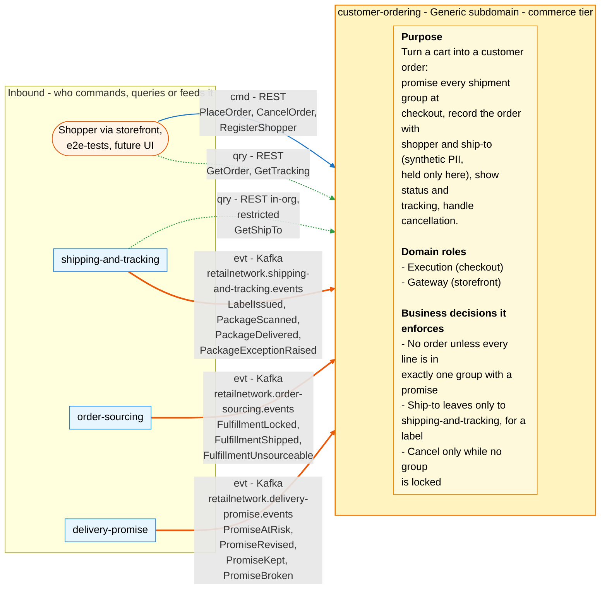
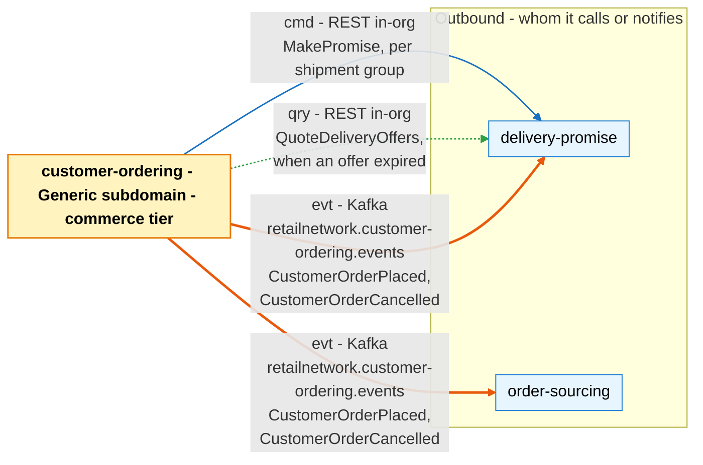

# Bounded Context Canvas

:::info[Proposed design]
Derived from [`model/model.yaml`](https://github.com/IQVO/retail-network-docs/blob/main/model/model.yaml). Nothing in this context is built yet; identifiers (`Err...` names, routes, CloudEvents types) are the names an implementation must use.
:::

Following the ddd-crew [Bounded Context Canvas v5](https://github.com/ddd-crew/bounded-context-canvas).
Every message row comes from `contexts[customer-ordering]` (`inbound`,
`consumes`, `publishes`, `sync_calls`, `rest`) or from a neighbour's entry
that names this context.

## Canvas at a glance

Two pictures of the sections below, laid out like the ddd-crew canvas:
first the inbound collaborators feeding this context (purpose, domain roles
and the business decisions it enforces), then the outbound collaborators it
calls or notifies. Arrows follow the message type: **solid blue** commands
(`cmd`), **dotted green** queries (`qry`), **thick orange** events (`evt`);
each arrow names its channel and the messages it carries. Box shapes mark
the collaborator kind: rounded = people, UI or any client; blue = sibling
bounded context. Channel names on the arrows are abbreviated; the Inbound
and Outbound Communication tables carry the exact route, topic and
CloudEvents type for every message.

### Inbound

### Outbound

Derived from: `model.yaml → contexts[customer-ordering].inbound`,
`.sync_calls`, `.publishes`, `.purpose`, `.roles`, `.business_decisions`.

The diagrams omit assumptions, verification metrics, open questions and the
ubiquitous language (sections below), the relationship pattern per message
(see the tables), and the synchronous replies. `RegisterShopper`
(`POST /shoppers`) is in the model's `rest` list but has no `inbound` row;
the arrow assigns it to the storefront, which is an assumption (see Open
Questions).

## Name

**Customer Ordering** (`customer-ordering`, code `CO`, CloudEvents tier
`commerce`).

## Purpose

To turn a shopper's cart into a customer order. The context:

- obtains a promise from `delivery-promise` for every shipment group at
  checkout (`MakePromise`), re-quoting when the offer the shopper saw has
  expired (`QuoteDeliveryOffers`);
- records the order with the shopper and the ship-to address (synthetic
  PII, held only here);
- publishes `CustomerOrderPlaced` with the promise snapshot of every group,
  so `order-sourcing` does not have to correlate two streams;
- shows status and tracking, built from fulfilment, promise and package
  events;
- handles customer cancellation while no group is locked.

## Strategic Classification

| Axis | Verdict |
| --- | --- |
| **Domain** | **Generic** subdomain. See the [Core Domain Chart](/contexts/customer-ordering/core-domain-chart). |
| **Business Model** | Engagement (the storefront transaction). |
| **Evolution** | Commodity. |

## Domain Roles

| Role | Applies? | Evidence in the model |
| --- | --- | --- |
| **Execution (checkout)** | **Yes, primary** | `PlaceOrder`, the `CheckoutPromising` policy, the sync calls `MakePromise` and `QuoteDeliveryOffers`. |
| **Gateway (storefront)** | **Yes** | The storefront routes `POST /checkout`, `GET /orders/{orderId}`, `GET /orders/{orderId}/tracking`, `POST /orders/{orderId}:cancel` are the shopper's way into the network's order flow (Open Host). |
| Analysis | No | `OrderTrackingView` is a projection for display, not a decision. |
| Specification / Enforcer | No | Promise rules and capacity belong to `delivery-promise`. |

## Inbound Communication

| Collaborator | Message | Type | Channel | Relationship |
| --- | --- | --- | --- | --- |
| Shopper / storefront | `PlaceOrder` | Command | REST `POST /checkout` | Open Host |
| Shopper / storefront | `CancelOrder` | Command | REST `POST /orders/{orderId}:cancel` | Open Host |
| Shopper / storefront (assumed; no `inbound` row) | `RegisterShopper` | Command | REST `POST /shoppers` | Open Host |
| Shopper / storefront | `GetOrder` | Query | REST `GET /orders/{orderId}` | Open Host |
| Shopper / storefront | `GetTracking` | Query | REST `GET /orders/{orderId}/tracking` | Open Host |
| `shipping-and-tracking` | `GetShipTo` | Query | REST `GET /orders/{orderId}/ship-to` (in-org, restricted) | Customer/Supplier (we are the Supplier) |
| `order-sourcing` | `FulfillmentLocked` | Event | Kafka `retailnetwork.order-sourcing.events`, `com.retailnetwork.commerce.order-sourcing.assignment.FulfillmentLocked` | Conformist |
| `order-sourcing` | `FulfillmentShipped` | Event | Kafka `retailnetwork.order-sourcing.events`, `com.retailnetwork.commerce.order-sourcing.assignment.FulfillmentShipped` | Conformist |
| `order-sourcing` | `FulfillmentUnsourceable` | Event | Kafka `retailnetwork.order-sourcing.events`, `com.retailnetwork.commerce.order-sourcing.assignment.FulfillmentUnsourceable` | Conformist |
| `delivery-promise` | `PromiseAtRisk` | Event | Kafka `retailnetwork.delivery-promise.events`, `com.retailnetwork.commerce.delivery-promise.promise.PromiseAtRisk` | Customer/Supplier |
| `delivery-promise` | `PromiseRevised` | Event | Kafka `retailnetwork.delivery-promise.events`, `com.retailnetwork.commerce.delivery-promise.promise.PromiseRevised` | Customer/Supplier |
| `delivery-promise` | `PromiseKept` | Event | Kafka `retailnetwork.delivery-promise.events`, `com.retailnetwork.commerce.delivery-promise.promise.PromiseKept` | Customer/Supplier |
| `delivery-promise` | `PromiseBroken` | Event | Kafka `retailnetwork.delivery-promise.events`, `com.retailnetwork.commerce.delivery-promise.promise.PromiseBroken` | Customer/Supplier |
| `shipping-and-tracking` | `LabelIssued` | Event | Kafka `retailnetwork.shipping-and-tracking.events`, `com.retailnetwork.logistics.shipping-and-tracking.label.LabelIssued` | Conformist |
| `shipping-and-tracking` | `PackageScanned` | Event | Kafka `retailnetwork.shipping-and-tracking.events`, `com.retailnetwork.logistics.shipping-and-tracking.journey.PackageScanned` | Conformist |
| `shipping-and-tracking` | `PackageDelivered` | Event | Kafka `retailnetwork.shipping-and-tracking.events`, `com.retailnetwork.logistics.shipping-and-tracking.journey.PackageDelivered` | Conformist |
| `shipping-and-tracking` | `PackageExceptionRaised` | Event | Kafka `retailnetwork.shipping-and-tracking.events`, `com.retailnetwork.logistics.shipping-and-tracking.journey.PackageExceptionRaised` | Conformist |

## Outbound Communication

| Collaborator | Message | Type | Channel | Relationship |
| --- | --- | --- | --- | --- |
| `delivery-promise` | `QuoteDeliveryOffers` | Query | REST `POST /delivery-offers:quote` (in-org) | Customer/Supplier (we are the Customer) |
| `delivery-promise` | `MakePromise` | Command | REST `POST /promises` (in-org) | Customer/Supplier (we are the Customer) |
| `order-sourcing`, `delivery-promise` | `CustomerOrderPlaced` | Event | Kafka `retailnetwork.customer-ordering.events`, `com.retailnetwork.commerce.customer-ordering.customerorder.CustomerOrderPlaced` | Customer/Supplier (we are the Supplier) |
| `order-sourcing`, `delivery-promise` | `CustomerOrderCancelled` | Event | Kafka `retailnetwork.customer-ordering.events`, `com.retailnetwork.commerce.customer-ordering.customerorder.CustomerOrderCancelled` | Customer/Supplier (we are the Supplier) |

What the consumers do with them (from their own model entries):
`delivery-promise` confirms the provisional promise of each group
(`ConfirmPromise`) on `CustomerOrderPlaced` and cancels it (`CancelPromise`)
on `CustomerOrderCancelled`; `order-sourcing` queues one assignment per group
(`QueueAssignment`) and cancels it (`CancelAssignment`). Full payloads:
[Domain Events](/contexts/customer-ordering/domain-events). Relationship
evidence: [Context Map](/contexts/customer-ordering/context-map).

## Ubiquitous Language

Full glossary: [Ubiquitous Language](/contexts/customer-ordering/ubiquitous-language).
Top terms: **Shopper**, **Customer Order**, **Ship-To** (PII, held only
here), **Checkout**, **Group Promise** (a snapshot of the **Promise**),
**Shipment Group**, **Delivery Offer**, **Path Lock** (ends customer
cancellation).

## Business Decisions

1. **No order without a promise per group.** Every line is in exactly one
   group and every group has a promise (`ErrLineWithoutPromise`). The
   promise's destination postal prefix matches the ship-to
   (`ErrPromiseDestinationMismatch`).
2. **Promise from the offer the shopper saw.** If that offer has expired,
   re-quote and show the new window before placing (`CheckoutPromising`).
   The order is never placed on a window the shopper did not see.
3. **The ship-to never leaves this context** except to
   `shipping-and-tracking`, for a label, through
   `GET /orders/{orderId}/ship-to`. Published events carry
   `destinationPostalPrefix` only.
4. **Cancel only while no group is locked** (`ErrCancelAfterLock`). After the
   lock, cancellation is a return.
5. **Status moves forward only** (`ErrStatusRegression`). A late or
   duplicated upstream event never moves the order back.
6. **An unfulfillable group is cancelled, not kept open.** When a group is
   unsourceable and no revised promise is feasible, cancel the group, and the
   order if nothing remains (`CancelOnUnfulfillable`).

## Assumptions

- `delivery-promise` answers `QuoteDeliveryOffers` and `MakePromise` within
  the checkout's request budget. Checkout has no fallback promise.
- `delivery-promise` consumes `CustomerOrderPlaced` before the provisional
  hold expires (`holdExpiresAt`); otherwise `ConfirmPromise` fails with
  `ErrPromiseHoldExpired`. The outbox relay lag must stay well under the hold
  time.
- `order-sourcing` publishes `FulfillmentLocked` for every group it locks,
  so this context can enforce `ErrCancelAfterLock` from local data.
- Every consumed event carries `orderId`, or an id this context has already
  linked to an order (`assignmentId` from `FulfillmentLocked`, `promiseId`
  from checkout, `trackingNumbers` from `FulfillmentShipped`). `LabelIssued`
  and `PackageScanned` carry no `orderId`.
- "Restricted" on the ship-to route is enforced by network placement (the
  route is not exposed through the storefront edge), because the network has
  no authentication (`conventions.no_auth`).

## Verification Metrics

| Metric | Target (proposed) | Source |
| --- | --- | --- |
| Checkout success rate (`201` / all `POST /checkout`) | tracked; alert on a drop | REST access log |
| Share of checkouts answered `409 offer-not-quotable` (offer expired, re-quoted) | below 2% | REST access log |
| p95 latency of `POST /checkout`, including every `MakePromise` | below 800 ms | traces |
| Placed orders whose promise was never confirmed (`CustomerOrderPlaced` without a matching `PromiseConfirmed` before `holdExpiresAt`) | 0 | analytics join on `promiseId` |
| Outbox age of the oldest unpublished `CustomerOrderPlaced` | below 5 s | `outbox_events.created_at` |
| `ErrCancelAfterLock` share of cancel requests | tracked | REST access log |
| `GET /orders/{orderId}/ship-to` calls per `LabelIssued` | about 1 | access log vs consumed events |
| Ship-to fields in any published event or non-restricted response | 0 | contract test on the schemas |
| Consumer lag on the three consumed topics | below 30 s | Kafka consumer metrics |

## Open Questions

- **Which event drives which command?** The model lists the consumed events
  and the commands, but not the mapping. These pages use: `FulfillmentLocked`
  → `MarkInFulfillment`, `FulfillmentShipped` → `MarkGroupShipped`,
  `PackageDelivered` → `MarkGroupDelivered`, `PromiseRevised` →
  `UpdateGroupPromise`, `FulfillmentUnsourceable` → `CancelOnUnfulfillable`.
  Every consumed event except `FulfillmentUnsourceable` also feeds
  `OrderTrackingView`, as the model's `read_models` lists.
- **Cancel wording.** `business_decisions` says a customer may cancel "until
  every shipment group is locked". The invariant says "cancel only while no
  group is locked" (`ErrCancelAfterLock`). These pages follow the invariant.
  If `IN_FULFILLMENT` starts at the first lock, then the transition
  `IN_FULFILLMENT → CANCELLED` (`CancelOrder`) can never pass that invariant.
- **When is a re-promise "not feasible"?** `CancelOnUnfulfillable` needs that
  signal. `delivery-promise` reports a failed re-promise only as
  `PromiseBroken` at judgement time, and judgement needs a delivery that never
  happens for an unsourceable group.
- **Group-level state.** `CustomerOrderCancelled` carries `groupNos`, and the
  status splits `PARTIALLY_SHIPPED` from `SHIPPED`. The `GroupPromise` value
  object has no field for a group's lock, shipment, delivery or cancellation.
  Its fields also do not include `tier`, `witnessNodeId` or `shipBy`, which
  `CustomerOrderPlaced` carries.
- **A group delivered while another is still unshipped.** There is no
  `PARTIALLY_SHIPPED → DELIVERED` transition and no partially-delivered state.
- **Cancel racing the lock.** A cancel accepted before `FulfillmentLocked`
  arrives can meet a lock `order-sourcing` already made; its
  `CancelAssignment` then fails, and the model has no compensation.
- **Hold expiry after placement.** If `delivery-promise` confirms too late,
  the promise is `RELEASED` and `PromiseReleased` goes to analytics only, so
  this context never learns that a placed order lost its promise.
- **Who calls `POST /shoppers`?** The route and `RegisterShopper` exist, but
  no `inbound` row names the caller.
- **Restricted without auth.** How the ship-to route is restricted, given
  `no_auth`.
