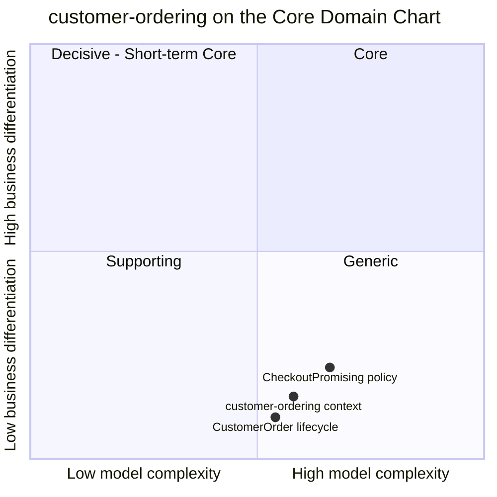

# Core Domain Chart

:::info[Proposed design]
Derived from [`model/model.yaml`](https://github.com/IQVO/retail-network-docs/blob/main/model/model.yaml). Nothing in this context is built yet; identifiers (`Err...` names, routes, CloudEvents types) are the names an implementation must use.
:::

Following the ddd-crew [Core Domain Charts](https://github.com/ddd-crew/core-domain-charts):
business differentiation (y) against model complexity (x). The
network-wide chart is [Core Domain Chart](/strategic-design/core-domain-chart).

Derived from: `model.yaml → contexts[customer-ordering].chart` (`complexity:
0.58`, `differentiation: 0.15`), `.classification`, `.aggregates[CustomerOrder]`,
`.policies[CheckoutPromising]`.

The two slices are placed by judgement, not by the model; the model gives
only the context's point. Omitted: the other nine contexts (their positions
are on their own pages and on the network-wide chart) and the `Shopper`
aggregate. `Shopper` is a one-state registry, so it would sit in the
Supporting corner on complexity alone. It is still part of a Generic context,
and plotting it would only show that a user registry is simple.

## Classification: Generic

All three points sit in **quadrant 4 (Generic)**, bottom-right. The model
classifies the context as `Generic`. Every online shop has a checkout and an
order record, and no shopper chooses this network because of how its order
record works. Shoppers choose it for the date on the order, and that date is
owned by `delivery-promise` (Core).

**Differentiation is low (y = 0.15).** The context makes no delivery
decision. It never computes a date, never holds capacity, never chooses a
node. Its rules are ordinary storefront rules: each line in one group, each
group promised, the address kept private, cancellation until the work is
committed.

**Complexity is moderate (x = 0.58).** It is not trivial, for four reasons
the model makes visible:

- Checkout is a **synchronous multi-call** to `delivery-promise`
  (`MakePromise` per shipment group, and `QuoteDeliveryOffers` when an offer
  expired). Partial failure leaves provisional holds that only expire.
- The aggregate has **six states and seven transitions**, driven by three
  upstream streams (`order-sourcing`, `delivery-promise`,
  `shipping-and-tracking`) that arrive in no guaranteed order across topics
  (`ErrStatusRegression`).
- It is the **PII boundary** of the network, with one restricted read path
  (`GET /orders/{orderId}/ship-to`).
- `CustomerOrderPlaced` must carry a **per-group promise snapshot**, so
  `order-sourcing` never has to correlate two streams.

The **CheckoutPromising** slice is plotted highest and furthest right
because it is where the context meets the Core promise. It still makes no
decision of its own, so it stays Generic.

## Business model

**Engagement (the storefront transaction).** The context earns nothing by
itself. It is the moment the shopper commits. Its value is measured by
conversion it does not lose: checkouts that fail because an offer expired,
or orders placed against a promise that was never confirmed (see
[Verification Metrics](/contexts/customer-ordering/bounded-context-canvas)).

## Evolution

| Part | Evolution stage | Why |
| --- | --- | --- |
| Order record, status, cancellation | **Commodity** | `chart.evolution: Commodity`. Standard e-commerce order management; a bought order-management product would fit. |
| Checkout promising (per-group `MakePromise`) | **Product** | The shape is common (an order service calling a promise service), but the per-group promise snapshot in `CustomerOrderPlaced` is specific to this network's split between promise and assignment ([ADR 0002](/adr/0002-promise-and-assignment-are-separate)). |
| Ship-to confinement and the restricted ship-to route | **Commodity** practice, local rule | PII minimisation is standard; the one-reader rule is this network's ([ADR 0006](/adr/0006-pii-confinement)). |
| Plumbing (outbox, inbox, CloudEvents) | **Commodity** | Network-wide building blocks ([CloudEvents standard](/strategic-design/event-standard-cloudevents)). |

**Movement to watch.** Nothing in the model moves this context up. If the
network later bought a commercial order-management product, this context
would shrink to an adapter around it, which is the expected path for a Generic
subdomain. The interface to keep stable would be `POST /checkout`, the two
published events and the ship-to route.
