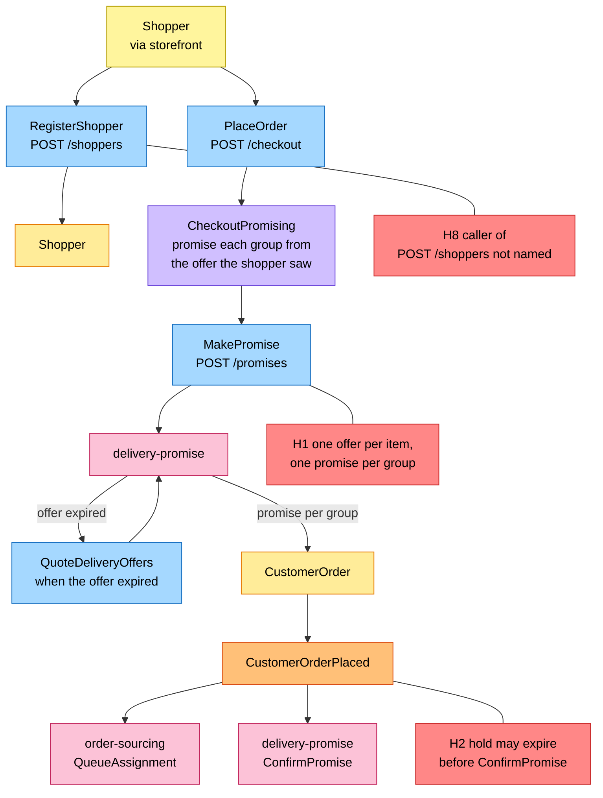
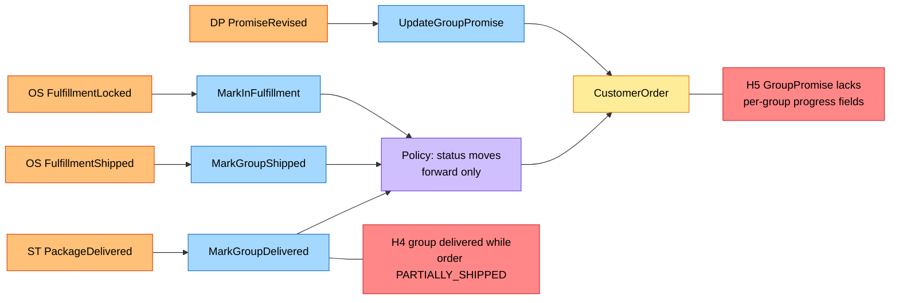
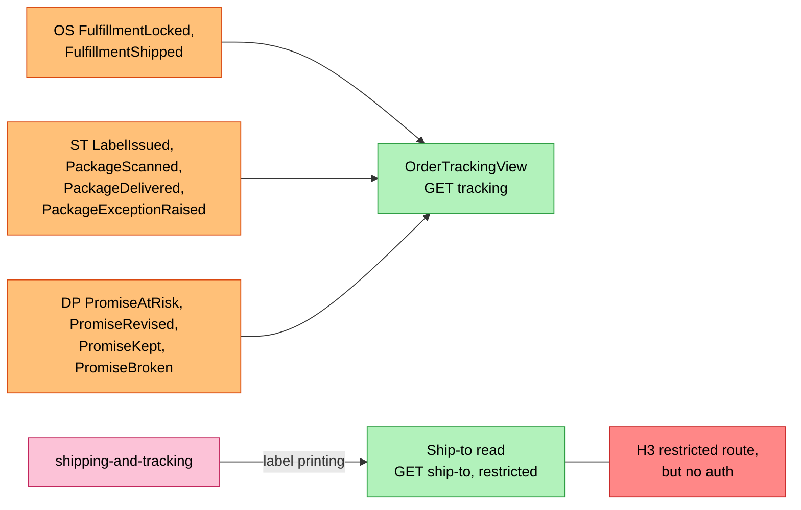
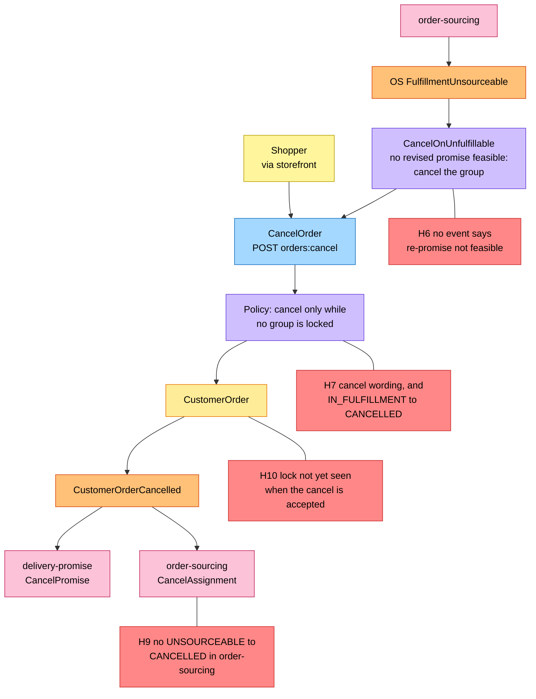

# EventStorming

:::info[Proposed design]
Derived from [`model/model.yaml`](https://github.com/IQVO/retail-network-docs/blob/main/model/model.yaml). Nothing in this context is built yet; identifiers (`Err...` names, routes, CloudEvents types) are the names an implementation must use.
:::

Process-level boards in the ddd-crew
[EventStorming glossary & cheat sheet](https://github.com/ddd-crew/eventstorming-glossary-cheat-sheet)
notation. Every sticky comes from `model.yaml`. Events published by a
neighbour are drawn as orange stickies prefixed with the producer. Every
hotspot is a gap or a risk the model itself shows, and its source is given in
the hotspot table. The big-picture board for the whole network is
[EventStorming big picture](/strategic-design/eventstorming-big-picture).
Boards 1 and 3 are drawn top to bottom and board 2 is split in two, because
left to right they would not fit the page width.

## Legend

| Colour | Sticky | Meaning here |
| --- | --- | --- |
| Pale yellow `#fff59d` | Actor | The shopper (via the storefront, e2e-tests or a future UI) |
| Blue `#a5d8ff` | Command | A command from `aggregates[*].commands` or a sync call from `sync_calls` |
| Yellow `#ffec99` | Aggregate | `CustomerOrder` or `Shopper` |
| Orange `#ffc078` | Domain Event | Ours (`publishes`) or a neighbour's (`consumes`, prefixed with the producer) |
| Lilac `#d0bfff` | Policy | `policies`, or the reaction a command takes to an event |
| Green `#b2f2bb` | Read Model | `OrderTrackingView`, or the restricted ship-to read |
| Pink `#fcc2d7` | External System | A sibling context |
| Red `#ff8787` | Hotspot | A gap or risk in the model (see the table at the end) |

## 1. Checkout and shopper registration

Derived from: `model.yaml → contexts[customer-ordering].aggregates[*].commands`,
`.sync_calls`, `.policies[CheckoutPromising]`, `.publishes[CustomerOrderPlaced]`;
`contexts[delivery-promise].aggregates[DeliveryOffer, Promise]`;
`contexts[order-sourcing].aggregates[FulfillmentAssignment].commands`.

Omitted: the invariant checks inside `PlaceOrder` (`ErrLineWithoutPromise`,
`ErrPromiseDestinationMismatch`), the 409 answers from `delivery-promise`
(`ErrOfferNotQuotable`, `ErrPromiseCapacityExhausted`, `ErrBookClosed`), and
the outbox. `Shopper` raises no event, so it has no orange sticky.

## 2. Fulfilment progress and tracking

The tracking side of the same events, and the one PII read:

Derived from: `model.yaml → contexts[customer-ordering].consumes`,
`.aggregates[CustomerOrder].commands`, `.invariants` (`ErrStatusRegression`),
`.read_models[OrderTrackingView]`, `.inbound` (`GetShipTo`, `GetTracking`).

The prefixes OS, ST and DP name the producer (`order-sourcing`,
`shipping-and-tracking`, `delivery-promise`). Omitted: the inbox, and the
shopper's `GetOrder`. The pairing of each event with a command is this
pack's reading. The model lists both sides but not the pairs.

## 3. Cancellation

Derived from: `model.yaml → contexts[customer-ordering].business_decisions`,
`.aggregates[CustomerOrder].invariants` (`ErrCancelAfterLock`),
`.transitions`, `.policies[CancelOnUnfulfillable]`,
`.publishes[CustomerOrderCancelled]`; `contexts[order-sourcing].aggregates[FulfillmentAssignment].transitions`;
`contexts[delivery-promise].policies[RepromiseOnRisk]`.

Omitted: the 409 answer to a refused cancellation (`cancel-after-lock`), the
re-promise branch (`PromiseRevised` → `UpdateGroupPromise`, board 2), and
returns after the lock (future `customer-returns`).

## Hotspots

| # | Hotspot | Where it comes from in the model |
| --- | --- | --- |
| H1 | A `DeliveryOffer` is quoted for one catalogue item and quantity, but a `Promise` covers a multi-line shipment group and names one `offerId`. The model does not say how a group of several lines maps to one offer. | `contexts[delivery-promise].aggregates[DeliveryOffer].description` vs `.aggregates[Promise]` and `publishes[PromiseMade].data` |
| H2 | `delivery-promise` confirms the promise only when it consumes `CustomerOrderPlaced`. If that happens after `holdExpiresAt`, `ConfirmPromise` fails (`ErrPromiseHoldExpired`) and the promise is `RELEASED`. `PromiseReleased` goes to analytics only, so this context never learns that a placed order has no promise. | `contexts[delivery-promise].aggregates[Promise].invariants`, `.transitions` (`ReleaseExpiredHolds`), `publishes[PromiseReleased].consumers` |
| H3 | `GET /orders/{orderId}/ship-to` is "in-org, restricted", but the network has no authentication. | `contexts[customer-ordering].inbound`; `conventions.no_auth` |
| H4 | There is no transition for a group delivered while the order is `PARTIALLY_SHIPPED`, and no partially-delivered status. | `contexts[customer-ordering].aggregates[CustomerOrder].transitions` |
| H5 | `GroupPromise` has no field for a group's lock, shipment, delivery or cancellation. `ErrCancelAfterLock` and the `PARTIALLY_SHIPPED`/`SHIPPED` choice need one. It also lacks `tier`, `witnessNodeId` and `shipBy`, which `CustomerOrderPlaced` publishes. | `aggregates[CustomerOrder].value_objects`, `.invariants`, `publishes[CustomerOrderPlaced].data` |
| H6 | `CancelOnUnfulfillable` waits for "no revised promise is feasible", but no event says so. `delivery-promise` reports an infeasible re-promise only as `PromiseBroken` at judgement, which needs a delivery. | `policies[CancelOnUnfulfillable]`; `contexts[delivery-promise].policies[RepromiseOnRisk]` |
| H7 | The business decision allows cancel "until every shipment group is locked". The invariant allows it only "while no group is locked". If `IN_FULFILLMENT` starts at the first lock, `IN_FULFILLMENT → CANCELLED` can never pass `ErrCancelAfterLock`. | `business_decisions`, `aggregates[CustomerOrder].invariants`, `.transitions` |
| H8 | `POST /shoppers` (`RegisterShopper`) is in `rest`, but no `inbound` row names its caller. | `contexts[customer-ordering].rest` vs `.inbound` |
| H9 | `order-sourcing` consumes `CustomerOrderCancelled`, but `FulfillmentAssignment` can be cancelled only from `QUEUED` or `RELEASED`, not from `UNSOURCEABLE`. That is the state of the group `CancelOnUnfulfillable` cancels. | `contexts[order-sourcing].aggregates[FulfillmentAssignment].transitions` |
| H10 | This context learns of a lock only from `FulfillmentLocked`. A cancel accepted between the vendor's acceptance and that event passes `ErrCancelAfterLock` here. `order-sourcing` then refuses `CancelAssignment` with its own `ErrCancelAfterLock`, and the model has no compensation. | `contexts[customer-ordering].aggregates[CustomerOrder].invariants`; `contexts[order-sourcing].aggregates[FulfillmentAssignment].invariants`, `policies[LockOnCommit]` |
