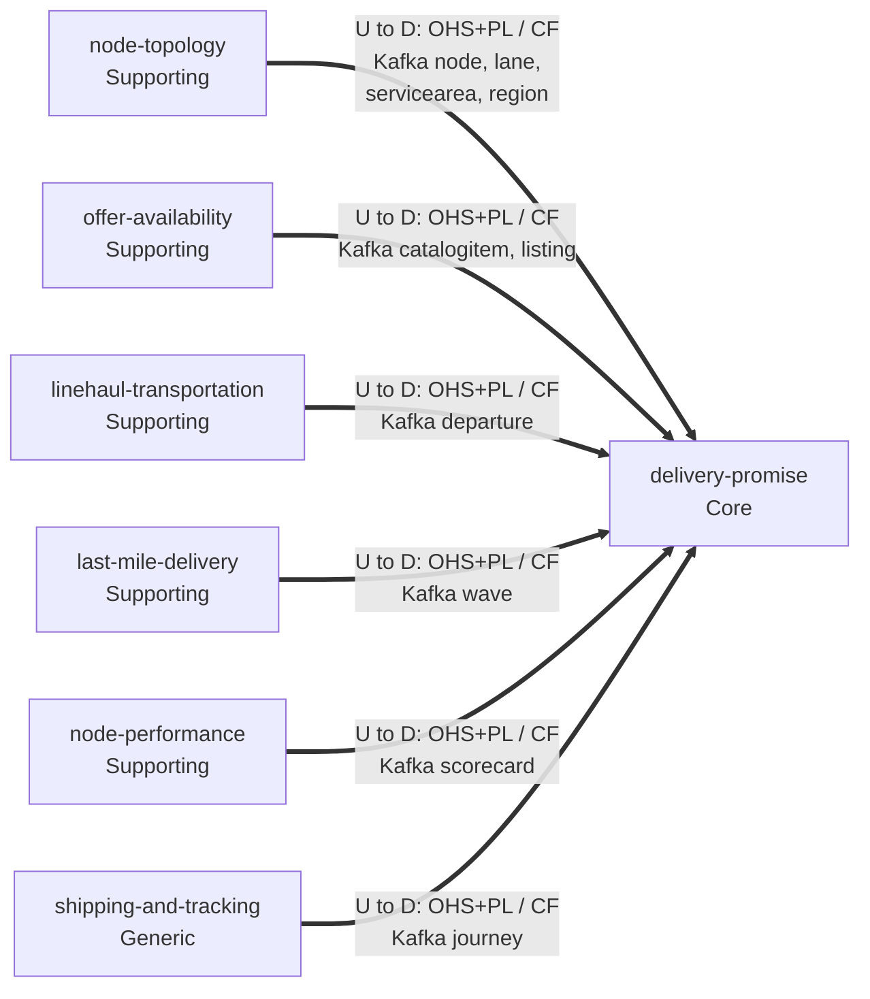
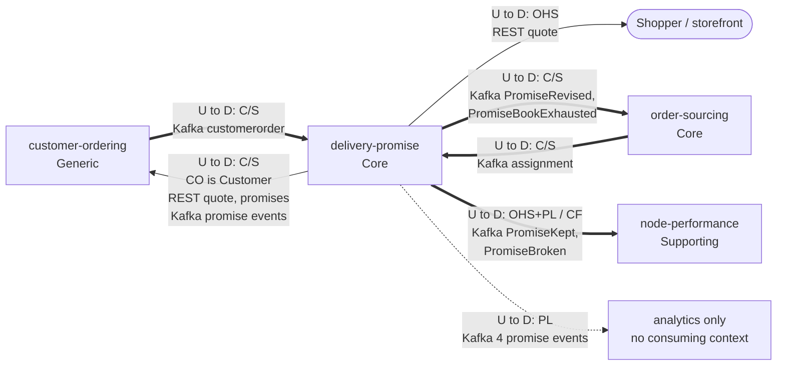

# Context Map

:::info[Proposed design]
Derived from [`model/model.yaml`](https://github.com/IQVO/retail-network-docs/blob/main/model/model.yaml). Nothing in this context is built yet; identifiers (`Err...` names, routes, CloudEvents types) are the names an implementation must use.
:::

Following ddd-crew [Context Mapping](https://github.com/ddd-crew/context-mapping).
This is **delivery-promise's slice** of [the domain context map](/strategic-design/context-map):
every relationship this context has, with the upstream (U) and downstream (D)
side, the pattern and the channel.

Delivery Promise is **downstream of six data owners**, from which it builds
local read models, and **upstream of the three contexts that act on a
promise**. Two neighbours, `customer-ordering` and `order-sourcing`, are both:
each relationship has one direction per message flow.

## Upstream: the data the promise is built from

Derived from: `model.yaml → contexts[delivery-promise].inbound` (rows with
`relationship: Conformist`), `.consumes`, `.read_models`.

## Partners in the order flow, and downstream

Derived from: `model.yaml → contexts[delivery-promise].inbound` (rows with
`relationship: Customer/Supplier` and `OHS`), `.publishes[*].consumers`;
`contexts[customer-ordering].sync_calls`; `contexts[order-sourcing].inbound`;
`contexts[node-performance].inbound`.

Legend: `==>` event flow over Kafka, `-->` synchronous REST, `-.->` published
with no consuming context. Arrows point from upstream to downstream; for REST
the upstream is the server (`delivery-promise` serves the quote and the
promise). Entity names on the arrows stand for every event of that entity this
context consumes (full list in the table).

Omitted: infrastructure (Postgres, Kafka); this context's own analytics topic;
contexts with no relationship (below).

## Relationships

| Neighbour | Direction | Pattern | Channel | Messages | Why this pattern |
| --- | --- | --- | --- | --- | --- |
| `node-topology` (Supporting) | U → D (DP downstream) | Open Host + Published Language / **Conformist** | Kafka `retailnetwork.node-topology.events` | `NodeRegistered`, `NodeOperationalProfileDeclared`, `NodeActivated`, `NodeSuspended`, `NodeRetired`, `LaneOpened`, `LaneClosed`, `ServiceAreaAssigned`, `RegionDefined` | Master data with many consumers. DP takes the node, lane and service-area vocabulary as published and builds `NodeProfileView`, `LaneView`, `RegionAndServiceAreaView`. |
| `offer-availability` (Supporting) | U → D | OHS + PL / **Conformist** | Kafka `retailnetwork.offer-availability.events` | `CatalogItemCreated`, `CatalogItemDiscontinued`, `ListingCreated`, `ListingAvailabilityChanged`, `ListingSuppressed`, `ListingRestored` | Availability per listing is used as published, basis included (`AvailabilityView`); DP never re-derives it. |
| `linehaul-transportation` (Supporting) | U → D | OHS + PL / **Conformist** | Kafka `retailnetwork.linehaul-transportation.events` | `DepartureScheduled`, `DepartureCapacityChanged`, `DepartureCancelled` | Departures and remaining capacity are the edges of the search graph (`DepartureView`). A cancelled departure on a witness path triggers `RepromiseOnRisk`. |
| `last-mile-delivery` (Supporting) | U → D | OHS + PL / **Conformist** | Kafka `retailnetwork.last-mile-delivery.events` | `DeliveryWaveScheduled`, `DeliveryWaveCapacityChanged` | Waves give the promise window and stop capacity (`DeliveryWaveView`). |
| `node-performance` (Supporting) | U → D | OHS + PL / **Conformist** | Kafka `retailnetwork.node-performance.events` | `NodeScorecardUpdated` | The grade is used as published (`ScorecardView`); the handicap rule is DP's own. |
| `shipping-and-tracking` (Generic) | U → D | OHS + PL / **Conformist** | Kafka `retailnetwork.shipping-and-tracking.events` | `PackageDelivered`, `PackageExceptionRaised` | Delivery and exception facts drive `JudgeOnDelivery` and `RepromiseOnRisk`. |
| `customer-ordering` (Generic) | DP U → CO D | **Customer/Supplier** (CO is the Customer) | REST `POST /delivery-offers:quote`, `POST /promises` (in-org); Kafka `retailnetwork.delivery-promise.events` | `QuoteDeliveryOffers`, `MakePromise`; `PromiseAtRisk`, `PromiseRevised`, `PromiseKept`, `PromiseBroken` | Checkout needs an answer inside the shopper's request (the only synchronous calls into DP, listed in `customer-ordering.sync_calls`), and CO's order status depends on promise changes. The contract is negotiated for this one customer. |
| `customer-ordering` (Generic) | CO U → DP D | **Customer/Supplier** | Kafka `retailnetwork.customer-ordering.events` | `CustomerOrderPlaced`, `CustomerOrderCancelled` | Placing the order confirms the provisional promises; cancelling releases them. |
| `order-sourcing` (Core) | OS U → DP D | **Customer/Supplier** | Kafka `retailnetwork.order-sourcing.events` | `FulfillmentUnsourceable`, `FulfillmentLocked` | An unsourceable group comes back to DP to re-promise; sourcing never breaks a promise silently ([ADR 0002](/adr/0002-promise-and-assignment-are-separate)). |
| `order-sourcing` (Core) | DP U → OS D | **Customer/Supplier** | Kafka `retailnetwork.delivery-promise.events` | `PromiseRevised`, `PromiseBookExhausted` | A revised `deliverByLatest` changes the sourcing constraint; an exhausted book raises the cost of that cutoff in sourcing's `AssignmentCost`. |
| Shopper / storefront | DP U → storefront D | **Open Host** | REST `POST /delivery-offers:quote` | `QuoteDeliveryOffers` | Any client may ask for a quote; no contract is negotiated per client. |
| `node-performance` (Supporting) | DP U → NP D | OHS + PL / **Conformist** | Kafka `retailnetwork.delivery-promise.events` | `PromiseKept`, `PromiseBroken` | NP counts kept and broken promises per node in `promiseKeptRate` and conforms to DP's events. |
| analytics (no context) | DP U → none | **Published Language** | Kafka `retailnetwork.delivery-promise.events` | `PromiseMade`, `PromiseConfirmed`, `PromiseReleased`, `PromiseCancelled` | Published for the record; the model names no consuming context ("analytics only"). |
| `vendor-connectivity` (Supporting) | none | **Separate Ways** | — | — | DP never sees a purchase order or a vendor; the vendor side starts after `order-sourcing` releases a group. |
| `network-fulfillment` (warehouse-systems fleet, other organization; Supporting in the fleet) | none | **Separate Ways** (hard boundary) | — | — | No retail-network context reads a `warehouse.*` topic or calls a fleet service; the only seam is the [Vendor API](/integration/vendor-api), which DP does not use. |

## Notes on the patterns

- **Conformist, with no ACL, toward the data owners.** Every upstream
  publishes the vocabulary this context needs (nodes, cutoffs, departures,
  waves, grades) under the same domain language. Translating it would add
  nothing; the read models store it as published. A **Shared Kernel** is
  explicitly avoided: `order-sourcing` builds its own `NetworkGraphView` from
  the same events, and the two contexts share no code or table.
- **Customer/Supplier, both ways, with the two order-flow contexts.** The
  contracts were shaped for each other: `PromiseMade`'s fields are what
  checkout needs, `CustomerOrderPlaced` carries each group's `promiseId`, and
  `FulfillmentUnsourceable` carries the `promiseId` back. That is negotiation,
  not conformity. It is not a Partnership: each side can release its half on
  its own schedule because every message is versioned (`dataschema ...:v1`).
- **No synchronous call out.** Every input of the promise hot path is a local
  read model (`conventions.integration_rules`). A neighbour that is down slows
  freshness, not quotes.
