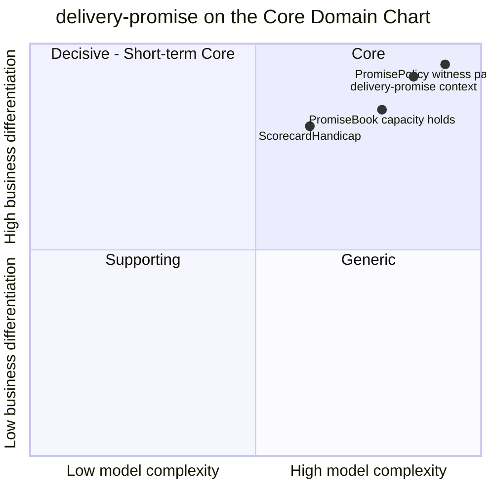

# Core Domain Chart

:::info[Proposed design]
Derived from [`model/model.yaml`](https://github.com/IQVO/retail-network-docs/blob/main/model/model.yaml). Nothing in this context is built yet; identifiers (`Err...` names, routes, CloudEvents types) are the names an implementation must use.
:::

Following the ddd-crew [Core Domain Charts](https://github.com/ddd-crew/core-domain-charts):
business differentiation (y) against model complexity (x).

Derived from: `model.yaml → contexts[delivery-promise].chart`
(`differentiation: 0.92`, `complexity: 0.85`), `.policies` (`PromisePolicy`,
`ScorecardHandicap`), `.aggregates[PromiseBook]`.

Omitted: the other nine contexts (they are on
[the domain core domain chart](/strategic-design/core-domain-chart)). The three
slice positions are this pack's estimate relative to the context point; only
the context point comes from the model.

## Classification: Core

The context point and all three slices sit in **quadrant 1 (Core)**. The model
classifies the context `Core`, with the highest differentiation of the ten
contexts. Its business model is **revenue generator** (a credible early date
converts) and **cost reducer** (no promise the network cannot keep).

### Why differentiation is high (y = 0.92)

- The promise is the one number every shopper sees before buying. Showing an
  earlier date than competitors, and keeping it, is the advantage
  ([the research page](/research/large-operator-logistics-network) explains why large
  networks treat it that way; this pack restates no figure).
- Nothing here can be bought. The search runs on this network's own nodes,
  cutoffs, departures, waves and grades. A generic carrier "transit time" table
  cannot know that one vendor's 14:00 cutoff is full.
- The rules are policy, not plumbing: `ScorecardHandicap`, `TierOrderDeadline`
  and `ShipmentGrouping` are business levers the network tunes, versioned by
  `policyVersion`.

### Why complexity is high (x = 0.85)

- The search is a **time-expanded earliest-arrival path** over scheduled
  departures with remaining capacity, with sort dwell at every node, operating
  hours and holidays at the origin, and delivery waves at the end.
- It must run on **every product page and cart view** without a synchronous
  call: seven event-fed read models (`NodeProfileView`,
  `RegionAndServiceAreaView`, `LaneView`, `AvailabilityView`, `DepartureView`,
  `DeliveryWaveView`, `ScorecardView`) must stay fresh enough to be trusted.
- A promise has seven states and eleven transitions, and must stay consistent
  with a contended capacity ledger (`PromiseBook`, one row per node cutoff,
  one hold per promise).
- It must react to four kinds of breakage (unsourceable group, package
  exception, cancelled departure, judgement) without ever moving a date
  earlier (`ErrRevisionMovesEarlier`).

### The slices

| Slice | Position | Why there |
| --- | --- | --- |
| `PromisePolicy` (witness path search) | highest on both axes | The differentiating algorithm. Hardest to get right, most valuable. |
| `PromiseBook` capacity holds | slightly lower | A classic reservation ledger, but on this network's own unit (orders per node cutoff) and contended. |
| `ScorecardHandicap` | lower complexity | A small rule table, but it is what makes declared capability honest ([ADR 0003](/adr/0003-declared-and-measured-capability)). |

## Evolution

| Part | Evolution stage | Why |
| --- | --- | --- |
| Witness path search and the four constraints | **Custom-built** (model: `evolution: Custom-built`) | Specific to this network's node types, tiers and read models. |
| `PromiseBook` | **Custom-built** | The unit (orders per pickup cutoff against a declared share) is this network's. |
| Policies (`ScorecardHandicap`, `TierOrderDeadline`, `ShipmentGrouping`) | **Custom-built**, tuned often | Versioned by `policyVersion`; expected to change with peak seasons. |
| Plumbing (outbox, inbox, CloudEvents, read-model projectors) | **Commodity** | The same building blocks every context uses. |

**Movement to watch.** If the search proves stable and the network grows a
second promise consumer (for example a seller-facing quote), the read-model
projection layer could be extracted as a shared network-graph product used by
both `delivery-promise` and `order-sourcing`, which today each build their own
view of the same events. That would be a new decision in an ADR; nothing in the
model proposes it today.
