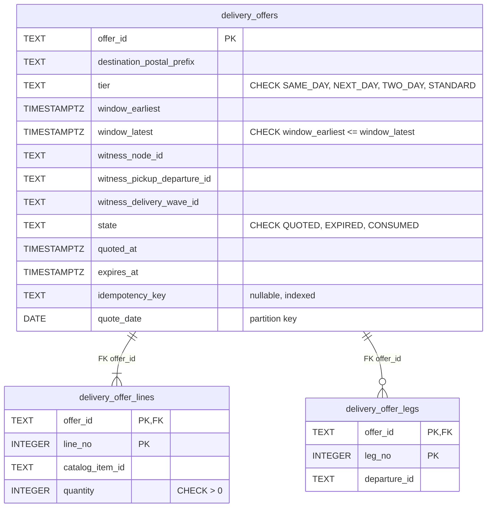
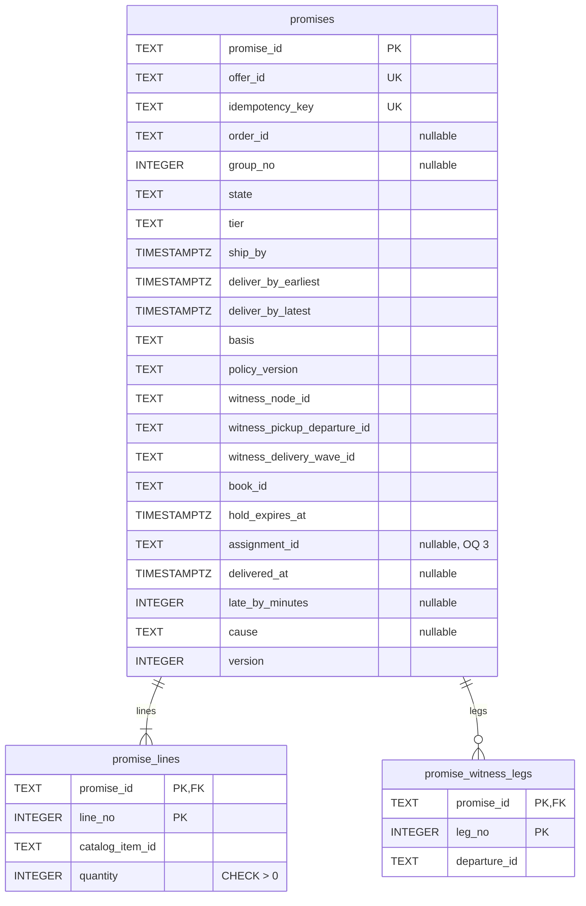
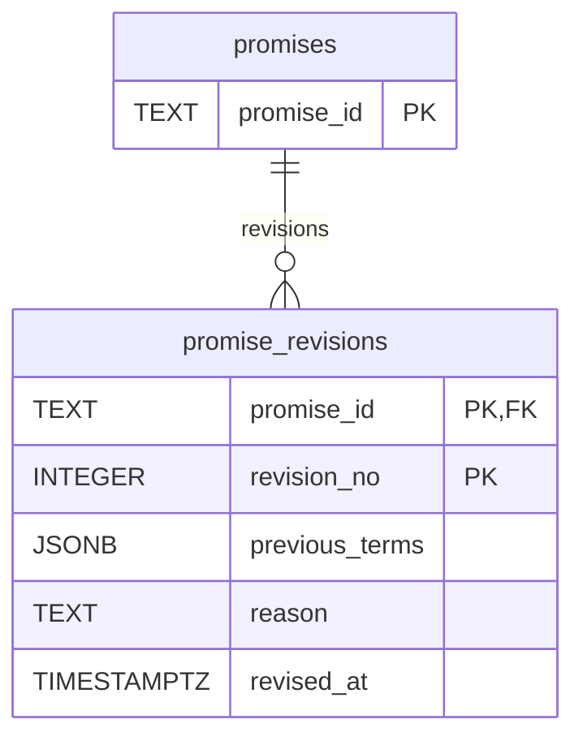
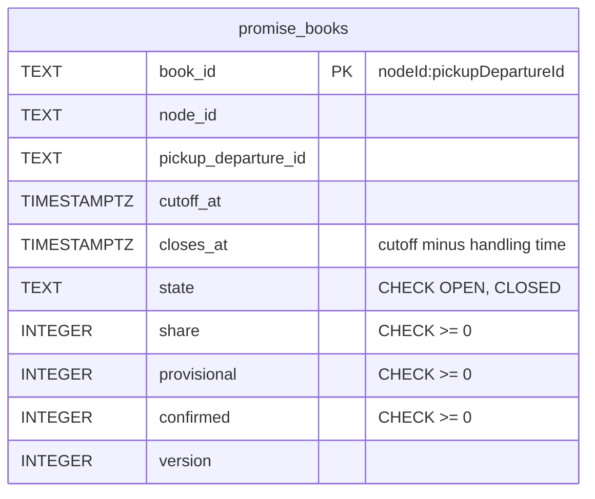
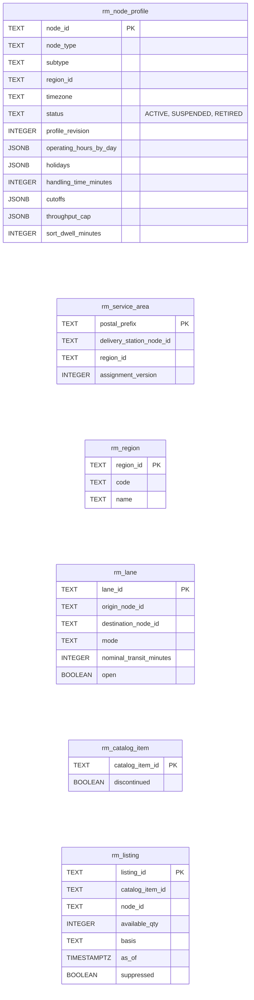
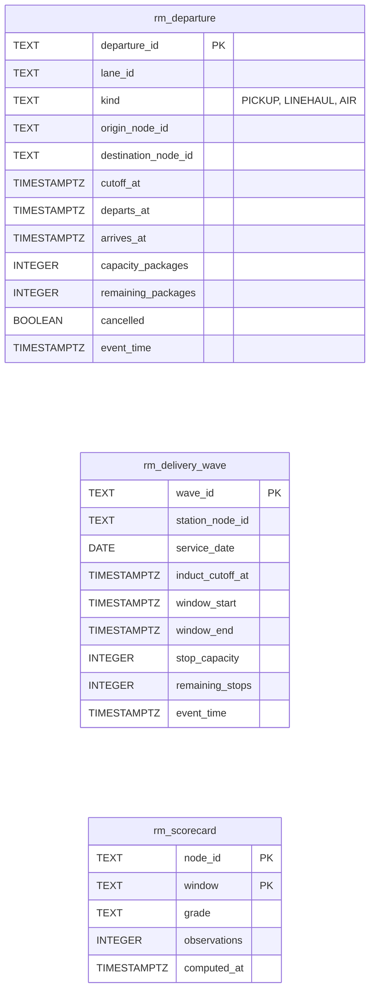
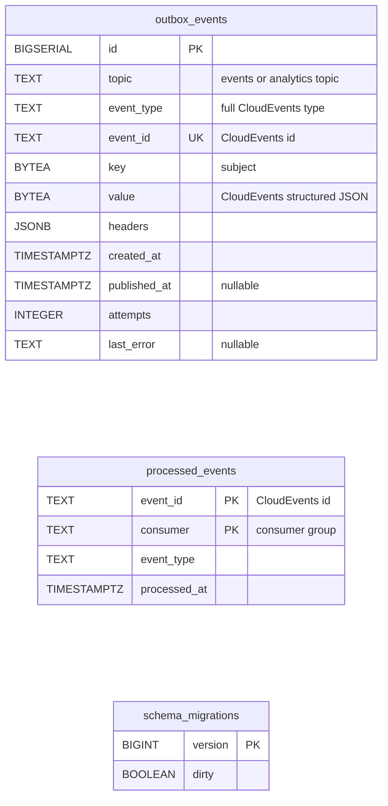

# Entity Relationship

:::info[Proposed design]
Derived from [`model/model.yaml`](https://github.com/IQVO/retail-network-docs/blob/main/model/model.yaml). Nothing in this context is built yet; identifiers (`Err...` names, routes, CloudEvents types) are the names an implementation must use.
:::

The **proposed** Postgres schema of the context's own database (every context
owns its database; no shared tables). Column names follow the model's field
names in `snake_case`; types, indexes and the extra infrastructure columns are
this pack's proposal. A relationship line is drawn **only** inside one
aggregate, where a real `FOREIGN KEY` would exist.

## 1. DeliveryOffer

Derived from: `model.yaml → contexts[delivery-promise].aggregates[DeliveryOffer]`
(`value_objects`, `states`, `invariants`, `size_estimate: TTL minutes; partitioned by day`).

Omitted: indexes (`expires_at WHERE state = 'QUOTED'` for `ExpireOffers`).
`delivery_offer_lines` is this pack's reading for a multi-line group (open
question 1). Day partitions are dropped after a short retention.

## 2. Promise

Derived from: `model.yaml → contexts[delivery-promise].aggregates[Promise]`
(`value_objects`: `ShipmentGroup`, `PromiseTerms`, `WitnessPath`, `Revision`;
`invariants`), `.publishes[PromiseMade, PromiseConfirmed, PromiseBroken].data`.

The promise is drawn in two diagrams (lines and legs, then revisions) to stay
within the page width; the second repeats only the key of `promises`. Every
child table has `promise_id` as `PK,FK`; `offer_id` and `idempotency_key` are
unique (`UK`), and `book_id` is a reference by value, without a foreign key.

Omitted: indexes on `(order_id, group_no)` for `GET /promises?orderId=` and the
consumers, on `hold_expires_at WHERE state = 'PROVISIONAL'` for
`ReleaseExpiredHolds`, and on `promise_witness_legs.departure_id` plus
`witness_pickup_departure_id` for `DepartureCancelled`. Proposed `CHECK`s:
`deliver_by_earliest <= deliver_by_latest`, `ship_by < deliver_by_earliest`
(`ErrInvalidPromiseTerms`), and `basis = 'SCHEDULED' OR tier = 'STANDARD'`
(`ErrNominalBasisNotAllowedForTier`). `assignment_id` is the correlation
`PackageDelivered` needs; the model names no such field (open question 3 on
[the canvas page](/contexts/delivery-promise/bounded-context-canvas)).

## 3. PromiseBook

Derived from: `model.yaml → contexts[delivery-promise].aggregates[PromiseBook]`.

Omitted: the index on `(node_id, cutoff_at)` for `GET /promise-books?nodeId=&date=`.
Proposed `CHECK provisional + confirmed <= share` backs
`ErrPromiseCapacityExhausted`, and the `>= 0` checks back
`ErrCapacityUnderflow`; the domain enforces both first. The book has no child
table on purpose: it counts holds, it does not list them.

## 4. Read models

Derived from: `model.yaml → contexts[delivery-promise].read_models` and the
consumed events' `data` in `contexts[node-topology]`, `[offer-availability]`,
`[linehaul-transportation]`, `[last-mile-delivery]`, `[node-performance]`
`.publishes`.

Omitted: indexes for the search (`rm_departure (origin_node_id, cutoff_at)`,
`rm_delivery_wave (station_node_id, induct_cutoff_at)`,
`rm_listing (catalog_item_id, node_id)`). Mapping to the model's read models:
`NodeProfileView` → `rm_node_profile`; `RegionAndServiceAreaView` →
`rm_service_area` + `rm_region`; `LaneView` → `rm_lane`; `AvailabilityView` →
`rm_catalog_item` + `rm_listing`; `DepartureView` → `rm_departure`;
`DeliveryWaveView` → `rm_delivery_wave`; `ScorecardView` → `rm_scorecard`.
`event_time` holds the CloudEvents `time` of the last applied change (the
"newer wins" guard).

## 5. Infrastructure

Derived from: `model.yaml → conventions.integration_rules` (transactional
outbox, inbox on the CloudEvents id).

**Infrastructure tables, not domain.** `outbox_events` is the transactional
outbox: one row per event, written in the aggregate's transaction and drained
by the relay to `retailnetwork.delivery-promise.events` (and the analytics
topic). `processed_events` is the inbox: one row per consumed CloudEvents `id`
per consumer, written in the same transaction as the projection or use case.
`schema_migrations` is the migration tool's bookkeeping.

## Why there is no foreign key across aggregates or contexts

- **Across aggregates.** `promises.book_id` → `promise_books.book_id` and
  `promises.offer_id` → `delivery_offers.offer_id` are references by id, not
  foreign keys. Each aggregate is its own consistency boundary; offers are
  dropped by partition while promises live on, and a book must be lockable
  without touching promises.
- **To other contexts.** `witness_node_id`, `*_departure_id`,
  `witness_delivery_wave_id`, `catalog_item_id`, `order_id`, `assignment_id`
  point at other contexts' data. Those live in other databases. A read-model
  row may arrive after the promise that names it, or be overwritten by its
  owner, so the link is by value only.
- **Read models** have no foreign keys at all: projectors apply events in the
  order each topic delivers them, which is not a global order.

## Table ≠ aggregate

| Table | What it is | Aggregate / role |
| --- | --- | --- |
| `delivery_offers` | root row | `DeliveryOffer` |
| `delivery_offer_lines`, `delivery_offer_legs` | collections inside the offer | `DeliveryOffer` (lines, `WitnessPath.legs`) |
| `promises` | root row | `Promise` |
| `promise_lines` | `ShipmentGroup.lines` | `Promise` |
| `promise_witness_legs` | `WitnessPath.legs` | `Promise` |
| `promise_revisions` | `Revision` entities | `Promise` |
| `promise_books` | root row | `PromiseBook` |
| `rm_node_profile`, `rm_service_area`, `rm_region`, `rm_lane`, `rm_catalog_item`, `rm_listing`, `rm_departure`, `rm_delivery_wave`, `rm_scorecard` | event-fed projections | none: the seven read models |
| `outbox_events`, `processed_events`, `schema_migrations` | infrastructure | none |
