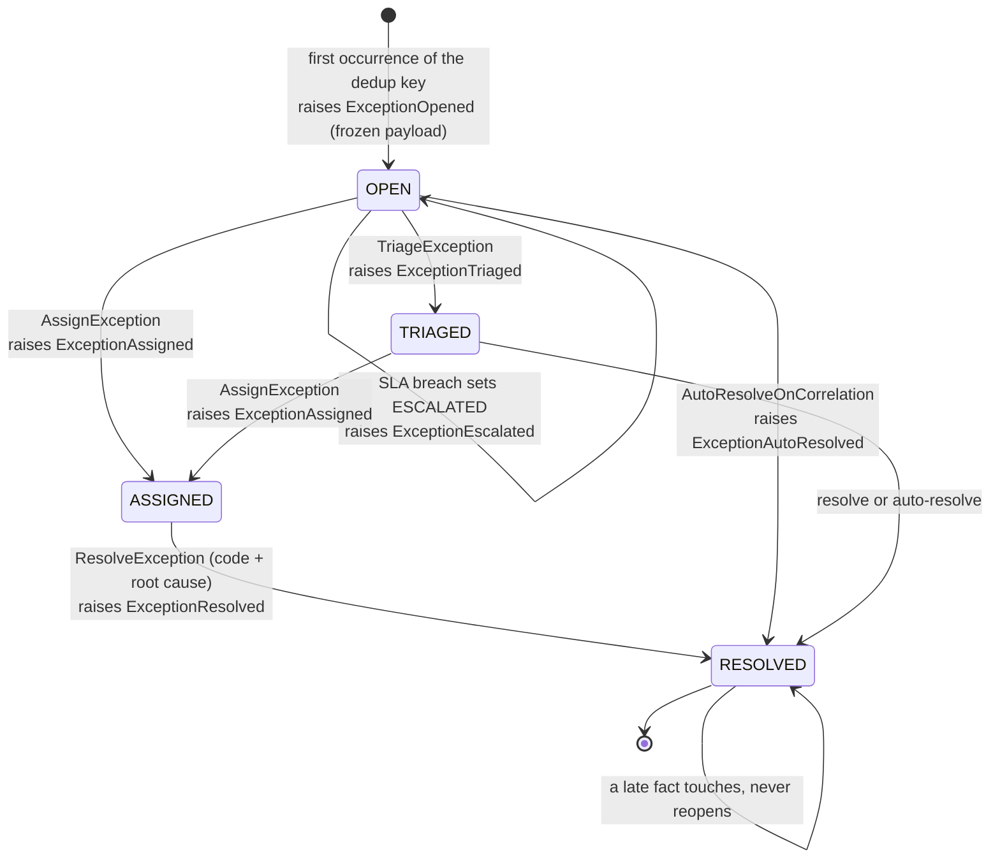

# Aggregate design canvas

ddd-crew [Aggregate Design Canvas](https://github.com/ddd-crew/aggregate-design-canvas),
for the two aggregates, from the context's `.claude/rules/domain-model.md`
and ADR 0002 on `develop` (written for this site; the repository does not
ship its own pack yet).

## ExceptionCase (`internal/domain/exceptioncase`, the richest aggregate and the mutation-gate package)

| Section | Content |
| --- | --- |
| Description | One owned anomaly with a lifecycle; exactly one open case per dedup key |
| State transitions | `OPEN -> TRIAGED -> ASSIGNED -> RESOLVED`; `ESCALATED` is a flag, not a state; `RESOLVED` is terminal |
| Commands | `OpenOrTouchException` (consumer-driven, idempotent on the CloudEvents `id`), `TriageException`, `AssignException`, `ResolveException` (operator, REST), `AutoResolveOnCorrelation` (consumer-driven), the SLA sweeper's escalation |
| Events | `ExceptionOpened`, `ExceptionTriaged`, `ExceptionAssigned`, `ExceptionEscalated`, `ExceptionResolved`, `ExceptionAutoResolved` |
| Invariants | one open case per (source type, source subject, site); every transition records its actor (operator id, policy id or `system`); the case holds a frozen copy of the source payload; `RESOLVED` requires a resolution code; a source fact after resolution touches (occurrence, `lastSeenAt`) and never reopens |
| Corrective policies | the SLA sweeper escalates on breach (flag + event, work continues); the policy's auto-resolve rule closes matching cases on a correlated fact |
| Throughput | moderate: one case per anomaly, touched on every re-fire of the fact |
| Size | small: the frozen payload is the largest part |
| Concurrency | the dedup-key claim and the effect commit in one transaction; the CloudEvents `id` claim makes a redelivery a no-op |
| Repository | Postgres, key the case id (`case-<uuid>`), subject and Kafka key of every event |

## ExceptionPolicy (`internal/domain/exceptionpolicy`)

| Section | Content |
| --- | --- |
| Description | Per source type: default severity, queue, SLA minutes, auto-resolve rule |
| State | versioned, append-only; the auto-resolve rule is data, not code |
| Commands | `DeclareExceptionPolicy` (REST `PUT /exception-policies/{sourceType}`) |
| Events | `ExceptionPolicyDeclared` (subject and key = the source type) |
| Invariants | a complete row per (source type, version); `auto_resolve` is null or `{on_type, within_minutes}`; `rule_id` is the derived deterministic form `<sourceType>-><onType>` |

Read models (projections, never aggregates): open cases by queue, the SLA
report, root-cause frequency.

Source: `internal/domain/exceptioncase`, `internal/domain/exceptionpolicy`,
ADR 0002, and `features/*.feature`.
