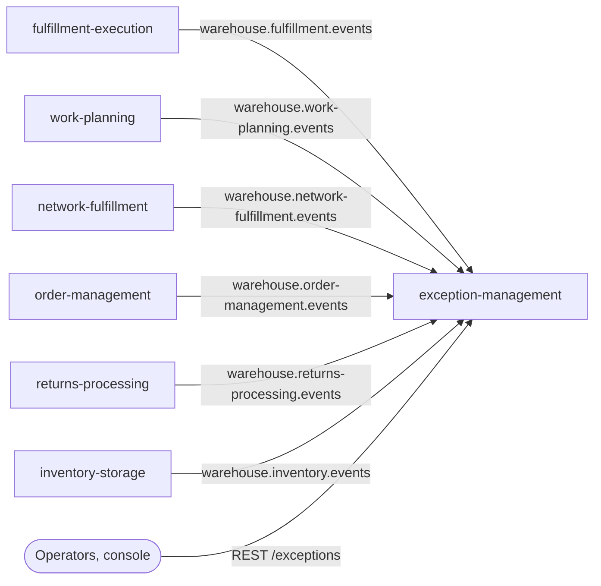
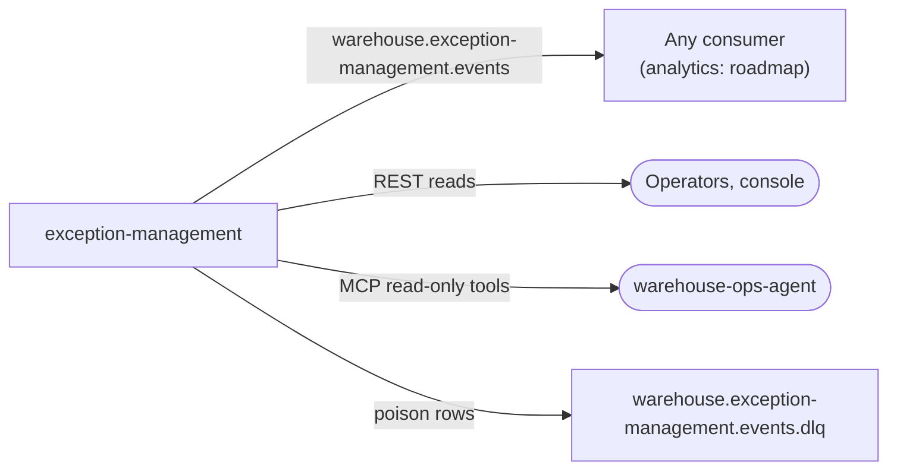

# Bounded context canvas

:::info[Synced from exception-management]
This page is a copy of [`docs/docs/ddd/bounded-context-canvas.md`](https://github.com/IQVO/exception-management/blob/develop/docs/docs/ddd/bounded-context-canvas.md) on `develop`, derived from that repository's code. Edit it there, then re-sync.
:::

Following the [ddd-crew Bounded Context Canvas](https://github.com/ddd-crew/bounded-context-canvas).
Every message row maps to a real REST route, MCP tool or Kafka topic and
CloudEvents `type` in the code on `develop`; the relationship vocabulary is
the [Context map](/contexts/exception-management/context-map). ADR 0001 carries the frozen
first version of this canvas; this page is the living copy.

## Canvas at a glance

### Inbound

### Outbound

## Name

`exception-management` — the owner of the **Problem Solve** lifecycle.

## Purpose

Give every detected anomaly a single owner with a lifecycle (open, triage,
assign, resolve, root cause), an SLA clock and dedup, so humans and the
ops-agent work cases instead of raw events.

## Strategic classification

- **Supporting subdomain** today; candidate **Core** once auto-resolution
  policies and agent recommendations run against it (operational accuracy
  at scale) — ADR 0001.
- **WES tier**, CloudEvents subdomain `wes`; type prefix
  `com.warehouse.wes.exception-management.`; source
  `/warehouse/exception-management`.

## Domain roles

- **System of record** for exception cases and handling policies.
- **Conformist** to every producer: frozen local copies of the source
  payload, never a live lookup (ADR 0003).
- **Open Host Service** for case facts: the integration topic plus REST
  reads and read-only MCP tools.

## Inbound communication

| Channel | Message / route | Relationship |
| --- | --- | --- |
| `warehouse.fulfillment.events` | `...task.TaskCPTMissed`, `...package.PackageDiverted`, `...package.WeightDiscrepancyDetected` — group env `FULFILLMENT_EXCEPTIONS_CONSUMER_GROUP` | Conformist, upstream → us |
| `warehouse.work-planning.events` | `...workpool.BacklogThresholdBreached` — `WORK_PLANNING_EXCEPTIONS_CONSUMER_GROUP` | Conformist |
| `warehouse.network-fulfillment.events` | `...networkorder.AcknowledgementDeadlineAtRisk`, `...networkorder.OrphanedHoldCancelled` — `NETWORK_FULFILLMENT_EXCEPTIONS_CONSUMER_GROUP` | Conformist |
| `warehouse.order-management.events` | `...order.OrderRepromised` — `ORDER_CORRELATION_CONSUMER_GROUP`; **correlation only, never a case source** | Conformist |
| `warehouse.returns-processing.events` | `...returnreceipt.UnexpectedReturnReceived` — `RETURNS_EXCEPTIONS_CONSUMER_GROUP` | Conformist |
| `warehouse.inbound-receiving.events` | `...receipt.CartonDiscrepancyRaised` — `CARTON_DISCREPANCY_CONSUMER_GROUP` | Conformist |
| `warehouse.inventory.events` | `...bin.DiscrepancyDetected`, `...stock.ItemUnlocated` — `INVENTORY_EXCEPTIONS_CONSUMER_GROUP` | Conformist |
| REST | `GET/POST /exceptions*` (list, triage, assign, resolve), `GET/PUT /exception-policies*` | Operator commands; deliberately no `POST /exceptions` |
| Roadmap | workforce-management `PathUnderstaffed`, network-inventory-planning `TransferStuckDetected` (analytics-topic sources, promotion pending) | planned / not built |

## Outbound communication

| Channel | Message | Notes |
| --- | --- | --- |
| `warehouse.exception-management.events` | `exceptioncase.ExceptionOpened`, `ExceptionTriaged`, `ExceptionAssigned`, `ExceptionEscalated`, `ExceptionResolved`, `ExceptionAutoResolved`, `exceptionpolicy.ExceptionPolicyDeclared` | CloudEvents 1.0, key = case id (source type for the policy event), through the transactional outbox |
| `warehouse.exception-management.events.dlq` | poison outbox rows, raw | ADR 0005 |
| REST reads | `GET /exceptions`, `GET /exceptions/{caseId}`, `GET /exception-policies` | |
| MCP (`cmd/mcp`, `:8090`) | `list_open_exceptions`, `get_exception`, `get_exception_policies`, `get_sla_report` | read-only for warehouse-ops-agent |
| Roadmap | `warehouse.exception-management.analytics` mirror + projector | declared in ADR 0004, not built |

## Ubiquitous language

Problem solve, case, source fact, dedup key, occurrence, queue, severity,
SLA clock, escalation, resolution code, root cause, auto-resolve rule,
correlated fact, work unit ref, policy version — each defined on
[Ubiquitous language](/contexts/exception-management/ubiquitous-language).

## Business decisions

- Exactly one open case per dedup key (source type, source subject, site):
  a repeated fact touches the open case (occurrence count, last seen)
  instead of opening another.
- Status machine `OPEN -> TRIAGED -> ASSIGNED -> RESOLVED`, one direction
  only; `ESCALATED` is a flag, not a state; `RESOLVED` needs a resolution
  code and is terminal; a fact after resolution touches, never reopens.
- Every transition records its actor (operator, policy id or `system`).
- The case holds a frozen copy of the source payload, never a reference to
  re-fetch.
- Auto-resolve is a declarative policy rule ("close when `<type>` arrives
  with the same subject within N minutes"), never agent-initiated; the
  ops-agent stays zero-write.
- No manual case creation: every case is a fact another context published.

## Assumptions

- `TaskCPTMissed.order_ref` and `PackageManifested.order_ref` carry WES's
  per-line work unit id `{order_id}-line-{line_no}` (order-management ADR
  0018); the CPT ↔ `OrderRepromised` correlation reverses that frozen
  formula, matches at ORDER level, and fails soft (case stays open) on no
  match.
- The SLA sweeper is a bounded ticker that reports facts and sets the flag;
  it never blocks work.
- Re-firing sources (`TaskCPTMissed` every sweep tick, the
  network-fulfillment sweeps while their condition holds) are by design:
  every repeat touches.

## Verification metrics

- Mutation gate over every domain package (`make mutation`, measured
  100/100, thresholds 95/95).
- Golden exact-JSON test per published type; `TestEventCatalogueMatchesContract`
  checks ADR 0004's catalogue against `apis/asyncapi.yaml`.
- godog scenarios: fact → open, repeated fact → touch,
  triage/assign/resolve, SLA breach → escalated, `OrderRepromised` →
  auto-resolved (`features/`).
- End-to-end on real Postgres + Kafka driven only through Kafka and REST
  (`cmd/api/e2e_integration_test.go`, `make integration`).

## Open questions

- When does the Supporting → Core flip happen? (ADR 0001's condition:
  auto-resolution policies and agent recommendations at scale.)
- The analytics mirror (ADR 0004) and its projector: build step, consumer
  set still zero — timing open.
- v2 candidates deliberately parked in ADR 0001: manual case creation,
  associate paging, labor-cost correlation.
