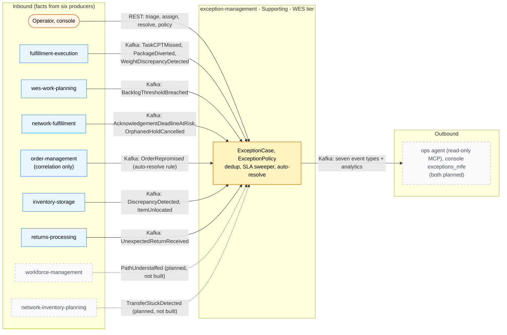

# Bounded context canvas

ddd-crew [Bounded Context Canvas](https://github.com/ddd-crew/bounded-context-canvas),
filled from the canvas in the context's own
[ADR 0001](https://github.com/IQVO/exception-management/blob/develop/docs/adr/0001-exception-management-bounded-context.md)
and its code on `develop` (the repository does not ship its own ddd-crew pack
yet; this page is written for this site from those sources).

## Canvas at a glance

Solid boxes are built on `develop`; the context is not deployed
(`warehouse-infra` has no entry for it), so every edge is
wired-but-unused. Dashed boxes are the two analytics-only producers whose
facts are not consumable yet.

## Name

exception-management

## Purpose

Give every detected anomaly a single owner with a lifecycle (open, triage,
assign, resolve, root cause), an SLA clock and dedup, so humans and the
ops-agent work cases instead of raw events.

## Strategic classification

**Supporting subdomain** today; candidate Core once auto-resolution policies
and agent recommendations run against it (operational accuracy at scale)
(ADR 0001).

## Tier / CloudEvents subdomain

**WES**, subdomain segment `wes` (it shapes operator flow; it holds no stock,
layout or master data). Type prefix
`com.warehouse.wes.exception-management.`, source
`/warehouse/exception-management`. Entity segments: `exceptioncase`,
`exceptionpolicy`.

## Domain roles

System of record for cases and policies. Conformist to every producer (frozen
local copies of the source payload). Open Host Service for case facts.

## Inbound communication

Six sibling topics on `develop`: fulfillment-execution (`TaskCPTMissed`,
`PackageDiverted`, `WeightDiscrepancyDetected`), wes-work-planning
(`BacklogThresholdBreached`), network-fulfillment
(`AcknowledgementDeadlineAtRisk`, `OrphanedHoldCancelled`),
order-management (`OrderRepromised`, correlation for auto-resolve only),
returns-processing (`UnexpectedReturnReceived`) and inventory-storage
(`DiscrepancyDetected`, `ItemUnlocated`). Planned, not built:
workforce-management `PathUnderstaffed` and network-inventory-planning
`TransferStuckDetected` (analytics-topic sources, promotion pending). REST
commands from operators and the console. No live REST/MCP call to a sibling,
ever.

## Outbound communication

`ExceptionOpened`, `ExceptionTriaged`, `ExceptionAssigned`,
`ExceptionEscalated`, `ExceptionResolved`, `ExceptionAutoResolved` and
`ExceptionPolicyDeclared` on `warehouse.exception-management.events` (ADR 0004
catalogue) plus their analytics copies; REST reads; read-only MCP tools for
warehouse-ops-agent (the client itself is planned).

## Ubiquitous language

Problem solve, case, source fact, dedup key, occurrence, queue, severity, SLA
clock, escalation, resolution code, root cause, auto-resolve rule. See
[Ubiquitous Language](/contexts/exception-management/ubiquitous-language).

## Business decisions

Exactly one open case per dedup key (source type, source subject, site): a
repeated fact touches the open case instead of opening another; status
machine `OPEN -> TRIAGED -> ASSIGNED -> RESOLVED`, `ESCALATED` is a flag;
`RESOLVED` needs a resolution code and is terminal; every transition records
its actor; the case holds a frozen copy of the source payload; auto-resolve
is a declarative policy rule, never agent-initiated. A source fact after
resolution touches the case and never reopens it.

## Assumptions

`TaskCPTMissed.order_ref` and `PackageManifested.order_ref` carry WES's
per-line work unit id `{order_id}-line-{line_no}` (order-management ADR 0018):
the CPT <-> `OrderRepromised` correlation reverses that frozen formula,
matches at ORDER level (line number ignored — `OrderRepromised` carries no
line), applies the inclusive window edge `now <= lastSeenAt +
within_minutes`, and fails soft (case stays open) on no match. The SLA
sweeper is a bounded ticker that reports facts and sets the flag; it never
blocks work.

## Verification

Mutation gate over every domain package; golden exact-JSON test per published
type; godog scenarios (fact -> open, repeated fact -> touch,
triage/assign/resolve, SLA breach -> escalated, `OrderRepromised` ->
auto-resolved); an end-to-end test on real Postgres + Kafka driven only
through Kafka and REST.

## Open questions

- Promotion of `PathUnderstaffed` and `TransferStuckDetected` off their
  producers' analytics topics (each producer's own PR; until then those edges
  stay dashed planned / not built, never faked).
- The `exceptions_mfe` console remote and the ops-agent's MCP client (named
  by ADR 0001, not built).
