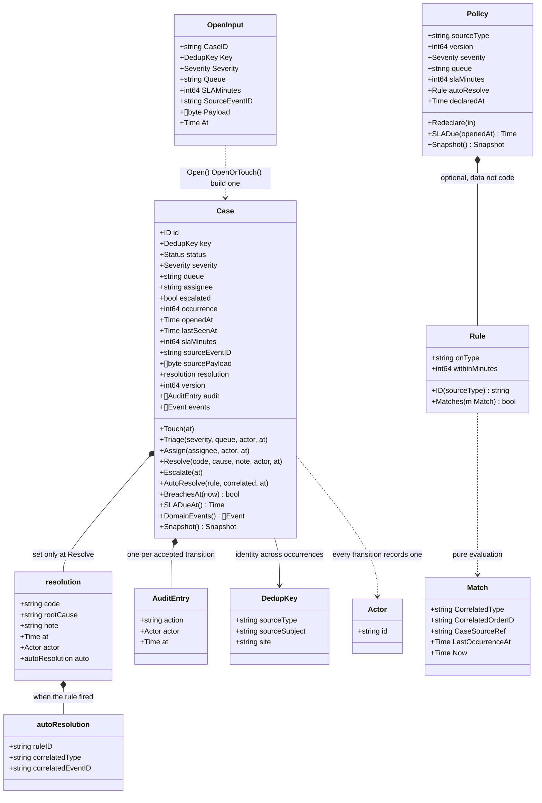

# Class diagram

:::info[Synced from exception-management]
This page is a copy of [`docs/docs/ddd/class-diagram.md`](https://github.com/IQVO/exception-management/blob/develop/docs/docs/ddd/class-diagram.md) on `develop`, derived from that repository's code. Edit it there, then re-sync.
:::

The domain model exactly as it exists in `internal/domain` (field and
method names taken from the code; pure Go, no I/O).

Facts worth knowing that the diagram cannot show:

- `Open` and `OpenOrTouch` are **package functions** of
  `exceptioncase` (they validate the input and build the aggregate);
  everything after open is a method on `*Case`.
- `Status` is a string type: `OPEN | TRIAGED | ASSIGNED | RESOLVED`;
  `ESCALATED` is the bool `escalated` flag, set once by `Escalate` (the
  sweeper), never a status value.
- `resolution` and `autoResolution` are unexported value types; the
  published evidence surfaces through the getters (`ResolutionCode`,
  `RootCause`, `Note`, `ResolvedAt`, `AutoResolution`) and the
  `exceptioncase.Snapshot`.
- `Rule.ID(sourceType)` derives the deterministic rule id
  `<sourceType>-><onType>` recorded on auto-resolved cases.
- `Match` carries everything the pure matcher needs — the correlated
  fact's type and order id, the case's frozen source `order_ref`, the last
  occurrence instant and `now` — so the domain reads no clocks.
- The domain events (`ExceptionOpened` … in each aggregate's `events.go`)
  are plain structs with `OccurredAt()`; they know nothing of CloudEvents
  or Kafka — the outbound adapter maps them (ADR 0004).
- Repositories persist and restore through the immutable `Snapshot`
  (`exceptioncase/snapshot.go`; `Restore` validates, so a corrupt row can
  never become a live aggregate); the views DTO
  (`internal/application/views`) is what inbound adapters see.
- `shared.ID` (case ids, `case-<uuid>` from `system.CaseIDs` at open),
  `shared.DedupKey`, `shared.Actor` and `shared.ParseWorkUnitRef` (the
  `{order_id}-line-{line_no}` reversal) are the shared value objects.
