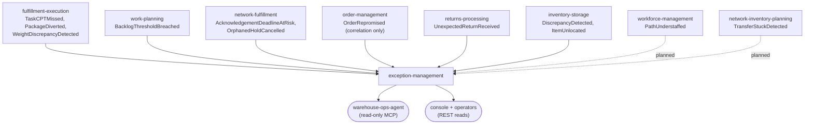

# Context map

:::info[Synced from exception-management]
This page is a copy of [`docs/docs/ddd/context-map.md`](https://github.com/IQVO/exception-management/blob/develop/docs/docs/ddd/context-map.md) on `develop`, derived from that repository's code. Edit it there, then re-sync.
:::

## Upstream edges (all Conformist, us downstream)

The pattern is uniform on purpose: exception-management replicates no
producer state, keeps only per-case frozen payloads, and restates each
producer's payload in its own `apis/asyncapi.yaml` (ADR 0003). There is no
live REST or MCP call to a sibling at request time, ever.

| Producer | Topic | Types consumed | Consumer group env | Status |
| --- | --- | --- | --- | --- |
| fulfillment-execution | `warehouse.fulfillment.events` | `task.TaskCPTMissed`, `package.PackageDiverted`, `package.WeightDiscrepancyDetected` | `FULFILLMENT_EXCEPTIONS_CONSUMER_GROUP` | Live: `TaskCPTMissed` verified on the producer's contract; the two package types were promoted to the integration topic by the producer's PR #234 (merged 2026-10-21) |
| work-planning | `warehouse.work-planning.events` | `workpool.BacklogThresholdBreached` | `WORK_PLANNING_EXCEPTIONS_CONSUMER_GROUP` | Live (verified) |
| network-fulfillment | `warehouse.network-fulfillment.events` | `networkorder.AcknowledgementDeadlineAtRisk`, `networkorder.OrphanedHoldCancelled` | `NETWORK_FULFILLMENT_EXCEPTIONS_CONSUMER_GROUP` | Live (verified) |
| order-management | `warehouse.order-management.events` | `order.OrderRepromised` — correlation only, never a case source | `ORDER_CORRELATION_CONSUMER_GROUP` | Live (verified) |
| returns-processing | `warehouse.returns-processing.events` | `returnreceipt.UnexpectedReturnReceived` | `RETURNS_EXCEPTIONS_CONSUMER_GROUP` | Live: the producer shipped (its develop publishes the type) |
| inbound-receiving | `warehouse.inbound-receiving.events` | `receipt.CartonDiscrepancyRaised` | `CARTON_DISCREPANCY_CONSUMER_GROUP` | Live: routed by kind (ADR 0006) |
| inventory-storage | `warehouse.inventory.events` | `bin.DiscrepancyDetected`, `stock.ItemUnlocated` | `INVENTORY_EXCEPTIONS_CONSUMER_GROUP` | Live: promoted by the producer's PR #239 (merged 2026-10-21) |

ADR 0003/0004 still describe the inventory and package types as "pending
the producer's promotion PR"; those promotions have since merged — the ADR
bodies are immutable, this table is the current truth.

## Downstream edges (us upstream)

| Consumer | Channel | Relationship | Status |
| --- | --- | --- | --- |
| warehouse-ops-agent | read-only MCP (`cmd/mcp`, `:8090`) | Open Host Service | Built |
| Console / operators | REST reads (`GET /exceptions*`, `GET /exception-policies`) | Open Host Service | Built |
| Any fleet consumer | `warehouse.exception-management.events` | Published Language (CloudEvents catalogue, ADR 0004) | Built; no known external consumer yet |
| This service's own projector | `warehouse.exception-management.analytics` | Internal | Roadmap (declared in ADR 0004, not built) |

## Planned, not built

- workforce-management `PathUnderstaffed` and network-inventory-planning
  `TransferStuckDetected`: analytics-topic-only today; a promotion PR on
  the producer side is the precondition (dashed edges above).
- Manual case creation, associate paging, labor-cost correlation: excluded
  from v1 by ADR 0001.

## Team relationships

One team owns the whole context (single repo, single deployable pair
`cmd/api` + `cmd/mcp`). Upstream contracts are verified per producer
against the producer's own `apis/asyncapi.yaml`; changes arrive as fleet
PRs, not negotiation.
