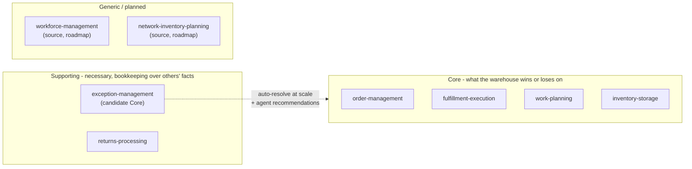

# Core domain chart

:::info[Synced from exception-management]
This page is a copy of [`docs/docs/ddd/core-domain-chart.md`](https://github.com/IQVO/exception-management/blob/develop/docs/docs/ddd/core-domain-chart.md) on `develop`, derived from that repository's code. Edit it there, then re-sync.
:::

The ddd-crew Core Domain Chart, drawn for the contexts exception-management
touches. Colour says classification today; the arrow says the declared
path (ADR 0001).

## Why supporting today

- Every input is another context's fact; every output is bookkeeping about
  it (who owns it, how old it is, why it happened).
- Delete the case rows and nothing physical is lost — the facts keep
  arriving; the record rebuilds.
- The differentiator is the *resolution record* (root causes), and acting
  on it at scale is exactly what v1 does not do yet: auto-resolve is one
  declarative rule, the ops-agent reads but never recommends into effect.

## What flips it to core (ADR 0001's condition)

1. Auto-resolution policies running against the caseload at scale — more
   declarative rules than the one `OrderRepromised` rule shipped, with
   measured precision.
2. Agent recommendations the operation actually follows, powered by the
   read-only MCP surface (`cmd/mcp`, built) and the policy data the agent
   can read.

Until then: invest for supporting — simple, fixed, well-tested; do not
gold-plate.
