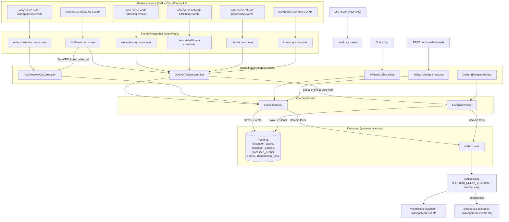

# Domain message flow

:::info[Synced from exception-management]
This page is a copy of [`docs/docs/ddd/domain-message-flow.md`](https://github.com/IQVO/exception-management/blob/develop/docs/docs/ddd/domain-message-flow.md) on `develop`, derived from that repository's code. Edit it there, then re-sync.
:::

One page, end to end: how an anomaly fact becomes a resolved case. Every
box below is a real package in this repo.

The flow in words:

1. **A fact lands** on one of the six consumed topics; the consumer under
   its pinned group id decodes the CloudEvents envelope
   (`internal/adapters/kafka/cloudevents`) and dispatches on the FULL type;
   unknown types are ignored; a non-CloudEvent message is WARN + skip.
2. **Id claim first.** The CloudEvents `id` is claimed in the SAME Postgres
   transaction as the effect; a replayed id is a no-op that still commits
   the Kafka offset (`FetchMessage` + `CommitMessages` — offset only after
   a durable effect).
3. **Open or touch** by the dedup key (source type, source subject, site),
   under the policy version current for the source type. Open freezes the
   payload, computes the SLA clock and writes `ExceptionOpened` to the
   outbox; touch bumps occurrence and `lastSeenAt` only.
4. **Correlation.** An `OrderRepromised` reverses the open case's source
   `order_ref` to an order id, compares (order level), checks the inclusive
   window against `lastSeenAt`, and auto-resolves on match.
5. **Operators** triage, assign and resolve over REST behind the
   `Idempotency-Key` middleware; the ops-agent only reads (REST + MCP).
6. **Everything leaves through the outbox**: the relay drains due rows,
   encodes to CloudEvents, deletes on publish, backs off exponentially,
   caps attempts (`OUTBOX_MAX_ATTEMPTS`) and dead-letters deterministic
   poison (ADR 0005).
