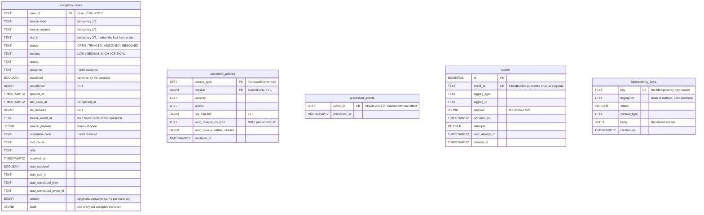

# Entity-relationship

:::info[Synced from exception-management]
This page is a copy of [`docs/docs/ddd/entity-relationship.md`](https://github.com/IQVO/exception-management/blob/develop/docs/docs/ddd/entity-relationship.md) on `develop`, derived from that repository's code. Edit it there, then re-sync.
:::

The whole OLTP schema is two migrations
(`migrations/0001_exception_management.up.sql`,
`migrations/0002_idempotency_keys.up.sql`), run embedded at boot by both
binaries. No read-model tables exist by design: the case freezes its own
evidence (ADR 0003).

(The `idempotency_keys` column list follows migration 0002 and the
middleware's store contract in `internal/adapters/inbound/http/idempotency.go`.)

## The constraints that matter

| Constraint | Enforces |
| --- | --- |
| `uq_exception_cases_one_open_per_key` — UNIQUE `(source_type, source_subject, site_id) WHERE status <> 'RESOLVED'` | The one-open-case-per-dedup-key invariant across cases; the loser of a race becomes `ErrOpenCaseExists`. A resolved case does not hold the key — but the domain never reopens: a later fact touches the resolved case. |
| `CHECK (last_seen_at >= opened_at)` | Occurrence semantics; `occurrence >= 1` likewise. |
| `PRIMARY KEY (source_type, version)` on `exception_policies` | Append-only versions; two writers racing the same next version collide into `ErrConcurrentModification`. |
| `CHECK` on `auto_resolve_*` — both NULL or both set | The rule is a pair, never half a rule. |
| `event_id UNIQUE` in `outbox` | A relay retry republishes the same CloudEvents id byte-identically; consumers dedupe on it. |
| `version` on `exception_cases` | Every UPDATE guards `WHERE version = excluded.version - 1` — optimistic concurrency, exactly one accepted transition per version. |

## Indexes

- `idx_exception_cases_key (source_type, source_subject, site_id, status)`
  — the dedup-key owner lookup (open case first, else the resolved owner).
- `idx_exception_cases_open (opened_at, case_id) WHERE status <> 'RESOLVED'`
  — the operator listing and the SLA sweep.
- `idx_outbox_attempts_next_attempt (attempts, next_attempt_at)` — the
  relay's claim scan (`FOR UPDATE SKIP LOCKED`, up to 100 due rows).
- `idx_idempotency_keys_created_at` — store cleanup.

Text keys compared or ordered in Go (case ids, dedup key parts, queues,
assignees) use the `C` collation so `ORDER BY` follows byte order, the
same order the in-memory adapter uses.
