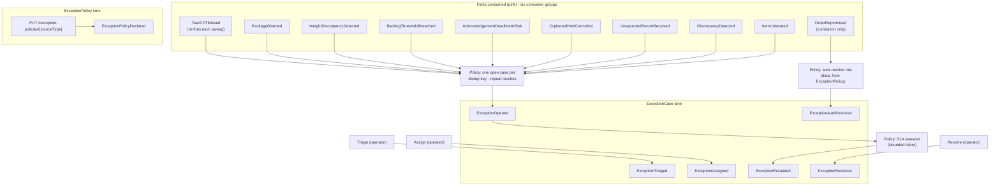

# EventStorming

:::info[Synced from exception-management]
This page is a copy of [`docs/docs/ddd/eventstorming.md`](https://github.com/IQVO/exception-management/blob/develop/docs/docs/ddd/eventstorming.md) on `develop`, derived from that repository's code. Edit it there, then re-sync.
:::

Big-picture view in the EventStorming colour convention: **domain events we
publish** (orange), **facts we consume** (pink), **commands** (blue),
**policies / automated rules** (purple), **read models** (green). Time
flows down; one lane per aggregate.

## The timeline in words

| Step | Event | Caused by |
| --- | --- | --- |
| 1 | `ExceptionOpened` | First occurrence of a dedup key: a consumed fact (policy: open-or-touch under the declared handling policy). |
| — | *(no event)* | A repeated fact TOUCHES (occurrence + 1, `lastSeenAt`): the audit trail is the record, nothing hits the wire. |
| 2 | `ExceptionPolicyDeclared` | `PUT /exception-policies/{sourceType}` appends a policy version. |
| 3 | `ExceptionTriaged` / `ExceptionAssigned` | Operator commands (severity/queue; owner), each with the operator as actor. |
| 4 | `ExceptionEscalated` | Policy: the SLA sweeper finds `now` past `slaDueAt` on an unflagged open case — once per case. |
| 5a | `ExceptionResolved` | Operator records resolution code + root cause (terminal). |
| 5b | `ExceptionAutoResolved` | Policy: the declarative rule fired on a correlated fact (`OrderRepromised` within the window of the same work unit's order). |

## Hotspots the model answers

- **Re-firing sources** (`TaskCPTMissed` every sweep tick): touch, never a
  second case — the dedup key plus occurrence counting.
- **The fact that arrives after resolution**: counts, never reopens —
  `RESOLVED` is terminal by invariant.
- **Who caused it**: every event carries its actor (operator id, policy id
  or `system`).
- **Poison on the way OUT**: no wire shape → raw to the DLQ (ADR 0005).

## Pivotal events not modelled (deliberately)

- *Case reopened* — rejected for v1 (ADR 0001/0002); a reopening need
  materialises as a new fact → new case.
- *Case created manually* — rejected for v1; every case is a fact.
- *Associate paged* — external channel, would need an ACL (ADR 0001).
