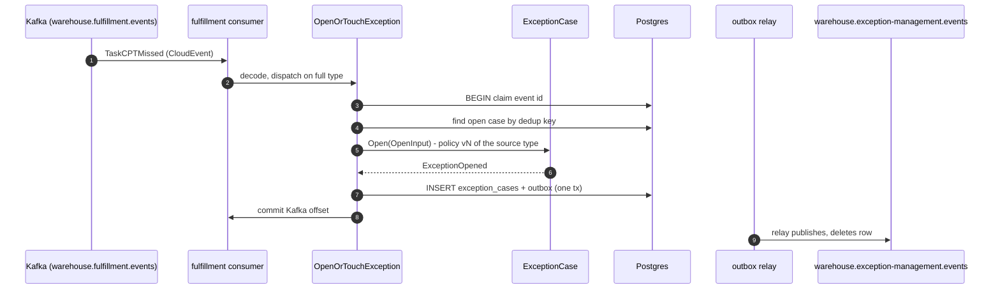
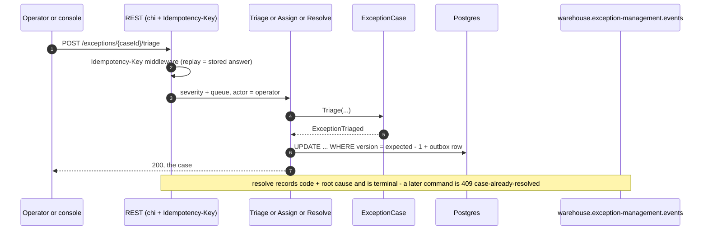
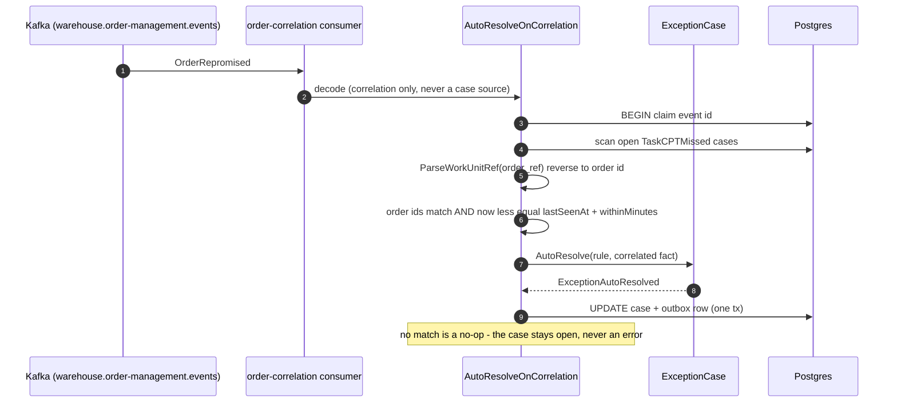
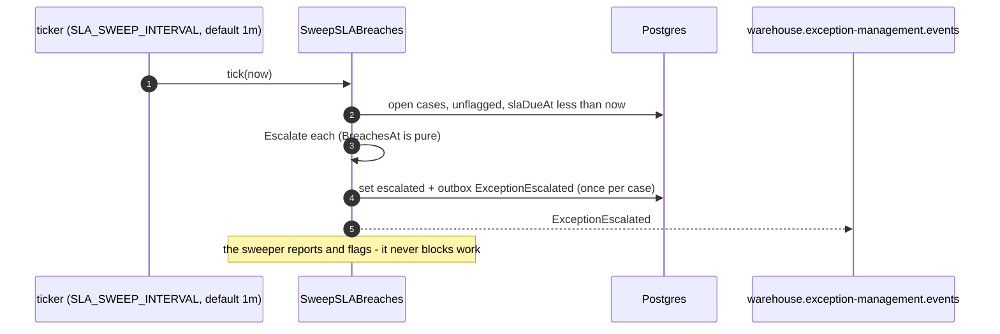
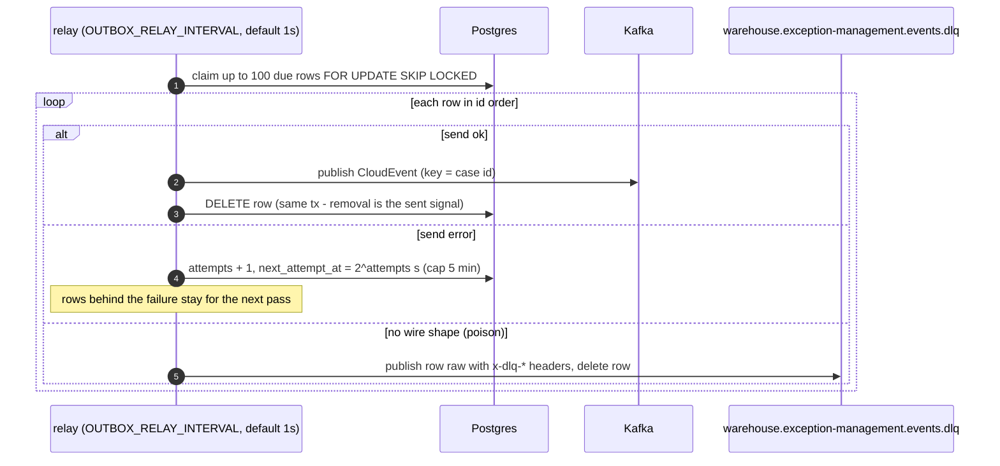

# Sequence diagrams

:::info[Synced from exception-management]
This page is a copy of [`docs/docs/ddd/sequence-diagrams.md`](https://github.com/IQVO/exception-management/blob/develop/docs/docs/ddd/sequence-diagrams.md) on `develop`, derived from that repository's code. Edit it there, then re-sync.
:::

## A fact opens a case (first occurrence)

A repeated fact (the sweeper re-fires `TaskCPTMissed` every tick) runs the
same path but returns **Touch**: occurrence + 1, `lastSeenAt`, one TOUCHED
audit entry, no event on the wire. A fact arriving after RESOLUTION also
touches — it never reopens.

## Operator lifecycle: triage, assign, resolve

## Auto-resolve: OrderRepromised closes the missed-CPT case

## The SLA sweep

## Everything leaves through the outbox relay

A row reaching `OUTBOX_MAX_ATTEMPTS` (default 20) is excluded from the
claim, logged once at ERROR and stays in the outbox for inspection;
re-arming is a runbook operation
([Runbook](/contexts/exception-management/runbook#outbox-relay)).
