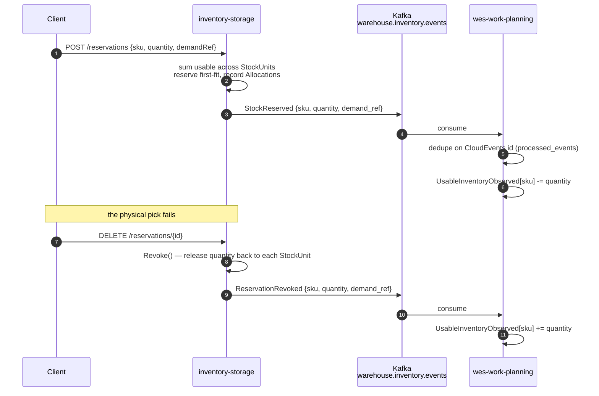
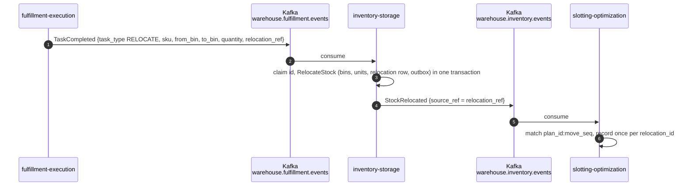

# Async API — Narrative

This page is the prose walkthrough of `inventory-storage`'s asynchronous
contract. The authoritative, machine-checked source is
`apis/asyncapi.yaml` (AsyncAPI 2.6.0), Spectral-linted in CI by the
`api-lint` job — everything below is drawn from it. For the full generated
reference (every message schema, in full), see
**[`/api-reference/async/inventory-storage`](/api-reference/async/inventory-storage)**.

## Topic

| | |
| --- | --- |
| **Topic** | `warehouse.inventory.events` |
| **Protocol** | Kafka |
| **Client library** | `github.com/segmentio/kafka-go` |
| **Balancer** | `Hash` on the Kafka key (the reservation id), `AllowAutoTopicCreation: true` — one reservation's events land on one partition, so they stay ordered per reservation (inventory-storage ADR-0021); there is no per-SKU ordering |
| **Broker** | `KAFKA_BROKERS`, default `localhost:9092` (shared broker at `~/warehouse-systems/docker-compose.kafka.yml`) |
| **Selected by** | `EVENT_PUBLISHER=kafka` (default is `log`, so tests and local runs never need a broker). With Postgres, events go through a transactional outbox (`outbox_events`, ADR-0017) drained by a relay in `cmd/inventory` |
| **Direction** | Publish on this topic. (Separately, this service consumes `ZoneRegistered`, `LocationSlotRegistered` and `LocationSlotDecommissioned` from `warehouse.facility.events` into its location-classification cache when `LOCATION_LOOKUP_MODE=kafka`, which the reference deployment sets — invalid messages go to `warehouse.facility.events.dlq`, ADR-0013 —, `product-master`'s `ProductClassified` from `warehouse.product-master.events` into its `product_classifications` copy under `PRODUCT_MASTER_CONSUMER_GROUP`, also set in the reference deployment, ADR-0034, `ReceiptLineReceived` from `warehouse.inbound-receiving.events` under `INBOUND_RECEIPT_CONSUMER_GROUP`, ADR-0037, and `fulfillment-execution`'s `TaskCompleted` from `warehouse.fulfillment.events` when `TASK_COMPLETED_CONSUMER_MODE=kafka`, which the reference deployment sets: `PICK` confirms reservations, ADR-0035 and ADR-0036, `RELOCATE` moves stock, ADR-0039, and `REPLENISH` moves stock with reason `REPLENISHMENT`, ADR-0041, see below. See [Domain Events](/contexts/inventory-storage/domain-events).) |
| **Consumers** | `wes-work-planning`, projecting `StockReserved` and `ReservationRevoked` into its own `UsableInventoryObserved` read model, keyed by SKU (per `wes-work-planning`, the projection feeds no decision yet); `slotting-optimization`, consuming `StockRelocated` into its plans' execution progress (`RELOCATION_MODE=kafka`, group `RELOCATION_CONSUMER_GROUP`, ADR-0039 and slotting ADR 0010; only reason `SLOTTING` executes a plan move); `pick-face-replenishment`, consuming `BinStockLevelChanged` (ADR-0040) and `StockRelocated` with reason `REPLENISHMENT` (ADR-0041) once it is deployed (built, not registered in `warehouse-infra`); `product-master`'s legacy importer, reading the legacy `ProductClassified` during the migration only; [`network-inventory-planning`](/contexts/network-inventory-planning), reading the transfer replies and destination facts (its `TRANSFER_REPLY_CONSUMER_GROUP`); it is also the producer of the `TransferAllocationRequested` command this service consumes |
| **Default content type** | `application/cloudevents+json` |

There is a second, separate topic, `warehouse.inventory.analytics`, carrying
nine of the eleven domain events for this service's own analytical read model
(the Inventory Flow & Accuracy report). That topic has exactly one
consumer — this service's own `cmd/inventory-projector` — and is not part of
the cross-context integration contract described on this page.

## What events are on the topic

The synced `apis/asyncapi.yaml` declares nine types on the integration
topic:

- `StockReserved` and `ReservationRevoked`, the reservation contract that
  `wes-work-planning` projects (described below);
- four transfer replies and destination facts (`TransferStockAllocated`,
  `TransferStockAllocationRejected`, `TransferReceiptStaged`,
  `TransferStockStowed`) for `network-inventory-planning` (ADR-0030,
  ADR-0033);
- `StockRelocated`
  (`com.warehouse.wms.inventory-storage.stock.StockRelocated`), raised by
  `RelocateStock` for `POST /relocations` and for a completed `RELOCATE` task
  (ADR-0039), consumed by `slotting-optimization`. Integration topic only: it
  has no analytics variant. Key and `subject` are the relocation id;
- `BinStockLevelChanged`
  (`com.warehouse.wms.inventory-storage.stock.BinStockLevelChanged`, ADR-0040),
  the absolute `on_hand` and `reserved` of one SKU in one bin after a ledger
  change, with a per-(bin, sku) `version` and a `reason` (`STOW`, `PICK`,
  `RELOCATE`, `REPLENISHMENT`, `COUNT`, `RESERVE`, `REVOKE`; `UNLOCATED` is
  reserved). Key `<bin>:<sku>`, raised in the same transaction as the change
  through the outbox, consumed by `pick-face-replenishment`;
- the legacy `com.warehouse.wms.inventory-storage.product.ProductClassified`.
  Since [ADR-0034](https://github.com/IQVO/inventory-storage/blob/develop/docs/docs/adr/0034-product-master-owns-classification.md)
  `product-master` owns classification, `PUT /products/{sku}/classification`
  answers `410` and no write path raises this event any more. Only the
  one-shot `republish-product-classifications` backfill emits it, for
  `product-master`'s legacy importer; it was run once on 2026-10-07. It is
  retired at `product-master`'s migration stage E.

See [Domain Events](/contexts/inventory-storage/domain-events) for the
complete catalog and which topic each event reaches, if any.

## The envelope: CloudEvents 1.0 (mandatory)

Every message is a CloudEvents 1.0 event in structured content mode, per
the fleet-wide, mandatory [Event Standard](/strategic-design/event-standard-cloudevents). Kafka header
`content-type: application/cloudevents+json; charset=UTF-8`; context
attributes carry routing and identity; the business payload lives entirely
under `data`:

```json
{
  "specversion": "1.0",
  "id": "1f7a4c30-9b2d-4e85-a6c1-7d3f0b5e8a94",
  "source": "/warehouse/inventory-storage",
  "type": "com.warehouse.wms.inventory-storage.reservation.StockReserved",
  "subject": "res-1",
  "time": "2026-08-21T22:00:00Z",
  "datacontenttype": "application/json",
  "dataschema": "urn:warehouse:inventory-storage:events:StockReserved:v1",
  "data": { "sku": "SKU-1", "quantity": 5, "demand_ref": "order-42" }
}
```

| Attribute | Required | Value |
| --- | --- | --- |
| `specversion` | ✅ | Always `"1.0"` |
| `id` | ✅ | UUID v4 minted once per domain event and persisted with the outbox row (stable across redelivery). `(source, id)` is the deduplication key. |
| `source` | ✅ | Always `/warehouse/inventory-storage` |
| `type` | ✅ | Reverse-DNS event type, pinned per message |
| `subject` | ✅ | The aggregate instance the event is about — a reservation id, a stock unit id, or a bin id |
| `time` | ✅ | RFC 3339 UTC, taken from the injected `Clock` port — the time it occurred *in the domain*, not at publish |
| `datacontenttype` | ✅ | Always `application/json` |
| `dataschema` | ✅ | `urn:warehouse:inventory-storage:events:<EventName>:v1` (integration topic) or `urn:warehouse:inventory-storage:analytics:<EventName>:v1` (analytics topic) |

There is no flat envelope and no envelope toggle; consumers reject (skip,
never parse) any message that is not a valid CloudEvent.

## The `type` convention

The platform-wide convention:

```text
com.warehouse.<subdomain>.<bounded-context>.<entity>.<EventName>
```

All lowercase except the final PascalCase event name. For this context,
`<subdomain>` is `wms` (Warehouse Management System, a Core subdomain);
`<bounded-context>` is `inventory-storage`; `<entity>` is the aggregate that
raises the event — `stock`, `reservation`, or `bin`. Each concrete message
pins `type` to a single enum value, so consumers can discriminate safely and
a typo fails validation instead of producing a silently-unrouted message.

## ReservationRevoked's enrichment, on the wire

The domain event `ReservationRevoked` carries only a `reservationId` — the
aggregate has no reason to repeat data the reservation already holds. But the
integration contract promises `{sku, quantity, demand_ref}`, because the
downstream projection is keyed by SKU and cannot afford a lookup. The Kafka
adapter bridges that gap by re-reading the reservation through
`ReservationRepo` at publish time, so the shape on the wire is identical to
`StockReserved`'s:

```json
{
  "specversion": "1.0",
  "id": "4b9e2f61-7c3a-4d08-85e2-1a6f9c0d3b72",
  "source": "/warehouse/inventory-storage",
  "type": "com.warehouse.wms.inventory-storage.reservation.ReservationRevoked",
  "subject": "res-1",
  "time": "2026-08-21T22:10:00Z",
  "datacontenttype": "application/json",
  "dataschema": "urn:warehouse:inventory-storage:events:ReservationRevoked:v1",
  "data": { "sku": "SKU-1", "quantity": 5, "demand_ref": "order-42" }
}
```

The use case saves the reservation before publishing, so this lookup always
succeeds in practice; the `ErrReservationNotFound` guard exists but is not an
expected path.

## Who consumes it

**`wes-work-planning`** is the consumer of the two reservation events. It projects both events
into `UsableInventoryObserved`, a read model keyed by SKU: `StockReserved`
decrements the observed usable count, `ReservationRevoked` increments it
back. Because the two events are exact inverses, the downstream projection
stays trivially simple — one decrement, one increment.



## Relocation: `TaskCompleted` in, `StockRelocated` out

This is the stock-ledger end of the slot-plan chain (inventory-storage
ADR-0039, slotting-optimization ADR 0010): `SlotPlanApproved` →
`wes-work-planning` plans one `RELOCATE` work unit per move →
`fulfillment-execution` runs the task → this service moves the stock →
`slotting-optimization` records the progress.

**In: `TaskCompleted` on `warehouse.fulfillment.events`.** The same consumer
that confirms picks (fixed group `TASK_COMPLETED_CONSUMER_GROUP`, default
`inventory-storage-confirm-pick`, running only with
`TASK_COMPLETED_CONSUMER_MODE=kafka`; the chart default is `off` and the
reference deployment sets `kafka`) has a second branch. When `task_type` is
`RELOCATE`, the additive fields `sku`, `from_bin`, `to_bin`, `quantity` (the
operator-confirmed count) and `relocation_ref` (`<plan_id>:<move_seq>`) are
applied through `RelocateStock`, the use case behind `POST /relocations`, with
reason `SLOTTING`, the site taken from the source bin, and `source_ref` =
`relocation_ref` (the task id when the producer sent none). The CloudEvents
`id` is claimed in `processed_events` (consumer `task-completed-relocate`) in
the same transaction as the move, so a redelivery is a no-op. A completion
that can never apply (missing or invalid field, unknown bin, bins of different
sites, the same bin, too little usable stock, a full destination) is
dead-lettered at once to `warehouse.fulfillment.events.dlq`; a transient
failure retries 5 times and then dead-letters; a shutdown mid-move commits and
dead-letters nothing.

**Out: `StockRelocated`.** One event per relocation, from either door, on
`warehouse.inventory.events` through the outbox: `relocation_id`, `site_code`,
`sku`, `from_bin`, `to_bin`, `quantity` (at least 1), `reason`
(`SLOTTING`, `CONSOLIDATION`, `MANUAL` or, for a completed `REPLENISH` task, `REPLENISHMENT`), `source_ref` (`""` when none) and
`occurred_at`. Because it is raised for every relocation, most
`StockRelocated` events (manual, consolidation) belong to no slot plan, and
`slotting-optimization` counts those as unmatched without storing them.



## Replenishment: `REPLENISH` completions in, `REPLENISHMENT` relocations out

The ledger end of the pick-face replenishment chain (inventory-storage
ADR-0041, `pick-face-replenishment` → `wes-work-planning` → `fulfillment-execution`
→ this service → `pick-face-replenishment`). The `TaskCompleted` consumer that
confirms picks and applies `RELOCATE` moves has a third branch: a
`task_type = REPLENISH` completion carries the same additive `sku`, `from_bin`,
`to_bin` and `quantity` plus the REQUIRED `request_ref`
(`internal/application/usecases/apply_replenish_task.go`, wired in
`cmd/inventory/confirmpick.go`). It runs the same `RelocateStock` with reason
`REPLENISHMENT`, the site taken from the source bin and `source_ref` =
`request_ref`, with no task-id fallback, because `pick-face-replenishment` closes a
request by `source_ref == request_id`. The CloudEvents `id` is claimed in
`processed_events` (consumer `task-completed-replenish`) in the same transaction;
a completion without `request_ref` is dead-lettered at once to
`warehouse.fulfillment.events.dlq`. The move enqueues `StockRelocated` (reason
`REPLENISHMENT`) and two `BinStockLevelChanged` events, the source bin and then
the destination bin, like a `RELOCATE`. `slotting-optimization` ignores a
`REPLENISHMENT` relocation. No `REPLENISH` task exists in the reference
deployment, because the planner's consumer in `wes-work-planning` is off and
`pick-face-replenishment` is not deployed (fleet edges K43 and K44,
wired-but-unused).

## Idempotency and consumer-group notes

- **At-least-once delivery is every consumer's problem.** `wes-work-planning`
  deduplicates with a `processed_events` table keyed by the CloudEvents
  `id`, so a redelivery does not
  double-decrement or double-increment its usable count.
- **Ordering is per reservation, not per SKU.** The `Hash` balancer keys on
  the reservation id, so different reservations for the same SKU can land on
  different partitions. Acceptable for an increment/decrement projection,
  which tolerates reordering of independent events — but it is why the REST
  read remains authoritative.
- **Tolerate unknown `type` values.** The catalog grows as more
  of it is wired to the outbound adapter; a consumer that fails closed on an
  unrecognised type will break the first time that happens.
- **The authoritative answer is always the REST read.** The event stream is
  a convenience projection for keeping a cheap local view warm, not a
  substitute for `GET /inventory/{sku}/usable` when correctness matters.
- **A broker outage does not fail the request.** With Postgres and
  `EVENT_PUBLISHER=kafka`, the use case inserts the encoded events into
  `outbox_events` in the same transaction as the aggregate write (ADR-0017),
  and the relay delivers them at-least-once later. The CloudEvents `id` is
  persisted with the outbox row, so a redelivery carries the same `id`.
  Only the in-memory, no-database mode publishes straight to Kafka.

## Building another consumer

1. Read `apis/asyncapi.yaml`, not this page — it is the linted contract.
2. Each message in the document says which topics it reaches in its own
   description. Do not build on the legacy `ProductClassified`: it is
   backfill-only and retiring. Read product classification from
   `product-master`'s `warehouse.product-master.events` instead.
3. Deduplicate on the event id; do not assume ordering.
4. Treat the event stream as a projection — call `GET
   /inventory/{sku}/usable` for the authoritative answer.

## Full reference

The complete, generated AsyncAPI HTML — every message schema, in full, built
directly from `apis/asyncapi.yaml` — is at
**[`/api-reference/async/inventory-storage`](/api-reference/async/inventory-storage)**.
