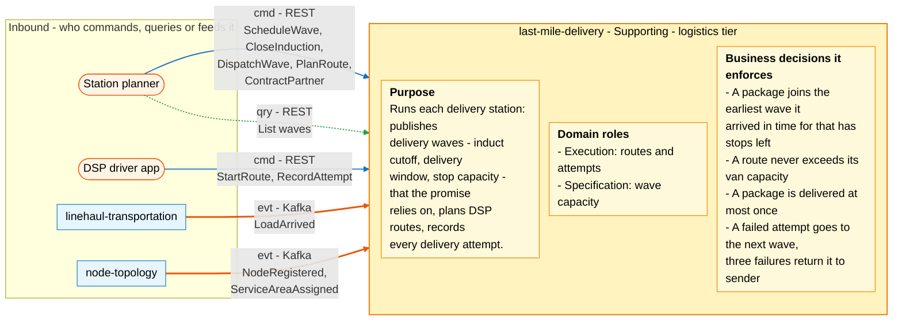
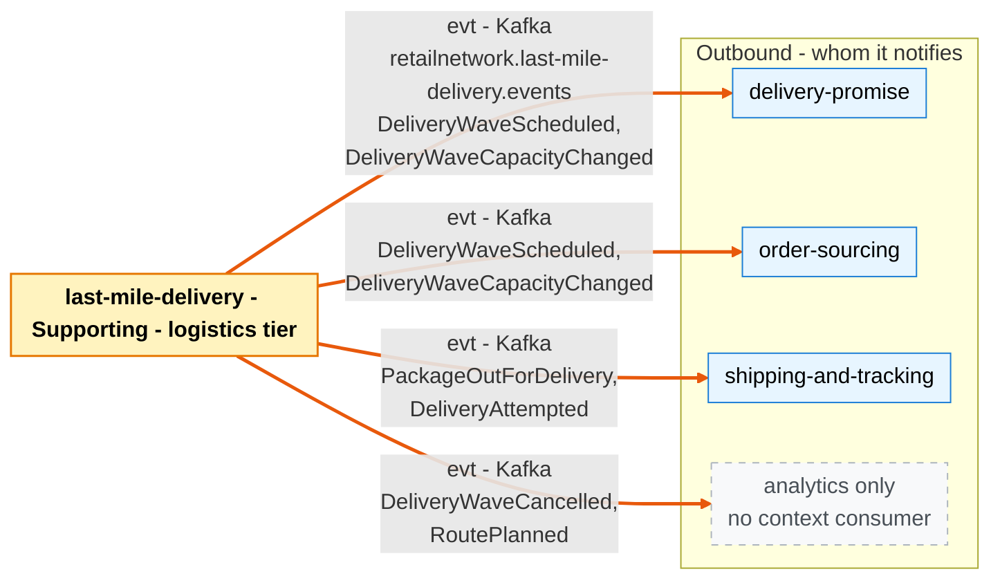

# Bounded Context Canvas

:::info[Proposed design]
Derived from [`model/model.yaml`](https://github.com/IQVO/retail-network-docs/blob/main/model/model.yaml). Nothing in this context is built yet; identifiers (`Err...` names, routes, CloudEvents types) are the names an implementation must use.
:::

Following the ddd-crew [Bounded Context Canvas v5](https://github.com/ddd-crew/bounded-context-canvas).
Every message row maps to a `rest` route, an `inbound` row, a `publishes` or a
`consumes` entry of `contexts[last-mile-delivery]` in the model.

## Canvas at a glance

Two pictures of the sections below, laid out like the ddd-crew canvas:
first the inbound collaborators feeding this context (purpose, domain roles
and the business decisions it enforces), then the outbound collaborators it
notifies. Arrows follow the message type: **solid blue** commands (`cmd`),
**dotted green** queries (`qry`), **thick orange** events (`evt`); each arrow
names its channel and the messages it carries. Box shapes mark the
collaborator kind: rounded = people or apps; blue = sibling bounded context;
dashed = published with no context consumer (analytics only). Channel names on
the arrows are abbreviated (REST, Kafka); the Inbound and Outbound
Communication tables carry the exact route, topic and CloudEvents type for
every message.

### Inbound

Derived from: model.yaml → `contexts[last-mile-delivery].inbound`, `.rest`,
`.consumes`, `.purpose`, `.roles`, `.business_decisions`.

### Outbound

Derived from: model.yaml → `contexts[last-mile-delivery].publishes`
(`consumers`), `.sync_calls` (empty).

Both diagrams omit assumptions, verification metrics, open questions and the
ubiquitous language (sections below), and the relationship pattern per
message (see the tables). The outbound picture has no command or query
arrow because the model gives this context no `sync_calls`.

## Name

**Last-Mile Delivery** (`last-mile-delivery`, code `LM`, CloudEvents tier
`logistics`).

## Purpose

Runs each delivery station: publishes delivery waves (induct cutoff, delivery
window, stop capacity) that the promise relies on, plans routes for delivery
service partners, and records every delivery attempt.

In practice the context:

- keeps one `DeliveryWave` per dispatch slot of a station and service date,
  and publishes its capacity for `delivery-promise` and `order-sourcing`;
- inducts every package of a load that arrives at a station into the earliest
  eligible wave (`InductOnArrival`);
- plans one `Route` per DSP van in a wave, never above the van's stop
  capacity;
- records each attempt, re-inducts a failed package into the next wave
  (`RetryNextWave`), and tells `shipping-and-tracking` what happened.

It never sees an address ([ADR 0006](/adr/0006-pii-confinement)).

## Strategic Classification

| Axis | Verdict |
| --- | --- |
| **Domain** | Supporting See [Core Domain Chart](/contexts/last-mile-delivery/core-domain-chart). |
| **Business Model** | Cost reducer and experience creator (the doorstep). |
| **Evolution** | Custom-built. |

## Domain Roles

| Role | Applies? | Evidence in the model |
| --- | --- | --- |
| **Execution (routes and attempts)** | **Yes, primary** | `Route` with `PlanRoute`, `StartRoute`, `RecordAttempt`, `CompleteRoute`; `DeliveryWave` with `InductPackage`, `DispatchWave` |
| **Specification (wave capacity)** | **Yes** | `DeliveryWave` publishes `inductCutoffAt`, the window and `stopCapacity`; two Core contexts plan on it |
| Gateway / ACL | No | It talks to no external system. The DSP driver app calls its REST API |
| Analysis | No | No scorecard or optimisation is modelled |

## Inbound Communication

| Collaborator | Message | Type | Channel | Relationship |
| --- | --- | --- | --- | --- |
| Station planner (person) | `ScheduleWave` | Command | REST `POST /waves` | UI on Open Host |
| Station planner | `CloseInduction` | Command | REST `POST /waves/{waveId}:close-induction` | UI on Open Host |
| Station planner | `DispatchWave` | Command | REST `POST /waves/{waveId}:dispatch` | UI on Open Host |
| Station planner | `PlanRoute` | Command | REST `POST /routes` | UI on Open Host |
| Station planner | List waves | Query | REST `GET /waves?stationNodeId=&serviceDate=` | UI on Open Host |
| Station planner | `ContractPartner` | Command | REST `POST /partners` | UI on Open Host |
| DSP driver app (external organisation) | `StartRoute` | Command | REST `POST /routes/{routeId}:start` | UI on Open Host |
| DSP driver app | `RecordAttempt` | Command | REST `POST /routes/{routeId}/attempts` | UI on Open Host |
| `linehaul-transportation` | `LoadArrived` | Event | Kafka `retailnetwork.linehaul-transportation.events`, type `com.retailnetwork.logistics.linehaul-transportation.load.LoadArrived` | Customer/Supplier (we are the Customer) |
| `node-topology` | `NodeRegistered` | Event | Kafka `retailnetwork.node-topology.events`, type `com.retailnetwork.logistics.node-topology.node.NodeRegistered` | Conformist |
| `node-topology` | `ServiceAreaAssigned` | Event | Kafka `retailnetwork.node-topology.events`, type `com.retailnetwork.logistics.node-topology.servicearea.ServiceAreaAssigned` | Conformist |

The model's planner `inbound` row names `ScheduleWave`, `PlanRoute` and
`DispatchWave`. The `CloseInduction`, list-waves and `ContractPartner` rows
come from the context's `rest` list, which has no matching `inbound` row.
The caller shown for them is this page's reading and is listed as an open
question below.

## Outbound Communication

| Collaborator | Message | Type | Channel | Relationship |
| --- | --- | --- | --- | --- |
| `delivery-promise`, `order-sourcing` | `DeliveryWaveScheduled` | Event | Kafka `retailnetwork.last-mile-delivery.events`, type `com.retailnetwork.logistics.last-mile-delivery.wave.DeliveryWaveScheduled` | Open Host + Published Language (they are Conformist) |
| `delivery-promise`, `order-sourcing` | `DeliveryWaveCapacityChanged` | Event | Kafka `retailnetwork.last-mile-delivery.events`, type `com.retailnetwork.logistics.last-mile-delivery.wave.DeliveryWaveCapacityChanged` | Open Host + Published Language (they are Conformist) |
| analytics only | `DeliveryWaveCancelled` | Event | Kafka `retailnetwork.last-mile-delivery.events`, type `com.retailnetwork.logistics.last-mile-delivery.wave.DeliveryWaveCancelled` | Published Language, no context consumer |
| analytics only | `RoutePlanned` | Event | Kafka `retailnetwork.last-mile-delivery.events`, type `com.retailnetwork.logistics.last-mile-delivery.route.RoutePlanned` | Published Language, no context consumer |
| `shipping-and-tracking` | `PackageOutForDelivery` | Event | Kafka `retailnetwork.last-mile-delivery.events`, type `com.retailnetwork.logistics.last-mile-delivery.route.PackageOutForDelivery` | Open Host + Published Language (it is Conformist) |
| `shipping-and-tracking` | `DeliveryAttempted` | Event | Kafka `retailnetwork.last-mile-delivery.events`, type `com.retailnetwork.logistics.last-mile-delivery.route.DeliveryAttempted` | Open Host + Published Language (it is Conformist) |
| — | (no synchronous call) | — | `sync_calls: []` | — |

Full message details: [Domain Events](/contexts/last-mile-delivery/domain-events).
Relationship reasoning: [Context Map](/contexts/last-mile-delivery/context-map).

## Ubiquitous Language

Full glossary: [Ubiquitous Language](/contexts/last-mile-delivery/ubiquitous-language).
Top terms: **Last Mile**, **Delivery Wave** (induct cutoff, delivery window,
stop capacity), **Induction**, **Route**, **Delivery Service Partner (DSP)**,
**Delivery Attempt** (`DELIVERED` or `FAILED`).

## Business Decisions

1. **Earliest eligible wave.** A package joins the earliest wave whose induct
   cutoff it arrived before and that has stop capacity left
   (`InductOnArrival`; `ErrInductionClosed`, `ErrWaveFull`).
2. **Van capacity is a hard limit.** A route never exceeds its van's stop
   capacity (`ErrRouteOverCapacity`), and a partner's van capacity is greater
   than zero (`ErrInvalidVanCapacity`).
3. **Delivered once.** A package is delivered at most once
   (`ErrAlreadyDelivered`). An attempt is recorded only on a route that is out
   for delivery (`ErrRouteNotStarted`).
4. **Fail forward.** A `FAILED` attempt re-inducts the package into the next
   wave. Three failures return it to sender (`RetryNextWave`).
5. **Waves are well-formed.** `inductCutoffAt < windowStart < windowEnd`
   (`ErrInvalidWaveTimes`), and assigned stops never exceed stops
   (`ErrWaveFull`).
6. **Capacity is published, never asked for.** The promise and sourcing
   contexts read waves from events; there is no query on their hot path
   (model integration rule).

## Assumptions

- `LoadArrived` with a `destinationNodeId` that is a delivery station is the
  only signal that packages are at the station. There is no station-side
  arrival scan in the model.
- `NodeRegistered` (`nodeType = DELIVERY_STATION`) is enough to know which
  nodes are stations. The model feeds no node status events to this context.
- A partner has one van capacity, expressed in stops ("van capacity of the
  partner").
- The DSP driver app can reach the REST API while on the road. The model has
  no offline or batch attempt upload.
- Every consumer is idempotent on the CloudEvents `id`, and every published
  event leaves through a transactional outbox (model `integration_rules`).

## Verification Metrics

| Metric | Definition | Source |
| --- | --- | --- |
| Induction lag p95 | `DeliveryWaveCapacityChanged.time` − `LoadArrived.arrivedAt`, per package | outbox + inbox timestamps |
| Earliest-wave hit rate | share of inducted packages placed in the earliest wave whose `inductCutoffAt` they arrived before | `InboundPackagesView` vs induction |
| Uninducted packages | packages in `InboundPackagesView` with no wave after their arrival | `InboundPackagesView` |
| Wave fill | `assignedStops / stopCapacity` at `CloseInduction` | `DeliveryWave` |
| Route utilisation | `stopCount / van capacity` per `RoutePlanned` | `Route`, `DeliveryServicePartner` |
| First-attempt success | share of tracking numbers whose first `DeliveryAttempted` has `outcome = DELIVERED` | `DeliveryAttempted` |
| Return-to-sender rate | share of tracking numbers with three `FAILED` attempts | `DeliveryAttempted` |
| Rejected commands | count of `ErrWaveFull`, `ErrRouteOverCapacity`, `ErrAlreadyDelivered` per day | problem responses |
| Outbox lag p95 | outbox `published_at` − `created_at` | `outbox_events` |

## Open Questions

- **Who triggers `CompleteWave`, `CancelWave` and `CompleteRoute`?** They are
  commands of the aggregates, but the model gives them no REST route, no
  `inbound` row and no policy.
- **Who calls `POST /partners` and `GET /waves`?** The routes are in `rest`
  but no `inbound` row names a caller. `CloseInduction` has a route but is
  missing from the planner's `inbound` row.
- **How does a package map to stops?** Wave capacity and van capacity are
  counted in stops, but induction is per package, and `Stop` groups several
  tracking numbers. Grouping packages into stops needs a delivery address,
  which this context never receives ([ADR 0006](/adr/0006-pii-confinement)).
- **What happens when no wave is eligible?** If every wave is full or closed,
  `InductPackage` fails with `ErrWaveFull` or `ErrInductionClosed`. No
  event tells `delivery-promise` that the witness wave was missed. Today
  only `shipping-and-tracking`'s `ExceptionOnSilence` would surface it later.
- **Does `delivery-promise` learn that a wave was cancelled?**
  `DeliveryWaveCancelled` is analytics only, and `DeliveryWaveView` is fed by
  `DeliveryWaveScheduled` and `DeliveryWaveCapacityChanged` only. A promise
  whose witness wave is cancelled is not re-promised by `RepromiseOnRisk`.
- **Who records the third failure and the return to sender?**
  `RetryNextWave` needs a failure count per package across routes and waves.
  No aggregate holds that count, and no event carries "return to sender" to
  `shipping-and-tracking`, whose `ReturnToSender` has no trigger from this
  context.
- **What happens to packages in a cancelled wave?** `CancelWave` is allowed
  only from `OPEN`, when packages may already be inducted. The model does
  not say whether they are re-inducted.
- **Is a station still active?** `StationView` is fed by `NodeRegistered` and
  `ServiceAreaAssigned` only. `NodeSuspended` and `NodeRetired` do not
  reach this context, so a wave can be scheduled at a suspended station.
