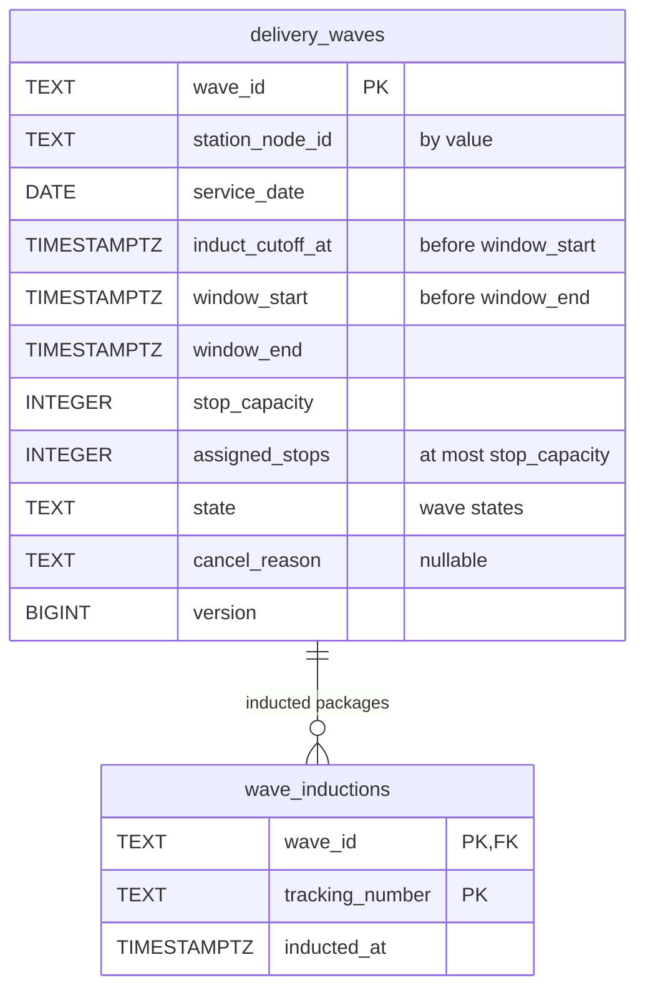
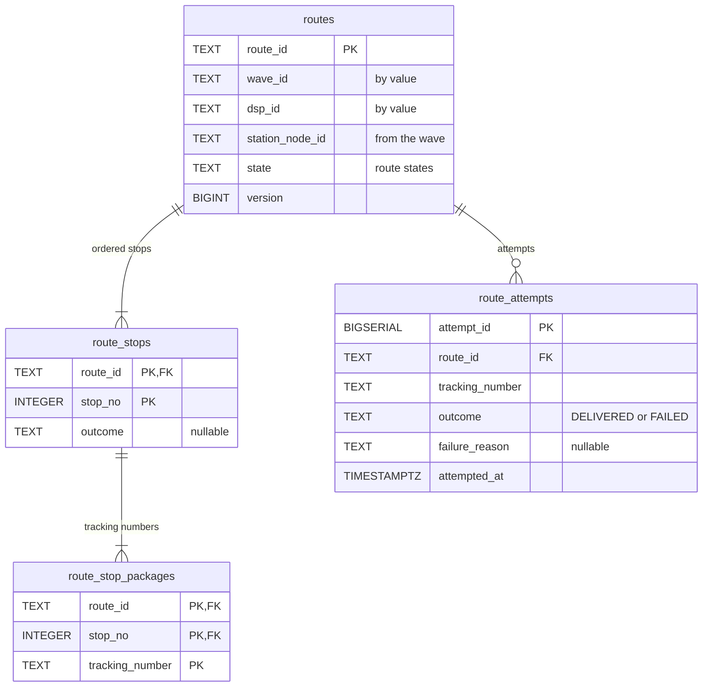
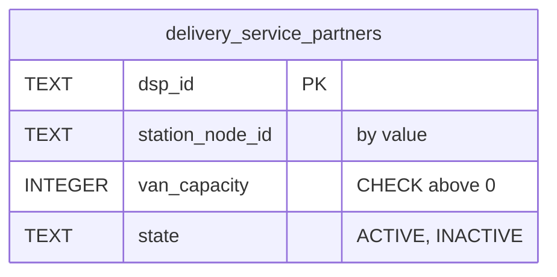
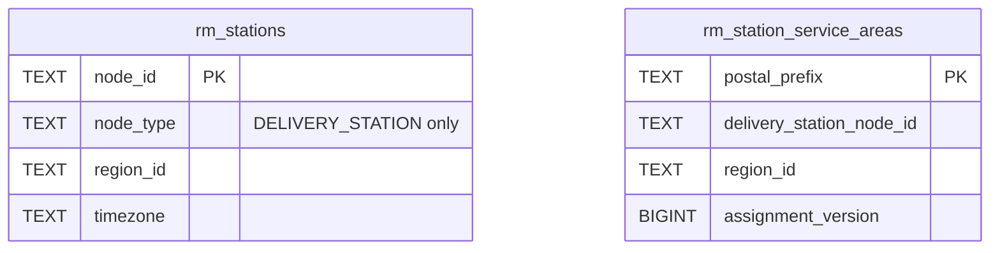
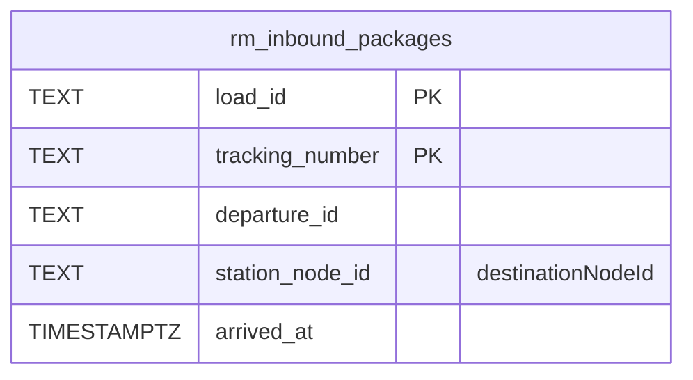
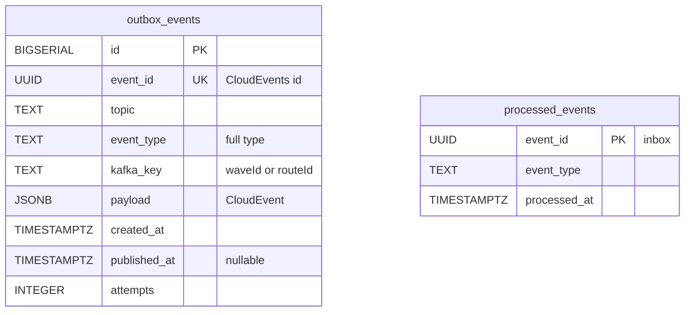
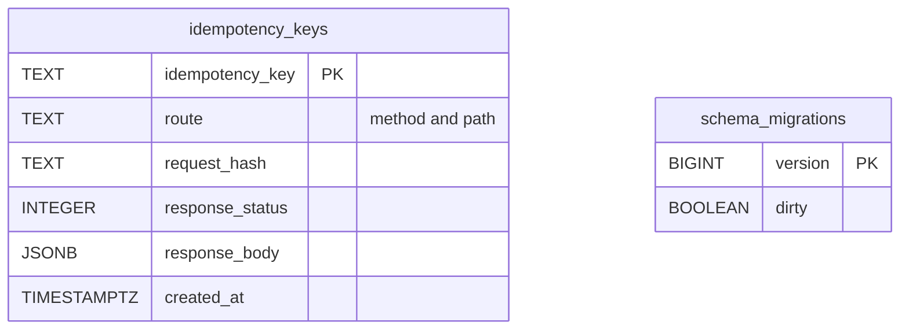

# Entity Relationship

:::info[Proposed design]
Derived from [`model/model.yaml`](https://github.com/IQVO/retail-network-docs/blob/main/model/model.yaml). Nothing in this context is built yet; identifiers (`Err...` names, routes, CloudEvents types) are the names an implementation must use.
:::

The **proposed** Postgres schema of this context's own database (model
`integration_rules`: every context owns its database; no shared tables).
There is one table per aggregate root, child tables for its entities and
collections, `rm_` tables for read models, and four infrastructure tables.
Relationship lines are drawn only inside one aggregate.

## Aggregate tables

DeliveryWave:

Derived from: model.yaml → `contexts[last-mile-delivery].aggregates[DeliveryWave]` (`root_id`, `states`, `value_objects`, `invariants`).

Route:

Derived from: model.yaml → `contexts[last-mile-delivery].aggregates[Route]` (`root_id`, `states`, `entities`, `invariants`), `.publishes[DeliveryAttempted].data`.

DeliveryServicePartner:

Derived from: model.yaml → `contexts[last-mile-delivery].aggregates[*]`
(`root_id`, `states`, `value_objects`, `entities`, `invariants`),
`.publishes[*].data`.

Column notes in full: `state` is CHECKed against the aggregate's states
(`OPEN`, `INDUCTION_CLOSED`, `DISPATCHED`, `COMPLETED`, `CANCELLED` for
waves; `PLANNED`, `OUT_FOR_DELIVERY`, `COMPLETED` for routes). CHECKs back
the invariants: `induct_cutoff_at < window_start < window_end`
(`ErrInvalidWaveTimes`), `assigned_stops <= stop_capacity` (`ErrWaveFull`),
`van_capacity > 0` (`ErrInvalidVanCapacity`). `route_stops.outcome` is
`DELIVERED` or `FAILED` once attempted. `version` is the optimistic
concurrency counter. "By value" marks an id of another aggregate or
context.

Omitted: indexes, for example `delivery_waves (station_node_id,
service_date)` for the list query, `delivery_waves (station_node_id,
induct_cutoff_at) WHERE state = 'OPEN'` for the earliest-wave search, and a
partial unique index on `route_attempts (tracking_number) WHERE outcome =
'DELIVERED'` backing `ErrAlreadyDelivered`.

`wave_inductions`, `route_stop_packages` and `route_attempts` are
collections this pack proposes so that induction is idempotent, stops hold
their tracking numbers (`Stop{stopNo, trackingNumbers[], outcome}`), and
attempts (`route.Attempt`) are kept per package. The model lists no such
fields. `dsp_id` and `van_capacity` on partners come from the aggregate's
root id and invariant; the model gives no field list.

## Read-model tables

Derived from: model.yaml → `contexts[last-mile-delivery].read_models[StationView]`; `contexts[node-topology].publishes[NodeRegistered, ServiceAreaAssigned].data`.

Derived from: model.yaml → `contexts[last-mile-delivery].read_models`
(`StationView`, `InboundPackagesView`); `contexts[node-topology].publishes`
(`NodeRegistered`, `ServiceAreaAssigned` data);
`contexts[linehaul-transportation].publishes[LoadArrived].data`.

Omitted: the other `NodeRegistered` fields (`subtype`, `operator`,
`vendorId`, `vendorNodeCode`, `postalCode`, `countryCode`), which are not
needed here. `StationView` is the pair `rm_stations` and
`rm_station_service_areas`; a `ServiceAreaAssigned` row is applied only if
its `assignment_version` is higher than the stored one.

## Infrastructure tables

Derived from: model.yaml → `conventions.integration_rules` (outbox, inbox).

Derived from: model.yaml → `conventions.integration_rules` (outbox, inbox)
and `conventions.cloudevents` (topic, key).

**Infrastructure, not domain:** `outbox_events` is the transactional outbox,
written in the same transaction as the aggregate and drained by a relay.
`processed_events` is the inbox: a consumer claims the CloudEvents `id` in
the same transaction as its effect. `idempotency_keys` stores the response
to a REST command under its `Idempotency-Key` header. `schema_migrations` is
the migration tool's bookkeeping.

## Why there is no foreign key across aggregates or contexts

- **Across aggregates.** `routes.wave_id` and `routes.dsp_id` point at other
  aggregates. Each aggregate is its own consistency boundary and is saved in
  its own transaction. A foreign key would couple their lifecycles and lock
  both rows on every write. The rule that needs the partner
  (`ErrRouteOverCapacity`) reads it once, at `PlanRoute`.
- **Across contexts.** `station_node_id`, `tracking_number`, `load_id` and
  `departure_id` belong to `node-topology`, `shipping-and-tracking` and
  `linehaul-transportation`. Their rows live in other databases. They arrive
  by event and are carried by value.
- **Read models.** `rm_` tables are rebuilt from events and may lag. A
  foreign key from an aggregate to a read model would make a write fail
  because a projection is late.

## Table ≠ aggregate

| Table | Aggregate / role | Notes |
| --- | --- | --- |
| `delivery_waves` | **DeliveryWave** (root) | One row per wave; `version` checked on every save. |
| `wave_inductions` | **DeliveryWave** (collection) | One row per inducted package; makes `InductPackage` idempotent. |
| `routes` | **Route** (root) | One row per route; `version` checked. |
| `route_stops` | **Route** (`Stop` entities) | `stopNo` is unique within the route. |
| `route_stop_packages` | **Route** (`Stop.trackingNumbers`) | Tracking numbers per stop. |
| `route_attempts` | **Route** (`Attempt` values) | Append-only. |
| `delivery_service_partners` | **DeliveryServicePartner** (root) | Rare writes. |
| `rm_stations`, `rm_station_service_areas` | read model `StationView` | Fed by `NodeRegistered`, `ServiceAreaAssigned`. |
| `rm_inbound_packages` | read model `InboundPackagesView` | Fed by `LoadArrived`. |
| `outbox_events` | none (infrastructure) | Transactional outbox. |
| `processed_events` | none (infrastructure) | Inbox, idempotent consumers. |
| `idempotency_keys` | none (infrastructure) | REST `Idempotency-Key`. |
| `schema_migrations` | none (infrastructure) | Migration bookkeeping. |
