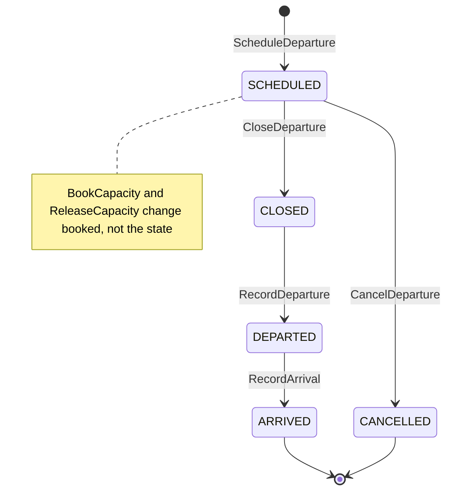
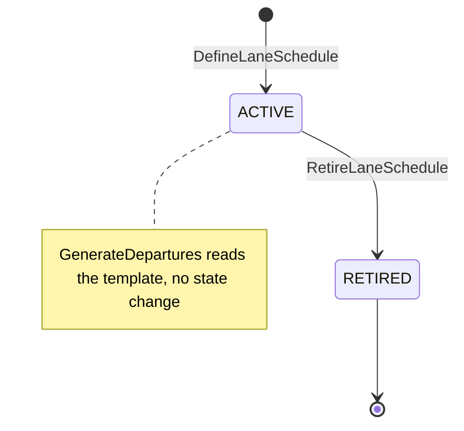
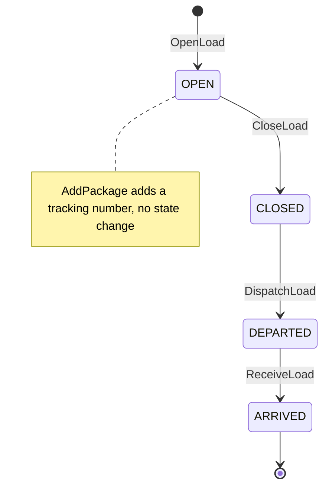

# Aggregate Design Canvas

:::info[Proposed design]
Derived from [`model/model.yaml`](https://github.com/IQVO/retail-network-docs/blob/main/model/model.yaml). Nothing in this context is built yet; identifiers (`Err...` names, routes, CloudEvents types) are the names an implementation must use.
:::

Following the ddd-crew [Aggregate Design Canvas v1.1](https://github.com/ddd-crew/aggregate-design-canvas).
The model has three aggregate roots: **Departure**, **LaneSchedule** and
**Load**. Proposed Go packages: `internal/domain/departure`,
`internal/domain/schedule`, `internal/domain/load` (from the `ul` code
identifiers `departure.Departure`, `schedule.LaneSchedule`, `load.Load`).

## Departure

### 1. Name

`Departure` (`departure.Departure`), identified by `departureId`.

### 2. Description

One scheduled trip on one lane: cutoff, departure, arrival and package
capacity. A `PICKUP` departure starts at a vendor node. Value objects:
`DepartureKind(PICKUP|LINEHAUL|AIR)`, `Capacity{packages, booked}`,
`Times{cutoffAt, departsAt, arrivesAt}`. It is the unit `delivery-promise`
puts on a witness path and `order-sourcing` names as `pickupDepartureId`.

### 3. State Transitions

Derived from: `model.yaml → contexts[linehaul-transportation].aggregates[Departure].states`,
`.transitions`, `.commands`.

Omitted: the creation arrow `[*] --> SCHEDULED` is `ScheduleDeparture`,
which the model lists as a command but not as a transition (a transition
needs a from-state). `BookCapacity` and `ReleaseCapacity` are not
transitions. `ARRIVED` and `CANCELLED` have no outgoing transition in the
model, so they are drawn as terminal.

### 4. Enforced Invariants

| Invariant | Enforced by |
| --- | --- |
| `cutoffAt <= departsAt < arrivesAt` | `ErrInvalidDepartureTimes` |
| `booked <= capacity` | `ErrDepartureFull` |
| The lane is `OPEN` when scheduling | `ErrLaneClosed` (checked against `LaneView`) |
| No booking after `cutoffAt` | `ErrDepartureClosed` |

### 5. Corrective Policies

- **`PickupFromCutoffs`** (this context): on
  `NodeOperationalProfileDeclared`, (re)generate `PICKUP` departures for
  every cutoff of the horizon; on `NodeSuspended` or `NodeRetired`, cancel
  future pickups (`CancelDeparture`).
- **`BookOnLock`** (this context): on `FulfillmentLocked`, book one package
  on the pickup departure (`BookCapacity`); on `FulfillmentCancelled` or
  reassignment, release it (`ReleaseCapacity`).
- **`HorizonRoll`** (this context): nightly `GenerateDepartures` keeps a
  14-day horizon.
- **`RepromiseOnRisk`** (`delivery-promise`, a neighbour's reaction): a
  cancelled departure on a witness path makes `delivery-promise` recompute
  and `RevisePromise`.
- The model names no corrective reaction to `LaneClosed` for departures
  already scheduled on that lane; `ErrLaneClosed` only guards new
  scheduling.

### 6. Handled Commands

| Command | Issued by |
| --- | --- |
| `ScheduleDeparture` | `GenerateDepartures` (lane schedules), `PickupFromCutoffs` |
| `BookCapacity` | `BookOnLock` on `FulfillmentLocked` |
| `ReleaseCapacity` | `BookOnLock` on `FulfillmentCancelled` or `FulfillmentReassigned` |
| `CloseDeparture` | not named in the model |
| `RecordDeparture` | not named in the model |
| `RecordArrival` | not named in the model |
| `CancelDeparture` | Network-ops planner, REST `POST /departures/{departureId}:cancel`; `PickupFromCutoffs` on `NodeSuspended` / `NodeRetired` |

### 7. Created Events

| Event | Raised when | Full CloudEvents type |
| --- | --- | --- |
| `DepartureScheduled` | `ScheduleDeparture` succeeds | `com.retailnetwork.logistics.linehaul-transportation.departure.DepartureScheduled` |
| `DepartureCapacityChanged` | `BookCapacity` or `ReleaseCapacity` succeeds | `com.retailnetwork.logistics.linehaul-transportation.departure.DepartureCapacityChanged` |
| `DepartureCancelled` | `CancelDeparture` succeeds | `com.retailnetwork.logistics.linehaul-transportation.departure.DepartureCancelled` |
| `DepartureDeparted` | `RecordDeparture` succeeds | `com.retailnetwork.logistics.linehaul-transportation.departure.DepartureDeparted` |
| `DepartureArrived` | `RecordArrival` succeeds | `com.retailnetwork.logistics.linehaul-transportation.departure.DepartureArrived` |

`CloseDeparture` raises no event in the model.

### 8. Throughput

*Estimate* (from the model): **high on capacity changes**. One
`BookCapacity` per locked shipment group lands on one pickup departure, so a
popular vendor cutoff is a contended row. Proposed: optimistic concurrency
on a `version` column, retried by the consumer.

### 9. Size

*Estimate* (from the model): **lanes × trips per day × horizon (14
days)**. Each instance is small: a handful of scalars, no child
collection. Lifetime: from scheduling (up to 14 days ahead) to arrival;
about 2 to 4 events per instance (scheduled, N capacity changes, departed,
arrived, or cancelled).

## LaneSchedule

### 1. Name

`LaneSchedule` (`schedule.LaneSchedule`), identified by `laneId` (one per
lane).

### 2. Description

The weekly template that generates departures for one lane, or the node
cutoffs for a pickup lane. The model does not list its slot fields; the
proposed slot shape (day of week, local cutoff, departure and arrival times,
package capacity) mirrors `Departure.Times` and `Departure.Capacity`.

### 3. State Transitions

Derived from: `model.yaml → contexts[linehaul-transportation].aggregates[LaneSchedule].states`,
`.transitions`, `.commands`.

Omitted: the creation arrow is `DefineLaneSchedule` (a command, not a model
transition). Whether `DefineLaneSchedule` on an `ACTIVE` schedule replaces
its slots is not stated.

### 4. Enforced Invariants

| Invariant | Enforced by |
| --- | --- |
| Template slots do not overlap on the same lane | `ErrOverlappingSlots` |

### 5. Corrective Policies

- **`HorizonRoll`**: nightly `GenerateDepartures` turns every `ACTIVE`
  template into departures up to 14 days ahead.
- The model does not say what happens to already generated departures when
  a schedule is retired.

### 6. Handled Commands

| Command | Issued by |
| --- | --- |
| `DefineLaneSchedule` | Network-ops planner, REST `POST /lane-schedules` |
| `RetireLaneSchedule` | REST `POST /lane-schedules/{laneId}:retire` (no `inbound` row names the actor) |
| `GenerateDepartures` | Scheduler, policy `HorizonRoll` |

### 7. Created Events

None (`events: []`). Its effect is visible through the `DepartureScheduled`
events of the departures it generates.

### 8. Throughput

*Estimate*: **low**. Planner edits, plus one nightly generation read.

### 9. Size

*Estimate*: **one per lane**; a weekly template of a few slots.

## Load

### 1. Name

`Load` (`load.Load`), identified by `loadId`.

### 2. Description

The packages physically consolidated onto one departure at its origin node
(for example at a sortation centre, onto a departure to a delivery
station). It holds the `departureId` and the list of tracking numbers.

### 3. State Transitions

Derived from: `model.yaml → contexts[linehaul-transportation].aggregates[Load].states`,
`.transitions`, `.commands`.

Omitted: the creation arrow is `OpenLoad` (a command, not a model
transition). The model has no cancellation for a load.

### 4. Enforced Invariants

| Invariant | Enforced by |
| --- | --- |
| A package is on at most one `OPEN` or `CLOSED` load | `ErrPackageAlreadyLoaded` |
| Package count `<=` departure capacity | `ErrLoadOverCapacity` |

Both invariants reach outside one `Load` instance: the first spans every
load, the second reads the departure's capacity. Proposed enforcement: a
unique index on the tracking number of packages on non-departed loads, and a
capacity snapshot copied from `Departure` into the load at `OpenLoad`.

### 5. Corrective Policies

- **`InductOnArrival`** (`last-mile-delivery`, a neighbour's reaction): on
  `LoadArrived` at a delivery station it inducts every package into the
  earliest eligible wave.
- **`HandoverOnFirstScan`** (`shipping-and-tracking`): the first
  `PICKUP`-load departure scan at the vendor node is the handover instant.

### 6. Handled Commands

| Command | Issued by |
| --- | --- |
| `OpenLoad` | Operators, REST `POST /loads` |
| `AddPackage` | Operators, REST `POST /loads/{loadId}/packages` |
| `CloseLoad` | Operators, REST `POST /loads/{loadId}:close` |
| `DispatchLoad` | Operators, REST `POST /loads/{loadId}:dispatch` |
| `ReceiveLoad` | Operators, REST `POST /loads/{loadId}:receive` |

### 7. Created Events

| Event | Raised when | Full CloudEvents type |
| --- | --- | --- |
| `LoadClosed` | `CloseLoad` succeeds | `com.retailnetwork.logistics.linehaul-transportation.load.LoadClosed` |
| `LoadDeparted` | `DispatchLoad` succeeds | `com.retailnetwork.logistics.linehaul-transportation.load.LoadDeparted` |
| `LoadArrived` | `ReceiveLoad` succeeds | `com.retailnetwork.logistics.linehaul-transportation.load.LoadArrived` |

`OpenLoad` and `AddPackage` raise no event.

### 8. Throughput

*Estimate* (from the model): **high, per package add**. One `AddPackage`
per scanned package; operators on the same load contend on one row.

### 9. Size

*Estimate* (from the model): **one per departure**. Up to the departure's
capacity in tracking numbers; three events per instance.

## Read models

| Read model | Source events | Used for | Why it is not an aggregate |
| --- | --- | --- | --- |
| `NodeProfileView` | `node-topology` `NodeRegistered`, `NodeOperationalProfileDeclared`, `NodeActivated`, `NodeSuspended`, `NodeRetired` | Node type, operator, status, time zone, operating hours, holidays and cutoffs for `PickupFromCutoffs` | A local copy of `node-topology`'s `Node`; this context never changes it and enforces no rule on it. |
| `LaneView` | `node-topology` `LaneOpened`, `LaneClosed` | `ErrLaneClosed` check, origin and destination of a lane, mode | A copy of `node-topology`'s `Lane`; the lane's own invariants live there. |
| `ExpectedVolumeView` | `order-sourcing` `FulfillmentReleasedToNode`, `FulfillmentReassigned`, `FulfillmentLocked`, `FulfillmentCancelled`; `shipping-and-tracking` `LabelIssued` | Which assignments and tracking numbers are heading for which pickup departure | A projection of other contexts' facts; it decides nothing. Booking is done on `Departure`. |

Derived from: `model.yaml → contexts[linehaul-transportation].read_models`.
