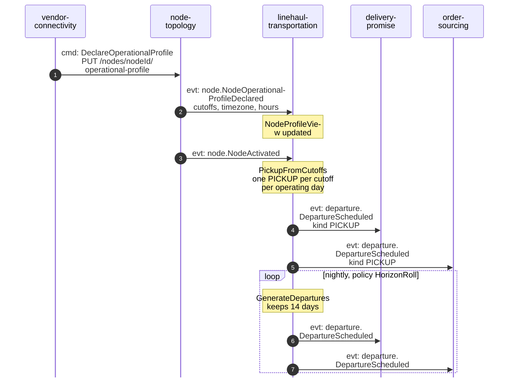
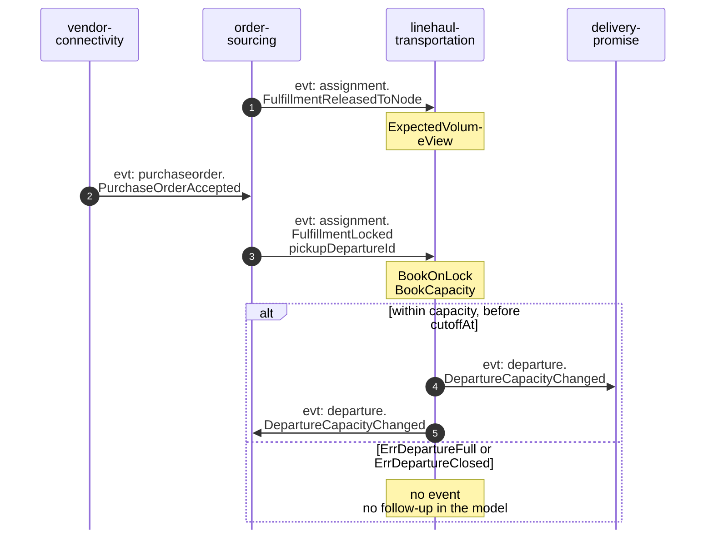
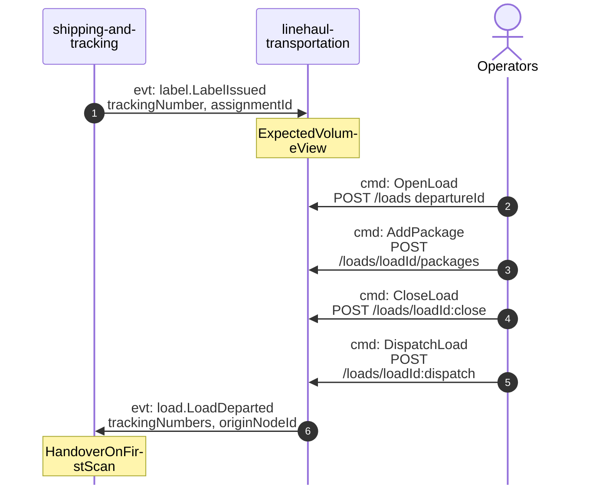
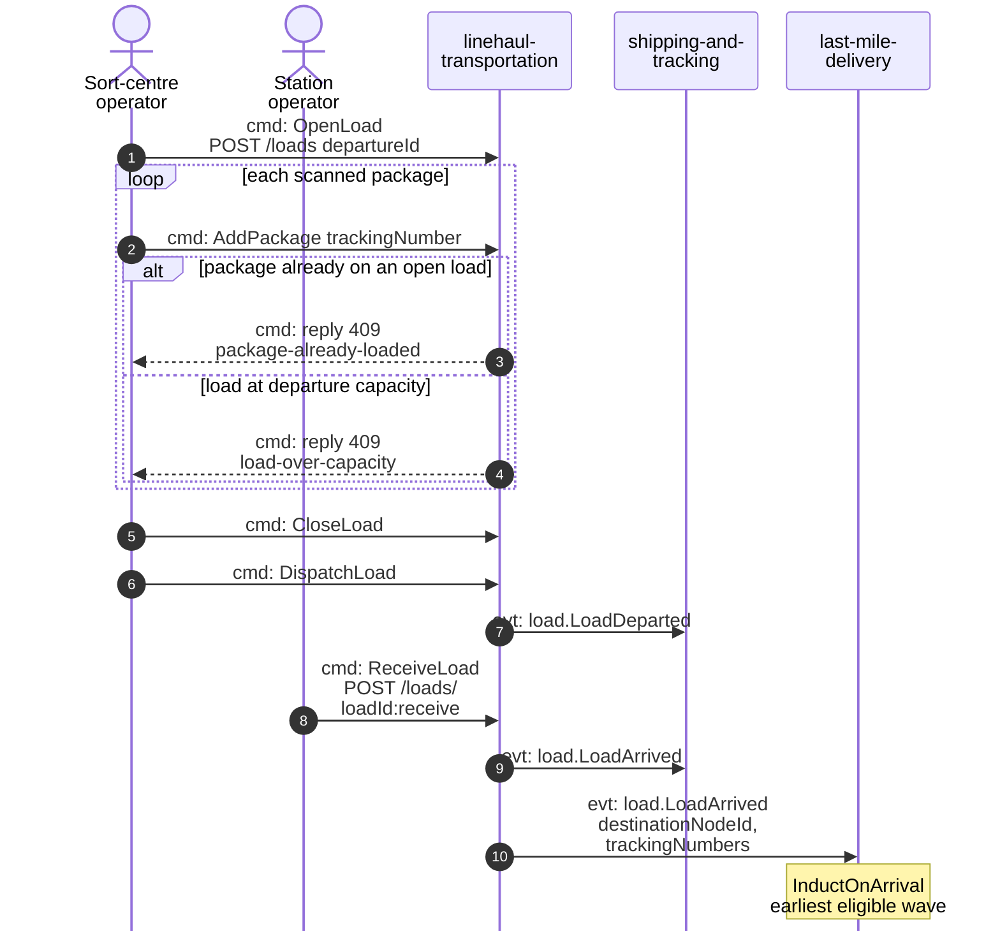
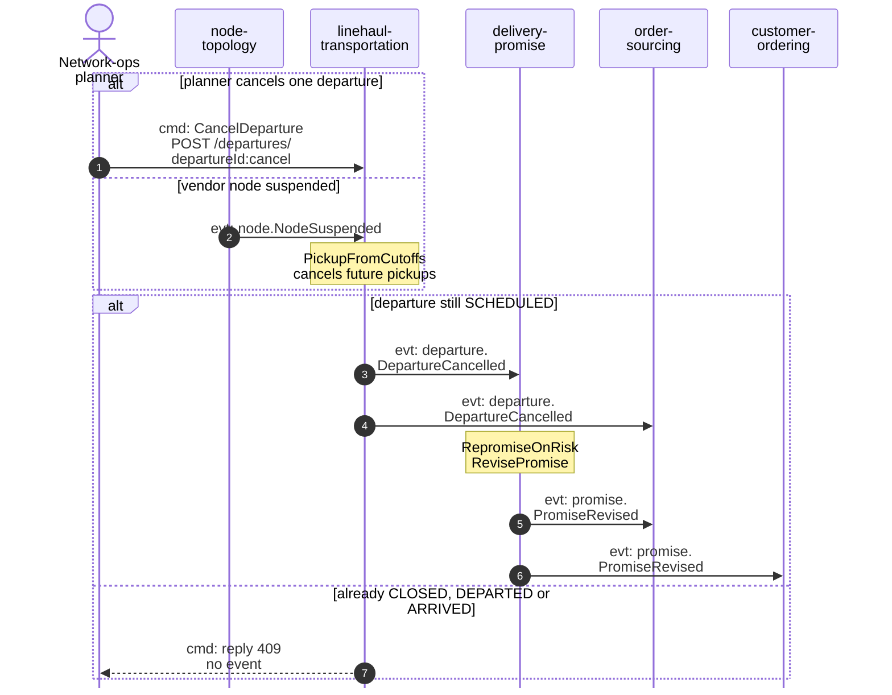

# Domain Message Flow

:::info[Proposed design]
Derived from [`model/model.yaml`](https://github.com/IQVO/retail-network-docs/blob/main/model/model.yaml). Nothing in this context is built yet; identifiers (`Err...` names, routes, CloudEvents types) are the names an implementation must use.
:::

Following ddd-crew [Domain Message Flow Modelling](https://github.com/ddd-crew/domain-message-flow-modelling).
Participants are contexts and actors. Every arrow is a message from
`model.yaml`, prefixed `cmd:`, `qry:` or `evt:`. Events are written
`entity.EventName`; the full type is
`com.retailnetwork.<tier>.<producer>.<entity>.<EventName>` (see
[Domain Events](/contexts/linehaul-transportation/domain-events)). Route
parameters are written without braces. The network-wide flows are on
[Domain Message Flows](/strategic-design/domain-message-flows).

## 1. A vendor cutoff becomes a pickup departure

Derived from: `model.yaml → contexts[vendor-connectivity].sync_calls`,
`contexts[node-topology].publishes`,
`contexts[linehaul-transportation].policies[PickupFromCutoffs, HorizonRoll]`,
`.publishes[DepartureScheduled]`.

Omitted: `node-topology` also sends both events to `delivery-promise` and
`order-sourcing` directly (their `NodeProfileView`). The model fires
`PickupFromCutoffs` on `NodeOperationalProfileDeclared`; it states no
reaction to `NodeActivated`. Since a fulfillment centre declares its
profile before it is activated, this diagram shows the pickup after
activation, which is the business decision ("an `ACTIVE` vendor fulfillment
node"); the trigger is a reported model gap. Linehaul departures from lane
schedules (`DefineLaneSchedule`) follow the same `DepartureScheduled` path.

## 2. Booking on lock and the pickup load

Booking:

The pickup load at the vendor node:

Derived from: `model.yaml → contexts[order-sourcing].publishes`,
`contexts[vendor-connectivity].publishes[PurchaseOrderAccepted]`,
`contexts[shipping-and-tracking].publishes[LabelIssued]`,
`contexts[linehaul-transportation].policies[BookOnLock]`,
`.aggregates[Load].commands`, `.publishes`.

Omitted: `LoadClosed` (analytics only); the vendor's label request and
shipment confirmation through `vendor-connectivity`. The model's operators
are "sort-centre and station operators"; who builds a `PICKUP` load at a
vendor node is not stated, so `OP` here stands for whoever scans the pickup.

## 3. Consolidated at a sortation centre, arrived at a delivery station

Derived from: `model.yaml → contexts[linehaul-transportation].aggregates[Load]`,
`.publishes[LoadDeparted, LoadArrived]`,
`contexts[last-mile-delivery].policies[InductOnArrival]`.

Omitted: the success replies of each command (`200` with the load);
`LoadClosed` (analytics only). The model does not say whether
`DispatchLoad` and `ReceiveLoad` also drive `RecordDeparture` and
`RecordArrival` on the departure, so `DepartureDeparted` and
`DepartureArrived` are not drawn.

## 4. Failure path: a departure is cancelled and promises are revised

Derived from: `model.yaml → contexts[linehaul-transportation].aggregates[Departure].transitions`
(`SCHEDULED → CANCELLED` only), `.policies[PickupFromCutoffs]`,
`.business_decisions`, `contexts[delivery-promise].policies[RepromiseOnRisk]`,
`.publishes[PromiseRevised]`.

Omitted: if nothing is feasible even at `STANDARD`, `delivery-promise`
reports `PromiseBroken` at judgement time, much later. `order-sourcing`
updates its `NetworkGraphView` and may re-optimise queued assignments; the
model names no message for that. The 409 reply has no `Err...` identifier in
the model (illegal transition), a reported gap.
