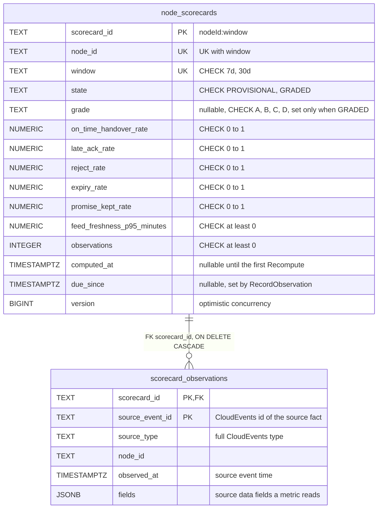
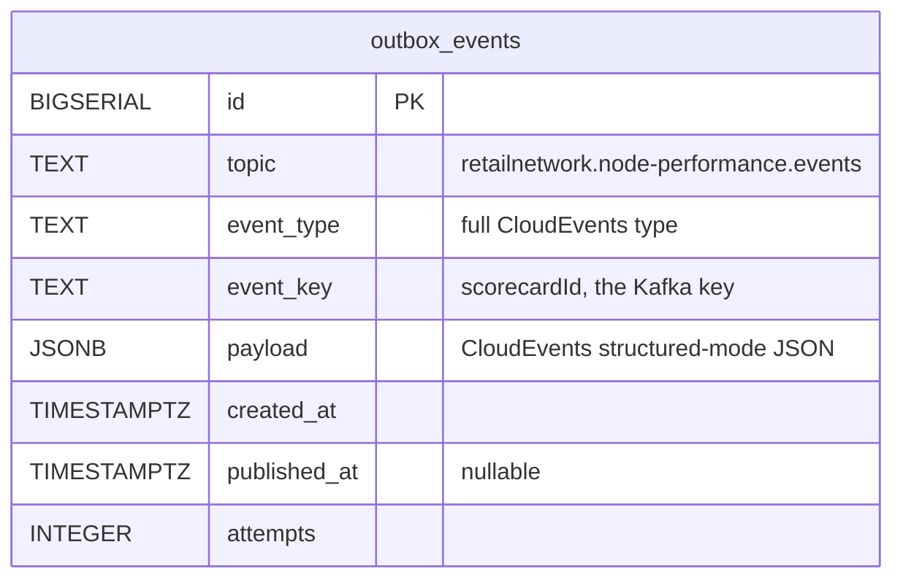
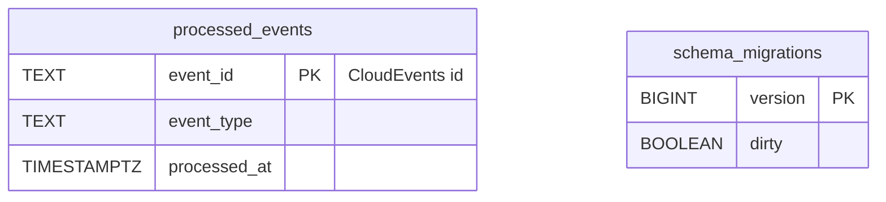

# Entity Relationship

:::info[Proposed design]
Derived from [`model/model.yaml`](https://github.com/IQVO/retail-network-docs/blob/main/model/model.yaml). Nothing in this context is built yet; identifiers (`Err...` names, routes, CloudEvents types) are the names an implementation must use.
:::

The **proposed** schema of this context's own Postgres database ("every
context owns its database; no shared tables",
`conventions.integration_rules`). A relationship line is drawn only where
a foreign key would exist, and foreign keys exist only inside one
aggregate.

Derived from: model.yaml → contexts[node-performance].aggregates[NodeScorecard]
(.root_id, .states, .value_objects, .invariants, .size_estimate),
.publishes[NodeScorecardUpdated].data.

Derived from: model.yaml → conventions.integration_rules (transactional
outbox, idempotent consumers with an inbox), conventions.cloudevents.

**Infrastructure tables:** `outbox_events` (transactional outbox, written
in the same transaction as `node_scorecards`, drained by the relay),
`processed_events` (the consumer inbox, one row per consumed CloudEvents
`id`, written in the same transaction as the observation), and
`schema_migrations` (migration bookkeeping, as golang-migrate creates it).

**No read-model tables.** The model declares no read model
(`read_models: []`), so there is no `rm_...` table. The two REST reads
query `node_scorecards` directly. Facts the model gives no use
(`NodeRegistered`, `NodeOperationalProfileDeclared`, `VendorOnboarded`,
`SubmissionProcessed`) leave only a `processed_events` row; adding a table
for them would need a model change first.

Omitted: indexes. The proposed ones are `node_scorecards (grade)` for
`GET /scorecards?grade=`, `node_scorecards (node_id)` for
`GET /scorecards/{nodeId}`, a partial index on `due_since IS NOT NULL` for
the recompute pass, `scorecard_observations (scorecard_id, observed_at)`
for the window slide, and a partial index on `outbox_events
(published_at IS NULL)`. The value of a `PROVISIONAL` scorecard's grade in
the event is `PROVISIONAL`; the column holds `NULL` and the mapper writes
the string.

## Why no foreign key leaves the aggregate

- `node_scorecards.node_id` names a node owned by `node-topology`, in
  another database. It is a value copied from events, not a reference:
  this context must accept facts about a node before (or without) ever
  seeing `NodeRegistered`, because Kafka partitions give no cross-topic
  order.
- `scorecard_observations.fields` may carry `poNumber`, `trackingNumber`,
  `promiseId` or `feedId`. Those are other contexts' aggregate ids; joining
  them by foreign key would couple this schema to theirs.
- The two scorecards of one node (`7d` and `30d`) are two aggregates and
  share no foreign key. They are written in one transaction by
  `RecordObservation` because they are fed by the same fact.

## Table ≠ aggregate

| Table | Aggregate / role | Notes |
| --- | --- | --- |
| `node_scorecards` | **NodeScorecard** (root) | One row per `(node_id, window)`; `version` guards concurrent saves. |
| `scorecard_observations` | **NodeScorecard** (its observations) | Primary key `(scorecard_id, source_event_id)` enforces `ErrDuplicateObservation` at the database too. Rows older than the window are deleted by `Recompute` (the `30d` scorecard keeps 30 days). |
| `outbox_events` | none (infrastructure) | One row per published event. |
| `processed_events` | none (infrastructure) | Consumer inbox, idempotency on the CloudEvents `id`. |
| `schema_migrations` | none (infrastructure) | golang-migrate. |
