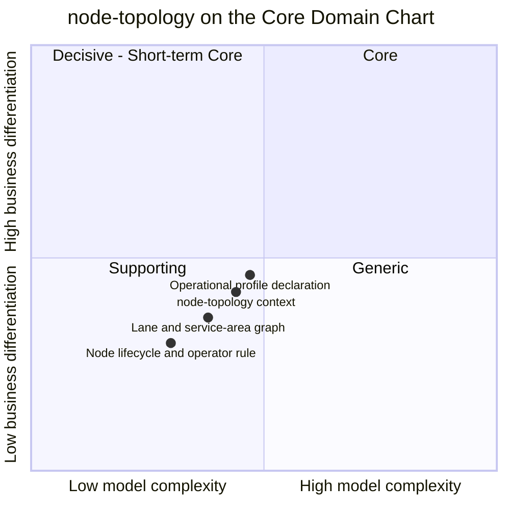

# Core Domain Chart

:::info[Proposed design]
Derived from [`model/model.yaml`](https://github.com/IQVO/retail-network-docs/blob/main/model/model.yaml). Nothing in this context is built yet; identifiers (`Err...` names, routes, CloudEvents types) are the names an implementation must use.
:::

Following the ddd-crew [Core Domain Charts](https://github.com/ddd-crew/core-domain-charts):
business differentiation (y) against model complexity (x).

Derived from: model.yaml → `contexts[node-topology].chart`
(`complexity: 0.44`, `differentiation: 0.42`), `.classification`,
`.aggregates`. The three slice positions are this page's estimate, not
values from the model.

Omitted: the other nine contexts (each has its own chart; all ten are on the
domain-wide [Core Domain Chart](/strategic-design/core-domain-chart)).

## Classification: Supporting

All four points sit in **quadrant 3 (Supporting)**, bottom-left, just below
both midlines. The model classifies `node-topology` as **Supporting** with
the business model "Enabler (every promise, assignment and route rests on
it)".

**Differentiation is moderate (y ≈ 0.42).** A shopper never sees a node
registry. What a shopper sees is the promise, and the promise is owned by
`delivery-promise` (Core) and kept by `order-sourcing` (Core). This context
differentiates only indirectly: a wrong cutoff, a missing lane or a
mis-assigned postal prefix produces promises the network cannot keep. That is
why it sits close to the midline rather than near the Generic floor. The
highest slice is the **operational profile declaration**, because a
versioned, declared handling time, cutoff set and throughput cap is what
lets the network promise from a vendor's building it does not run
([ADR 0003](/adr/0003-declared-and-measured-capability)).

**Model complexity is moderate (x ≈ 0.44).** There are four aggregates
(`Node`, `Lane`, `ServiceArea`, `Region`), one lifecycle with four states,
one with two, and two with a single state. There are thirteen invariants,
each with its own `Err...` identifier. The rules are crisp (allowed operator
per node type, allowed lane type pairs, strictly increasing revisions,
cutoffs inside operating hours). What lifts complexity is the cross-aggregate
checks: opening a lane reads both end nodes, assigning a service area reads
the station, and three uniqueness rules span many aggregates
(`ErrVendorNodeCodeTaken`, `ErrDuplicateLane`, `ErrRegionCodeTaken`). The
slice **node lifecycle and operator rule** is the simplest part.

## Business model

Enabler. It earns nothing on its own. It reduces the cost of every other
decision: `delivery-promise`, `order-sourcing`, `linehaul-transportation` and
`last-mile-delivery` each read the same node, lane and service-area facts
from one source, through events, instead of keeping their own registries.

## Evolution

| Part | Evolution stage | Why |
| --- | --- | --- |
| Node, lane, region and service-area registry | **Custom-built** (model `evolution: Custom-built`) | The node types, the operator rule and the lane type pairs are this network's own design ([ADR 0004](/adr/0004-parcel-nodes-are-network-operated)). |
| Operational profile | **Custom-built**, shaped after a **Product** | Modelled after the Supply Sources `operationalConfiguration` (see [SP-API surface map](/research/sp-api-surface-map)), extended with cutoffs and sort dwell. |
| Master-data plumbing (outbox, CloudEvents, REST) | **Commodity** | The same building blocks every context uses ([event standard](/strategic-design/event-standard-cloudevents)). |

**Movement to watch.** If the network ever optimises its own topology
(choosing where to open a station, which lanes to run), that capability would
be differentiating and complex, and would land in quadrant 1. The model keeps
it out: such a capability is not in any context, and the closest named
future context, `inventory-placement`, is about stock, not buildings. Nothing
in the model moves this context out of quadrant 3 today.
