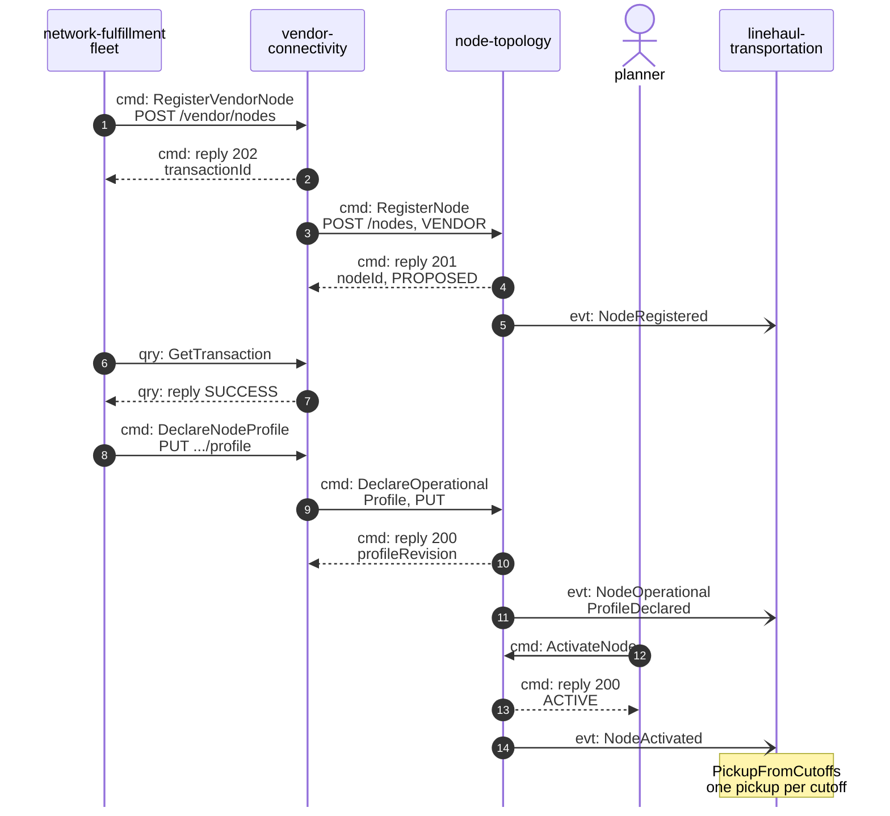
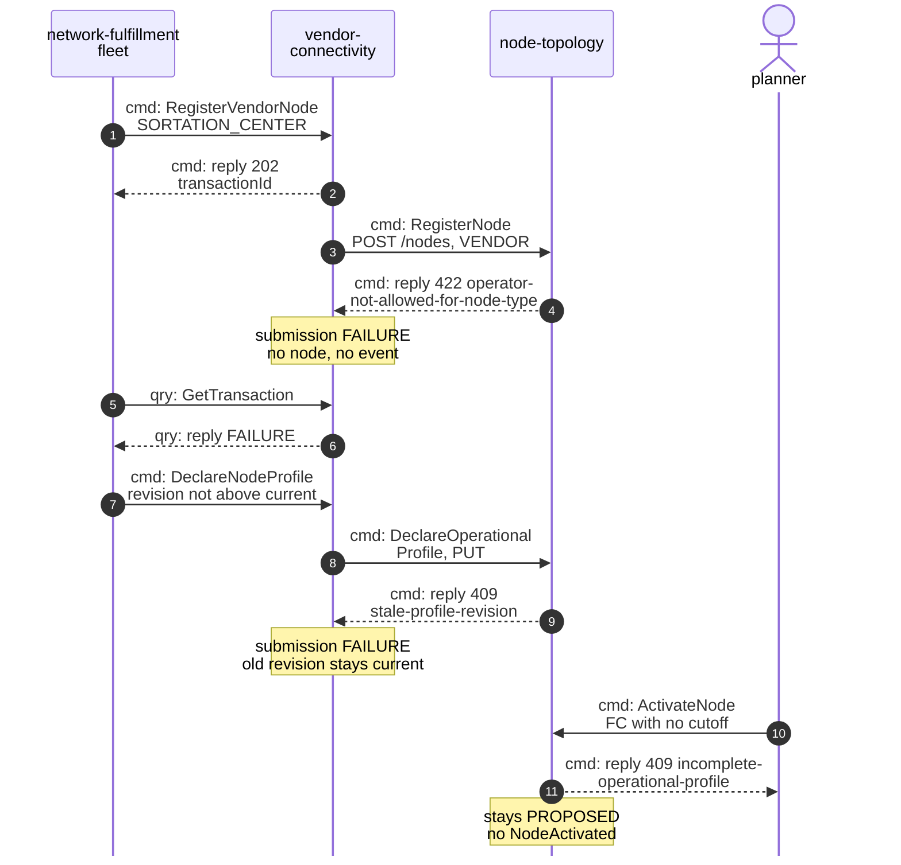
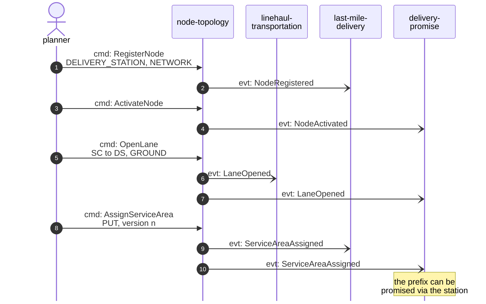
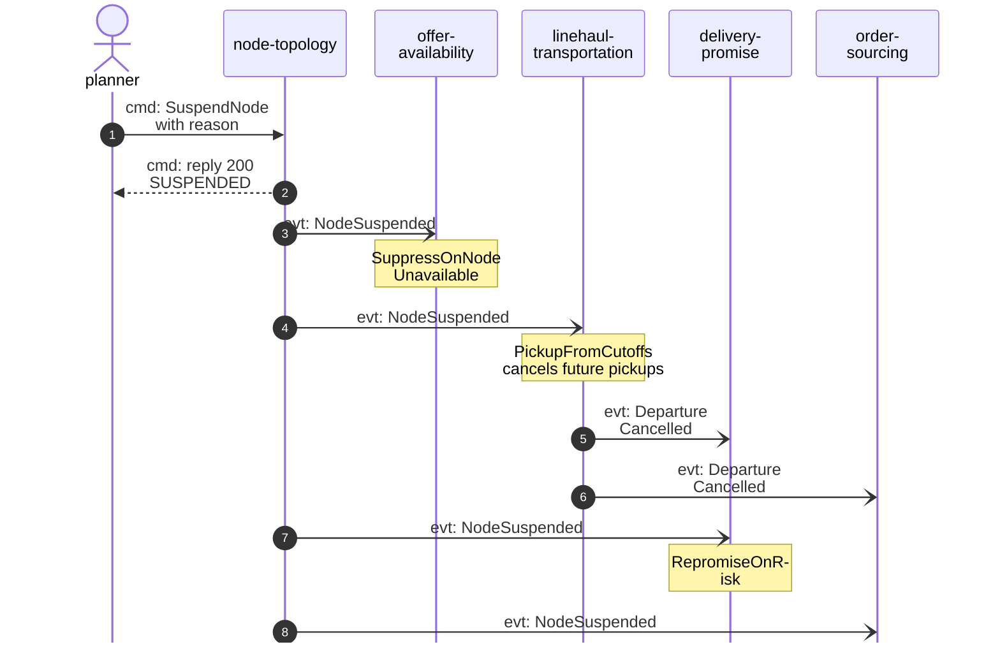

# Domain Message Flow

:::info[Proposed design]
Derived from [`model/model.yaml`](https://github.com/IQVO/retail-network-docs/blob/main/model/model.yaml). Nothing in this context is built yet; identifiers (`Err...` names, routes, CloudEvents types) are the names an implementation must use.
:::

Following ddd-crew [Domain Message Flow Modelling](https://github.com/ddd-crew/domain-message-flow-modelling).
Participants are contexts and actors. Every arrow is a message from the
model, prefixed `cmd:` (command), `qry:` (query) or `evt:` (event). Events go
through `retailnetwork.node-topology.events`; the diagrams draw them straight
to the consumer. Full CloudEvents types are
`com.retailnetwork.logistics.node-topology.<entity>.<EventName>` (see
[Domain Events](/contexts/node-topology/domain-events)). Path parameters are
written without braces. The domain-wide flows are on
[Domain Message Flows](/strategic-design/domain-message-flows).

## 1. A vendor node joins the network (happy path)

Derived from: model.yaml → `contexts[vendor-connectivity].inbound`,
`.rest`, `.sync_calls`; `contexts[node-topology].inbound`, `.publishes`;
`contexts[linehaul-transportation].policies[PickupFromCutoffs]`,
`.business_decisions`.

Omitted: the other consumers of the same events (`NodeRegistered` also goes
to `offer-availability`, `delivery-promise`, `order-sourcing`,
`last-mile-delivery`, `node-performance` and `vendor-connectivity`;
`NodeOperationalProfileDeclared` to `delivery-promise`, `order-sourcing` and
`node-performance`; `NodeActivated` to `offer-availability`,
`delivery-promise`, `order-sourcing` and `vendor-connectivity`); the second
`GetTransaction` poll after the profile declaration; `vendor-connectivity`'s
own `SubmissionProcessed` event; and the lane from the new node to a
sortation centre, which the planner opens as in scenario 3.

## 2. A vendor write refused, and an incomplete node not activated (failure paths)

Derived from: model.yaml → `contexts[node-topology].aggregates[Node].invariants`
(`ErrOperatorNotAllowedForNodeType`, `ErrStaleProfileRevision`,
`ErrIncompleteOperationalProfile`); `contexts[vendor-connectivity].aggregates[Submission]`.

Omitted: `ErrCutoffOutsideOperatingHours`, `ErrUnknownRegion`,
`ErrSubtypeNotAllowed` and `ErrSortDwellNotAllowed` (all 422, same shape as
the first branch), and `ErrVendorNodeCodeTaken` (409, same shape as the stale
revision branch). The same incomplete-profile refusal (`ErrIncompleteOperationalProfile`) also
stops a later revision of an `ACTIVE` fulfillment centre that drops every
cutoff or sets `handlingTime` to zero. Nothing reaches Kafka from this context on any refusal. The problem
`type` slugs are listed on [Use Cases](/contexts/node-topology/use-cases).

## 3. The planner adds a delivery station and its service area

Derived from: model.yaml → `contexts[node-topology].inbound`, `.publishes`,
`.aggregates[Lane|ServiceArea].invariants`; `lane_rules.allowed`;
`contexts[last-mile-delivery].read_models[StationView]`;
`contexts[delivery-promise].read_models`.

Omitted: the replies (201 or 200 with the new state); the other consumers
(`order-sourcing` takes every event shown; `offer-availability`,
`node-performance` and `vendor-connectivity` also take `NodeRegistered`);
`DefineRegion`, which precedes the station when the region is new; the
branches `ErrLaneEndpointNotActive` (opening the lane before activation) and
`ErrNotADeliveryStation` (assigning to a node that is not an `ACTIVE`
station), both 409.

## 4. A node is suspended

Derived from: model.yaml → `contexts[node-topology].publishes[NodeSuspended]`;
`contexts[offer-availability].policies[SuppressOnNodeUnavailable]`;
`contexts[linehaul-transportation].policies[PickupFromCutoffs]`,
`.publishes[DepartureCancelled]`;
`contexts[delivery-promise].policies[RepromiseOnRisk]`.

Omitted: `vendor-connectivity` also consumes `NodeSuspended` (its
`VendorNodeView`); the listing events `offer-availability` then publishes
(`ListingSuppressed`); the reactivation path (`ActivateNode` from
`SUSPENDED`, `NodeActivated`, listings restored). The node's lanes stay
`OPEN` and its assigned service areas stay `ASSIGNED`: policy
`SuspendedEndpointsUnusable` closes nothing, and consumers treat them as
unusable while the node is not `ACTIVE`.
