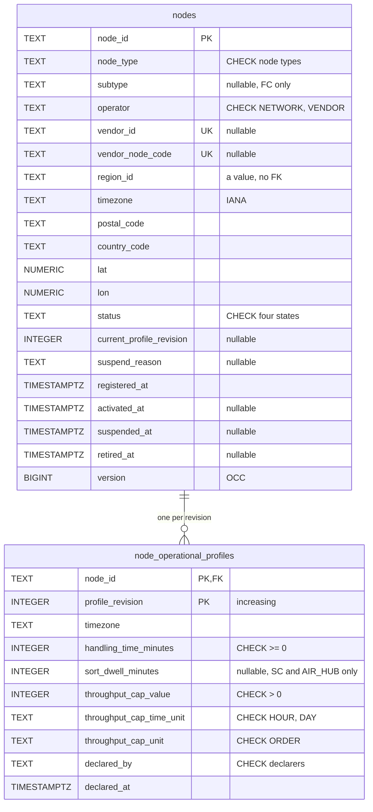
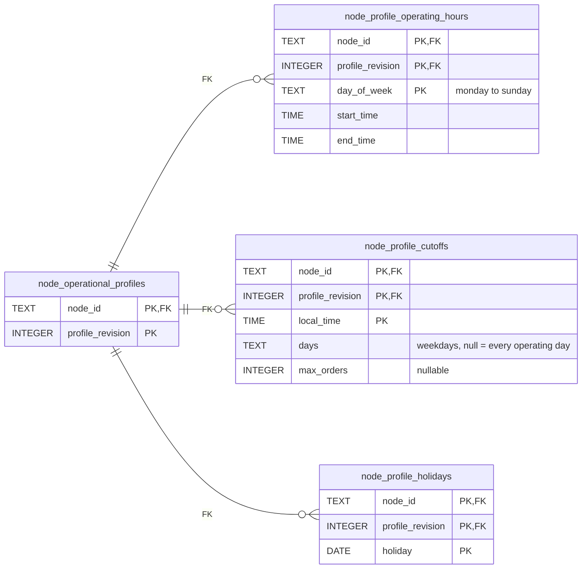
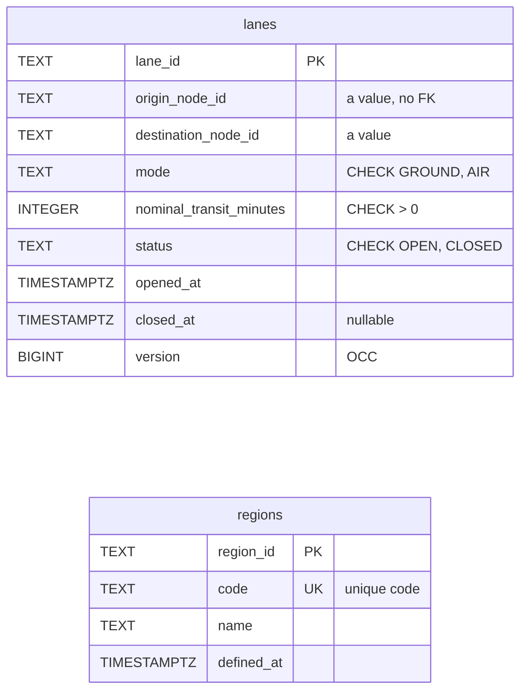
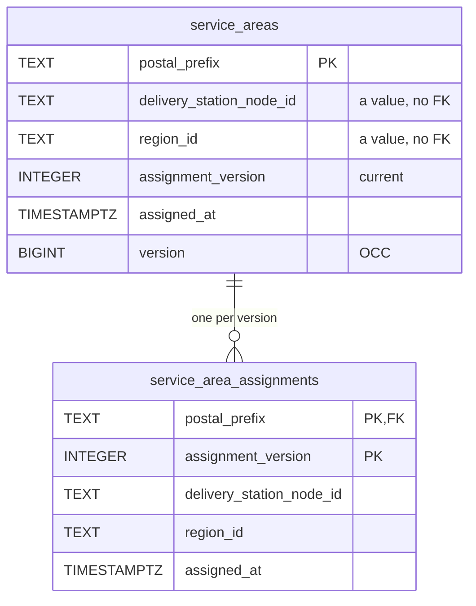
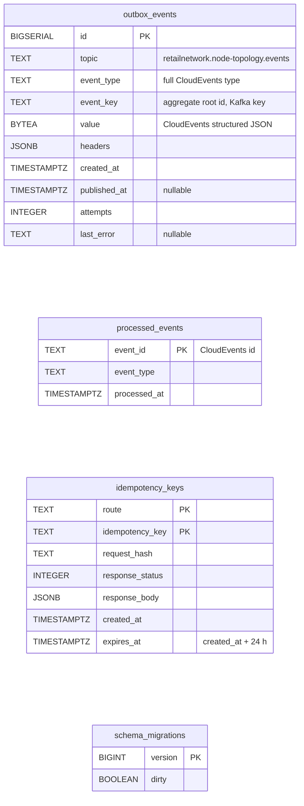

# Entity Relationship

:::info[Proposed design]
Derived from [`model/model.yaml`](https://github.com/IQVO/retail-network-docs/blob/main/model/model.yaml). Nothing in this context is built yet; identifiers (`Err...` names, routes, CloudEvents types) are the names an implementation must use.
:::

The **proposed** Postgres schema of the context's own database (every context
owns its database; no shared tables, model `conventions.integration_rules`).
A relationship line is drawn only for a foreign key inside one aggregate.
Column types are a proposal; column names follow the model's fields in
snake case.

## Node aggregate

Derived from: model.yaml → `contexts[node-topology].aggregates[Node]`
(`value_objects`, `invariants`, `size_estimate`: "one row + one profile row
per revision"), `.publishes[NodeRegistered|NodeOperationalProfileDeclared].data`.

Omitted: indexes other than the keys. The second diagram repeats only the
key of `node_operational_profiles`. `OCC` marks the optimistic-concurrency
counter. The `CHECK`s are: `status` in `PROPOSED`, `ACTIVE`, `SUSPENDED`,
`RETIRED`; `declared_by` in `VENDOR`, `NETWORK_OPS`; `node_type` in the six
node types; `subtype` set only for `FULFILLMENT_CENTER` (`ErrSubtypeNotAllowed`
also checks it is one of the seven subtypes); `throughput_cap_time_unit` in
`HOUR`, `DAY`. `sort_dwell_minutes` is set only when the node is a
`SORTATION_CENTER` or `AIR_HUB` (`ErrSortDwellNotAllowed`); that rule needs the
node type, so the domain checks it, not a table constraint. The unique key on
`(vendor_id, vendor_node_code)` is one compound `UNIQUE` constraint, drawn as
`UK` on both columns; it backs `ErrVendorNodeCodeTaken`. Capabilities are not stored: they are derived from
`node_type` on load (`DefaultCapabilitiesByType`). Profile rows are only
inserted, never updated, so an old revision cannot be edited.

## Lane, ServiceArea and Region aggregates

Derived from: model.yaml → `contexts[node-topology].aggregates[Lane|ServiceArea|Region]`,
`.publishes[LaneOpened|LaneClosed|ServiceAreaAssigned|RegionDefined].data`.

Omitted: a `CHECK` that `destination_node_id` differs from
`origin_node_id` (backs `ErrLaneLoop`); `regions.code` is unique (backs
`ErrRegionCodeTaken`); the partial unique index `uq_lanes_open` on
`(origin_node_id, destination_node_id, mode) WHERE status = 'OPEN'`, which
backs `ErrDuplicateLane` (Mermaid cannot draw a partial key); the index on
`lanes (origin_node_id, destination_node_id)` for `ListLanes`; the index on
`nodes (node_type, region_id, status)` for the node list query.

## Infrastructure tables

Derived from: model.yaml → `conventions.integration_rules` (transactional
outbox, idempotent consumers with an inbox table), `conventions.cloudevents`.

**All four tables are infrastructure, not domain state.**
`outbox_events` is written in the same transaction as the aggregate and
drained by the relay. `processed_events` is the standard inbox; it stays
**empty** here because the context consumes no topic, and is kept only so the
service has the same shape as its siblings when a consumer is added.
`idempotency_keys` is keyed by `(route, key)`, stores the first answer per
`Idempotency-Key` header, keeps it for 24 hours (`expires_at`) and is written
in the same transaction as the command. It is an infrastructure table, not an
aggregate. `schema_migrations` is
the migration tool's bookkeeping.

## Read-model tables

None. The model gives this context no read model (`read_models: []`), so
there is no `rm_...` table. The four query routes read the aggregate tables.

## Why there is no foreign key across aggregates or to other contexts

- **Across aggregates.** `lanes.origin_node_id`,
  `lanes.destination_node_id`, `service_areas.delivery_station_node_id`,
  `nodes.region_id` and `service_areas.region_id` hold ids by value. Each
  aggregate is a consistency boundary loaded and saved on its own. The rules
  that need another aggregate's state (both lane ends `ACTIVE`, the station
  `ACTIVE`, the region defined: `ErrUnknownRegion`) are checked by the use case when it reads that aggregate, and are
  facts about the moment of the command: a node retired later must not make
  the lane row invalid or block the retirement.
- **To other contexts.** `nodes.vendor_id` names a `vendor-connectivity`
  vendor account, which lives in another database. No context shares a table
  (model `conventions.integration_rules`).
- **Inside one aggregate**, foreign keys are drawn and real: a profile
  revision and its hours, cutoffs and holidays belong to one node; an
  assignment history row belongs to one service area.

## Table ≠ aggregate

| Table | Aggregate / role | Notes |
| --- | --- | --- |
| `nodes` | **Node** (root) | One row per node, saved with a `version` check. |
| `node_operational_profiles` | **Node** (its `OperationalProfile` revisions) | Insert-only; `nodes.current_profile_revision` points at the latest. |
| `node_profile_operating_hours` | **Node** (`operatingHoursByDay` of one revision; a missing day has no row, so it is closed) | Insert-only. |
| `node_profile_cutoffs` | **Node** (`cutoffs[CutoffSlot]` of one revision) | Insert-only. |
| `node_profile_holidays` | **Node** (`holidays[]` of one revision) | Insert-only. |
| `lanes` | **Lane** | One row per lane; a closed lane is never reopened. |
| `service_areas` | **ServiceArea** (current assignment) | One row per postal prefix. |
| `service_area_assignments` | **ServiceArea** (assignment history) | One row per `assignmentVersion`; insert-only. |
| `regions` | **Region** | One row per region. |
| `outbox_events` | none (infrastructure) | Transactional outbox. |
| `processed_events` | none (infrastructure) | Inbox; empty, no consumer. |
| `idempotency_keys` | none (infrastructure) | `Idempotency-Key` replay store, keyed by `(route, key)`, 24-hour TTL. |
| `schema_migrations` | none (infrastructure) | Migration bookkeeping. |
