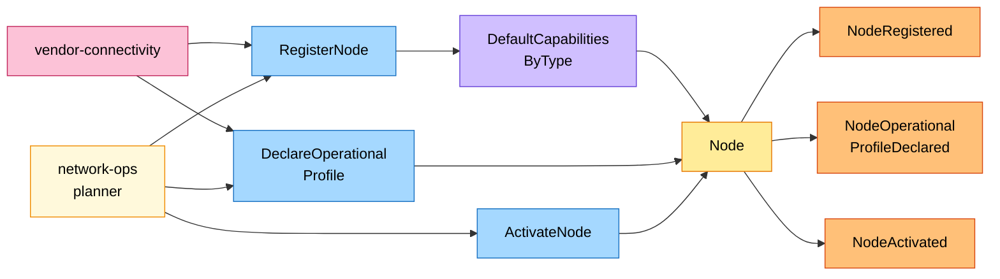
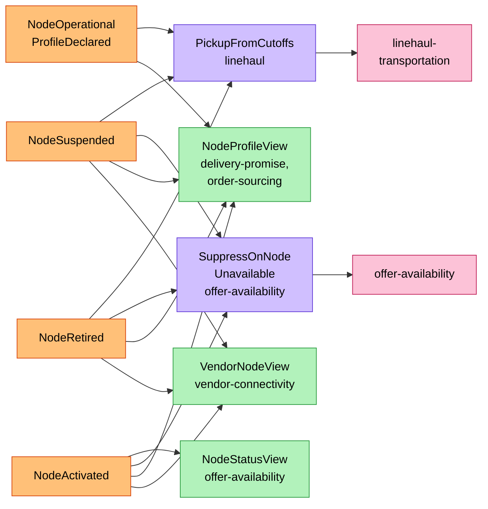
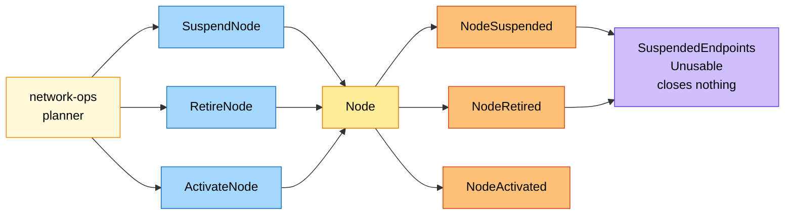
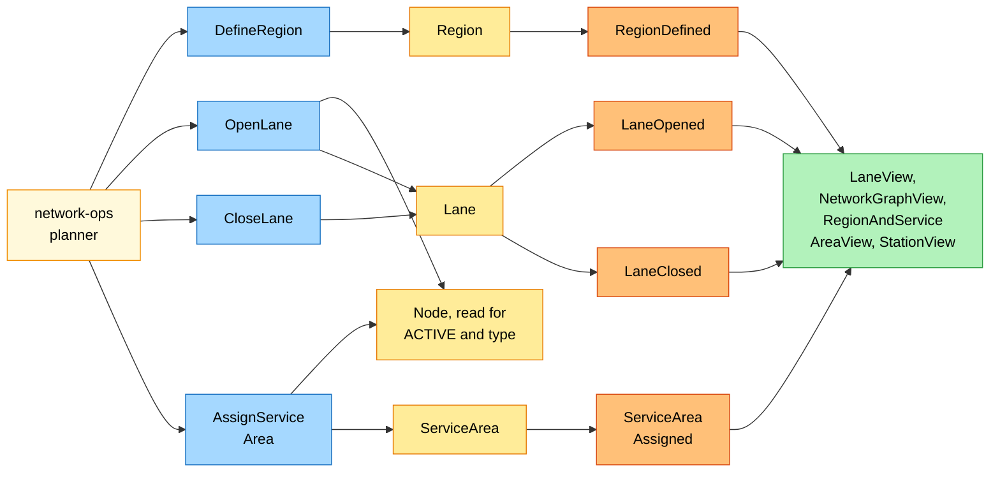

# EventStorming

:::info[Proposed design]
Derived from [`model/model.yaml`](https://github.com/IQVO/retail-network-docs/blob/main/model/model.yaml). Nothing in this context is built yet; identifiers (`Err...` names, routes, CloudEvents types) are the names an implementation must use.
:::

Process-level boards in the ddd-crew
[EventStorming glossary & cheat sheet](https://github.com/ddd-crew/eventstorming-glossary-cheat-sheet)
notation. Every sticky comes from the model. A hotspot would be an open
question or a risk the model leaves open; the model leaves none for this
context today (see the end of the page). The domain-wide board is
[EventStorming big picture](/strategic-design/eventstorming-big-picture).

## Legend

| Colour | Sticky | Meaning here |
| --- | --- | --- |
| Blue `#a5d8ff` | Command | A command from the model's `commands` |
| Yellow `#ffec99` | Aggregate | `Node`, `Lane`, `ServiceArea`, `Region` |
| Orange `#ffc078` | Domain Event | An event from the model's `publishes` |
| Lilac `#d0bfff` | Policy | This context's policy or a neighbour's reaction |
| Green `#b2f2bb` | Read Model | A neighbour's event-fed read model |
| Pink `#fcc2d7` | External System | Another bounded context |
| Red `#ff8787` | Hotspot | An open question or risk in the model |
| Pale yellow `#fff9db` | Actor | A person (the network-ops planner) |

## 1. A node is registered, declared and activated

Derived from: model.yaml → `contexts[node-topology].aggregates[Node]`,
`.policies`, `.inbound`, `.publishes`.

Omitted: the refusals (`ErrOperatorNotAllowedForNodeType`,
`ErrVendorNodeCodeTaken`, `ErrStaleProfileRevision`,
`ErrCutoffOutsideOperatingHours`, `ErrIncompleteOperationalProfile`,
`ErrUnknownRegion`, `ErrSubtypeNotAllowed`, `ErrSortDwellNotAllowed`), which
raise no event; the downstream reactions, on board 2.

## 2. What the network does with node facts

Derived from: model.yaml → `contexts[linehaul-transportation].policies[PickupFromCutoffs]`,
`contexts[offer-availability].policies[SuppressOnNodeUnavailable]`,
`.read_models[NodeStatusView]`; `contexts[delivery-promise|order-sourcing].read_models[NodeProfileView]`;
`contexts[vendor-connectivity].read_models[VendorNodeView]`.

Omitted: `NodeRegistered` feeding the same read models (and `StationView` in
`last-mile-delivery`); `node-performance`, which records
`NodeOperationalProfileDeclared` as the declaration it measures against.

## 3. Suspension and retirement

Derived from: model.yaml → `contexts[node-topology].aggregates[Node].transitions`,
`.invariants`; `.aggregates[Lane]`, `.aggregates[ServiceArea]`, `.policies`.

The policy `SuspendedEndpointsUnusable` is this context's: the node's `OPEN`
lanes and `ASSIGNED` service areas stay as they are, and consumers treat them
as unusable while the node is not `ACTIVE`.

Omitted: `ErrNodeRetired` (any command on a `RETIRED` node) and
`ErrIllegalTransition` (any other command outside the transition table); the reasons a
planner suspends (the model leaves them free text; `node-performance` never
suspends a node).

## 4. Lanes, regions and service areas

Derived from: model.yaml → `contexts[node-topology].aggregates[Lane|ServiceArea|Region]`,
`lane_rules`; the read models of `delivery-promise`, `order-sourcing`,
`linehaul-transportation` and `last-mile-delivery`.

Omitted: the refusals (`ErrLaneLoop`, `ErrLaneTypePairNotAllowed`,
`ErrLaneEndpointNotActive`, `ErrDuplicateLane`, `ErrNotADeliveryStation`,
`ErrStaleAssignmentVersion`, `ErrUnknownRegion`, `ErrRegionCodeTaken`). The `Node` sticky here
is read, not changed: the lane and service-area use cases load it to check
their invariants.

## Hotspots

None. The six hotspots of the earlier draft are answered in the model and
stated in the pages of this pack:

- lanes and service areas of a node that leaves service: policy
  `SuspendedEndpointsUnusable`;
- who declares a network node's profile: the network-ops planner, with
  `declaredBy` `NETWORK_OPS`;
- cutoff days: `CutoffSlot.days`, default every operating day;
- a later revision of an `ACTIVE` fulfillment centre: it keeps at least one
  cutoff and a `handlingTime` above zero (`ErrIncompleteOperationalProfile`);
- region membership: `ErrUnknownRegion`;
- illegal transitions and unknown ids: the shared `ErrIllegalTransition` and
  `ErrNotFound`.
