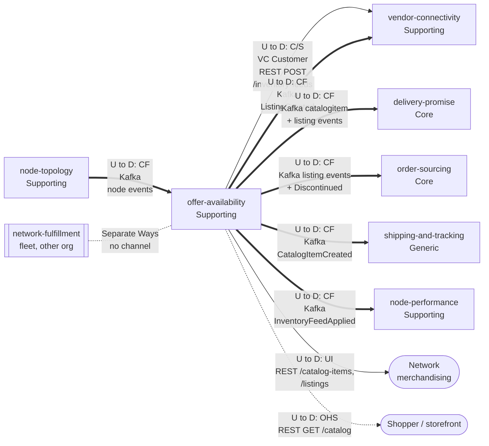

# Context Map

:::info[Proposed design]
Derived from [`model/model.yaml`](https://github.com/IQVO/retail-network-docs/blob/main/model/model.yaml). Nothing in this context is built yet; identifiers (`Err...` names, routes, CloudEvents types) are the names an implementation must use.
:::

Following ddd-crew [Context Mapping](https://github.com/ddd-crew/context-mapping).
This is **offer-availability's slice** of the domain map: every
relationship this context has, with the upstream (U) and downstream (D)
side, the pattern and the channel. Patterns: OHS = Open Host Service,
PL = Published Language, CF = Conformist, C/S = Customer/Supplier.

Derived from: `model.yaml → contexts[offer-availability].inbound`,
`.publishes`, `.consumes`; `contexts[vendor-connectivity].sync_calls`,
`.inbound`; `contexts[delivery-promise].inbound`,
`contexts[order-sourcing].inbound`,
`contexts[shipping-and-tracking].inbound`,
`contexts[node-performance].inbound`; `meta.hard_boundary`.

Legend: arrows point from upstream to downstream. Solid = command, dotted
arrow = query, thick = events. The dotted line with no arrow head is a
deliberately absent relationship. Labels are abbreviated ("node events"
= the four `node.*` events, "+ Discontinued" = `CatalogItemDiscontinued`);
the edge table has every message. In the `vendor-connectivity` edge the
command flows from `vendor-connectivity` into this context, but this
context is the upstream Supplier of that call. Classifications follow the
[Subdomain Classification](/strategic-design/subdomain-classification).

Omitted: Postgres and Kafka as infrastructure, and the contexts with no
relationship to this one, which are Separate Ways:
`customer-ordering` (the storefront's catalogue browse is modelled as the
shopper / storefront actor, not as a `customer-ordering` edge),
`linehaul-transportation`, `last-mile-delivery`.

## Edge table

| Neighbour | Direction | Pattern | Channel | Messages | Why this pattern |
| --- | --- | --- | --- | --- | --- |
| `node-topology` (Supporting) | Upstream; OA is downstream | **Conformist** | Kafka `retailnetwork.node-topology.events`, `com.retailnetwork.logistics.node-topology.node.<Event>` | `NodeRegistered`, `NodeActivated`, `NodeSuspended`, `NodeRetired` | Node status is `node-topology`'s fact; OA takes it as published into `NodeStatusView` and does not negotiate it. |
| `vendor-connectivity` (Supporting) | OA upstream (Supplier); VC downstream (Customer) | **Customer/Supplier** | REST `POST /inventory-feeds` (in-org, VC's `sync_calls`) | `ApplyInventoryFeed` | VC needs an answer inside its own processing of a vendor's inventory submission, so the call is synchronous; the contract is negotiated between two in-org teams. |
| `vendor-connectivity` (Supporting) | OA upstream; VC downstream | **Conformist** | Kafka `retailnetwork.offer-availability.events`, `com.retailnetwork.commerce.offer-availability.listing.ListingCreated` | `ListingCreated` | VC keeps a `ListingView` from it; its purchase-order lines carry `listingId`. |
| `delivery-promise` (Core) | OA upstream; DP downstream | **Conformist** | Kafka `retailnetwork.offer-availability.events` | `CatalogItemCreated`, `CatalogItemDiscontinued`, `ListingCreated`, `ListingAvailabilityChanged`, `ListingSuppressed`, `ListingRestored` | DP's `AvailabilityView` is a local, event-fed read model; the promise hot path makes no synchronous call. |
| `order-sourcing` (Core) | OA upstream; OS downstream | **Conformist** | Kafka `retailnetwork.offer-availability.events` | `CatalogItemDiscontinued`, `ListingCreated`, `ListingAvailabilityChanged`, `ListingSuppressed`, `ListingRestored` | Same reason: OS re-optimises from its own `AvailabilityView`. |
| `shipping-and-tracking` (Generic) | OA upstream; S&T downstream | **Conformist** | Kafka `retailnetwork.offer-availability.events`, `com.retailnetwork.commerce.offer-availability.catalogitem.CatalogItemCreated` | `CatalogItemCreated` | S&T keeps a `CatalogDimensionsView` from it (dimensions, weight, flags). |
| `node-performance` (Supporting) | OA upstream; NP downstream | **Conformist** | Kafka `retailnetwork.offer-availability.events`, `com.retailnetwork.commerce.offer-availability.inventoryfeed.InventoryFeedApplied` | `InventoryFeedApplied` | NP measures feed freshness from observed facts only. |
| Network merchandising (human) | OA upstream | **UI** | REST `POST /catalog-items`, `POST /catalog-items/{catalogItemId}:discontinue`, `POST /listings` | `CreateCatalogItem`, `DiscontinueItem`, `CreateListing` | Internal operators of this context. |
| Shopper / storefront | OA upstream | **Open Host Service** | REST `GET /catalog`, `GET /catalog/{catalogItemId}` | `BrowseCatalog` | One read surface for any storefront client, not tailored to one consumer. |
| `network-fulfillment` (Supporting in the fleet; external) | none | **Separate Ways** | none | none | `meta.hard_boundary`: the fleet talks only to `vendor-connectivity`'s Vendor API. Its inventory reaches OA as a feed applied by VC. |

## Notes on the patterns

- **Conformist downstream, no Published Language claimed.** The model
  marks every consumer of this context's events as Conformist. The
  CloudEvents envelope and `dataschema` URNs are the shared convention
  (`conventions.cloudevents`), but the model does not call this topic a
  Published Language, so this page does not either.
- **Customer/Supplier, not Conformist, with `vendor-connectivity`.** The
  `POST /inventory-feeds` contract is in-org and synchronous; both sides
  can shape it. VC is the Customer.
- **No Anti-Corruption Layer here.** The vendor's vocabulary is translated
  in `vendor-connectivity`; by the time a feed arrives it speaks
  `listingId`, `availableQty`, `basis`.
- **No Shared Kernel.** `nodeId`, `catalogItemId` and `listingId` cross
  boundaries by value only.
