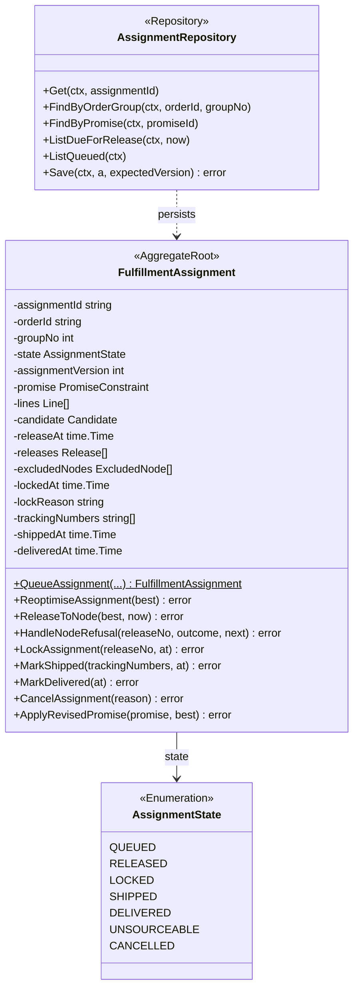
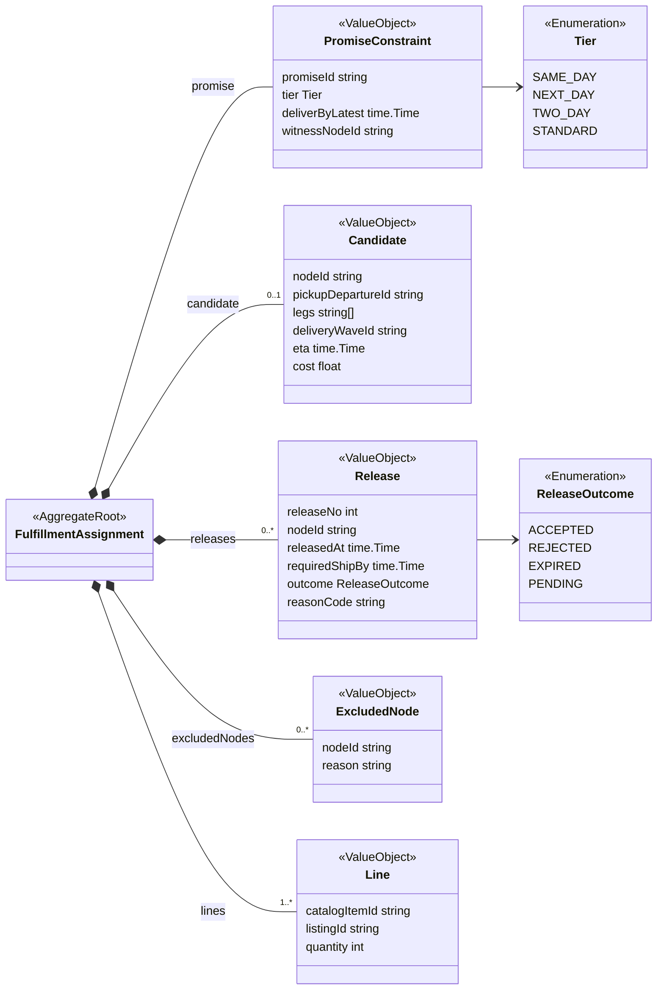
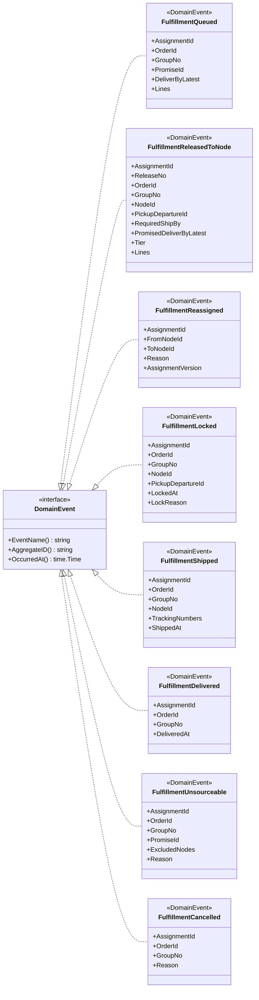
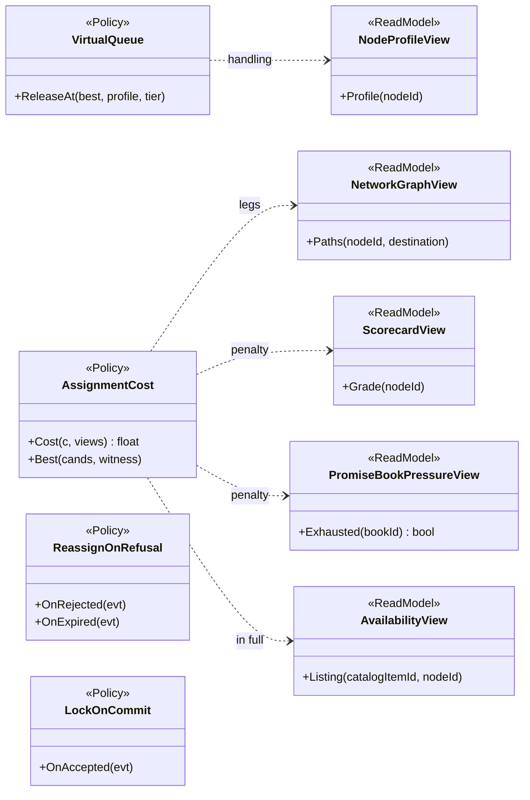
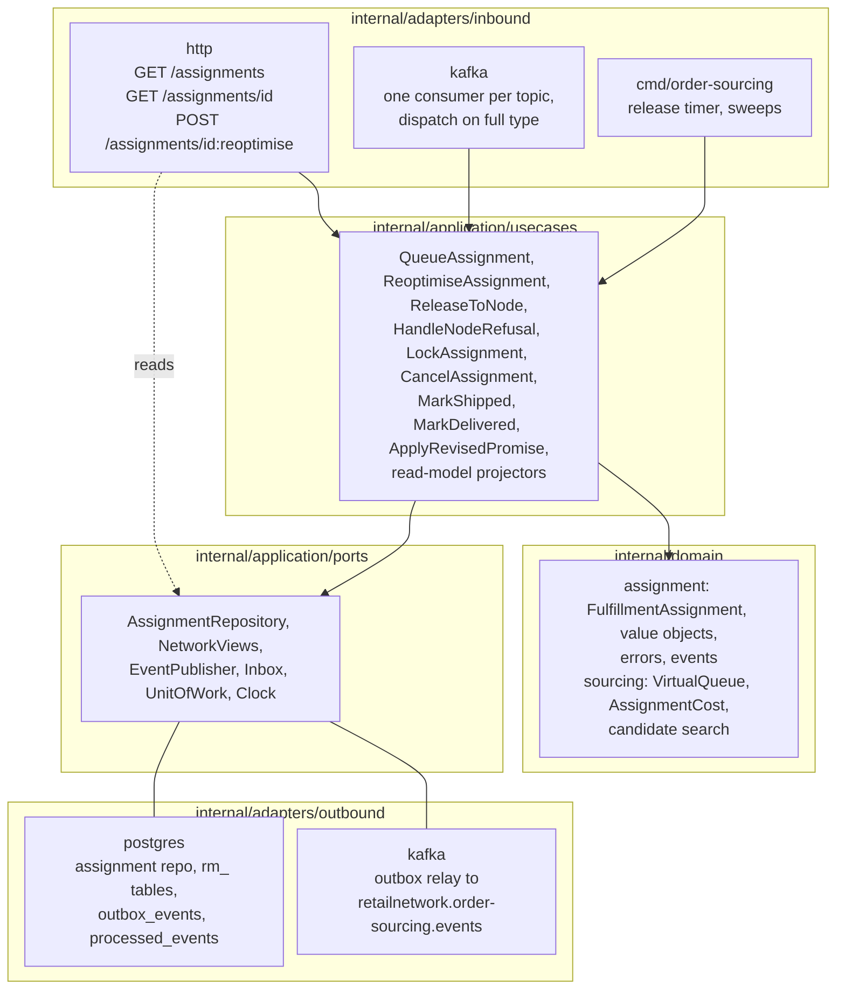

# Class Diagram

:::info[Proposed design]
Derived from [`model/model.yaml`](https://github.com/IQVO/retail-network-docs/blob/main/model/model.yaml). Nothing in this context is built yet; identifiers (`Err...` names, routes, CloudEvents types) are the names an implementation must use.
:::

Proposed Go types for `internal/domain`. Fields would be unexported in Go
and are shown with `-`; methods are shown with `+`. Class, field and method
names come from the model's aggregates, value objects, commands, events,
policies and read models; Go types (`time.Time`, `string`) are this page's
proposal.

## 1. FulfillmentAssignment aggregate

The root, its state and its repository first; then its value objects and
enumerations.

Derived from: model.yaml → `contexts[order-sourcing].aggregates[FulfillmentAssignment]`
(`root_id`, `states`, `commands`, `value_objects`), `.publishes[*].data` (the
lock, shipment and delivery fields, the `Line` shape of
`FulfillmentReleasedToNode`), `service_tiers` (`Tier`).

Omitted: the full `QueueAssignment` signature (`orderId, groupNo, promise,
lines, best`); the read accessors; the six `Err...` variables (listed on
[Aggregate Design Canvas](/contexts/order-sourcing/aggregate-design-canvas));
`destinationPostalPrefix`, which the candidate search needs but the model
does not place on the aggregate (open question). `Release` is a value object
in the model; its `outcome` changes from `PENDING` once, so an implementation
replaces the element identified by `releaseNo` rather than mutating it.
`Line` is the release's line shape; before release a line has no
`listingId`. The repository finders are this page's proposal, one per
trigger on [Use Cases](/contexts/order-sourcing/use-cases).

## 2. Domain events

Derived from: model.yaml → `contexts[order-sourcing].publishes` (event names
and `data`).

Omitted: field types (on [Domain Events](/contexts/order-sourcing/domain-events));
JSON tags are the camelCase `data` names. `AggregateID()` returns the
`assignmentId`, which becomes the CloudEvents `subject` and the Kafka key.

## 3. Policies and read models

Derived from: model.yaml → `contexts[order-sourcing].policies`,
`.read_models`.

Omitted: the penalty weights and the vendor ack budget, which the model does
not set. `ReassignOnRefusal` and `LockOnCommit` are event reactions that call
`HandleNodeRefusal` and `LockAssignment`; they live in the application layer
as the Kafka handlers. `<<ReadModel>>` is an extra stereotype for the
projections, which are not domain classes.

## 4. Hexagonal ports and adapters

Derived from: model.yaml → `contexts[order-sourcing].rest`, `.consumes`,
`.read_models`, `.policies`, `.sync_calls` (empty: no outbound client port);
`conventions.integration_rules` (outbox, inbox, own database, dispatch on the
full type).

Proposed packages: `internal/domain/assignment`,
`internal/domain/sourcing`, `internal/application/usecases`,
`internal/application/ports`, `internal/adapters/inbound/http`,
`internal/adapters/inbound/kafka`, `internal/adapters/outbound/postgres`,
`internal/adapters/outbound/kafka`. `NetworkViews` is the port over the five
read models.

Omitted: `Clock` has no adapter package (a system clock in `cmd/`). There is
no outbound HTTP client: the model allows no synchronous call from this
context. Path parameters are written `id` inside the diagram.
