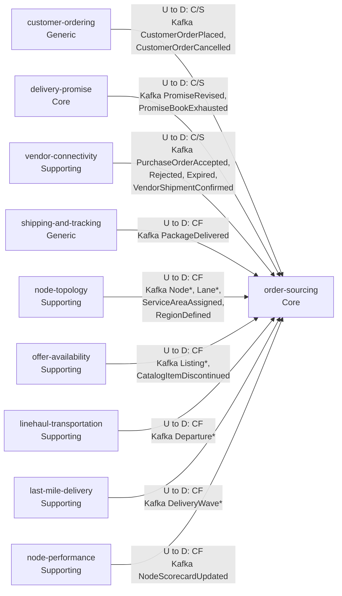
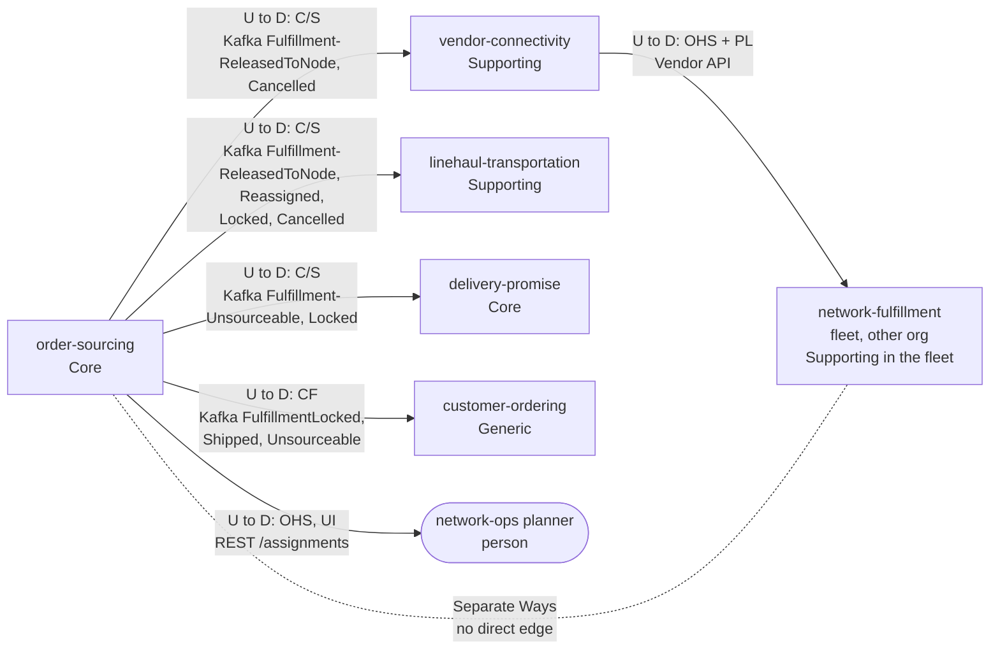

# Context Map

:::info[Proposed design]
Derived from [`model/model.yaml`](https://github.com/IQVO/retail-network-docs/blob/main/model/model.yaml). Nothing in this context is built yet; identifiers (`Err...` names, routes, CloudEvents types) are the names an implementation must use.
:::

Following ddd-crew [Context Mapping](https://github.com/ddd-crew/context-mapping).
This is **order-sourcing's slice** of the
[network context map](/strategic-design/context-map): every relationship this
context has, with the upstream (U) and downstream (D) side, the pattern and
the channel. The slice is drawn as two diagrams (upstream, downstream) to
stay readable. Four neighbours appear on both sides: this context consumes from
them and they consume from it. The pattern for each direction is the one the
**downstream** side's `inbound` row declares.

## Upstream of order-sourcing

Derived from: model.yaml → `contexts[order-sourcing].inbound`, `.consumes`;
classification labels from each neighbour's `classification`.

## Downstream of order-sourcing

Derived from: model.yaml → `contexts[order-sourcing].publishes` (consumers),
`.rest`, `.inbound` (the planner row); the `inbound` rows of
`vendor-connectivity`, `linehaul-transportation`, `delivery-promise` and
`customer-ordering`; `meta.hard_boundary`; `external[network-fulfillment]`.

Legend: solid arrows point from upstream to downstream; the dotted line
without an arrow head is a deliberately absent relationship. `Node*`,
`Lane*`, `Listing*`, `Departure*`, `DeliveryWave*` and `PurchaseOrder*` stand
for the full event lists in the table below. The `vendor-connectivity` →
`network-fulfillment` edge is drawn only to show where the fleet sits; it is
not this context's relationship.

Omitted: analytics-only events (`FulfillmentQueued`, `FulfillmentDelivered`,
no domain consumer), Postgres and Kafka as infrastructure, and the future
contexts (`inventory-placement`, `customer-returns`,
`customer-notification`, `payments-and-invoicing`), which have no edge here.

## Relationships

| Neighbour | Direction | Pattern | Channel | Messages | Why this pattern |
| --- | --- | --- | --- | --- | --- |
| `customer-ordering` (Generic) | U → OS | **Customer/Supplier** | Kafka `retailnetwork.customer-ordering.events` | `CustomerOrderPlaced`, `CustomerOrderCancelled` | Sourcing needs every group with its promise constraint (`groups(groupNo, promiseId, tier, witnessNodeId, shipBy, deliverByEarliest, deliverByLatest, lines)`); the event's shape is negotiated for this consumer. |
| `customer-ordering` (Generic) | OS → U | **Conformist** (customer-ordering conforms) | Kafka `retailnetwork.order-sourcing.events` | `FulfillmentLocked`, `FulfillmentShipped`, `FulfillmentUnsourceable` | customer-ordering only reflects sourcing facts into its status and tracking view; it takes them as published. |
| `delivery-promise` (Core) | U → OS | **Customer/Supplier** | Kafka `retailnetwork.delivery-promise.events` | `PromiseRevised`, `PromiseBookExhausted` | The re-promise answers this context's `FulfillmentUnsourceable`; book exhaustion feeds `bookPressurePenalty`. |
| `delivery-promise` (Core) | OS → U | **Customer/Supplier** | Kafka `retailnetwork.order-sourcing.events` | `FulfillmentUnsourceable`, `FulfillmentLocked` | The two Core contexts form a loop: unsourceable → re-promise → re-queue ([ADR 0002](/adr/0002-promise-and-assignment-are-separate)). Each side is the other's customer for one message pair. |
| `vendor-connectivity` (Supporting) | OS → U | **Customer/Supplier** | Kafka `retailnetwork.order-sourcing.events` | `FulfillmentReleasedToNode`, `FulfillmentCancelled` | vendor-connectivity turns a release into a purchase order (`IssueOnRelease`, `poNumber` idempotent on `assignmentId + releaseNo`) and cancels it on `FulfillmentCancelled` (`CancelOnSourcingCancel`). |
| `vendor-connectivity` (Supporting) | U → OS | **Customer/Supplier** | Kafka `retailnetwork.vendor-connectivity.events` | `PurchaseOrderAccepted`, `PurchaseOrderRejected`, `PurchaseOrderExpired`, `VendorShipmentConfirmed` | The outcomes carry `assignmentId` and `releaseNo` for this consumer; acceptance is the path lock ([ADR 0005](/adr/0005-vendor-acceptance-is-the-path-lock)). |
| `linehaul-transportation` (Supporting) | U → OS | **Conformist** | Kafka `retailnetwork.linehaul-transportation.events` | `DepartureScheduled`, `DepartureCapacityChanged`, `DepartureCancelled` | Departures are linehaul's published facts; they feed `NetworkGraphView`. |
| `linehaul-transportation` (Supporting) | OS → U | **Customer/Supplier** | Kafka `retailnetwork.order-sourcing.events` | `FulfillmentReleasedToNode`, `FulfillmentReassigned`, `FulfillmentLocked`, `FulfillmentCancelled` | linehaul expects volume (`ExpectedVolumeView`) and books the pickup on lock (`BookOnLock`). |
| `shipping-and-tracking` (Generic) | U → OS | **Conformist** | Kafka `retailnetwork.shipping-and-tracking.events` | `PackageDelivered` | A tracking fact, taken as published; drives `MarkDelivered`. |
| `node-topology` (Supporting) | U → OS | **Conformist** | Kafka `retailnetwork.node-topology.events` | `NodeRegistered`, `NodeOperationalProfileDeclared`, `NodeActivated`, `NodeSuspended`, `NodeRetired`, `LaneOpened`, `LaneClosed`, `ServiceAreaAssigned`, `RegionDefined` | Master data of the network's shape; feeds `NodeProfileView` and `NetworkGraphView`. |
| `offer-availability` (Supporting) | U → OS | **Conformist** | Kafka `retailnetwork.offer-availability.events` | `ListingCreated`, `ListingAvailabilityChanged`, `ListingSuppressed`, `ListingRestored`, `CatalogItemDiscontinued` | Which node can ship which item, and the `listingId` a release must carry; feeds `AvailabilityView`. |
| `last-mile-delivery` (Supporting) | U → OS | **Conformist** | Kafka `retailnetwork.last-mile-delivery.events` | `DeliveryWaveScheduled`, `DeliveryWaveCapacityChanged` | Wave capacity for the last leg of a candidate; feeds `NetworkGraphView`. |
| `node-performance` (Supporting) | U → OS | **Conformist** | Kafka `retailnetwork.node-performance.events` | `NodeScorecardUpdated` | Measured performance; feeds `scorecardPenalty` through `ScorecardView`. |
| Network-ops planner (person) | OS → planner | **Open Host** (UI) | REST `GET /assignments?state=&nodeId=&orderId=`, `GET /assignments/{assignmentId}`, `POST /assignments/{assignmentId}:reoptimise` | `ListAssignments`, `GetAssignment`, `ReoptimiseAssignment` | An operator surface; the model's `inbound` row calls it `UI`. |
| `network-fulfillment` (warehouse-systems fleet, other organization; Supporting in the fleet) | none | **Separate Ways** | — | — | The hard boundary: no retail-network context calls a fleet service or reads a fleet topic. The fleet reaches this context's decisions only as purchase orders it polls from `vendor-connectivity`'s Vendor API ([vendor API](/integration/vendor-api)). |

## Notes on the patterns

- **Customer/Supplier both ways with `delivery-promise`.** Not a Shared
  Kernel: no model element is shared. The promise constraint crosses as four
  fields inside `CustomerOrderPlaced`, and the loop closes with
  `FulfillmentUnsourceable` → `PromiseRevised`.
- **Conformist to the logistics and partner master data.** Topology,
  availability, departures, waves and scorecards are consumed as published
  into local read models. Their owners do not adapt to this context.
- **No synchronous dependency.** `sync_calls` is empty: every decision is
  made from local, event-fed read models, so a neighbour outage delays
  freshness, never a release.
- **No Anti-Corruption Layer is needed.** Every neighbour speaks the same
  network language. The ACL toward the fleet lives in the fleet
  (`network-fulfillment`), behind `vendor-connectivity`'s Open Host Service.
