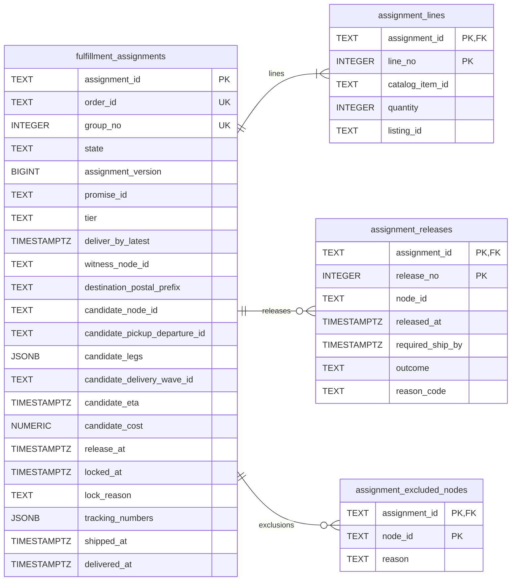
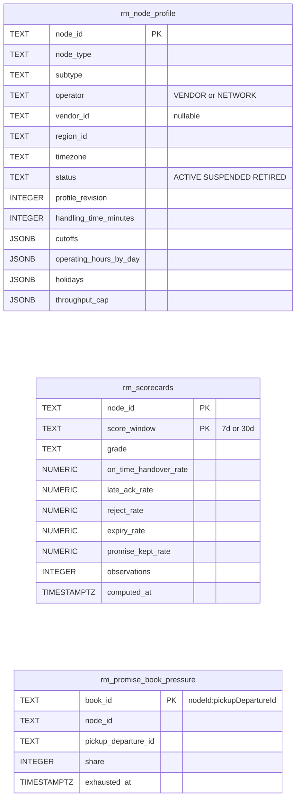
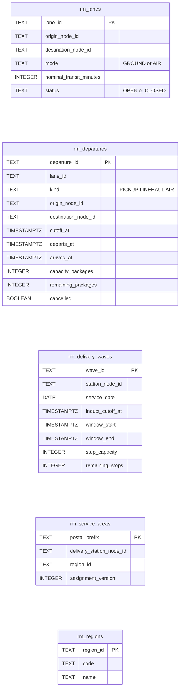
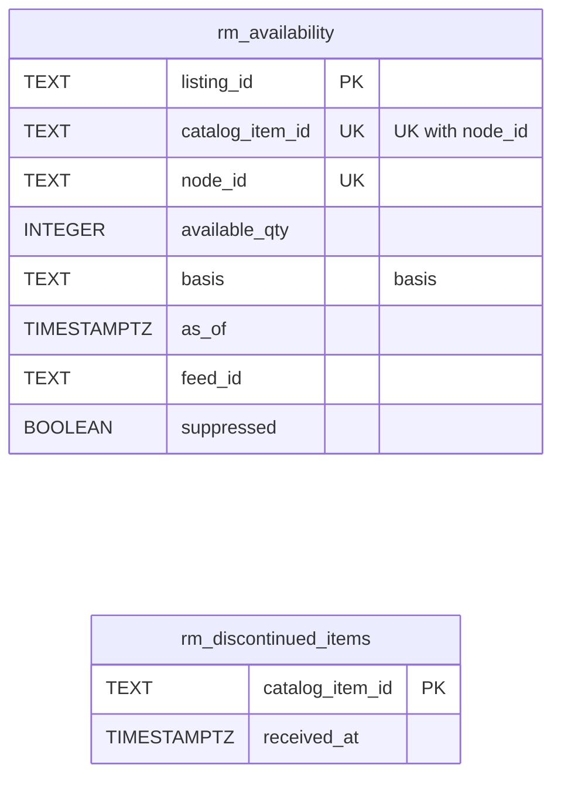
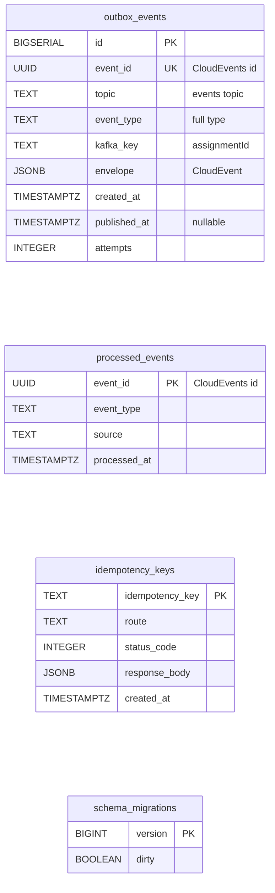

# Entity Relationship

:::info[Proposed design]
Derived from [`model/model.yaml`](https://github.com/IQVO/retail-network-docs/blob/main/model/model.yaml). Nothing in this context is built yet; identifiers (`Err...` names, routes, CloudEvents types) are the names an implementation must use.
:::

A **proposed** schema for this context's own Postgres database ("every
context owns its database; no shared tables"). Column names are the model's
field names in `snake_case`; SQL types are this page's proposal. A
relationship line is drawn **only** for a foreign key inside one aggregate.

## FulfillmentAssignment (aggregate tables)

Derived from: model.yaml → `contexts[order-sourcing].aggregates[FulfillmentAssignment]`
(`root_id`, `states`, `value_objects`, `invariants`), `.publishes[*].data`;
`contexts[customer-ordering].publishes[CustomerOrderPlaced].data`
(`destinationPostalPrefix`, `lineNo`).

Column notes: `order_id` + `group_no` is one composite unique key (one
assignment per shipment group); `state` is `CHECK`ed against the seven states;
`assignment_version` is the optimistic lock; `candidate_legs` holds the
departure ids; `release_at` orders the virtual queue; `listing_id` is set at
release; `outcome` is `ACCEPTED`, `REJECTED`, `EXPIRED` or `PENDING`.
Every child table's `assignment_id` is a foreign key to
`fulfillment_assignments` with `ON DELETE CASCADE`. The candidate, lock,
shipment and delivery columns are nullable until they apply.

Omitted: indexes. Proposed: a partial index on `release_at WHERE state =
'QUEUED'` (the virtual queue and the release timer), a partial unique index
on `assignment_releases (assignment_id) WHERE outcome = 'PENDING'`
(`ErrReleaseInFlight` as a database backstop), and indexes on `promise_id`
and on `candidate_node_id` (`GET /assignments?nodeId=`). The exclusion table
has no promise-revision column because `PromiseConstraint` carries none
(open question). `destination_postal_prefix` is a postal prefix, not an
address: no PII is stored here.

## Read-model tables

Fed only by sibling events; rebuilt by replaying their topics.

Derived from: model.yaml → `contexts[order-sourcing].read_models`; the
producers' `publishes[*].data` (`node-topology`, `linehaul-transportation`,
`last-mile-delivery`, `offer-availability`, `node-performance`,
`delivery-promise`).

The five read models map to tables as follows: `NodeProfileView` →
`rm_node_profile`; `NetworkGraphView` → `rm_lanes`, `rm_departures`,
`rm_delivery_waves`, `rm_service_areas`, `rm_regions`; `AvailabilityView` →
`rm_availability`, `rm_discontinued_items`; `ScorecardView` →
`rm_scorecards`; `PromiseBookPressureView` → `rm_promise_book_pressure`.
`score_window` stands for the scorecard's `window` (a reserved word in SQL).

Omitted: scorecard `feed_freshness_p95_minutes` and the node's
`sort_dwell_minutes`, `postal_code` and `country_code`, which the ranking does
not use.

## Infrastructure tables

Derived from: model.yaml → `conventions.integration_rules` (outbox,
idempotent consumers on the CloudEvents id), `conventions.cloudevents`.

**All four are infrastructure, not domain tables.** `outbox_events` is
written in the same transaction as the aggregate and drained by the relay.
`processed_events` is the inbox: one row per consumed CloudEvents `id`,
written in the same transaction as its effect. `idempotency_keys` stores the
answer to `POST /assignments/{assignmentId}:reoptimise` per
`Idempotency-Key`. `schema_migrations` is the migration tool's bookkeeping.

## No foreign key across aggregates or contexts

- `node_id`, `candidate_node_id`, `witness_node_id`, `promise_id`,
  `order_id`, `catalog_item_id`, `listing_id`, `pickup_departure_id` name
  entities **of other contexts**. Those live in other databases, so they are
  values, not foreign keys. A node retired in `node-topology` must not be able
  to block a write here.
- The `rm_` tables are **not** joined to the aggregate by foreign keys
  either: they are projections that can be dropped and replayed at any time;
  a constraint would make a replay order-dependent.
- There is only one aggregate, so no cross-aggregate key exists; the child
  tables are part of `FulfillmentAssignment` and are written with it.

## Table ≠ aggregate

| Table | Aggregate / role | Notes |
| --- | --- | --- |
| `fulfillment_assignments` | **FulfillmentAssignment** (root) | One row per shipment group; `assignment_version` guards every update (`ErrStaleAssignmentVersion`). |
| `assignment_lines` | **FulfillmentAssignment** (lines) | Written at queueing; `listing_id` filled at release. |
| `assignment_releases` | **FulfillmentAssignment** (`Release` value objects) | One row per release; `outcome` moves from `PENDING` once. |
| `assignment_excluded_nodes` | **FulfillmentAssignment** (`ExcludedNode` value objects) | One row per refusing node. |
| `rm_node_profile` | read model `NodeProfileView` | |
| `rm_lanes`, `rm_departures`, `rm_delivery_waves`, `rm_service_areas`, `rm_regions` | read model `NetworkGraphView` | One view, five tables. |
| `rm_availability`, `rm_discontinued_items` | read model `AvailabilityView` | |
| `rm_scorecards` | read model `ScorecardView` | |
| `rm_promise_book_pressure` | read model `PromiseBookPressureView` | Rows age out after their pickup cutoff. |
| `outbox_events`, `processed_events`, `idempotency_keys`, `schema_migrations` | none (infrastructure) | |
