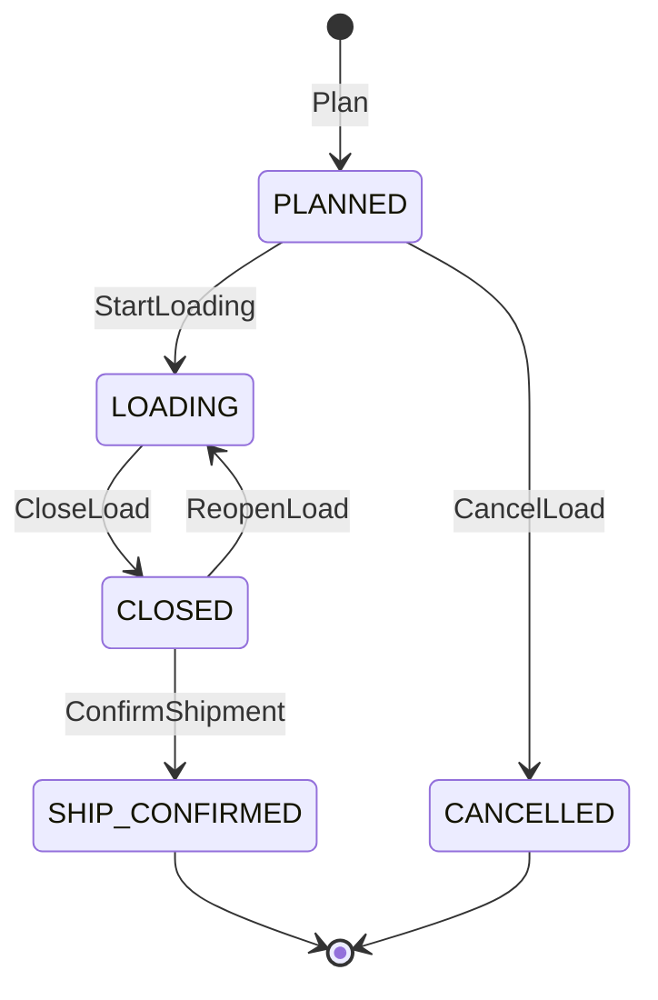
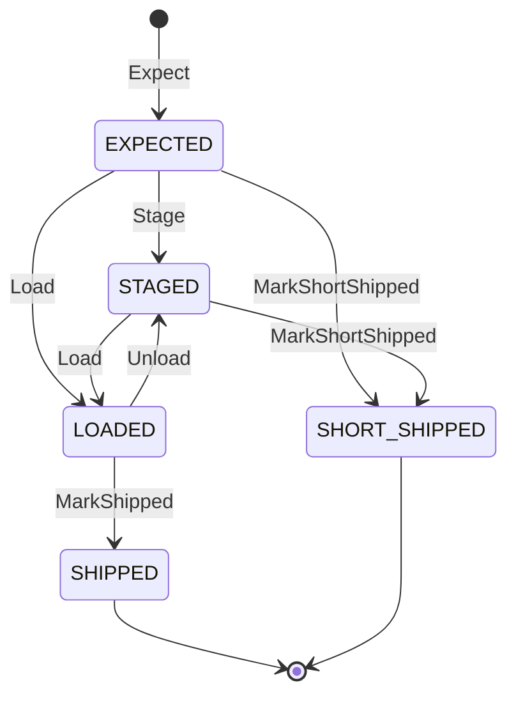
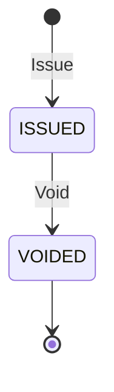

# Aggregate design canvas

:::info[Synced from outbound-shipping]
This page is a copy of [`docs/docs/ddd/aggregate-design-canvas.md`](https://github.com/IQVO/outbound-shipping/blob/develop/docs/docs/ddd/aggregate-design-canvas.md) on `develop`, derived from that repository's code. Edit it there, then re-sync.
:::

Following the ddd-crew [Aggregate Design Canvas](https://github.com/ddd-crew/aggregate-design-canvas). Three aggregates, each with its own repository and its own `version` for optimistic concurrency. Rules that span aggregates (one open load per key, the confirm cascade) live in use cases, with a database constraint as the race backstop.

Source: `internal/domain/outboundload/{load,commands,errors,events}.go`, `internal/domain/shippingpackage/{package,commands,errors,events}.go`, `internal/domain/billoflading/{bol,errors,events}.go`, `internal/domain/shared/*.go`, `migrations/0001_outbound_shipping_schema.up.sql`.

## OutboundLoad

**Purpose.** The packages planned to leave together for one `(site, cpt, operating date, ship method)`.

**Identity.** `load_id` (`shared.LoadID`), minted by `ports.LoadIDs` when the load is planned. Version 1 at planning, +1 per event-raising transition (`AttachTrailer` raises nothing and bumps nothing).

**State machine.**

Source: `internal/domain/outboundload/commands.go`, `internal/domain/outboundload/load.go`.

`AssignDoor` is allowed while `PLANNED` or `LOADING` and does not change the state.

**Enforced invariants.**

| Invariant | Error | Enforced by |
| --- | --- | --- |
| At most one open load per cutoff key | `ErrDuplicateOpenLoad` | `Plan` (given the open keys) and the partial unique index `uq_open_load_per_cutoff` as race backstop |
| Loading starts only with a door and a docked trailer | `ErrTrailerNotDocked` | `StartLoading` |
| The trailer must dock at the load's door | `ErrWrongDoor` | `AttachTrailer` |
| A load closes only when every package is loaded or short-shipped | `ErrPackagesOutstanding` | `CloseLoad` (outstanding list supplied by the use case) |
| Every short-ship names a package and a reason | `ErrInvalidShortShip` | `CloseLoad` |
| Ship-confirm needs a `CLOSED` load | `ErrLoadNotClosed` | `ConfirmShipment` |
| A `SHIP_CONFIRMED` load never changes | `ErrLoadConfirmed` | `refuseIfConfirmed` on every command |
| Only a `PLANNED` load can be cancelled, with a reason | `ErrInvalidTransition`, `ErrCancelReasonRequired` | `CancelLoad` |
| A command not allowed from the current state | `ErrInvalidTransition` | each command |
| Operating date is a calendar date; version at least 1 | `ErrInvalidOperatingDate`, `ErrInvalidVersion` | `Plan`, `Rehydrate` |

**Commands to events.**

| Command | Allowed from | Event |
| --- | --- | --- |
| `Plan` | none | `LoadPlanned` |
| `AssignDoor` | `PLANNED`, `LOADING` | `LoadDoorAssigned` |
| `AttachTrailer` | `PLANNED`, `LOADING` | none |
| `StartLoading` | `PLANNED` | `LoadingStarted` |
| `CloseLoad` | `LOADING` | `LoadClosed` |
| `ReopenLoad` | `CLOSED` | `LoadReopened` |
| `ConfirmShipment` | `CLOSED` | `ShipmentConfirmed` |
| `CancelLoad` | `PLANNED` | `LoadCancelled` |

**Data.** Cutoff key, `cutoff`, `state`, `door_code`, `trailer_id`, `appointment_id`, `short_ships[]` (package id and reason), `package_count` (loaded count recorded at close), `version`. Table `outbound_loads`.

**Collaborators.** `ShippingPackage` (by `load_id`), dock-scheduling (door, carrier), yard-management (trailer, departure).

## ShippingPackage

**Purpose.** One manifested package and where it is on its way to the truck.

**Identity.** `package_id` (`shared.PackageID`), the id fulfillment-execution assigned. Version 1 when expected, +1 per event-raising change.

Source: `internal/domain/shippingpackage/commands.go`, `internal/domain/shippingpackage/package.go`.

| Invariant | Error | Enforced by |
| --- | --- | --- |
| Stages only at a Staging location of its own site | `ErrNotStagingLocation` | `Stage` (facts from the layout copy) |
| Loads only onto its own load, through that load's door | `ErrWrongLoad` | `Load` |
| Belongs to one load at a time | `ErrPackageOnAnotherLoad` | `AssignToLoad` (same load again is a no-op) |
| Unloads only before ship-confirm | `ErrAlreadyShipped` | `Unload`, `Load` |
| A short-ship needs a reason | `ErrShortShipReasonRequired` | `MarkShortShipped` |
| A missed flag needs a load and is raised at most once | `ErrLoadRequired`, once-guard `missed_flagged` | `FlagMissedLoad` |
| Weight is not negative | `ErrInvalidWeight` | `Expect` |

| Command | Allowed from | Event |
| --- | --- | --- |
| `Expect` | none | none |
| `AssignToLoad` | any (not another load) | none |
| `Stage` | `EXPECTED` (a repeat at the same location is a no-op) | `PackageStaged` |
| `Load` | `EXPECTED`, `STAGED` | `PackageLoaded` |
| `Unload` | `LOADED` | `PackageUnloaded` |
| `MarkShipped` | `LOADED` | none |
| `MarkShortShipped` | `EXPECTED`, `STAGED` | none |
| `FlagMissedLoad` | any state except `LOADED`, `SHIPPED` | `PackageMissedLoad` (once) |

**Data.** `site_id`, `source_order_id`, `work_unit_ref`, `weight_g`, `load_id`, `staging_location`, `state`, `missed_flagged`, `version`. Table `shipping_packages`.

## BillOfLading

**Purpose.** The shipping document of one confirmed load.

**Identity.** `bol_number` (`shared.BolNumber`), minted by `ports.LoadIDs.NewBolNumber` from the load's operating date. Version 1 at issue, 2 once voided.

Source: `internal/domain/billoflading/bol.go`.

| Invariant | Error | Enforced by |
| --- | --- | --- |
| Issued only for a ship-confirmed load, exactly once per load | `ErrBolAlreadyIssued` (two messages: already exists, or load not confirmed) | `Issue`; `UNIQUE (load_id)` in `bills_of_lading` |
| Issued only with the seal the yard recorded | `ErrSealMissing` | `Issue` |
| Carrier, trailer, bol number, load and site are required; at least one package; weight not negative | `ErrRequiredField`, `ErrInvalidPackageCount`, `ErrInvalidWeight` | `Issue` |
| Void needs a reason, once | `ErrVoidReasonRequired`, `ErrBolAlreadyVoided` | `Void` |

| Command | Allowed from | Event |
| --- | --- | --- |
| `Issue` | none | `BillOfLadingIssued` |
| `Void` | `ISSUED` | `BillOfLadingVoided` |

**Data.** Carrier, optional SCAC, trailer, seal, package count, total weight in grams, issue and void instants, void reason, state, version. Table `bills_of_lading`.

## Cross-aggregate rules (in use cases)

| Rule | Where |
| --- | --- |
| One open load per cutoff key, with a retried race | `ExpectPackage` plus `uq_open_load_per_cutoff` |
| The confirm cascade: `ConfirmShipment`, every loaded package `MarkShipped`, `Issue` the bill of lading | `OnDeparture.confirm`, one transaction |
| Short-ships mark packages before the close is judged | `CloseLoad.applyShortShips` |
| A load with packages cannot be cancelled | `CancelLoad` (`ErrLoadHasPackages`) |
| Dedupe of consumed events | `Intake` with `processed_events` |

## Sizing

Aggregates are small and loaded whole: a package is a flat row; a load holds its short-ship list as JSON. A load's packages are referenced by id (`load_id` on the package), not embedded, so a load with thousands of packages stays a single-row aggregate. Pagination of a load's packages is by keyset, page size 200 inside use cases.
