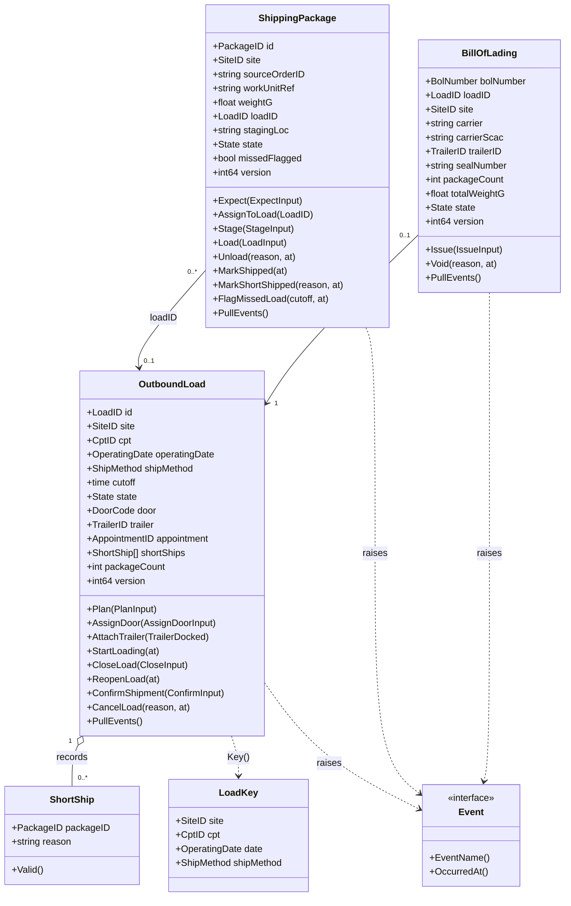
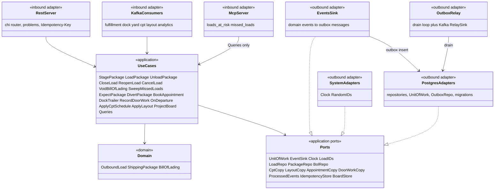

# Class diagram

:::info[Synced from outbound-shipping]
This page is a copy of [`docs/docs/ddd/class-diagram.md`](https://github.com/IQVO/outbound-shipping/blob/develop/docs/docs/ddd/class-diagram.md) on `develop`, derived from that repository's code. Edit it there, then re-sync.
:::

Two diagrams: the domain model (aggregates, value objects, events) and the hexagonal structure (use cases, ports, adapters). Go has no classes: the boxes are structs and interfaces, the methods are the exported ones that matter.

## Domain model

Source: `internal/domain/outboundload/load.go`, `internal/domain/outboundload/commands.go`, `internal/domain/shippingpackage/package.go`, `internal/domain/shippingpackage/commands.go`, `internal/domain/billoflading/bol.go`, `internal/domain/shared/shortship.go`, `internal/domain/shared/ids.go`.

Events raised per aggregate: `OutboundLoad` raises `LoadPlanned`, `LoadDoorAssigned`, `LoadingStarted`, `LoadClosed`, `LoadReopened`, `ShipmentConfirmed`, `LoadCancelled`; `ShippingPackage` raises `PackageStaged`, `PackageLoaded`, `PackageUnloaded`, `PackageMissedLoad`; `BillOfLading` raises `BillOfLadingIssued`, `BillOfLadingVoided`. Each package declares its own `Event` interface and `Header` (id, site, version after the change, instant). Aggregates have private fields and are rebuilt through `Rehydrate`, which validates every field.

## Hexagonal structure

Source: `cmd/api/wire.go`, `cmd/api/consumers.go`, `cmd/mcp/main.go`, `internal/application/ports/ports.go`, `internal/application/ports/unit_of_work.go`, `internal/application/usecases/*.go`, `internal/adapters/**`, `internal/architecture/architecture_test.go`.

Notes: `cmd/` is the only place adapters meet (adapters never import each other); `EventsSink` writes through the `Inserter` interface that `postgres.OutboxRepo` implements, wired in `cmd/api/wire.go`. The in-memory adapters in `internal/adapters/outbound/memory` implement the same ports for tests only and are never imported by `cmd/`.
