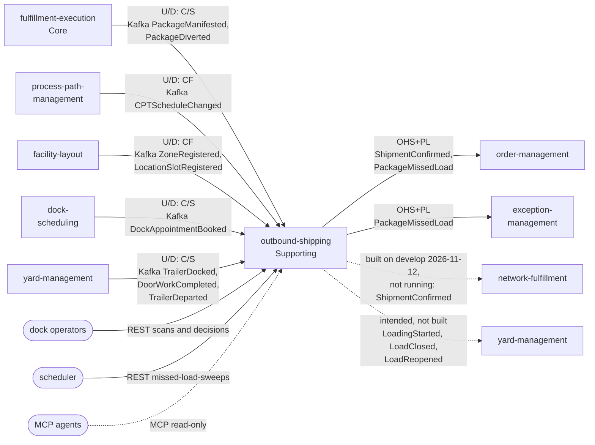

# Context map

:::info[Synced from outbound-shipping]
This page is a copy of [`docs/docs/ddd/context-map.md`](https://github.com/IQVO/outbound-shipping/blob/develop/docs/docs/ddd/context-map.md) on `develop`, derived from that repository's code. Edit it there, then re-sync.
:::

Following ddd-crew [Context Mapping](https://github.com/ddd-crew/context-mapping). This is **outbound-shipping's slice** of the fleet map: every relationship it has, with the upstream (U) and downstream (D) side, the pattern and the channel. Abbreviations: OHS = Open Host Service, PL = Published Language, CF = Conformist, C/S = Customer/Supplier.

Source: `internal/adapters/inbound/kafka/fulfillment_consumer.go`, `internal/adapters/inbound/kafka/cpt_layout_consumers.go`, `internal/adapters/inbound/kafka/dock_yard_consumers.go`, `internal/adapters/outbound/events/sink.go`, `apis/asyncapi.yaml`, `docs/adr/0001-outbound-shipping-bounded-context.md`, `docs/adr/0005-cloudevents-envelope-and-type-catalogue.md`.

Legend: arrows point from upstream to downstream. Solid = events or commands that exist on both sides; dotted = a synchronous read, or an edge that [ADR 0005](https://iqvo.github.io/outbound-shipping/docs/adr/0005-cloudevents-envelope-and-type-catalogue) intends but is not yet running in the cluster (checked 2026-11-13: network-fulfillment's consumer landed on its `develop` on 2026-11-12 but the pod's image predates it; yard-management's consumer does not exist). "Exists on both sides" is about code and configuration; the live question is separate: outbound-shipping is applied and running, so the solid edges whose both ends run — the five upstreams, the analytics fold and exception-management — **are live** today (see [Integration](https://iqvo.github.io/outbound-shipping/docs/ecosystem/integration#edge-status-in-the-cluster)). `yard-management` appears twice because it is on both sides of the intended relationship. People and callers are rounded boxes.

Omitted: Kafka and Postgres as infrastructure. **Separate Ways** (no edge at all): the retail network; no `retailnetwork.*` topic is consumed or produced, and network-fulfillment stays the only channel to it. No sibling is called synchronously: sibling data reaches this service only as event-fed local copies.

## Relationships

| Neighbour | Direction | Pattern | Channel | Notes |
| --- | --- | --- | --- | --- |
| fulfillment-execution | upstream | Customer/Supplier | `warehouse.fulfillment.events` | The producer's correlation fields (`site_id`, `source_order_id`, `cpt`, `weight_g`) are additive and optional ([ADR 0003](https://iqvo.github.io/outbound-shipping/docs/adr/0003-package-manifested-carries-ship-correlation)); the consumer never parses `order_ref`. |
| process-path-management | upstream | Conformist | `warehouse.process-path-management.events` | Takes `CPTScheduleChanged` as published; no translation beyond the cutoff resolution. |
| facility-layout | upstream | Conformist | `warehouse.facility.events` | Takes `ZoneRegistered` and `LocationSlotRegistered`; a location's site is its zone's site. |
| dock-scheduling | upstream | Customer/Supplier | `warehouse.dock-scheduling.events` | Outbound `DockAppointmentBooked` only; `cpt_id` and `carrier_scac` nullable. Pinned and tested ([ADR 0007](https://iqvo.github.io/outbound-shipping/docs/adr/0007-dock-scheduling-contract-pinned)). |
| yard-management | upstream | Customer/Supplier | `warehouse.yard-management.events` | The only recorder of physical facts. Pinned and tested ([ADR 0006](https://iqvo.github.io/outbound-shipping/docs/adr/0006-yard-contract-pinned)). |
| order-management | downstream | OHS + PL | `warehouse.outbound-shipping.events` | Implemented in code (shipped lines from `ShipmentConfirmed`, re-promise from `PackageMissedLoad`); off by default and not switched on in warehouse-infra. |
| exception-management | downstream | OHS + PL | `warehouse.outbound-shipping.events` | Implemented: one case per `PackageMissedLoad`; its consumer group is set in warehouse-infra. |
| network-fulfillment | downstream | OHS + PL (intended) | `warehouse.outbound-shipping.events` | Built on its `develop` on 2026-11-12 (its PR 165); the running pod's image predates it, so the edge is not live yet. |
| yard-management (reverse edge) | downstream | C/S (intended) | `warehouse.outbound-shipping.events` | Absent: no handler on its `develop`. |
| dock operators, schedulers | clients | none | REST | Unauthenticated. |
| MCP agents | clients | none | MCP over Streamable HTTP | Read-only, unauthenticated. |
