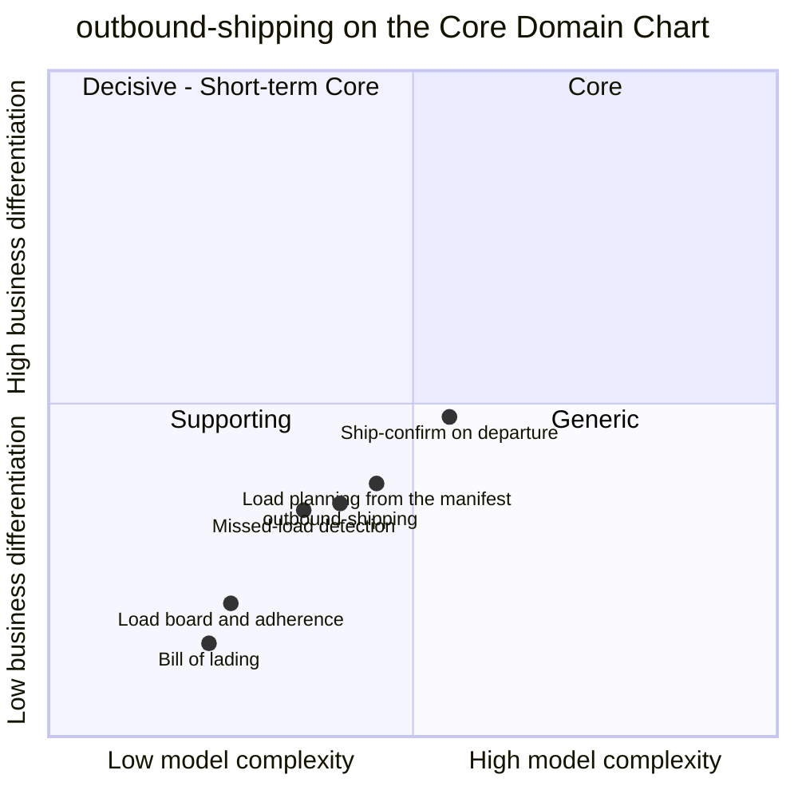

# Core domain chart

:::info[Synced from outbound-shipping]
This page is a copy of [`docs/docs/ddd/core-domain-chart.md`](https://github.com/IQVO/outbound-shipping/blob/develop/docs/docs/ddd/core-domain-chart.md) on `develop`, derived from that repository's code. Edit it there, then re-sync.
:::

Following the ddd-crew [Core Domain Charts](https://github.com/ddd-crew/core-domain-charts): business differentiation (y) against model complexity (x).

Source: `internal/domain/outboundload/load.go`, `internal/domain/outboundload/commands.go`, `internal/domain/shippingpackage/commands.go`, `internal/domain/billoflading/bol.go`, `internal/application/usecases/on_departure.go`, `internal/application/usecases/expect_package.go`, `internal/application/usecases/sweep_missed.go`, `internal/application/usecases/project_board.go`.

Omitted: the other contexts (their points are on their own charts; the fleet plot is the [Core Domain Chart](https://iqvo.github.io/warehouse-docs/strategic-design/core-domain-chart) in warehouse-docs, where this context is plotted at the same point as above, 0.40, 0.35, read on `origin/main` on 2026-11-11). The five slices are this page's reading of the code, not values taken from a design model: they place relative effort and distinctiveness, not measurements. All of them stay in quadrant 3 (Supporting) or on its edge.

## Classification: Supporting

The context point sits in **quadrant 3 (Supporting)** ([classification](https://iqvo.github.io/outbound-shipping/docs/ddd/subdomain-classification), [ADR 0001](https://iqvo.github.io/outbound-shipping/docs/adr/0001-outbound-shipping-bounded-context)).

**Differentiation is moderate to low (y = 0.35).** The fleet does not win customers by how it records what was loaded on a truck. What this context protects is accuracy and timeliness of the "it left" fact that order-management, exception-management and the retail network act on. The highest slice is ship-confirm on departure, because getting it wrong (confirming a load that did not leave, or missing one that did) is the failure other contexts feel.

**Model complexity is moderate (x = 0.40).** Three aggregates, small state machines (5, 5 and 2 states), and cross-aggregate coordination that lives in use cases: one open load per cutoff key under a race backstop, a departure that must be handled differently in three load states, idempotency at three layers, and events that arrive out of order from five producers. There is no optimiser and no scoring.

## Slices

| Slice | Reading | Why |
| --- | --- | --- |
| Ship-confirm on departure (`OnDeparture`) | highest differentiation, highest complexity | Three-way split on the load state, the seal rule, the once-only bill of lading, the "never confirm a loading load" decision of [ADR 0002](https://iqvo.github.io/outbound-shipping/docs/adr/0002-ship-confirm-follows-the-physical-departure). |
| Load planning from the manifest (`ExpectPackage`, `ResolveCutoff`) | middle | Resolves a manifested cutoff instant against a site's timezone schedule, with one open load per key and a retried race. |
| Missed-load detection (`FlagMissedLoad`, `SweepMissedLoads`) | lower | A once-per-package flag raised by a sweep or by an early departure. |
| Load board and adherence (`ProjectBoard`) | low | Plain counting over the own analytics stream. |
| Bill of lading (`BillOfLading`) | lowest | A commodity document with one invariant pair (confirmed load, seal). |

## Evolution

| Part | Evolution stage (reading) | Why |
| --- | --- | --- |
| Load, package and ship-confirm model | **Custom-built** | Specific to the fleet's split between the yard (physical facts) and shipping (the load). |
| Bill of lading | **Product** | A shipping document is commodity; a product could issue it if fed the same facts. |
| Board and adherence report | **Custom-built, thin** | A small projection with no analytics database behind it. |
| Plumbing (outbox, inbox, CloudEvents, idempotency) | **Commodity** | The same building blocks as every context of the fleet. |

**Movement to watch.** Pallets, load sequencing and a master bill of lading are deferred ([ADR 0001](https://iqvo.github.io/outbound-shipping/docs/adr/0001-outbound-shipping-bounded-context), decision D4); adding them would raise model complexity but not differentiation. If loading adherence ever drove dispatch decisions rather than being reported, the missed-load slice would move toward the Core quadrant.
