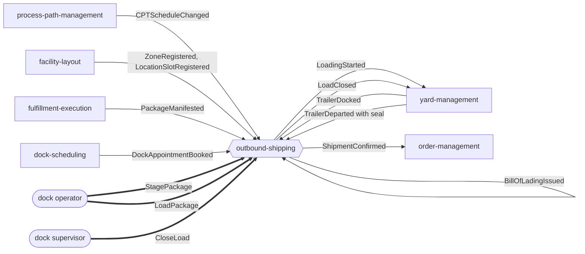
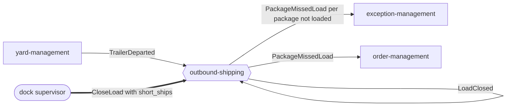
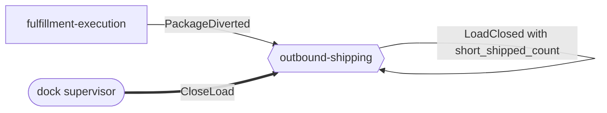
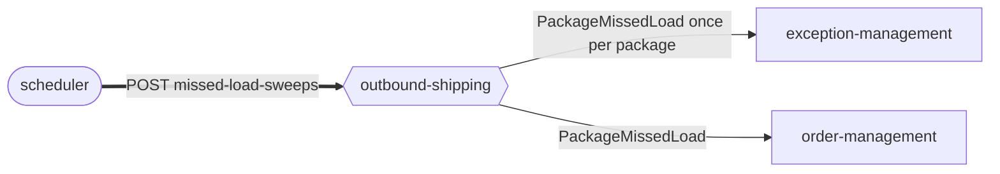
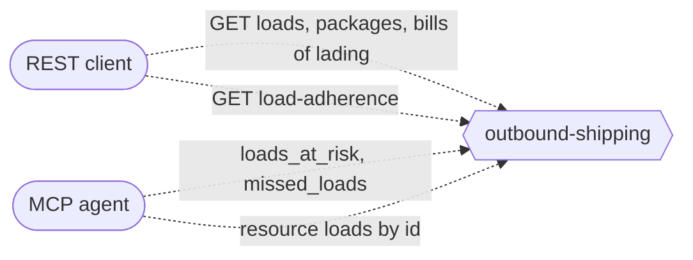

# Domain message flow

:::info[Synced from outbound-shipping]
This page is a copy of [`docs/docs/ddd/domain-message-flow.md`](https://github.com/IQVO/outbound-shipping/blob/develop/docs/docs/ddd/domain-message-flow.md) on `develop`, derived from that repository's code. Edit it there, then re-sync.
:::

Following ddd-crew [Domain Message Flow Modelling](https://github.com/ddd-crew/domain-message-flow-modelling): actors and contexts exchange **commands**, **events** and **queries**. In the diagrams, rectangles are contexts, rounded boxes are people or schedulers, solid arrows are events on Kafka, thick arrows are commands over REST, dotted arrows are queries.

Source: `internal/application/usecases/*.go`, `internal/adapters/inbound/kafka/*.go`, `internal/adapters/outbound/events/*.go`, `features/ship_confirm_on_departure.feature`, [ADR 0002](https://iqvo.github.io/outbound-shipping/docs/adr/0002-ship-confirm-follows-the-physical-departure).

## 1. From manifest to ship-confirm (happy path)

Source: `internal/application/usecases/expect_package.go`, `book_appointment.go`, `dock_trailer.go`, `scan_package.go`, `load_commands.go`, `on_departure.go`. The self arrows are events folded by the context's own projector (analytics only). The arrows to yard-management for `LoadingStarted` and `LoadClosed` are the intended edge of [ADR 0005](https://iqvo.github.io/outbound-shipping/docs/adr/0005-cloudevents-envelope-and-type-catalogue); the yard has no handler for them yet.

Reading: the cutoff schedule and staging locations are copied in first and passively. The first manifested package plans the load; a dock appointment gives it a door; the yard's docking starts loading. Operators scan; the supervisor closes. Only the yard's departure, never a user command, confirms the shipment.

## 2. The departure that comes before the close

Source: `internal/application/usecases/on_departure.go` (`flagWithoutClose`), `features/ship_confirm_on_departure.feature` (scenarios 2 and 3). The load is not confirmed and no bill of lading exists. After the supervisor short-ships and closes, a re-delivery of the same departure confirms nothing either (the inbox claim). exception-management opens one case per package; order-management re-promises the order.

## 3. A diverted package

Source: `internal/application/usecases/divert_package.go`, `load_commands.go`, `features/ship_confirm_on_departure.feature` (scenario 5). The diverted package becomes `SHORT_SHIPPED` with reason `DIVERTED`, raises no event, and no longer blocks the close. The close records it once in the load's short-ship list.

## 4. The missed-load sweep

Source: `internal/application/usecases/sweep_missed.go`, `features/ship_confirm_on_departure.feature` (scenario 6). Running the sweep twice flags each package once.

## 5. Reads

Source: `internal/application/usecases/queries.go`, `internal/adapters/inbound/mcp/tools.go`, `internal/adapters/inbound/http/handlers.go`. REST reads of loads and packages hit the OLTP tables; the adherence report, `loads_at_risk` and the board read the projector-fed `load_board`, which may lag by a few seconds.
