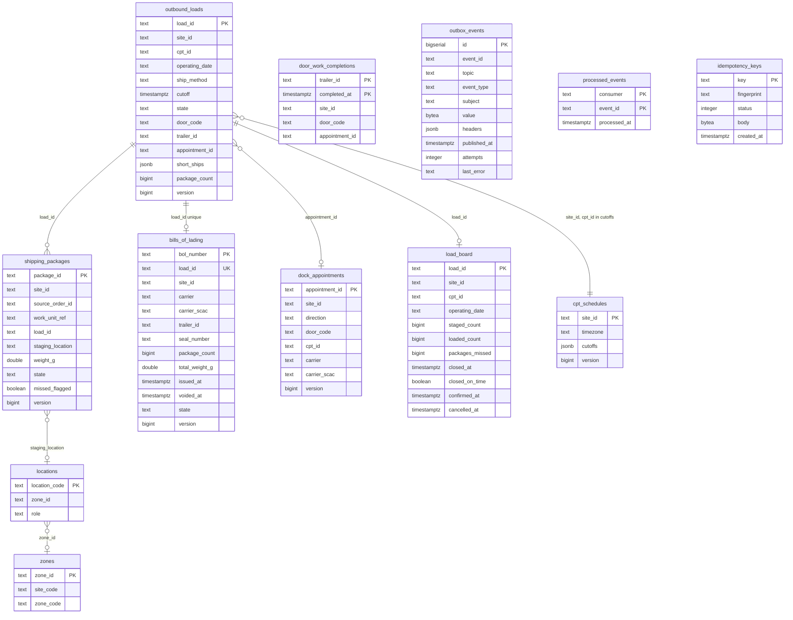

# Entity relationship

:::info[Synced from outbound-shipping]
This page is a copy of [`docs/docs/ddd/entity-relationship.md`](https://github.com/IQVO/outbound-shipping/blob/develop/docs/docs/ddd/entity-relationship.md) on `develop`, derived from that repository's code. Edit it there, then re-sync.
:::

One PostgreSQL schema, created by `migrations/0001_outbound_shipping_schema.up.sql` (embedded in the binaries, applied at boot). There are no foreign keys: aggregates reference each other by id and the local copies are joined in Go or by key. The relationships drawn below are logical.

Source: `migrations/0001_outbound_shipping_schema.up.sql`, `internal/adapters/outbound/postgres/*.go`.

Some columns are omitted for readability (`created_at`/`updated_at`, `dataschema`, `key`, `content_type`, `window_start`, `window_end`, `booked_at`, `void_reason`). The migration has the full list.

## Tables

| Table | Role | Key and constraints | Written by |
| --- | --- | --- | --- |
| `outbound_loads` | `OutboundLoad` aggregate | PK `load_id`; `state` check (5 values); `version >= 1`; **partial unique index `uq_open_load_per_cutoff`** on `(site_id, cpt_id, operating_date, ship_method)` where `state IN ('PLANNED','LOADING')`; indexes for listing, site and state, open loads by site and cpt, open loads by site and door, loads by site and trailer | `ExpectPackage`, door, dock, close, reopen, cancel, confirm |
| `shipping_packages` | `ShippingPackage` aggregate | PK `package_id`; `state` check (5 values); `weight_g >= 0`; indexes by load, by load and state, listing, site and missed | `ExpectPackage`, scans, close, confirm, sweep |
| `bills_of_lading` | `BillOfLading` aggregate | PK `bol_number`; **`UNIQUE (load_id)`** (one document per load); `package_count >= 1`; `state` check | `OnDeparture`, `VoidBillOfLading` |
| `cpt_schedules` | local copy of the cutoff schedule | PK `site_id`; the whole schedule replaced per event | cpt consumer |
| `zones`, `locations` | local copy of staging locations | PK `zone_id`, `location_code`; a location's site is its zone's site; empty `role` means Storage | layout consumer |
| `dock_appointments` | local copy of appointments acted on | PK `appointment_id`; carrier and SCAC read back at ship-confirm | dock consumer |
| `door_work_completions` | copy of `DoorWorkCompleted` | PK `(trailer_id, completed_at)` | yard consumer |
| `load_board` | LoadBoardView projection | PK `load_id`; index `(site_id, operating_date, cpt_id)` for the report | analytics consumer |
| `outbox_events` | transactional outbox | PK `id`; `UNIQUE (event_id, topic)`; partial index of unpublished rows | use cases (insert), relay (drain) |
| `processed_events` | inbox | PK `(consumer, event_id)` | every consumer |
| `idempotency_keys` | stored answers of REST POSTs | PK `key`; `status` between 200 and 499; index on `created_at` | the Idempotency-Key middleware |

Text keys that are compared or ordered in Go use the `"C"` collation so ordering and keyset comparisons follow byte order. The migration has a `.down.sql`; there is no other migration.

There is no analytics database and no retention job: `outbox_events`, `processed_events` and `idempotency_keys` grow without a purge (see the [runbook](/contexts/outbound-shipping/runbook)).
