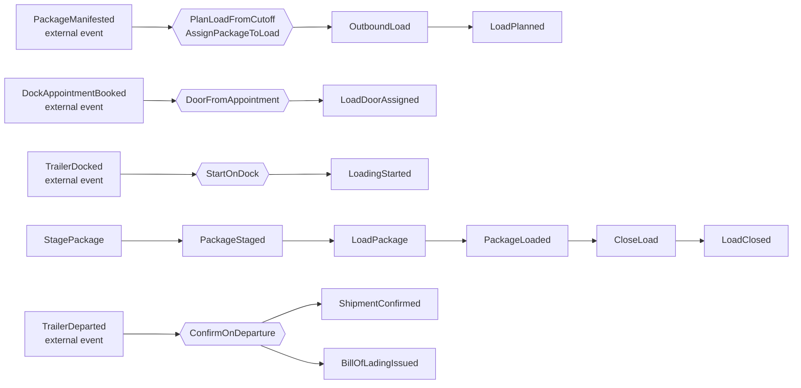

# EventStorming

:::info[Synced from outbound-shipping]
This page is a copy of [`docs/docs/ddd/eventstorming.md`](https://github.com/IQVO/outbound-shipping/blob/develop/docs/docs/ddd/eventstorming.md) on `develop`, derived from that repository's code. Edit it there, then re-sync.
:::

Following the ddd-crew [EventStorming glossary](https://github.com/ddd-crew/eventstorming-glossary-cheat-sheet): events (orange), commands (blue), policies (lilac), aggregates (yellow), external systems and read models, plus **hotspots** (red) for the questions the model had to settle. The board is reconstructed from the code and the ADRs, not a record of a workshop.

Source: `internal/domain/*`, `internal/application/usecases/*`, `docs/adr/0001` to `0006`.

## Process-level timeline

Source: `internal/application/usecases/expect_package.go`, `book_appointment.go`, `dock_trailer.go`, `scan_package.go`, `load_commands.go`, `on_departure.go`.

Alternative and exception lanes (all are events or commands in the code):

| Lane | Sequence |
| --- | --- |
| Unload | `UnloadPackage` then `PackageUnloaded` (package back to `STAGED`) |
| Reopen | `ReopenLoad` then `LoadReopened` (load back to `LOADING`) |
| Cancel | `CancelLoad` then `LoadCancelled` (only a planned load with no packages) |
| Diversion | external `PackageDiverted`, policy DropDiverted, package `SHORT_SHIPPED` (no event) |
| Early departure | external `TrailerDeparted` on a `LOADING` load, policy FlagDepartureWithoutClose, `PackageMissedLoad` per package |
| Cutoff passes | `SweepMissedLoads` command (a scheduler), policy SweepMissedLoad, `PackageMissedLoad` per package |
| Void | `VoidBillOfLading` then `BillOfLadingVoided` |

Read models on the board: the cutoff schedule copy, the staging-location copy, the dock-appointment copy and the `LoadBoardView` (`load_board`).

## Hotspots and how each was settled

| Hotspot | Settlement |
| --- | --- |
| Who confirms that an order shipped: a supervisor's click, or the departure? | The departure. The yard is the only recorder of physical facts, so ship-confirm follows `TrailerDeparted` ([ADR 0002](https://iqvo.github.io/outbound-shipping/docs/adr/0002-ship-confirm-follows-the-physical-departure), decision D3). There is no confirm route. |
| What if the trailer leaves before the load was closed? | Never confirm. Flag every package not loaded with `PackageMissedLoad`, leave the load for a supervisor; the later close does not confirm either. |
| A departure that has no seal. | Confirms nothing: the bill of lading must certify the yard's seal (`ErrSealMissing`). The load stays `CLOSED`. |
| How does a manifest know which load it belongs to? | `PackageManifested` carries optional `site_id`, `cpt` and `source_order_id`; without them nothing is planned ([ADR 0003](https://iqvo.github.io/outbound-shipping/docs/adr/0003-package-manifested-carries-ship-correlation), decision D5). |
| Two packages of one cutoff manifest at the same moment. | One open load per key: a partial unique index backs the rule and the loser retries once and joins the winner. |
| What replaces the manual shipment confirmation toward the retail network? | `ShipmentConfirmed`, consumed by network-fulfillment ([ADR 0004](https://iqvo.github.io/outbound-shipping/docs/adr/0004-shipment-confirmed-replaces-the-manual-network-confirmation)); the consumer is not built yet. |
| Does the yard contract really carry the facts this service needs? | It did not (the yard published two of the three on its analytics topic only). The contract is now pinned and tested ([ADR 0006](https://iqvo.github.io/outbound-shipping/docs/adr/0006-yard-contract-pinned)). |
| A diverted package blocks the close. | It is short-shipped with reason `DIVERTED` as soon as the diversion arrives, so the load can still close. |
| Can a load with packages be cancelled? | No: cancelling would strand them on a dead load; short-ship and close instead (`ErrLoadHasPackages`). |
| An appointment that arrives before the load exists. | Only the copy is saved; the door is assigned only when a later appointment for the same cpt arrives while a load is open. Assigning it when the load is planned is **planned**, not implemented: no ADR fixes the rule (see [Troubleshooting](/contexts/outbound-shipping/troubleshooting#appointment-before-the-load-planned)). |
| Pallets, load sequencing, master bill of lading. | Deferred (decision D4); v1 ships packages. |
| Who triggers the sweep? | Left to an external scheduler; nothing in this repository schedules it. |
