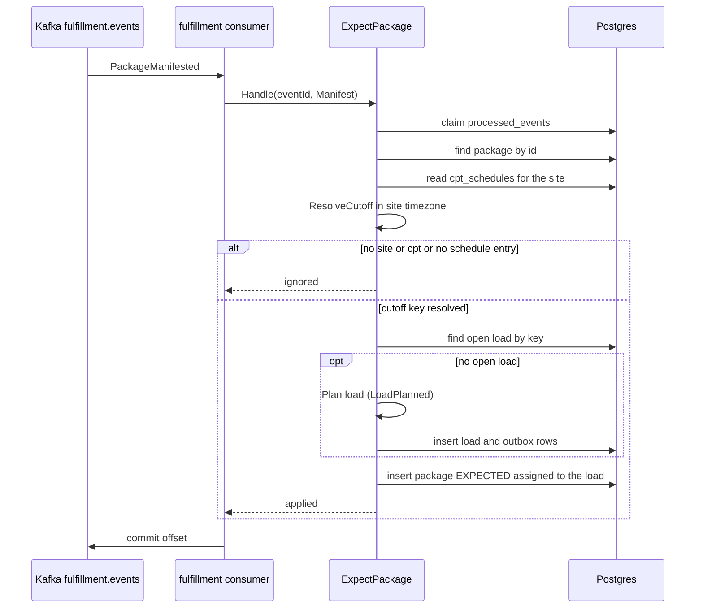
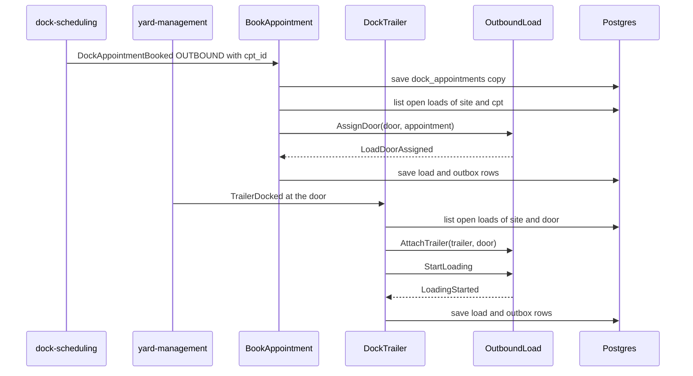
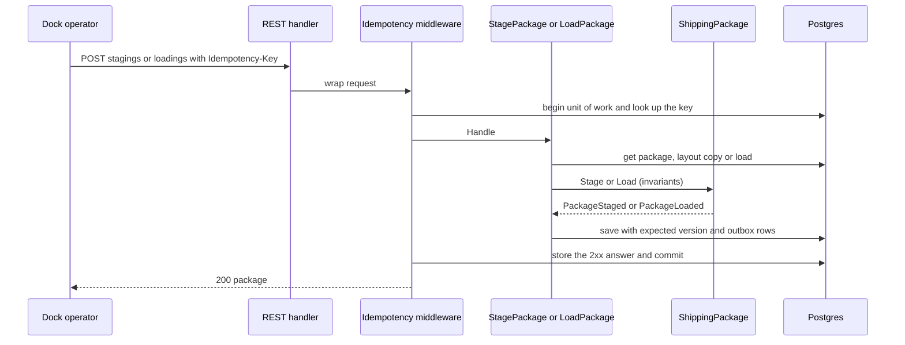
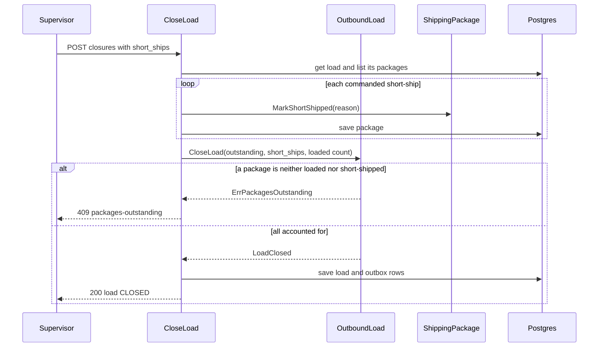
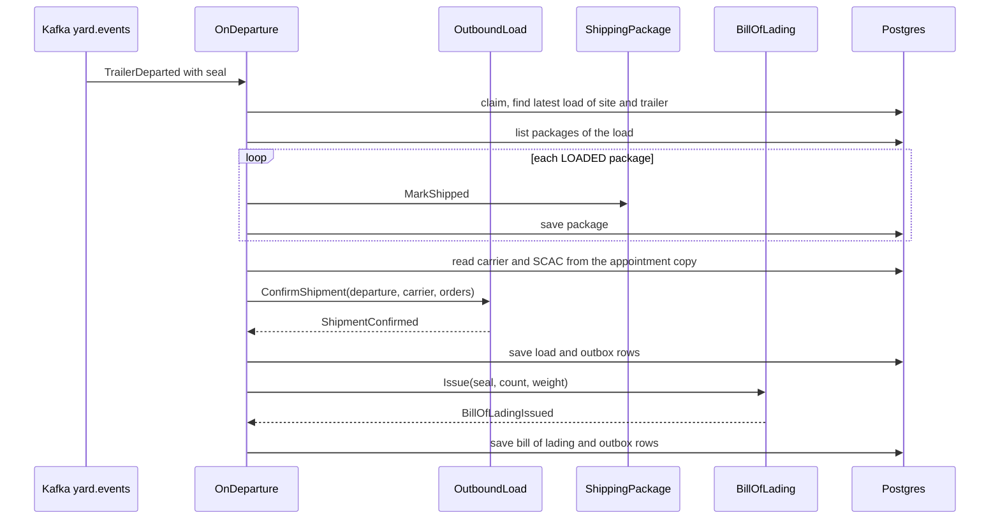
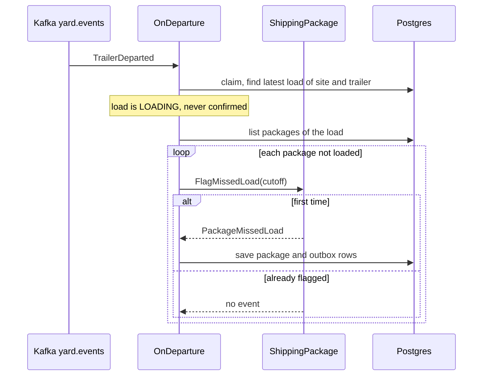
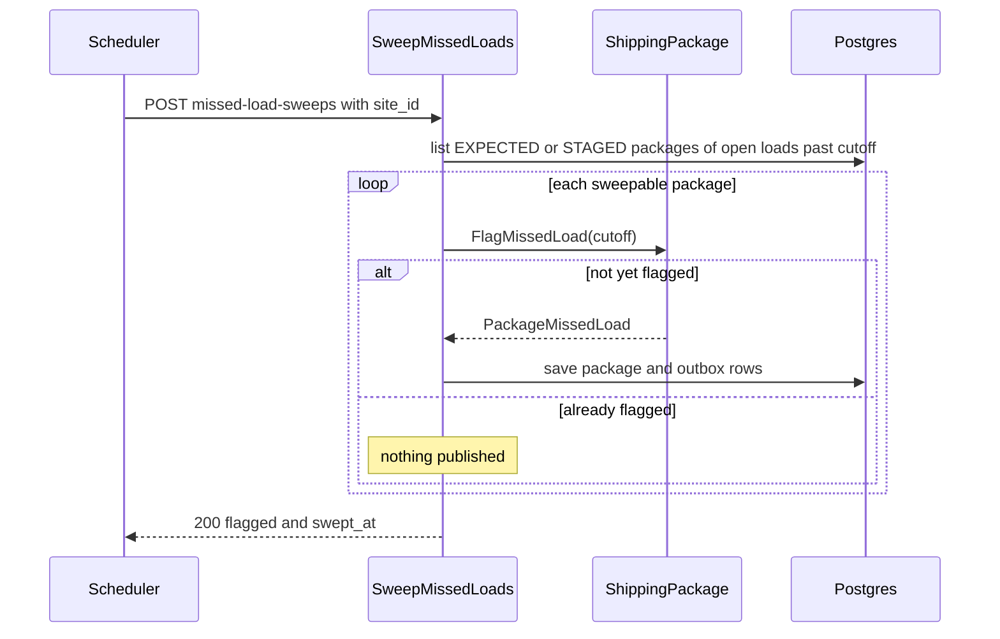
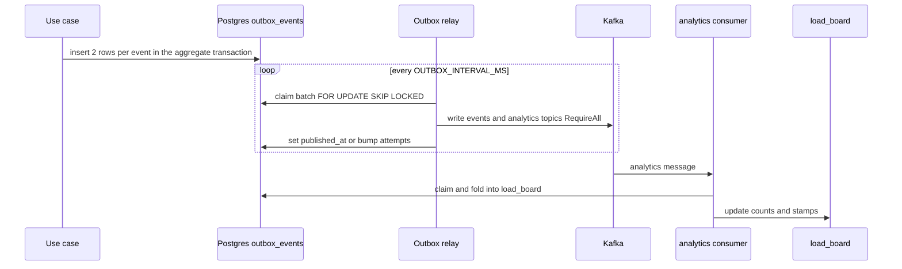

# Sequence diagrams

:::info[Synced from outbound-shipping]
This page is a copy of [`docs/docs/ddd/sequence-diagrams.md`](https://github.com/IQVO/outbound-shipping/blob/develop/docs/docs/ddd/sequence-diagrams.md) on `develop`, derived from that repository's code. Edit it there, then re-sync.
:::

One diagram per main flow, drawn from the use-case code. Every consumer flow starts with the inbox claim and runs in one unit of work, so a failed step rolls the claim back and the message is retried. "Outbox" below means two rows per event (integration and analytics twin) inserted in the same transaction.

## 1. Manifest plans or joins the load

Source: `internal/application/usecases/expect_package.go`, `internal/application/usecases/apply_cpt_schedule.go` (`ResolveCutoff`), `internal/adapters/inbound/kafka/fulfillment_consumer.go`. A raced insert fails on `uq_open_load_per_cutoff`, rolls the whole unit back and `Handle` retries once on a fresh transaction, which then finds the winner's load.

## 2. Door assignment and docking start loading

Source: `internal/application/usecases/book_appointment.go`, `internal/application/usecases/dock_trailer.go`, `internal/domain/outboundload/commands.go`. An appointment that is inbound, names no cpt, or arrives before a load of that cpt exists only updates the copy; assigning the door when the load is planned later is planned, not implemented ([Troubleshooting](/contexts/outbound-shipping/troubleshooting#appointment-before-the-load-planned)).

## 3. Scans: stage, load, unload

Source: `internal/application/usecases/scan_package.go`, `internal/adapters/inbound/http/idempotency.go`, `internal/adapters/inbound/http/handlers.go`. A refusal (`422 not-staging-location`, `409 wrong-load`) rolls the unit back and the 4xx answer is stored under the key; a 5xx is never stored.

## 4. Close the load

Source: `internal/application/usecases/load_commands.go` (`CloseLoad`, `applyShortShips`), `internal/domain/outboundload/commands.go`.

## 5. Departure confirms a closed load

Source: `internal/application/usecases/on_departure.go` (`confirm`, `markShipped`, `carrierOf`), `internal/domain/outboundload/commands.go`, `internal/domain/billoflading/bol.go`. All inside one unit of work. Without a seal the departure is ignored; an empty carrier makes `Issue` fail, the unit rolls back and the message is retried then dead-lettered.

## 6. Departure while the load is still loading

Source: `internal/application/usecases/on_departure.go` (`flagWithoutClose`), `internal/domain/shippingpackage/commands.go` (`FlagMissedLoad`), `features/ship_confirm_on_departure.feature` (scenarios 2 and 3). The load stays `LOADING` for a supervisor.

## 7. Missed-load sweep

Source: `internal/application/usecases/sweep_missed.go`, `features/ship_confirm_on_departure.feature` (scenario 6).

## 8. The outbox path

Source: `internal/adapters/outbound/events/sink.go`, `internal/adapters/outbound/outbox/relay.go`, `internal/adapters/outbound/postgres/outbox_repository.go`, `internal/application/usecases/project_board.go`.
