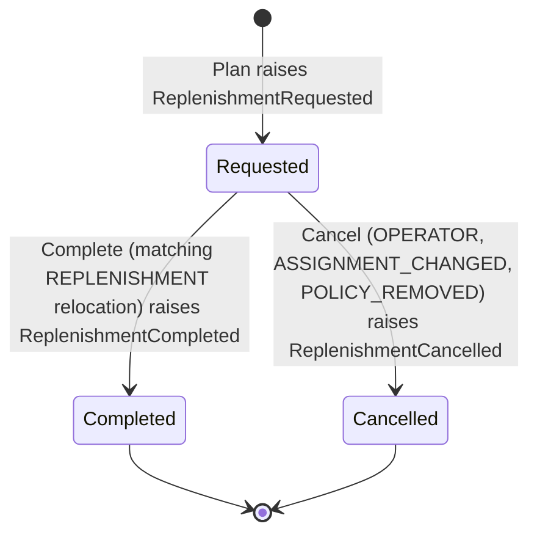

# Aggregate design canvas

:::info[Synced from pick-face-replenishment]
This page is a copy of [`docs/docs/ddd/aggregate-design-canvas.md`](https://github.com/IQVO/pick-face-replenishment/blob/develop/docs/docs/ddd/aggregate-design-canvas.md) on `develop`, derived from that repository's code. Edit it there, then re-sync.
:::

ddd-crew [Aggregate Design Canvas v1.1](https://github.com/ddd-crew/aggregate-design-canvas), for the two aggregates.
There is also a third modelling element that is **not** an aggregate: the pure detector (`internal/domain/detection`),
which has no state.

## ReplenishmentRequest (`internal/domain/replenishment`)

| Section | Content |
| --- | --- |
| Name | `ReplenishmentRequest` (type `Request`), the richest aggregate |
| Description | One decision to move `quantity` units of one SKU from one reserve bin to one forward bin, and how it ended |
| State transitions | `Requested` to `Completed` or `Cancelled`; both final. `version` is 1 when planned and +1 per transition. |
| Lifecycle | `Plan` creates it; `Complete` and `Cancel` close it; `Restore` rebuilds it from a snapshot and validates everything the snapshot can show |
| Commands | `Plan(PlanInput)`, `Complete(Relocation, at)`, `Cancel(reason, at)` |
| Events | `ReplenishmentRequested`, `ReplenishmentCompleted`, `ReplenishmentCancelled` (plain domain facts; the outbound adapter maps them to CloudEvents) |
| Invariants | 1. at most one open request per (site, forward bin, SKU), enforced by the use case and a partial unique index; 2. `quantity >= 1` and `projected + quantity <= policy max`; 3. source differs from the forward bin, same site, a reserve-zone bin, `quantity <= source usable`; 4. completion only by a `REPLENISHMENT` relocation whose `source_ref` is the id and whose SKU, from bin and to bin match; 5. a newer slot plan that drops the assignment cancels it with `ASSIGNMENT_CHANGED` |
| Corrective policies | none: a request that stays open is cancelled by an operator or by a slot plan or policy change |
| Throughput | low: created by detection, closed once |
| Size | small: about 17 fields, no collections |
| Concurrency | optimistic: every UPDATE is `WHERE version = <loaded>`; a mismatch is `concurrent-modification`. The partial unique index decides racing creators. |
| Repository | `ports.RequestRepo` (Postgres table `replenishment_requests`, in-memory adapter) |

## ReplenishmentPolicy (`internal/domain/policy`)

| Section | Content |
| --- | --- |
| Name | `ReplenishmentPolicy` (type `Policy`), a versioned value object keyed by (site, SKU) |
| Description | The explicit `MIN_MAX` rule of one pick face |
| State | `minQty`, `maxQty`, `multiple`, `version`; no lifecycle states |
| Commands | `New` (declares at version 1), `WithBounds` (a new value at `version + 1`), `Restore` |
| Events | `ReplenishmentPolicyDeclared` (the `Declaration` fact), analytics topic only |
| Invariants | site and SKU not blank; `0 <= minQty < maxQty`; `multiple >= 1`; `version >= 1` |
| Concurrency | optimistic through `If-Match`: create when absent, replace or delete only at the loaded version |
| Repository | `ports.PolicyRepo` (table `policies`) |
| Cross-aggregate behaviour | removing a policy cancels the open requests of its site and SKU with `POLICY_REMOVED` in the same unit of work (use case `RemovePolicy`) |

Source: `internal/domain/replenishment/request.go`, `internal/domain/replenishment/values.go`.
