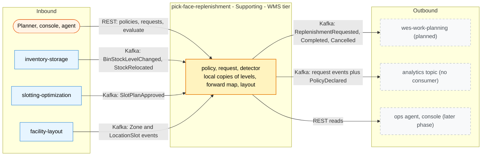

# Bounded context canvas

:::info[Synced from pick-face-replenishment]
This page is a copy of [`docs/docs/ddd/bounded-context-canvas.md`](https://github.com/IQVO/pick-face-replenishment/blob/develop/docs/docs/ddd/bounded-context-canvas.md) on `develop`, derived from that repository's code. Edit it there, then re-sync.
:::

ddd-crew [Bounded Context Canvas v5](https://github.com/ddd-crew/bounded-context-canvas), filled from the code on
`develop` and ADR 0001.

## Canvas at a glance

Source: `internal/adapters/inbound/http/server.go`, `internal/adapters/inbound/kafka/*_consumer.go`,
`internal/adapters/outbound/events/encoder.go`, ADR 0001 canvas. Dashed boxes are edges with no consumer or caller yet.

## Name

pick-face-replenishment

## Purpose

Keep every forward pick face stocked between its minimum and maximum by requesting a move from the best reserve bin, and
close the request when the ledger records the move.

## Strategic classification

Supporting subdomain, WMS tier ([reasoning](https://iqvo.github.io/pick-face-replenishment/docs/ddd/subdomain-classification)). Business model: cost reduction (no
empty forward pick face, fewer short picks). Evolution: custom-built (genesis).

## Domain roles

- **Policy holder**: owns the min/max rule per site and SKU.
- **Work generator**: raises replenishment requests from levels, from a new forward map, from the sweep, or by hand.
- **Closer**: completes a request from the ledger's `StockRelocated`.

## Inbound communication

| Message | Type | Sender | Channel | Collaborator behaviour |
| --- | --- | --- | --- | --- |
| `PUT /policies/{siteId}/{sku}` | command | planner, console | REST | declare or change a policy (`If-Match`) |
| `DELETE /policies/{siteId}/{sku}` | command | planner | REST | remove a policy, cancel its open requests |
| `POST /replenishments` | command | planner, agent | REST | raise a request by hand (`Idempotency-Key`) |
| `POST /replenishments/{requestId}/cancel` | command | planner | REST | cancel an open request (`Idempotency-Key`) |
| `POST /sites/{siteId}/evaluate` | command | planner, agent | REST | sweep a site (`Idempotency-Key`) |
| `GET /policies`, `/policies/{siteId}/{sku}`, `/pick-faces`, `/replenishments`, `/replenishments/{requestId}` | query | planner, console, agent | REST | read |
| `com.warehouse.wms.inventory-storage.stock.BinStockLevelChanged` | event | inventory-storage | Kafka `warehouse.inventory.events` | absolute bin level, versioned (inventory-storage ADR 0040) |
| `com.warehouse.wms.inventory-storage.stock.StockRelocated` | event | inventory-storage | Kafka `warehouse.inventory.events` | completes a request when reason is `REPLENISHMENT` (produced for a completed `REPLENISH` task, inventory-storage ADR 0041) |
| `com.warehouse.wms.slotting-optimization.slotplan.SlotPlanApproved` | event | slotting-optimization | Kafka `warehouse.slotting-optimization.events` | full forward map |
| `com.warehouse.wms.facility-layout.zone.ZoneRegistered` | event | facility-layout | Kafka `warehouse.facility.events` | zone code per zone |
| `com.warehouse.wms.facility-layout.locationslot.LocationSlotRegistered` | event | facility-layout | Kafka `warehouse.facility.events` | location, its zone and role |
| `com.warehouse.wms.facility-layout.locationslot.LocationSlotDecommissioned` | event | facility-layout | Kafka `warehouse.facility.events` | location retired |

## Outbound communication

| Message | Type | Receiver | Channel |
| --- | --- | --- | --- |
| `com.warehouse.wms.pick-face-replenishment.replenishment.ReplenishmentRequested` | event | wes-work-planning (planned) | Kafka `warehouse.pick-face-replenishment.events` and `.analytics` |
| `com.warehouse.wms.pick-face-replenishment.replenishment.ReplenishmentCompleted` | event | anyone | Kafka `...events` and `...analytics` |
| `com.warehouse.wms.pick-face-replenishment.replenishment.ReplenishmentCancelled` | event | anyone | Kafka `...events` and `...analytics` |
| `com.warehouse.wms.pick-face-replenishment.policy.ReplenishmentPolicyDeclared` | event | analytics | Kafka `...analytics` only |
| REST responses | query results | planner, console, agent | REST |
| `<topic>.dlq` dead letters | event | operators | Kafka |

## Ubiquitous language

See the [glossary](/contexts/pick-face-replenishment/ubiquitous-language). Key terms: pick face, forward bin, reserve bin, policy (min, max,
multiple), request, projected level, priority, source bin policy, usable stock.

## Business decisions

- A face is low when `projected <= minQty`, with `projected = on_hand - reserved + open request quantity`.
- How much: up to `maxQty`, rounded down to a multiple, capped at the source's usable stock.
- Which reserve bin: the one with the most usable stock, ties to the smallest bin code (`fullest-reserve-bin-v1`).
- `URGENT` when nothing is available.
- At most one open request per pick face.
- When a request is cancelled: operator, a newer slot plan that drops the assignment, or policy removal.
- A request completes only on a matching `REPLENISHMENT` relocation.

## Assumptions

- Reserve bins are Storage locations in zones listed in `RESERVE_ZONE_CODES` (default `RSV`); forward faces are in
  `FORWARD_ZONE_CODES` (default `FWD`).
- One SKU per forward slot; the forward bin of a SKU is its slot in the last approved slot plan.
- A bin never seen reads as level 0 (ADR 0005).
- The execution chain is built from fulfillment-execution onwards (`REPLENISH` task, then a relocation with reason
  `REPLENISHMENT` in inventory-storage); the first hop, wes-work-planning turning `ReplenishmentRequested` into
  `REPLENISH` work, is not built.

## Verification metrics

Domain coverage gate 90 %; mutation efficacy and mutant coverage thresholds 90 % (measured 100 %); 57 BDD scenarios;
golden bytes per published type; fitness tests ([Testing](/contexts/pick-face-replenishment/testing)). The service exports no runtime
metrics ([Observability](/contexts/pick-face-replenishment/observability)).

## Open questions

- Producer changes P3 and P3b (`REPLENISH` work in wes-work-planning) are not built: wes-work-planning has no consumer
  of `warehouse.pick-face-replenishment.events` and emits no `replenishment` object, so the loop cannot start. P1
  (`BinStockLevelChanged`, inventory-storage ADR 0040) and P4 (reason `REPLENISHMENT` on `StockRelocated`, its ADR
  0041) are built, and fulfillment-execution runs the `REPLENISH` task (its ADR 0050) (ADR 0001, 0003).
- slotting-optimization's relocation consumer acts only on reason `SLOTTING` and counts every other reason, including
  `REPLENISHMENT`, as unmatched (`internal/application/usecases/record_relocation.go`), so the clash ADR 0003 records
  no longer exists.
- No data retention exists for `outbox_events`, `processed_events` and `idempotency_keys` ([Runbook](/contexts/pick-face-replenishment/runbook#housekeeping)).
