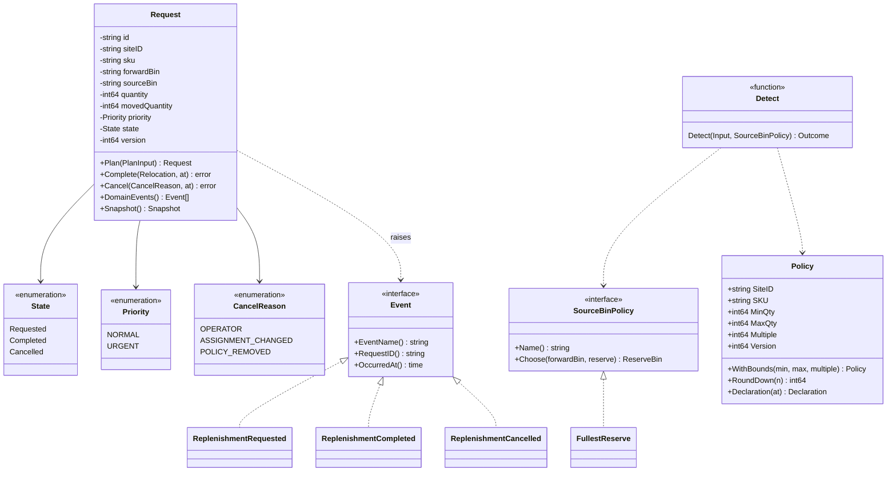
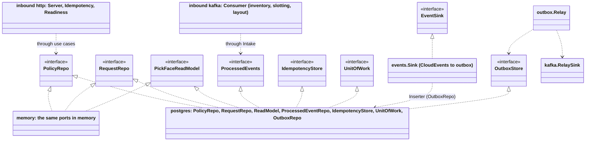

# Class diagrams

:::info[Synced from pick-face-replenishment]
This page is a copy of [`docs/docs/ddd/class-diagram.md`](https://github.com/IQVO/pick-face-replenishment/blob/develop/docs/docs/ddd/class-diagram.md) on `develop`, derived from that repository's code. Edit it there, then re-sync.
:::

## Domain types

Source: `internal/domain/policy/policy.go`, `internal/domain/replenishment/{request,values,events}.go`,
`internal/domain/detection/{detector,source}.go`.

## Ports and adapters

Source: `internal/application/ports/*.go`, `internal/adapters/outbound/{postgres,memory,events,outbox,kafka}`,
`internal/adapters/inbound/{http,kafka}`, `cmd/api/adapters.go`. The inbound adapters reach the ports only through the use
cases; `cmd/api` is the only place that connects adapters, which `TestHexagonalArchitecture` enforces.
