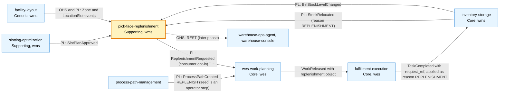

# Context map

:::info[Synced from pick-face-replenishment]
This page is a copy of [`docs/docs/ddd/context-map.md`](https://github.com/IQVO/pick-face-replenishment/blob/develop/docs/docs/ddd/context-map.md) on `develop`, derived from that repository's code. Edit it there, then re-sync.
:::

This context's slice of the fleet map, following ddd-crew [Context Mapping](https://github.com/ddd-crew/context-mapping).
Solid edges exist as a producer and a consumer; dotted edges lack a producer or a consumer on `develop`. Solid does not
mean live: nothing is deployed, and `warehouse-infra` has no entry for this service and sets no `REPLENISHMENT_MODE`.
Relationship patterns are the ones ADR 0001 decides. The ADR's producer changes P1 (`BinStockLevelChanged`), P3 and P3b
(`REPLENISH` work in wes-work-planning, its ADR 0042) and P4 (reason `REPLENISHMENT`) are built, together with the
`REPLENISH` path in process-path-management (its ADR 0036) and the `REPLENISH` task in fulfillment-execution (its ADR
0050): the chain is built end to end.

Source: `docs/adr/0001-pick-face-replenishment-bounded-context.md` (context map table),
`docs/adr/0003-local-copies-and-consumed-contracts.md`, producers' `apis/asyncapi.yaml` on `origin/develop`.
Omits: contexts with no edge to this one. Classifications are the fleet table's.

| Edge | Relationship | Technology | Status (producer side checked on `origin/develop`) |
| --- | --- | --- | --- |
| inventory-storage to this | Published Language; this context is a **Conformist** and keeps a local bin stock copy | Kafka `warehouse.inventory.events`, CloudEvents | **built and published**: `BinStockLevelChanged` (inventory-storage ADR 0040, change P1) and `StockRelocated` with reasons `SLOTTING`, `CONSOLIDATION`, `MANUAL` and `REPLENISHMENT` (its ADR 0041, change P4) |
| slotting-optimization to this | Published Language; **Conformist**, local forward-assignment copy | Kafka `warehouse.slotting-optimization.events` | live |
| facility-layout to this | Open Host Service and Published Language; **Conformist**, local location copy | Kafka `warehouse.facility.events` | live |
| this to wes-work-planning | Published Language (`ReplenishmentRequested`); wes-work-planning is the Conformist and turns it into one `REPLENISH` work unit per request id | Kafka `warehouse.pick-face-replenishment.events` | **built, opt-in** (P3b; wes-work-planning ADR 0042, `internal/adapters/inbound/kafka/replenishment_consumer.go`): started only with `REPLENISHMENT_MODE=kafka` and `REPLENISHMENT_CONSUMER_GROUP`, the default `permissive` consumes nothing. `ReplenishmentCancelled` withdraws a unit only while `Pending`; `ReplenishmentCompleted` is ignored |
| process-path-management to wes-work-planning | Published Language (catalogue replay on `warehouse.process-path-management.events`) | Kafka | **declared, seeding is an operator step**: `catalogue/paths.json` has `REPLENISH` (`matchPrefix` `replenish`, capability `replenish`, intake `REPLENISHMENT`), applied by `scripts/seed_catalogue.py` (process-path-management ADR 0036). Until it is seeded in a cluster, requests are dead-lettered (wes-work-planning ADR 0042) |
| wes-work-planning to fulfillment-execution | `WorkReleased` carries an additive `replenishment` object and creates a `REPLENISH` task | Kafka | **built and published** (P3): wes-work-planning releases the object (its ADR 0042), and fulfillment-execution creates the `REPLENISH` task from `WorkReleased.data.replenishment` (its ADR 0050) |
| fulfillment-execution to inventory-storage | `TaskCompleted` of a `REPLENISH` task (with `request_ref`) is applied as a relocation with reason `REPLENISHMENT` and `source_ref` = the request id | Kafka `warehouse.fulfillment.events` | **built and published** (P4): fulfillment-execution announces the task on `TaskAvailable` and publishes `TaskCompleted` with `request_ref` (ADR 0050); inventory-storage applies it as `StockRelocated` (its ADR 0041) |
| this to ops agent, console | Open Host Service | REST, `apis/openapi.yaml` | no caller yet; no Kong route in `warehouse-infra` |

Rule of the map: **no live REST or MCP call between contexts**. Every edge is an event, and this context's copies of
other contexts' data are rebuilt from the topics.

An anticorruption layer is not needed on any inbound edge: payloads are restated in `internal/adapters/inbound/kafka` and
read only for the fields this context uses; unknown fields and unknown types are ignored.
