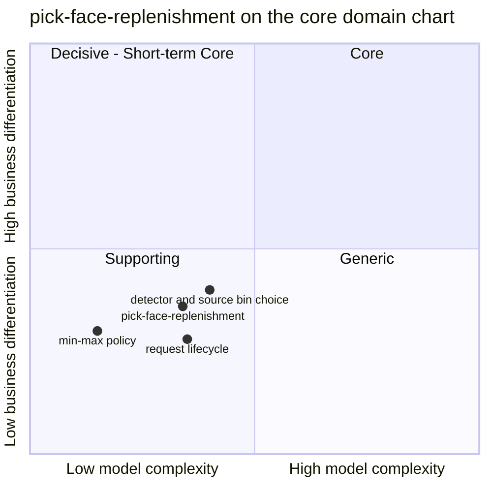

# Core domain chart

:::info[Synced from pick-face-replenishment]
This page is a copy of [`docs/docs/ddd/core-domain-chart.md`](https://github.com/IQVO/pick-face-replenishment/blob/develop/docs/docs/ddd/core-domain-chart.md) on `develop`, derived from that repository's code. Edit it there, then re-sync.
:::

Following the ddd-crew [Core Domain Charts](https://github.com/ddd-crew/core-domain-charts): business differentiation on
the vertical axis, model complexity on the horizontal axis. Mermaid numbers the quadrants 1 = top-right (Core),
2 = top-left, 3 = bottom-left (Supporting), 4 = bottom-right (Generic). The coordinates are an assessment made from the
evidence below, not a measurement.

Source: `docs/adr/0001-pick-face-replenishment-bounded-context.md` (canvas, strategic classification),
`docs/adr/0002-aggregates-and-detection-policy.md`, `internal/domain/policy/policy.go`,
`internal/domain/detection/detector.go`, `internal/domain/replenishment/request.go`.
Omits: the sibling contexts (their own charts place them).

## Classification: Supporting

ADR 0001 classifies the context as a **Supporting subdomain**: necessary for picking without stock-outs and specific to
this warehouse's policy, but built from replaceable policy objects rather than the competitive core, which stays the WES
conductor (`wes-work-planning`) and the task lifecycle (`fulfillment-execution`). It sits in the bottom-left quadrant.
The warehouse-docs fleet table agrees ([Subdomain classification](https://iqvo.github.io/pick-face-replenishment/docs/ddd/subdomain-classification)).

**Business differentiation is moderate-low (y = 0.36).** Keeping forward faces stocked prevents empty faces and short
picks, which matters, and the rules differ per retailer, so it is not Generic. But min/max is a well-understood rule behind a
replaceable policy object, and nothing in the fleet's customer promise depends on it today: the chain that executes a
request on the floor is built on `develop` but not live ([Integration](https://iqvo.github.io/pick-face-replenishment/docs/ecosystem/integration)).

**Model complexity is low to moderate (x = 0.34).** Evidence from the code:

- Two small aggregates: a versioned value object (`Policy`) and the `Request` with three states, three events and five
  invariants, restored through a strict `Restore` that rejects an inconsistent snapshot.
- One cross-aggregate rule, at most one open request per (site, forward bin, SKU), enforced by the use case and backed by
  a partial unique index.
- A pure detector with five verdicts and a deterministic, order-independent source bin choice.
- Event-fed read models with version and stamp guards (levels by `version`, the forward map by `approved_at`) and
  idempotent consumers.

What would move the point: a demand-cover policy (planned in ADR 0001, not built) would raise differentiation and
complexity; if a vendor WMS replenishment module sat behind an anti-corruption layer the context would drop towards
Generic.
