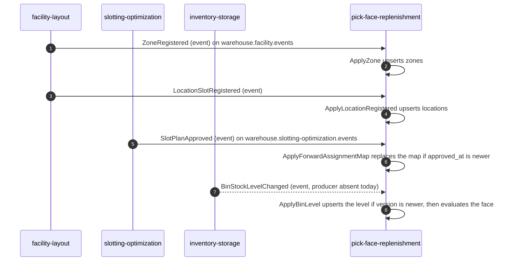
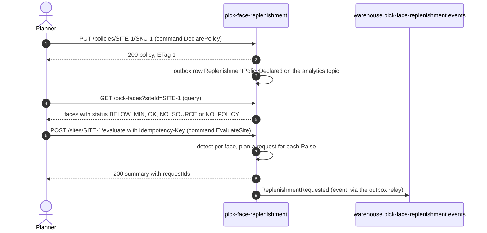
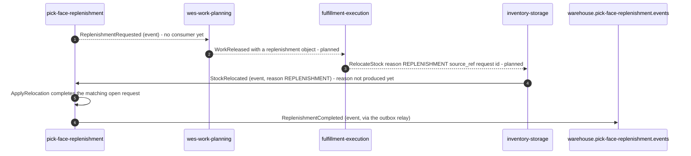
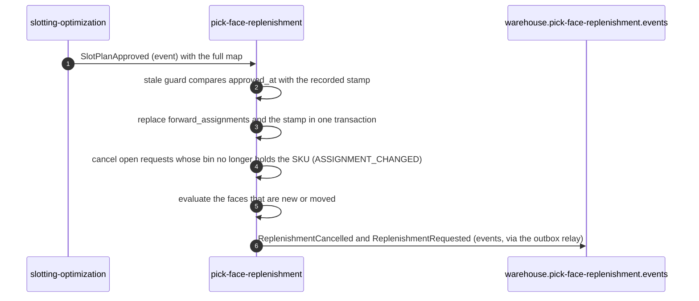
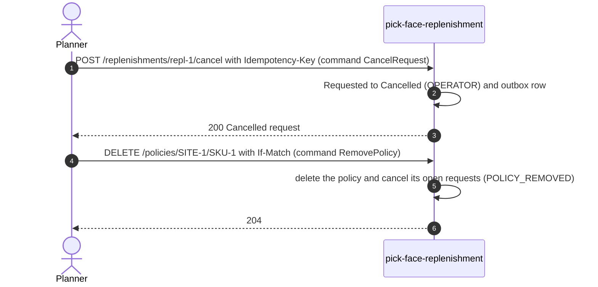

# Domain message flow

:::info[Synced from pick-face-replenishment]
This page is a copy of [`docs/docs/ddd/domain-message-flow.md`](https://github.com/IQVO/pick-face-replenishment/blob/develop/docs/docs/ddd/domain-message-flow.md) on `develop`, derived from that repository's code. Edit it there, then re-sync.
:::

The key business scenarios as numbered command, event and query flows, following ddd-crew
[Domain Message Flow Modelling](https://github.com/ddd-crew/domain-message-flow-modelling). Only edges that exist in code
are solid arrows; a note marks each planned step.

## 1. Keep the local copies current

Source: `internal/adapters/inbound/kafka/{layout,slotting,inventory}_consumer.go`,
`internal/application/usecases/{apply_layout,apply_forward_assignments,apply_bin_level}.go`.

## 2. Declare a policy and sweep a site

Source: `internal/application/usecases/{declare_policy,list_pick_faces,evaluate_site}.go`,
`internal/adapters/outbound/events/sink.go`.

## 3. Execute and close a request

Source: ADR 0001 context map, `internal/application/usecases/apply_relocation.go`. Dashed arrows are planned or absent
today.

## 4. A new slot plan changes the forward map

Source: `internal/application/usecases/apply_forward_assignments.go`.

## 5. Cancel and remove

Source: `internal/application/usecases/{cancel_request,remove_policy}.go`.
