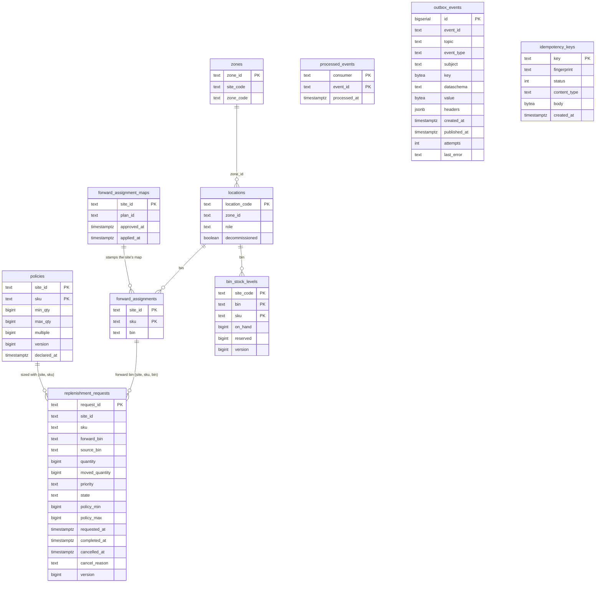
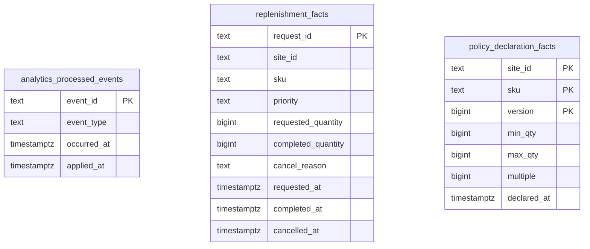

# Entity-relationship diagram

:::info[Synced from pick-face-replenishment]
This page is a copy of [`docs/docs/ddd/entity-relationship.md`](https://github.com/IQVO/pick-face-replenishment/blob/develop/docs/docs/ddd/entity-relationship.md) on `develop`, derived from that repository's code. Edit it there, then re-sync.
:::

The OLTP schema created by `migrations/0001_replenishment_schema.up.sql` and
`migrations/0002_forward_assignment_maps.up.sql`, plus the separate [analytics database](#analytics-database). The schema declares **no foreign keys**: the relations drawn below are
logical, joined at read time, so rows of the event-fed copies may arrive in any order.

Source: `migrations/0001_replenishment_schema.up.sql`, `migrations/0002_forward_assignment_maps.up.sql`.
`processed_events`, `outbox_events` and `idempotency_keys` are plumbing and relate to nothing by key.

## What backs what

| Table | Backs | Written by | Notes |
| --- | --- | --- | --- |
| `policies` | `ReplenishmentPolicy` | `DeclarePolicy`, `RemovePolicy` | `version` guards UPDATE and DELETE; checks `min_qty >= 0`, `min_qty < max_qty`, `multiple >= 1` |
| `replenishment_requests` | `ReplenishmentRequest` snapshot | `Evaluator`, `RaiseManualRequest`, `CancelRequest`, `ApplyRelocation`, `ApplyForwardAssignmentMap`, `RemovePolicy` | partial unique index `uq_requests_one_open_per_pick_face` on `(site_id, forward_bin, sku) WHERE state = 'Requested'` is invariant 1; `idx_requests_listing` serves the newest-first listing |
| `bin_stock_levels` | bin stock copy | `ApplyBinLevel` | absolute level guarded by the per-(bin, SKU) `version`; a bin never seen has no row and reads 0 |
| `forward_assignments` | the site's forward map | `ApplyForwardAssignmentMap` | replaced wholesale per site; one forward bin per (site, SKU) |
| `forward_assignment_maps` | stale-map guard | `ApplyForwardAssignmentMap` | one row per site; `approved_at` of the map currently held |
| `zones`, `locations` | layout copy | `ApplyZone`, `ApplyLocationRegistered`, `ApplyLocationDecommissioned` | a location joins its zone at read time; `decommissioned` is irreversible; empty `role` means Storage |
| `processed_events` | consumer idempotency | every consumer use case | `(consumer, event_id)` claimed in the effect's transaction |
| `outbox_events` | transactional outbox | the events sink, drained by the relay | unique `(event_id, topic)`; partial index on unpublished rows; `attempts` and `last_error` |
| `idempotency_keys` | `Idempotency-Key` answers | the HTTP middleware | only 2xx and 4xx answers; first writer wins |

Text keys compared or ordered in Go use the `"C"` collation so database order equals the byte order of the in-memory
test doubles under `internal/adapters/outbound/memory` (contract tests only: nothing in `cmd/` wires them).

## OLTP migration range

The OLTP database (`DATABASE_URL`) has two migrations, `0001_replenishment_schema` and `0002_forward_assignment_maps`,
embedded from `migrations/` and applied by `cmd/api` at boot (see the [runbook](/contexts/pick-face-replenishment/runbook)).

## Analytics database

The analytics projector and reports binaries (ADR 0008) use a SEPARATE database, `ANALYTICS_DATABASE_URL`, with its own
golang-migrate set embedded from `analytics/migrations/` (one migration, `0001_replenishment_funnel`). `cmd/pfr-projector`
applies it at boot and is the only writer; `cmd/pfr-reports` opens it through a read-only pool. Every row is a projection of
the `warehouse.pick-face-replenishment.analytics` topic, not a source of truth: the database can be dropped and rebuilt by
replaying the topic under a new consumer group. Like the OLTP schema it declares no foreign keys.

Source: `analytics/migrations/0001_replenishment_funnel.up.sql`; writes in
`internal/adapters/outbound/analyticsstore/postgres_projection.go`.

| Table | Fed by | Written how | Notes |
| --- | --- | --- | --- |
| `analytics_processed_events` | every applied analytics event | `INSERT ... ON CONFLICT (event_id) DO NOTHING` in the same transaction as the effect | dedupe on the CloudEvents `id`; `occurred_at` is the CloudEvents `time`, and `max(occurred_at)` is the freshness the reports endpoint returns; indexed on `occurred_at` |
| `replenishment_facts` | `ReplenishmentRequested`, `ReplenishmentCompleted`, `ReplenishmentCancelled` | upsert per `request_id`: each milestone column keeps the earliest time (`LEAST`), each descriptive column its first non-NULL value (`COALESCE`) | one row per request seen; open from `requested_at` until `completed_at` or `cancelled_at`; completion latency exists only when both ends were seen; partial indexes on each milestone column and an index on `site_id` |
| `policy_declaration_facts` | `ReplenishmentPolicyDeclared` (analytics topic only) | upsert per `(site_id, sku, version)` keeping the earliest `declared_at` | one row per declared policy version; indexed on `declared_at` |

The funnel report counts its per-day numbers from these rows over the requested window
(`internal/adapters/outbound/analyticsstore/postgres_report.go`). The in-memory twin
`internal/adapters/outbound/analyticsstore/memory_store.go` mirrors the same semantics for the shared contract test and is
never wired by `cmd/`.
